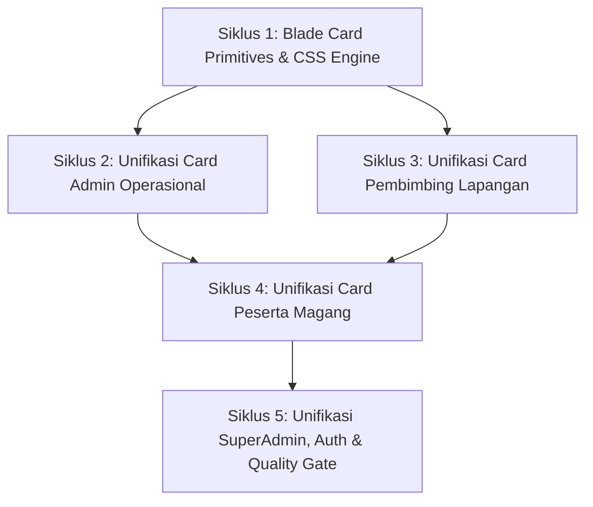

# 📋 Rencana Kerja & Buku Panduan Senior Developer: Unifikasi Komponen Card & Widget Gentelella di Seluruh Portal MagKom

> **Dokumen ID**: `PRD-MAGKOM-GENTELELLA-CARD-UNIFICATION-V4`  
> **Tanggal Rilis**: 22 Oktober 2026  
> **Penulis**: Senior Principal Lead Architect  
> **Target Pelaksana**: Junior Full-Stack Developer & AI Agent Model (Gemini 3.8 Flash / Claude 3.5 Sonnet)  
> **Target Branch**: `test-2`  
> **Tujuan Akhir**: Mengunifikasi seluruh komponen *Card*, *Metric Widget*, *Stat Tile*, *Callout Banner*, *Profile Box*, dan *Timeline Card* di 4 portal peran (`Admin`, `Pembimbing`, `Peserta`, `SuperAdmin`) serta *Auth Layer* MagKom agar menggunakan visual bahasa desain **Gentelella Modern** yang konsisten dengan identitas MagKom Sleman (Deep Navy `#0641CC` & Kominfo Blue `#0751FF`).

---

## ⚠️ PERATURAN MUTLAK & BATASAN ARSITEKTURAL (GUARDRAILS)

Junior Developer atau AI Pelaksana **WAJIB MEMBACA DAN MEMATUHI ATURAN INI SEBELUM MENULIS KODE SATU BARIS PUN**:

1. **ZERO BACKEND LOGIC MODIFICATIONS**:
   - DILARANG KERAS mengubah isi Controller, Eloquent Models, Database Migrations, FormRequest validation rules, Service classes, dan `routes/web.php`.
   - Modifikasi HANYA diizinkan pada layer presentasi Blade (`resources/views/`), stylesheet CSS (`public/css/gentelella-theme.css`), dan JavaScript native (`public/js/gentelella-theme.js`).
2. **ZERO JQUERY / ZERO BOOTSTRAP 3 DEPENDENCY**:
   - DILARANG mengimpor jQuery atau Bootstrap 3 dari repo Gentelella Colorlib.
   - Semua interaktivitas kartu, collapse, close, tooltip, dan tab switcher wajib menggunakan **Vanilla JavaScript modern** (`ES6+`) dan **Vanilla CSS Flexbox/Grid**.
3. **PRESERVASI ELEMEN SAKRAL (ZERO REGRESSION GUARANTEE)**:
   - Dilarang menghapus atau mengubah atribut `id`, `name`, `@csrf`, `@method`, dan atribut form lainnya.
   - Dilarang mengubah string atau label teks yang menjadi target asersi dalam PHPUnit Feature Test (contoh: `Citra Lestari`, `FIFO`, `Okupansi:`, `Alokasikan Kuota Jurusan`, `Manajemen Kuota Magang`, `Keputusan Verifikasi`).
4. **QUALITY GATE HARUS SELALU HIJAU**:
   - Seluruh 457 test cases dalam test suite `php artisan test` harus tetap **100% PASS (Minimal 457 Passed, 0 Failed, 2,682 assertions)** di setiap akhir siklus.
   - Format kode wajib lolos linter Laravel Pint (`./vendor/bin/pint --test`).
   - Pengetahuan AST wajib diperbarui dengan `graphify update .`.

---

## 1. Analisis Kebutuhan & Desain Primitives Card Gentelella

Saat ini di codebase MagKom terdapat berbagai implementasi kartu (*ad-hoc card*) yang dibuat terpisah-pisah, seperti:
- `.cert-stat-card` di modul sertifikat
- `.macro-card` di modul survei
- `.health-card` di modul telemetri kesehatan
- `.backup-stat-card` di modul pencadangan basis data
- `.identity-card` di modul profil peserta
- `.nilai-summary-card` di modul lembar evaluasi nilai
- Berbagai `div` berkode gaya inline `style="background: var(--neutral-0); border: 1px solid var(--neutral-400); border-radius: 12px; ..."`

### Solusi Arsitektural: Komponen Blade Primitives Baru

Kita akan membuat 5 komponen Blade Gentelella baru di `resources/views/components/gentelella/`:

1. `<x-gentelella.card>`: Kartu konten universal yang ramping, memiliki opsi header, subjudul, ikon, badge, toolbox actions, dan footer.
2. `<x-gentelella.profile-card>`: Porting bersih dari Gentelella `profile_view` / `well profile_view` dengan avatar lingkaran, badge peranan, data institusi, dan tombol aksi ringkas.
3. `<x-gentelella.metric-card>`: Kartu analitik visual dengan meteran progres bar (`progress-bar`), komparasi persentase, dan indikator warna dinamis.
4. `<x-gentelella.callout>`: Kotak peringatan (*callout/banner*) terstruktur dengan border samping kiri tebal 4px, ikon svg, dan palet warna semantik (*info*, *success*, *warning*, *danger*).
5. `<x-gentelella.timeline>`: Komponen visual alur rekam jejak untuk logbook harian, status pendaftaran, dan riwayat bimbingan.

---

## 2. Rincian Siklus Kerja (5 Siklus Sprint)



---

### 📦 SIKLUS 1: Pembuatan Primitive Blade Components & Update CSS Engine (Estimasi: 2,5 Jam)

#### 📌 Tugas 1.1: Pembuatan Komponen Universal `<x-gentelella.card>`
- **Target File**: `resources/views/components/gentelella/card.blade.php` (Create)
- **Tingkat Kesulitan**: 🟢 Mudah (30 Menit)
- **Props yang Didukung**:
  - `title` (string/slot, opsional)
  - `subtitle` (string, opsional)
  - `icon` (string/svg, opsional)
  - `badge` & `badgeType` (`primary`, `success`, `warning`, `danger`, `info`)
  - `footer` (slot opsional)
  - `actions` (slot opsional untuk tombol di pojok kanan atas)
  - `hoverable` (boolean, default: `false`)
- **Struktur Markup**:
  ```blade
  @props([
      'title' => null,
      'subtitle' => null,
      'icon' => null,
      'badge' => null,
      'badgeType' => 'primary',
      'hoverable' => false,
  ])
  <div {{ $attributes->merge(['class' => 'gentelella-card' . ($hoverable ? ' gentelella-card-hover' : '')]) }}>
      @if($title || $badge || isset($actions))
          <div class="gentelella-card-header">
              <div class="gentelella-card-title-wrap">
                  @if($icon) <span class="gentelella-card-icon">{!! $icon !!}</span> @endif
                  <div>
                      <h4 class="gentelella-card-title">{!! $title !!}</h4>
                      @if($subtitle) <small class="gentelella-card-subtitle">{!! $subtitle !!}</small> @endif
                  </div>
              </div>
              <div class="gentelella-card-header-actions">
                  @if($badge) <span class="x_badge x_badge_{{ $badgeType }}">{{ $badge }}</span> @endif
                  @if(isset($actions)) {{ $actions }} @endif
              </div>
          </div>
      @endif
      <div class="gentelella-card-body">
          {{ $slot }}
      </div>
      @if(isset($footer))
          <div class="gentelella-card-footer">
              {{ $footer }}
          </div>
      @endif
  </div>
  ```

#### 📌 Tugas 1.2: Pembuatan Komponen Profil `<x-gentelella.profile-card>`
- **Target File**: `resources/views/components/gentelella/profile-card.blade.php` (Create)
- **Tingkat Kesulitan**: 🟡 Sedang (45 Menit)
- **Tujuan**: Mengakomodasi kartu profil mentee (`pembimbing/peserta/show`), profil staf (`superadmin/staf`), dan identitas diri (`peserta/profil/show`).
- **Fitur Utama**:
  - Cover background gradient Sleman.
  - Avatar lingkaran interaktif dengan foto atau inisial nama 2 huruf.
  - Role badge pill, NIM/NIP, asal institusi & prodi.
  - Slot tombol aksi (Chat, Unduh Berkas, Evaluasi).

#### 📌 Tugas 1.3: Pembuatan Komponen Analitik `<x-gentelella.metric-card>` & `<x-gentelella.callout>`
- **Target File**:
  - `resources/views/components/gentelella/metric-card.blade.php` (Create)
  - `resources/views/components/gentelella/callout.blade.php` (Create)
- **Tingkat Kesulitan**: 🟢 Mudah (45 Menit)
- **Fitur `<x-gentelella.metric-card>`**:
  - Bar meter kapasitas terisi vs total kuota.
  - Warna bar adaptif (hijau <75%, amber 75-99%, merah >=100%).
  - Teks status keterisian (Tersedia, Padat, Penuh).
- **Fitur `<x-gentelella.callout>`**:
  - Border samping 4px solid dengan varian: `info` (blue), `warning` (amber), `danger` (red), `success` (green).
  - Slot judul dan deskripsi terstruktur.

#### 📌 Tugas 1.4: Update Stylesheet CSS Engine Gentelella
- **Target File**: `public/css/gentelella-theme.css` (Modify)
- **Tingkat Kesulitan**: 🟢 Mudah (30 Menit)
- **Langkah Kerja**: Tambahkan Section 15 untuk `.gentelella-card`, `.profile_view`, `.gentelella-callout`, `.gentelella-metric-bar`, dan sinkronisasi Dark Mode `[data-theme="dark"]`.
- **Perintah Verifikasi**:
  ```bash
  ./vendor/bin/pint --test
  php artisan test --filter="TypographyDesignSystemTest"
  ```
- **Checklist Kriteria Penerimaan (DoD)**:
  - [ ] Seluruh 4 komponen Blade baru terdaftar dan dapat dirender tanpa error syntax.
  - [ ] CSS Gentelella terkompilasi rapi tanpa konflik variabel.
  - [ ] Pint linter lolos 100%.

---

### 📦 SIKLUS 2: Unifikasi Card Portal Admin Operasional (Estimasi: 4 Jam)

#### 📌 Tugas 2.1: Redesign Kartu Manajemen Kuota & Kapasitas Pembimbing
- **Target File**: `resources/views/admin/kuota/index.blade.php`
- **Tingkat Kesulitan**: 🟡 Sedang (1 Jam)
- **Elemen SAKRAL yang DILARANG HAPUS**:
  - ID Modal: `modal-tambah-kuota`, `modal-edit-kuota`, `modal-buat-bulan`, `modal-ubah-bulan`
  - Teks Sakral: `Manajemen Kuota Magang`, `Sistem Informasi`, `Okupansi:`, `Alokasikan Kuota Jurusan`
  - Input: `jumlah`, `jurusan_id[]`, `bulan_magang_id`
- **Langkah Kerja**:
  1. Bungkus kartu okupansi atas dengan `<x-gentelella.card>` atau `<x-gentelella.metric-card>` dengan tetap menampilkan string `Okupansi:`.
  2. Ganti banner validasi kapasitas mentor dengan `<x-gentelella.callout type="warning">`.
  3. Ganti grid kartu alokasi per bidang dinas menggunakan styling card Gentelella yang seragam.
- **Perintah Verifikasi**:
  ```bash
  php artisan test --filter="AdminKuotaRevampTest"
  ```

#### 📌 Tugas 2.2: Redesign Visual Analytics Card di Hub Laporan & Laporan Tahunan
- **Target File**:
  - `resources/views/admin/laporan/index.blade.php`
  - `resources/views/admin/laporan/tahunan.blade.php`
- **Tingkat Kesulitan**: 🟡 Sedang (1 Jam)
- **Langkah Kerja**:
  1. Ubah 6 kotak metrik atas (`Total Pengajuan`, `Peserta Diterima`, `Penempatan Aktif`, dll) menjadi `<x-gentelella.tile-stat>`.
  2. Transformasi kartu visual analitik "Tingkat Keterisian Kuota per Jurusan" dan "Proporsi Jenjang Pendidikan" ke `<x-gentelella.card>`.
  3. Ubah tab filter laporan menjadi toolbar Gentelella.
- **Perintah Verifikasi**:
  ```bash
  php artisan test --filter="AdminLaporanDanArsipTest|NextLevelEnhancementsTest|ReleaseTwoFeaturesTest"
  ```

#### 📌 Tugas 2.3: Redesign Kartu Hub Penerbitan Sertifikat Kelulusan
- **Target File**: `resources/views/admin/sertifikat/index.blade.php`
- **Tingkat Kesulitan**: 🟢 Mudah (45 Menit)
- **Langkah Kerja**:
  1. Ganti kartu stat ad-hoc `.cert-stat-card` dengan `<x-gentelella.card>` berlatar belakang bersih dan border halus.
  2. Pasang `<x-gentelella.x-panel title="Daftar Penerbitan Sertifikat Magang">` membungkus tabel utama.
- **Perintah Verifikasi**:
  ```bash
  php artisan test --filter="Sertifikat"
  ```

#### 📌 Tugas 2.4: Redesign Kartu Dasbor Evaluasi Mutu & Survei Kepuasan (IKM & NPS)
- **Target File**: `resources/views/admin/survei/index.blade.php`
- **Tingkat Kesulitan**: 🟡 Sedang (45 Menit)
- **Elemen SAKRAL yang DILARANG HAPUS**:
  - Teks Sakral: Nilai IKM, Predikat Mutu Pelayanan, Nilai NPS, Testimoni Alumni.
  - Link ekspor CSV survei.
- **Langkah Kerja**:
  1. Ubah kartu metrik makro `.macro-card` menjadi `<x-gentelella.card>` dengan aksen warna Sleman.
  2. Ubah daftar umpan balik testimoni alumni menjadi kartu review bergaya Gentelella.
- **Perintah Verifikasi**:
  ```bash
  php artisan test --filter="SurveiKepuasanAdminVisualTest"
  ```

#### 📌 Tugas 2.5: Redesign Kartu Arsip & Berkas Peserta Selesai Magang
- **Target File**:
  - `resources/views/admin/arsip/index.blade.php`
  - `resources/views/admin/arsip/show.blade.php`
- **Tingkat Kesulitan**: 🟢 Mudah (30 Menit)
- **Langkah Kerja**:
  1. Bungkus dossier berkas peserta yang telah selesai diarsipkan ke dalam `<x-gentelella.card>`.
  2. Pertahankan seluruh tautan unduh dokumen riwayat magang.
- **Perintah Verifikasi**:
  ```bash
  php artisan test --filter="AdminLaporanDanArsipTest"
  ```

---

### 📦 SIKLUS 3: Unifikasi Card Portal Pembimbing Lapangan (Estimasi: 3,5 Jam)

#### 📌 Tugas 3.1: Redesign Kartu Profil 360° Mentee Bimbingan
- **Target File**: `resources/views/pembimbing/peserta/show.blade.php`
- **Tingkat Kesulitan**: 🟡 Sedang (1 Jam)
- **Elemen SAKRAL yang DILARANG HAPUS**:
  - Teks Sakral: Nama mentee, institusi, capaian bimbingan, status penempatan, NIM/NISN.
  - Tautan navigasi: Logbook Mentee, Tugas Mentee, Lembar Nilai Magang.
- **Langkah Kerja**:
  1. Ganti hero profil mentee di baris atas dengan `<x-gentelella.profile-card>`.
  2. Ubah 3 widget KPI kinerja mentee (Penyelesaian Tugas, Kedisiplinan Logbook, Status Penilaian) menjadi `<x-gentelella.card>` terstandarisasi dengan progress meter Gentelella.
  3. Bungkus riwayat aktivitas bimbingan dengan `<x-gentelella.x-panel title="Rekam Jejak Aktivitas Bimbingan">`.
- **Perintah Verifikasi**:
  ```bash
  php artisan test --filter="DeltaDashboardEnhancementTest"
  ```

#### 📌 Tugas 3.2: Redesign Kartu Detail Penugasan & Evaluasi Progres Tugas
- **Target File**: `resources/views/pembimbing/tugas/show.blade.php`
- **Tingkat Kesulitan**: 🟡 Sedang (1 Jam)
- **Elemen SAKRAL yang DILARANG HAPUS**:
  - Teks Sakral: Judul tugas, instruksi pengerjaan, tenggat waktu, lampiran, nama mentee.
  - Form feedback & persetujuan progres tugas.
- **Langkah Kerja**:
  1. Kolom kiri: Bungkus detail instruksi tugas ke dalam `<x-gentelella.card title="Instruksi & Materi Penugasan">`.
  2. Kolom kanan: Bungkus rekapitulasi progres deliverable dan form evaluasi pembimbing ke dalam `<x-gentelella.card title="Pemeriksaan & Umpan Balik Progres">`.
- **Perintah Verifikasi**:
  ```bash
  php artisan test --filter="TugasLogbookTest"
  ```

#### 📌 Tugas 3.3: Redesign Grid Kartu Bank Template Tugas
- **Target File**: `resources/views/pembimbing/tugas/template/index.blade.php`
- **Tingkat Kesulitan**: 🟢 Mudah (45 Menit)
- **Langkah Kerja**:
  1. Ubah grid kartu template tugas menjadi `<x-gentelella.card hoverable="true">`.
  2. Sertakan badge kategori, tingkat kompleksitas (`mudah`, `sedang`, `tinggi`), dan tombol `Gunakan Template`.
- **Perintah Verifikasi**:
  ```bash
  php artisan test --filter="TugasLogbookTest"
  ```

#### 📌 Tugas 3.4: Redesign Kartu Laporan Kinerja Mentoring Pembimbing
- **Target File**: `resources/views/pembimbing/laporan/kinerja.blade.php`
- **Tingkat Kesulitan**: 🟢 Mudah (45 Menit)
- **Langkah Kerja**:
  1. Ubah kartu metrik rekapitulasi bimbingan, logbook disetujui, dan tugas selesai menjadi `<x-gentelella.tile-stat>`.
  2. Bungkus tabel rincian performa mentee ke dalam `<x-gentelella.x-panel>`.
- **Perintah Verifikasi**:
  ```bash
  php artisan test --filter="AdvancedRoleEnhancementPhaseSixTest"
  ```

---

### 📦 SIKLUS 4: Unifikasi Card Portal Peserta Magang (Estimasi: 4 Jam)

#### 📌 Tugas 4.1: Redesign Kartu Status & Hero di Dashboard Peserta
- **Target File**: `resources/views/peserta/dashboard.blade.php`
- **Tingkat Kesulitan**: 🟡 Sedang (1 Jam)
- **Elemen SAKRAL yang DILARANG HAPUS**:
  - Status magang peserta (`diajukan`, `diterima`, `aktif`, `selesai`, dll).
  - Tautan cepat: Isi Logbook, Lihat Tugas, Biodata Profil.
- **Langkah Kerja**:
  1. Ubah banner pengumuman status menjadi `<x-gentelella.callout>` yang elegan dan informatif.
  2. Bungkus kartu ringkasan bimbingan (Bidang Penempatan, Pembimbing Lapangan, Sisa Hari Magang) ke dalam `<x-gentelella.card>`.
  3. Format agenda mendatang dan reminder tugas ke dalam kartu Gentelella yang bersih.
- **Perintah Verifikasi**:
  ```bash
  php artisan test --filter="PesertaPortalWorkflowTest"
  ```

#### 📌 Tugas 4.2: Redesign Kartu Identitas & Biodata Profil Peserta
- **Target File**: `resources/views/peserta/profil/show.blade.php`
- **Tingkat Kesulitan**: 🟡 Sedang (1 Jam)
- **Elemen SAKRAL yang DILARANG HAPUS**:
  - Form upload foto profil, input kontak darurat, data akademik institusi.
  - Assertion tes nama peserta dan informasi profil.
- **Langkah Kerja**:
  1. Ubah kolom kiri `.identity-card` menjadi `<x-gentelella.profile-card>` dengan integrasi tombol ganti pasfoto.
  2. Ubah kolom kanan data pribadi dan kontak darurat menjadi `<x-gentelella.card title="Data Pribadi & Kontak Darurat">` dan `<x-gentelella.card title="Informasi Akademik & Jurusan">`.
- **Perintah Verifikasi**:
  ```bash
  php artisan test --filter="PesertaPortalWorkflowTest"
  ```

#### 📌 Tugas 4.3: Redesign Kartu Alur Pendaftaran & Unggah Berkas
- **Target File**:
  - `resources/views/peserta/pendaftaran/index.blade.php`
  - `resources/views/peserta/pendaftaran/detail.blade.php`
- **Tingkat Kesulitan**: 🟡 Sedang (1 Jam)
- **Langkah Kerja**:
  1. Ganti kartu status pendaftaran dan kartu tahapan pendaftaran dengan `<x-gentelella.card>` bertingkat.
  2. Ubah kartu checklist unggah dokumen (Proposal, Surat Pengantar, CV, Transkrip) menjadi list item rapi di dalam card Gentelella.
- **Perintah Verifikasi**:
  ```bash
  php artisan test --filter="PesertaPortalWorkflowTest"
  ```

#### 📌 Tugas 4.4: Redesign Kartu Evaluasi & Lembar Nilai Akhir Peserta
- **Target File**: `resources/views/peserta/nilai/show.blade.php`
- **Tingkat Kesulitan**: 🟢 Mudah (1 Jam)
- **Elemen SAKRAL yang DILARANG HAPUS**:
  - Teks Sakral: Skor angka nilai akhir, predikat kelulusan, rincian skor rubrik.
  - Tombol unduh sertifikat / lembar nilai resmi.
- **Langkah Kerja**:
  1. Ganti `.nilai-summary-card` dengan kartu metrik Gentelella berlatar belakang gradasi biru Kominfo Sleman yang elegan.
  2. Bungkus tabel rincian 5 rubrik penilaian dengan `<x-gentelella.x-panel title="Rincian Evaluasi Kompetensi Magang">` dan kelas `jambo_table`.
- **Perintah Verifikasi**:
  ```bash
  php artisan test --filter="PesertaPortalWorkflowTest|ScoringAndCompletionTest"
  ```

---

### 📦 SIKLUS 5: Unifikasi Card SuperAdmin, Auth Layer & Quality Gate (Estimasi: 4 Jam)

#### 📌 Tugas 5.1: Redesign Kartu Panel Telemetri Kesehatan Infrastruktur
- **Target File**: `resources/views/superadmin/health/index.blade.php`
- **Tingkat Kesulitan**: 🟡 Sedang (45 Menit)
- **Langkah Kerja**:
  1. Ganti 4 kartu telemetri `.health-card` (CPU/Memory, Database Latency, Disk Capacity, Cache/Redis) menggunakan `<x-gentelella.card>`.
  2. Pasang badge status kesehatan sistem (`SLA 99.9%`, `Normal`, `Optimal`).
  3. Bungkus panel aksi diagnostik pemeliharaan 1-klik dengan `<x-gentelella.x-panel title="Suite Pemeliharaan Sistem Proaktif">`.
- **Perintah Verifikasi**:
  ```bash
  php artisan test --filter="SuperAdminMasterArchitectureTest"
  ```

#### 📌 Tugas 5.2: Redesign Kartu Monitoring Peserta Lintas Bidang & Backup Hub
- **Target File**:
  - `resources/views/superadmin/monitoring/index.blade.php`
  - `resources/views/superadmin/backup/index.blade.php`
- **Tingkat Kesulitan**: 🟢 Mudah (45 Menit)
- **Langkah Kerja**:
  1. Pada `monitoring/index.blade.php`: Ubah kartu distribusi beban mentee per bidang menjadi `<x-gentelella.card>`.
  2. Pada `backup/index.blade.php`: Ganti `.backup-stat-card` dengan `<x-gentelella.tile-stat>` dan bungkus tabel riwayat pencadangan dengan `<x-gentelella.x-panel>`.
- **Perintah Verifikasi**:
  ```bash
  php artisan test --filter="SuperAdminPortalVisualTest"
  ```

#### 📌 Tugas 5.3: Redesign Kartu Form Builder & Data Kustom Dinamis
- **Target File**:
  - `resources/views/superadmin/modul-builder/index.blade.php`
  - `resources/views/superadmin/modul-data/index.blade.php`
- **Tingkat Kesulitan**: 🟢 Mudah (45 Menit)
- **Langkah Kerja**:
  1. Ubah daftar entitas modul kustom dinamis menjadi kartu grid `<x-gentelella.card hoverable="true">`.
  2. Sertakan tombol aksi kelola struktur kolom dan input data.
- **Perintah Verifikasi**:
  ```bash
  php artisan test --filter="SuperAdminMasterArchitectureTest"
  ```

#### 📌 Tugas 5.4: Redesign Kartu Autentikasi Pengguna Publik (Login & Register)
- **Target File**:
  - `resources/views/auth/login.blade.php`
  - `resources/views/auth/register.blade.php`
  - `resources/views/auth/forgot-password.blade.php`
- **Tingkat Kesulitan**: 🟢 Mudah (45 Menit)
- **Langkah Kerja**:
  1. Bungkus box formulir autentikasi ke dalam card Gentelella modern dengan bayangan halus, logo resmi Sleman di header, dan tab pemilih login (Email vs Google OAuth).
  2. Pastikan seluruh input token (`@csrf`), id form, dan tombol submit berfungsi tanpa regresi.
- **Perintah Verifikasi**:
  ```bash
  php artisan test --filter="Auth"
  ```

#### 📌 Tugas 5.5: Final Quality Gate & Knowledge Graph Synchronization
- **Target File**: Seluruh file proyek
- **Tingkat Kesulitan**: 🔴 Tinggi (1 Jam)
- **Langkah Kerja**:
  1. Jalankan linter kode: `./vendor/bin/pint --test`.
  2. Jalankan test suite menyeluruh: `php artisan test` (Wajib lulus minimal 457 Passed, 0 Failed, 2,682 assertions).
  3. Jalankan sinkronisasi knowledge graph: `graphify update .`.
- **Checklist Kriteria Penerimaan (DoD)**:
  - [ ] `php artisan test` **457 passed, 0 failed**.
  - [ ] `./vendor/bin/pint` **0 errors**.
  - [ ] `graphify update .` **berhasil merefresh graph**.

---

## 3. Matriks Referensi Elemen Sakral (Anti-Regresi Cheatsheet)

| Modul & File | Elemen / ID / Atribut Sakral | Teks Sakral (Strict String Assertion) | Test Penguji |
|---|---|---|---|
| `admin/kuota/index.blade.php` | `modal-tambah-kuota`, `modal-edit-kuota`, `modal-buat-bulan` | `Manajemen Kuota Magang`, `Okupansi:`, `Alokasikan Kuota Jurusan` | `AdminKuotaRevampTest` |
| `admin/laporan/index.blade.php` | Filter tanggal, dropdown jurusan | `Total Pengajuan`, `Peserta Diterima`, `Live Capacity` | `AdminLaporanDanArsipTest` |
| `admin/survei/index.blade.php` | Tombol ekspor CSV, badge IKM | `Indeks Kepuasan Magang`, `Net Promoter Score` | `SurveiKepuasanAdminVisualTest` |
| `pembimbing/peserta/show.blade.php` | Link logbook, link tugas, link nilai | Nama mentee, institusi, NIM/NISN | `DeltaDashboardEnhancementTest` |
| `pembimbing/tugas/show.blade.php` | Form review & revisi tugas | `Tugas Anda`, `Panduan Pengerjaan` | `TugasLogbookTest` |
| `peserta/profil/show.blade.php` | Form upload avatar, input kontak darurat | Nama peserta, email, institusi | `PesertaPortalWorkflowTest` |
| `peserta/nilai/show.blade.php` | Score number box, tombol unduh sertifikat | Lembar Nilai Magang, skor angka, predikat | `PesertaPortalWorkflowTest` |
| `superadmin/health/index.blade.php` | 4 diagnostic action buttons | `Telemetri Kesehatan`, `Backup Hub`, `Audit Trail Stream` | `SuperAdminMasterArchitectureTest` |

---

## 4. Kriteria Selesai Sprint (Definition of Done)

Sebelum branch pekerjaan ini dapat disetujui untuk *merge*, seluruh poin berikut wajib terpenuhi:
- [ ] Seluruh kartu di 4 portal peran dan autentikasi telah menggunakan komponen standar `<x-gentelella.card>`, `<x-gentelella.profile-card>`, `<x-gentelella.metric-card>`, `<x-gentelella.callout>`, atau `<x-gentelella.tile-stat>`.
- [ ] Tampilan konsisten dengan token desain MagKom Sleman (`#0641CC` & `#0751FF`) dan mendukung penuh Dark Mode (`[data-theme="dark"]`).
- [ ] Zero dependensi jQuery / Bootstrap 3 legacy.
- [ ] 0 perubahan logika backend / controller / migration.
- [ ] Linter Laravel Pint lolos tanpa pelanggaran (`./vendor/bin/pint --test`).
- [ ] Test suite PHPUnit **100% HIJAU (Minimal 457 passed, 0 failed)**.
- [ ] Knowledge graph tersinkronisasi via `graphify update .`.
