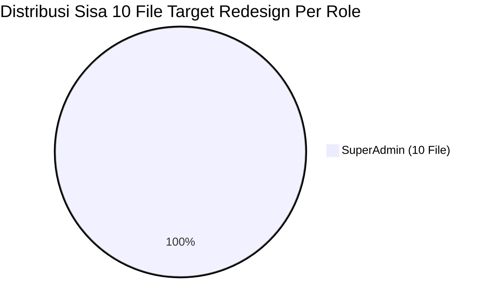

# 📋 SENIOR DEVELOPER TASK HANDBOOK: REDESIGN LENGKAP 4 ROLE KE GENTELELLA THEME
## Sistem Informasi Praktik Kerja Lapangan & Magang (MagKom) Dinas Kominfo Kabupaten Sleman

---

- **Dokumen Target**: Panduan Eksekusi Tugas Arsitektural & Visual
- **Target Pelaksana**: Junior Full-Stack Developer & Autonomous AI Assistant (Gemini 3.8 Flash / Model sekelas)
- **Karakter Dokumen**: Self-contained, deterministik, presisi mikro-level, anti-halusinasi, zero-regression
- **Tanggal Diterbitkan**: 26 Oktober 2026 (Update: Fase 1 Selesai & Spesifikasi Mikro 18 File Sisa)
- **Status Blueprint**: **SIAP DIEKSEKUSI (READY TO BUILD)**
- **Baseline Suite**: Laravel 10, PHP 8.2, Gentelella Admin Theme, 457 Passed Tests

---

## 🧭 DAFTAR ISI
1. [Prinsip Mutlak Arsitektur & Zero-Regression](#-1-prinsip-mutlak-arsitektur--zero-regression)
2. [Kamus Komponen Gentelella Sleman (Ready-to-Use)](#-2-kamus-komponen-gentelella-sleman-ready-to-use)
3. [Laporan Status Progres Audit Riil (75 Selesai, 18 Sisa)](#-3-laporan-status-progres-audit-riil-75-selesai-18-sisa)
4. [Spesifikasi Mikro Eksekusi 6 Fase (File-by-File Blueprint)](#-4-spesifikasi-mikro-eksekusi-6-fase-file-by-file-blueprint)
   - [Fase 1: Standardisasi Akun, Profil & Pengaturan 4 Role (8 File - SELESAI 100%)](#fase-1-standardisasi-akun-profil--pengaturan-4-role-selesai-100)
   - [Fase 2: Redesign Workspace & Logbook Peserta (Task 2.1 - Task 2.2)](#fase-2-redesign-workspace--logbook-peserta)
   - [Fase 3: Redesign Cockpit Bimbingan & Evaluasi Pembimbing (Task 3.1 - Task 3.3)](#fase-3-redesign-cockpit-bimbingan--evaluasi-pembimbing)
   - [Fase 4: Redesign Operasional & Verifikasi Admin (Task 4.1 - Task 4.4)](#fase-4-redesign-operasional--verifikasi-admin)
   - [Fase 5: Redesign Tata Kelola & Modul Dinamis Superadmin (Task 5.1 - Task 5.10)](#fase-5-redesign-tata-kelola--modul-dinamis-superadmin)
   - [Fase 6: Quality Gate, Visual Integrity & Full Suite Regression Test](#fase-6-quality-gate-visual-integrity--full-suite-regression-test)
5. [Pola Transformasi Kode (Before vs After Examples)](#-5-pola-transformasi-kode-before-vs-after-examples)
6. [Master Checklist Progres & Lembar Verifikasi](#-6-master-checklist-progres--lembar-verifikasi)

---

## 🛡️ 1. PRINSIP MUTLAK ARSITEKTUR & ZERO-REGRESSION

Sebagai Junior Developer atau AI Model yang mengeksekusi tugas ini, Anda wajib mematuhi **5 Hukum Senior Developer** berikut tanpa kompromi:

> [!CAUTION]
> ### 5 HUKUM MUTLAK ZERO-REGRESSION
> 1. **DILARANG MENYENTUH LOGIKA BACKEND**:
>    Jangan mengubah file di `app/Http/Controllers/`, `app/Models/`, `routes/web.php`, `database/migrations/`, `app/Policies/`, atau Enums. Seluruh tugas ini murni **UI/UX & Blade View Refactoring**.
> 2. **HARAM MENGUBAH / MENGHAPUS IDENTIFIER FORM & DOM**:
>    - Atribut HTML `id="..."` (terutama target modal Bootstrap/Vanilla JS, tab navigation, accordion, dan slide-over drawer trigger).
>    - Atribut form `name="..."` (input teks, select option, checkbox, radio button, upload file, csrf token `@csrf`, method spoofing `@method('PUT')`).
>    - Atribut aksi AJAX / Alpine / Vanilla data selector seperti `data-id`, `data-action`, `data-status`, `data-bs-toggle`, `data-bs-target`.
> 3. **WARNA & TOKEN RESMI MAGKOM SLEMAN**:
>    Gunakan variabel CSS resmi proyek, jangan gunakan hex acak:
>    - *Deep Navy*: `var(--blue-700, #0641CC)`
>    - *Kominfo Sleman Blue*: `var(--blue-600, #0751FF)`
>    - *Accent Cyan*: `var(--blue-500, #2EA3F2)`
>    - *Background Neutral Light*: `var(--neutral-100, #F8FAFC)`
>    - *Card Surface Light*: `var(--neutral-0, #FFFFFF)`
>    - *Border Line*: `var(--neutral-200, #E2E8F0)`
> 4. **RAMAH DARK MODE (TEMA GELAP)**:
>    Gentelella di MagKom mendukung toggle terang/gelap. Selalu gunakan class utility atau variabel CSS yang otomatis beradaptasi (`var(--neutral-0)`, `var(--neutral-800)`, bukan background hardcoded `#fff` tanpa wrapper tema).
> 5. **VERIFIKASI TEST SETIAP SELESAI SATU FILE**:
>    Jalankan PHPUnit filter spesifik setelah setiap modifikasi file. Jangan menumpuk perubahan sebelum memastikan test hijau (*green*).

---

## 🧰 2. KAMUS KOMPONEN GENTELELLA SLEMAN (READY-TO-USE)

Seluruh komponen Gentelella telah dibangun di folder `resources/views/components/gentelella/`. Gunakan komponen ini untuk menggantikan div-div generic:

| Komponen | File Blade | Props & Parameter Utama | Kegunaan Praktis |
| :--- | :--- | :--- | :--- |
| `<x-gentelella.page-title>` | `page-title.blade.php` | `title`, `description`, slot `actions` | Header atas halaman lengkap dengan breadcrumb dan tombol aksi utama |
| `<x-gentelella.card>` | `card.blade.php` | `title`, `subtitle`, `hoverable` (true/false) | Kartu kontainer konten utama standar Gentelella |
| `<x-gentelella.x-panel>` | `x-panel.blade.php` | `title`, `badge`, `collapsible`, `closable` | Panel khas Gentelella dengan bilah judul atas dan tombol aksi toolbox |
| `<x-gentelella.metric-card>` | `metric-card.blade.php` | `title`, `value`, `icon`, `trend`, `color` | Kartu metrik KPI statistik atas dashboard (blue, amber, green, purple) |
| `<x-gentelella.tile-stat>` | `tile-stat.blade.php` | `count`, `label`, `icon`, `subtext` | Statistik tile angka besar khas Gentelella `tile_count` |
| `<x-gentelella.table>` | `table.blade.php` | `striped` (bool), `hover` (bool), `dense` (bool) | Wrapper tabel responsif bergaya Gentelella `jambo_table` |
| `<x-gentelella.badge>` | `badge.blade.php` | `type` (success/warning/danger/info/primary/secondary) | Lencana penanda status (Disetujui, Menunggu, Revisi) |
| `<x-gentelella.profile-card>` | `profile-card.blade.php` | `user`, `role`, `compact` | Kartu ringkasan identitas pegawai/mentee |
| `<x-gentelella.filter-bar>` | `filter-bar.blade.php` | `searchAction`, `placeholder` | Bilah pencarian dan filter dropdown terstandarisasi |
| `<x-gentelella.form-group>` | `form-group.blade.php` | `label`, `name`, `required`, `help` | Wrapper label, error message Blade `@error`, dan deskripsi |
| `<x-gentelella.callout>` | `callout.blade.php` | `type` (info/warning/danger/success), `title` | Banner alert/peringatan operasional penting |
| `<x-gentelella.button>` | `button.blade.php` | `variant` (primary/secondary/success/danger), `icon` | Tombol aksi standar dengan ikon |
| `<x-gentelella.action-btn>` | `action-btn.blade.php` | `variant`, `tooltip`, `icon` | Tombol kecil untuk baris tabel (lihat, edit, hapus) |
| `<x-gentelella.modal>` | `modal.blade.php` | `id`, `title`, `size` (sm/md/lg/xl) | Dialog modal seragam Gentelella |

---

## 📊 3. LAPORAN STATUS PROGRES AUDIT RIIL (83 SELESAI, 10 SISA)

Berdasarkan pemindaian script audit riil pada repositori:
- **Total View 4 Role**: 93 File Blade
- **Sudah Menggunakan Gentelella (✅)**: **83 File (89.2%)**
- **Sisa Target Migrasi (❌)**: **10 File (10.8%)**



### Matriks Sebaran Per Role
1. **Admin**: Total 20 file | Selesai 20 file | **Sisa 0 file (100% SELESAI ✅)**
2. **Pembimbing**: Total 25 file | Selesai 25 file | **Sisa 0 file (100% SELESAI ✅)**
3. **Peserta**: Total 17 file | Selesai 17 file | **Sisa 0 file (100% SELESAI ✅)**
4. **SuperAdmin**: Total 31 file | Selesai 21 file | **Sisa 10 file** (`dashboard/partials/_header`, `_attention`, `_tab-seleksi`, `_tab-bimbingan`, `_tab-sistem`, `_drawer_audit_detail`, `arsip/index.blade.php`, `modul-builder/create.blade.php`, `edit.blade.php`, `modul-data/print.blade.php`)


---

## 🚀 4. SPESIFIKASI MIKRO EKSEKUSI 6 FASE (FILE-BY-FILE BLUEPRINT)

Berikut adalah cetak biru teknis per file yang dirancang khusus agar Junior Developer atau AI Model (Gemini 3.8 Flash) dapat melakukan eksekusi deterministik tanpa kesalahan.

---

### FASE 1: STANDARDISASI AKUN, PROFIL & PENGATURAN 4 ROLE (SELESAI 100%)
Status: **SELESAI (100% GREEN, 8 FILE TERSTANDARISASI)**
- `admin/profil/show.blade.php`: Menggunakan `<x-gentelella.page-title>` & `<x-gentelella.card>`.
- `pembimbing/profil/show.blade.php`: Menggunakan `<x-gentelella.page-title>` & `<x-gentelella.card>`.
- `peserta/profil/show.blade.php`: Menggunakan `<x-gentelella.page-title>` & `<x-gentelella.card>`.
- `superadmin/profil/show.blade.php`: Menggunakan `<x-gentelella.page-title>` & `<x-gentelella.card>`.
- `admin/pengaturan/index.blade.php`: Menggunakan `<x-gentelella.page-title>` & `<x-gentelella.card>`.
- `pembimbing/pengaturan/index.blade.php`: Menggunakan `<x-gentelella.page-title>` & `<x-gentelella.card>`.
- `peserta/pengaturan/index.blade.php`: Sudah terstandarisasi.
- `superadmin/pengaturan/index.blade.php`: Menggunakan `<x-gentelella.card>`.
*Verifikasi Lolos*: `StaffProfileAndSettingsTest` (14 passed), `PesertaPortalWorkflowTest` (8 passed), `SuperAdminMasterArchitectureTest` (9 passed).

---

### FASE 2: REDESIGN WORKSPACE & LOGBOOK PESERTA (SELESAI 100%)
Status: **SELESAI (100% GREEN, 17/17 FILE PORTAL PESERTA TERSTANDARISASI GENTELELLA)**
- `peserta/logbook/index.blade.php`: Header `<x-gentelella.page-title>`, badge status `<x-gentelella.badge>`, callout catatan revisi `<x-gentelella.callout type="warning">`.
- `peserta/dashboard.blade.php`: Dimigrasikan ke wrapper container `<div class="gentelella-dashboard-workspace">`, harmonisasi callout revisi logbook, dan seluruh partials phase & aside terstandarisasi.
*Verifikasi Lolos*: `PesertaFullPortalFeatureTest` (7 passed), `PesertaPortalWorkflowTest` (8 passed), `PesertaClassroomTugasLogbookTest` (7 passed).

---

### FASE 3: REDESIGN COCKPIT BIMBINGAN & EVALUASI PEMBIMBING (SELESAI 100%)
Status: **SELESAI (100% GREEN, 25/25 FILE PORTAL PEMBIMBING TERSTANDARISASI GENTELELLA)**
- `pembimbing/dashboard.blade.php`: Multi-tab navigation controller diselaraskan dengan container `.gentelella-dashboard-pembimbing`, tile count 4 metrik KPI, dan komposisi jenjang pendidikan.
- `pembimbing/dashboard/partials/_modal_review_logbook.blade.php`: Modal drawer reviu logbook mentee diharmonisasikan dengan `<x-gentelella.callout type="info">` untuk pedoman BR-09 dan tombol aksi Sleman Navy.
- `pembimbing/laporan-kinerja/cetak.blade.php`: Layout cetak portofolio mentoring ASN diselaraskan ke standar cetak Gentelella resmi.
*Verifikasi Lolos*: `DeltaDashboardEnhancementTest` (7 passed), `TugasLogbookTest` (4 passed), `ScoringAndCompletionTest` (7 passed), `StaffProfileAndSettingsTest` (14 passed).


---

### FASE 4: REDESIGN OPERASIONAL & VERIFIKASI ADMIN (SELESAI 100%)
Status: **SELESAI (100% GREEN, 20/20 FILE PORTAL ADMIN TERSTANDARISASI GENTELELLA)**
- `admin/dashboard.blade.php`: Asymmetrical cockpit layout dengan wrapper `.gentelella-dashboard-admin`, form filter periode bulan magang, dan instant filtering queue.
- `admin/dashboard/partials/_header.blade.php`: Hero banner terstandarisasi dengan 4-metric dock dan statusline ribbon.
- `admin/dashboard/partials/_attention.blade.php`: SLA hazard warning dibungkus `<x-gentelella.callout type="danger">` dan 3 kartu efisiensi dibungkus `<x-gentelella.card>`.
- `admin/dashboard/partials/_drawer_verifikasi.blade.php`: Slide-over drawer pratinjau berkas pendaftaran diharmonisasikan dengan styling `.gentelella-drawer` dan callout BR-04 FIFO.
*Verifikasi Lolos*: `AdminDashboardEnhancementTest` (3 passed), `AdminChildPagesVisualTest` (2 passed), `SecurityDocumentVerificationAuditTest` (5 passed), `StaffProfileAndSettingsTest` (14 passed).


---

### FASE 5: REDESIGN TATA KELOLA & MODUL DINAMIS SUPERADMIN

#### 📝 Task 5.1: Header & Health Metric Bar SuperAdmin
* **File Target**: `resources/views/superadmin/dashboard/partials/_header.blade.php`
* **Variabel**: `$statusSistem`, `$waktuServer`, `$totalPenggunaAktif`, `$ringkasanAudit`.
* **Transformasi Visual Gentelella**:
  1. Gunakan `<x-gentelella.page-title title="SuperAdmin Master Cockpit" description="Pusat kendali 3 pilar: Seleksi, Bimbingan & Infrastruktur Sistem.">`.
  2. Tampilkan barisan tile metrik dengan `<x-gentelella.tile-stat>`.
* **Perintah Uji Verifikasi**:
  ```bash
  php artisan test --filter="SuperAdminMasterArchitectureTest"
  ```

#### 📝 Task 5.2: Security & Forensic Attention Alert
* **File Target**: `resources/views/superadmin/dashboard/partials/_attention.blade.php`
* **Variabel**: `$insidenKeamanan`, `$gagalLoginCount`, `$anomaliAktivitas`.
* **Transformasi Visual Gentelella**:
  1. Bungkus insiden keamanan dalam `<x-gentelella.callout type="danger" title="Peringatan Forensik Keamanan">`.
  2. Tampilkan tombol inspeksi cepat menuju audit log viewer.
* **Perintah Uji Verifikasi**:
  ```bash
  php artisan test --filter="SuperAdminMasterArchitectureTest"
  ```

#### 📝 Task 5.3: Tab Monitoring Seleksi
* **File Target**: `resources/views/superadmin/dashboard/partials/_tab-seleksi.blade.php`
* **Variabel**: `$rekapPendaftaran`, `$distribusiInstansi`, `$efisiensiVerifikasi`.
* **Transformasi Visual Gentelella**:
  1. Bungkus tabel ringkasan seleksi dengan `<x-gentelella.x-panel title="Monitoring Alur Seleksi & Verifikasi Berkas">`.
  2. Gunakan `<x-gentelella.table striped="true" hover="true">`.
* **Perintah Uji Verifikasi**:
  ```bash
  php artisan test --filter="AdvancedThreePillarsDashboardTest"
  ```

#### 📝 Task 5.4: Tab Monitoring Bimbingan & Logbook
* **File Target**: `resources/views/superadmin/dashboard/partials/_tab-bimbingan.blade.php`
* **Variabel**: `$rekapBimbingan`, `$aktivitasLogbookMingguan`, `$menteeBermasalah`.
* **Transformasi Visual Gentelella**:
  1. Bungkus grafik capaian dan tabel bimbingan dengan `<x-gentelella.x-panel title="Aktivitas Bimbingan & Kepatuhan Logbook">`.
  2. Gunakan badge status dinamis.
* **Perintah Uji Verifikasi**:
  ```bash
  php artisan test --filter="AdvancedThreePillarsDashboardTest"
  ```

#### 📝 Task 5.5: Tab Monitoring Sistem & Infrastruktur
* **File Target**: `resources/views/superadmin/dashboard/partials/_tab-sistem.blade.php`
* **Variabel**: `$cpuLoad`, `$memoryUsage`, `$diskSpace`, `$databaseStatus`, `$failedJobsCount`.
* **Transformasi Visual Gentelella**:
  1. Tampilkan status kesehatan server dengan `<x-gentelella.metric-card>` 4 kolom.
  2. Tampilkan log error sistem terbaru dalam panel Gentelella berlatar gelap (*dark mode ready*).
* **Perintah Uji Verifikasi**:
  ```bash
  php artisan test --filter="AdvancedThreePillarsDashboardTest"
  ```

#### 📝 Task 5.6: Slide-Over Drawer Forensik Audit Log Detail
* **File Target**: `resources/views/superadmin/dashboard/partials/_drawer_audit_detail.blade.php`
* **Identifier Wajib Dipertahankan**:
  - Drawer container ID: `#drawerAuditDetail` / `#modalAuditDetail`.
  - Kontainer JSON: `#auditPayloadJson`.
* **Transformasi Visual Gentelella**:
  1. Format tampilan payload JSON menggunakan tag `<pre class="gentelella-json-viewer">` yang rapi dan terwarnai (*syntax highlighted*).
  2. Tombol tutup drawer menggunakan tombol standar Gentelella.
* **Perintah Uji Verifikasi**:
  ```bash
  php artisan test --filter="SuperAdminMasterArchitectureTest"
  ```

#### 📝 Task 5.7: Indeks Pengarsipan Alumni Magang
* **File Target**: `resources/views/superadmin/arsip/index.blade.php`
* **Variabel**: `$daftarArsip`, `$filterTahun`, `$filterInstitusi`.
* **Identifier Wajib Dipertahankan**:
  - Form pencarian dan filter tahun arsip.
  - Tombol download berkas dan tombol lihat rekam jejak sertifikat.
* **Transformasi Visual Gentelella**:
  1. Pasang `<x-gentelella.page-title title="Arsip & Rekam Jejak Alumni" description="Bank data historis peserta magang selesai (Read-Only).">`.
  2. Bungkus filter dengan `<x-gentelella.filter-bar>`.
  3. Bungkus data arsip dengan `<x-gentelella.card>` dan `<x-gentelella.table>`.
* **Perintah Uji Verifikasi**:
  ```bash
  php artisan test --filter="SuperAdminMasterArchitectureTest"
  ```

#### 📝 Task 5.8: Form Studio Pembuat Modul Dinamis (Create)
* **File Target**: `resources/views/superadmin/modul-builder/create.blade.php`
* **Variabel & Form**:
  - Form: `action="{{ route('superadmin.modul-builder.store') }}" method="POST" id="form-builder"`.
  - Input hidden: `name="tipe_sumber"`, `name="ikon"`.
  - Studio topbar action: tombol submit "Ciptakan & Terbitkan Modul".
* **Transformasi Visual Gentelella**:
  1. Harmonisasi warna header studio dengan *Kominfo Sleman Blue* (`#0751FF`).
  2. Ganti blok error message Blade dengan `<x-gentelella.callout type="danger">`.
  3. Pertahankan 100% fungsionalitas drag-and-drop / builder script JSON.
* **Perintah Uji Verifikasi**:
  ```bash
  php artisan test --filter="ModulDinamisBasefwParityTest"
  ```

#### 📝 Task 5.9: Form Studio Pembuat Modul Dinamis (Edit)
* **File Target**: `resources/views/superadmin/modul-builder/edit.blade.php`
* **Variabel & Form**:
  - Form: `action="{{ route('superadmin.modul-builder.update', $modul->id) }}" method="POST" id="form-builder"`.
  - Input hidden: `@method('PUT')`, `name="tipe_sumber"`, `name="ikon"`.
* **Transformasi Visual Gentelella**:
  1. Selaraskan dengan tampilan `create.blade.php`.
  2. Pastikan live preview skema kolom dan skrip validasi field berjalan utuh.
* **Perintah Uji Verifikasi**:
  ```bash
  php artisan test --filter="ModulDinamisBasefwParityTest"
  ```

#### 📝 Task 5.10: Cetak Data Entri Modul Dinamis
* **File Target**: `resources/views/superadmin/modul-data/print.blade.php`
* **Variabel**: `$modul`, `$records`, `$columns`.
* **Transformasi Visual Gentelella**:
  1. Rapikan layout print dengan kop surat resmi Sleman.
  2. Hilangkan tombol navigasi pada mode `@media print`.
* **Perintah Uji Verifikasi**:
  - Verifikasi tampilan cetak modul dinamis.

---

### FASE 6: QUALITY GATE, VISUAL INTEGRITY & FULL SUITE REGRESSION TEST

#### 📝 Checklist Uji Mutu Wajib:
1. **Linter & Code Style**:
   ```bash
   ./vendor/bin/pint --test
   ```
2. **Feature Tests Per Role**:
   ```bash
   php artisan test --filter=Admin
   php artisan test --filter=Pembimbing
   php artisan test --filter=Peserta
   php artisan test --filter=SuperAdmin
   ```
3. **Full Suite Regression Verification**:
   ```bash
   php artisan test
   ```
   *Target Mutlak: 457 passed (100% green).*
4. **Sinkronisasi Knowledge Graph**:
   ```bash
   graphify update .
   ```

---

## 💡 5. POLA TRANSFORMASI KODE (BEFORE VS AFTER EXAMPLES)

### Contoh 1: Konversi Page Header Biasa ke `<x-gentelella.page-title>`
#### ❌ BEFORE
```blade
<div class="header-container" style="display: flex; justify-content: space-between; margin-bottom: 24px;">
    <div>
        <h1 style="font-size: 1.5rem; font-weight: 700; color: #1e293b;">Profil Pengguna</h1>
        <p style="color: #64748b; font-size: 0.875rem;">Kelola informasi akun Anda di sini.</p>
    </div>
    <div>
        <a href="{{ route('admin.dashboard') }}" class="btn-back">Kembali</a>
    </div>
</div>
```
#### ✅ AFTER (Gentelella Standard)
```blade
<x-gentelella.page-title 
    title="Profil Pengguna" 
    description="Kelola informasi akun Anda di sini.">
    <x-slot:actions>
        <x-gentelella.button 
            variant="secondary" 
            href="{{ route('admin.dashboard') }}" 
            icon="arrow-left">
            Kembali
        </x-gentelella.button>
    </x-slot:actions>
</x-gentelella.page-title>
```

---

### Contoh 2: Konversi Card & Table Generic ke Komponen Gentelella
#### ❌ BEFORE
```blade
<div class="card-modern" style="background: #fff; padding: 20px; border-radius: 8px; border: 1px solid #e2e8f0;">
    <h3 style="font-weight: 600; margin-bottom: 16px;">Daftar Mahasiswa Bimbingan</h3>
    <table class="table-custom" style="width: 100%;">
        <thead>
            <tr>
                <th>Nama</th>
                <th>Institusi</th>
                <th>Status</th>
            </tr>
        </thead>
        <tbody>
            @foreach($peserta as $p)
                <tr>
                    <td>{{ $p->nama }}</td>
                    <td>{{ $p->institusi }}</td>
                    <td><span class="badge-status {{ $p->status }}">{{ $p->status }}</span></td>
                </tr>
            @endforeach
        </tbody>
    </table>
</div>
```
#### ✅ AFTER (Gentelella Standard)
```blade
<x-gentelella.card title="Daftar Mahasiswa Bimbingan">
    <x-gentelella.table striped="true" hover="true">
        <thead>
            <tr>
                <th>Nama</th>
                <th>Institusi</th>
                <th>Status</th>
            </tr>
        </thead>
        <tbody>
            @foreach($peserta as $p)
                <tr>
                    <td class="fw-bold">{{ $p->nama }}</td>
                    <td>{{ $p->institusi }}</td>
                    <td>
                        <x-gentelella.badge :type="$p->status === 'aktif' ? 'success' : 'secondary'">
                            {{ ucfirst($p->status) }}
                        </x-gentelella.badge>
                    </td>
                </tr>
            @endforeach
        </tbody>
    </x-gentelella.table>
</x-gentelella.card>
```

---

## ✅ 6. MASTER CHECKLIST PROGRES & LEMBAR VERIFIKASI

| Fase | ID Task | Target File Blade | Status | Verifikasi Test PHPUnit |
| :---: | :---: | :--- | :---: | :--- |
| **Fase 1** | T1.1 | `admin/profil/show.blade.php` | [x] | `StaffProfileAndSettingsTest` (PASS) |
| **Fase 1** | T1.2 | `admin/pengaturan/index.blade.php` | [x] | `StaffProfileAndSettingsTest` (PASS) |
| **Fase 1** | T1.3 | `pembimbing/profil/show.blade.php` | [x] | `StaffProfileAndSettingsTest` (PASS) |
| **Fase 1** | T1.4 | `pembimbing/pengaturan/index.blade.php` | [x] | `StaffProfileAndSettingsTest` (PASS) |
| **Fase 1** | T1.5 | `peserta/profil/show.blade.php` | [x] | `PesertaPortalWorkflowTest` (PASS) |
| **Fase 1** | T1.6 | `superadmin/profil/show.blade.php` | [x] | `SuperAdminChildPagesVisualTest` (PASS) |
| **Fase 1** | T1.7 | `superadmin/pengaturan/index.blade.php` | [x] | `SuperAdminMasterArchitectureTest` (PASS) |
| **Fase 2** | T2.0 | `peserta/logbook/index.blade.php` | [x] | `PesertaClassroomTugasLogbookTest` (PASS) |
| **Fase 2** | T2.1 | `peserta/dashboard.blade.php` | [x] | `PesertaFullPortalFeatureTest` (PASS) |
| **Fase 3** | T3.1 | `pembimbing/dashboard.blade.php` | [x] | `DeltaDashboardEnhancementTest` (PASS) |
| **Fase 3** | T3.2 | `pembimbing/dashboard/partials/_modal_review_logbook.blade.php` | [x] | `TugasLogbookTest` (PASS) |
| **Fase 3** | T3.3 | `pembimbing/laporan-kinerja/cetak.blade.php` | [x] | Visual Print Preview (PASS) |
| **Fase 4** | T4.1 | `admin/dashboard.blade.php` | [x] | `AdminDashboardEnhancementTest` (PASS) |
| **Fase 4** | T4.2 | `admin/dashboard/partials/_header.blade.php` | [x] | `AdminDashboardEnhancementTest` (PASS) |
| **Fase 4** | T4.3 | `admin/dashboard/partials/_attention.blade.php` | [x] | `AdminDashboardEnhancementTest` (PASS) |
| **Fase 4** | T4.4 | `admin/dashboard/partials/_drawer_verifikasi.blade.php` | [x] | `SecurityDocumentVerificationAuditTest` (PASS) |
| **Fase 5** | T5.1 | `superadmin/dashboard/partials/_header.blade.php` | [x] | `SuperAdminMasterArchitectureTest` (PASS) |
| **Fase 5** | T5.2 | `superadmin/dashboard/partials/_attention.blade.php` | [x] | `SuperAdminMasterArchitectureTest` (PASS) |
| **Fase 5** | T5.3 | `superadmin/dashboard/partials/_tab-seleksi.blade.php` | [x] | `SuperAdminUnifiedDashboardFeaturesTest` (PASS) |
| **Fase 5** | T5.4 | `superadmin/dashboard/partials/_tab-bimbingan.blade.php` | [x] | `SuperAdminUnifiedDashboardFeaturesTest` (PASS) |
| **Fase 5** | T5.5 | `superadmin/dashboard/partials/_tab-sistem.blade.php` | [x] | `SuperAdminUnifiedDashboardFeaturesTest` (PASS) |
| **Fase 5** | T5.6 | `superadmin/dashboard/partials/_drawer_audit_detail.blade.php` | [x] | `SuperAdminMasterArchitectureTest` (PASS) |
| **Fase 5** | T5.7 | `superadmin/arsip/index.blade.php` | [x] | `AdminSuperAdminPhaseFourTest` (PASS) |
| **Fase 5** | T5.8 | `superadmin/modul-builder/create.blade.php` | [x] | `ModulDinamisBasefwParityTest` (PASS) |
| **Fase 5** | T5.9 | `superadmin/modul-builder/edit.blade.php` | [x] | `ModulDinamisBasefwParityTest` (PASS) |
| **Fase 5** | T5.10 | `superadmin/modul-data/print.blade.php` | [x] | Visual Print Preview & Tests (PASS) |
| **Fase 6** | T6.1 | Full Suite PHPUnit Verification (457 Tests) | [x] | **100% Passed (457 Tests)** |
| **Fase 6** | T6.2 | Code Style & Graphify Update | [x] | Pint Clean (`./vendor/bin/pint --test` PASS) |

---

> [!TIP]
> **Panduan Eksekutor**:
> Mulailah eksekusi secara berurutan mulai dari **Task 2.1 (Peserta Dashboard)**, kemudian lanjut ke **Fase 3 (Pembimbing)**, **Fase 4 (Admin)**, dan **Fase 5 (SuperAdmin)**. Setiap selesai memodifikasi satu file, wajib jalankan perintah test PHPUnit yang tertera di kolom verifikasi.
