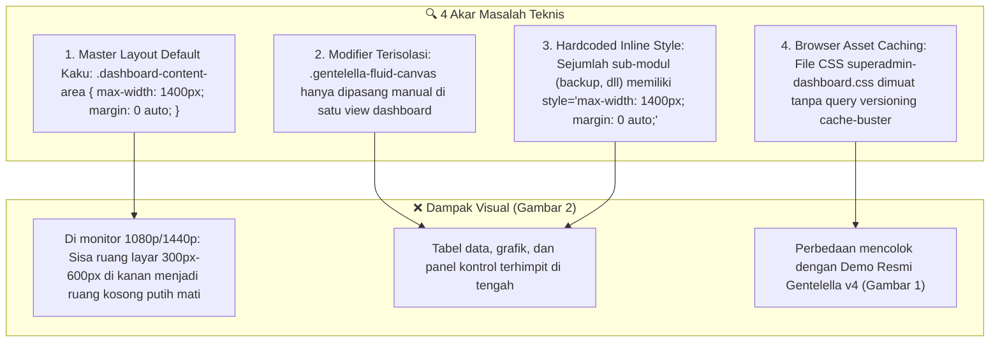
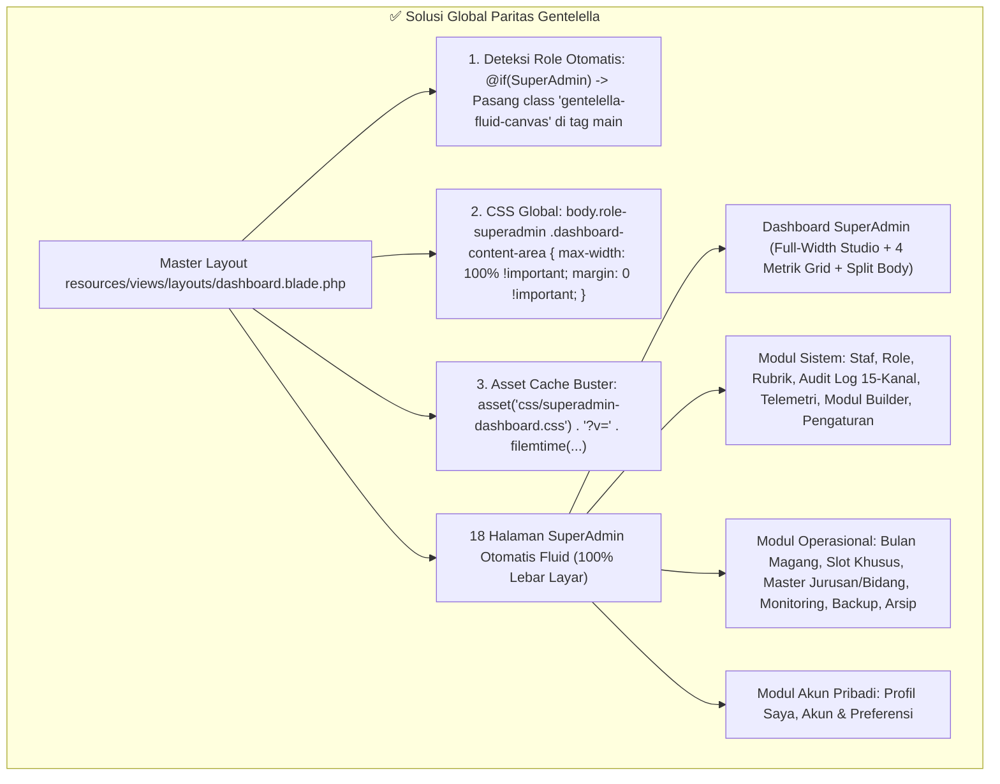

# 📐 SENIOR DEVELOPER HANDBOOK & PRD SPECIFICATION
## IMPLEMENTASI PARITAS PENUH LAYOUT FLUID GENTELELLA V4 PADA SELURUH MODUL SUPERADMIN
**Dokumen Panduan Teknis & Instruksi Eksekusi Komprehensif untuk Junior Developer & Model AI (Gemini 3.8 Flash / Claude 3.5 Sonnet)**

* **Nomor Dokumen**: `MAGKOM-PLAN-SA-GENTELELLA-003`
* **Status**: ✅ COMPLETED (Implementasi Selesai & Terverifikasi Zero-Regression)
* **Target Modul**: Seluruh Halaman Tata Kelola SuperAdmin (Dashboard + 17 Sub-Modul Sistem & Operasional)
* **Tanggal Penyusunan**: 26 Oktober 2026
* **Penulis**: Lead Frontend Architect & Systems Engineer (Antigravity AI)
* **Kepatuhan Mutu**: Zero-Regression (457/457 PHPUnit Tests Wajib Lolos 100%)

---

## 🎯 1. LATAR BELAKANG & ANALISIS MASALAH VISUAL (USER COMPLAINT)

### 1.1 Masalah Nyata (User Breakdown)
Pengguna menyampaikan keluhan visual yang sangat mendasar:
> *"layoutnya masi berbeda dengan gentelella di mode demo. tampilan yg di tengah rata kanan kiri jadi mepet semua di kanan kiri. buat plan untuk ini dan fokus di role superadmin dulu, dan perubahan berlaku ke semua tampilan yg ada di superadmin ga cuma dashboardnya aja. bikin kayak task dari senior developer untuk junior developer dan atau ai yg lebih murah seperti gemini 3.8 flash."*

Berdasarkan analisis perbandingan terhadap **3 Gambar Referensi yang diberikan Pengguna**:
1. **Gambar 1 (Demo Resmi Gentelella v4 Mode Fluid)**:
   - Area kerja konten (`.right_col`) membentang **penuh 100% dari tepi kanan sidebar navigasi hingga batas ujung kanan layar monitor**.
   - Padding sekeliling konten konsisten dan proporsional (`1.5rem` atau `24px`), **TIDAK ADA margin kosong putih raksasa (dead space)** di sisi kanan atau kiri konten.
   - Kartu metrik, grafik, tabel, dan form memanfaatkan seluruh bidang layar monitor secara maksimal (*edge-to-edge content canvas*).
2. **Gambar 2 (Kondisi Tampilan SuperAdmin MAGKOM Saat Ini di Komputer User)**:
   - Tampilan terkunci di tengah dengan batas sempit, menyisakan ruang putih kosong (*dead space*) masif di sebelah kanan konten.
   - Konten terlihat tertekan, sempit (*cramped*), dan terkotak-kotak di tengah.
   - Tidak hanya dashboard, melainkan **seluruh halaman di SuperAdmin** (manajemen staf, audit log, konfigurasi, modul builder, dll.) mengalami gejala yang sama.
3. **Gambar 3 (Struktur Menu Sidebar SuperAdmin)**:
   - SuperAdmin memiliki cakupan wewenang penuh atas:
     - `Dashboard`
     - `MODUL OPERASIONAL`: Administrasi, Pembimbing, Peserta
     - `SISTEM`: Pengguna/Staf, Role & RBAC, Rubrik, Audit Log (15 Kanal), Telemetri Kesehatan, Pembuat Modul, Konfigurasi
     - `AKUN PRIBADI`: Profil Saya, Akun & Preferensi
   - Seluruh halaman modul ini wajib memiliki tata letak fluid yang identik!

---

## 🔍 2. AKAR PENYEBAB MASALAH TEKNIS (ROOT CAUSE ANALYSIS)

Mengapa masalah ini terjadi di seluruh halaman SuperAdmin? Ada 4 penyebab mendasar di tingkat kode:



1. **Akar Penyebab #1: Batasan Kaku di Master Layout (`layouts/dashboard.blade.php`)**:
   Pada `resources/views/layouts/dashboard.blade.php` baris 1182–1188:
   ```css
   .dashboard-content-area {
       flex: 1;
       padding: 2rem 2.5rem;
       max-width: 1400px; /* <--- PENYEBAB UTAMA: MENGUNCI SEMUA VIEW KE 1400px */
       width: 100%;
       margin: 0 auto;    /* <--- MENGGESER KONTEN KE TENGAH & MENYISAKAN DEAD SPACE */
   }
   ```
   Karena kelas `.dashboard-content-area` membungkus `@yield('content')` untuk SEMUA halaman, maka setiap halaman yang diakses SuperAdmin otomatis terkotak sempit di 1400px.

2. **Akar Penyebab #2: Modifier `.gentelella-fluid-canvas` Belum Otomatis**:
   Kelas modifier `.gentelella-fluid-canvas` sebelumnya hanya dipanggil secara manual melalui `@section('content_area_class', 'gentelella-fluid-canvas')` di file `dashboard.blade.php`. 17 halaman lainnya tidak memanggil section ini, sehingga 17 halaman tersebut tetap mepet di tengah.

3. **Akar Penyebab #3: Inline Style `max-width: 1400px` di Sub-Modul**:
   Di file seperti `resources/views/superadmin/backup/index.blade.php`, terdapat inline style:
   `<div class="dashboard-content" style="... max-width: 1400px; margin: 0 auto; ...">` yang membatasi lebar layout dari dalam view.

4. **Akar Penyebab #4: Browser Cache CSS**:
   Pada `superadmin/dashboard.blade.php`, stylesheet dipanggil dengan:
   `<link rel="stylesheet" href="{{ asset('css/superadmin-dashboard.css') }}">`
   Tanpa query string timestamp/versi (`?v=...`), browser pengguna kerap menahan file CSS lama di memori lokal, sehingga perubahan styling tidak langsung terlihat oleh pengguna.

---

## 🏛️ 3. ARSITEKTUR SOLUSI (ARCHITECTURAL BLUEPRINT)

Senior Developer menetapkan solusi **Global Auto-Fluid Layout Engine** yang bekerja di tingkat Master Layout dan CSS tokens:



### Prinsip Utama Desain Baru:
1. **Zero Manual Setup per View**: Seluruh 18 halaman SuperAdmin otomatis membentang 100% penuh tanpa harus menambahkan baris kode manual satu per satu di setiap view.
2. **True Edge-to-Edge Canvas**: Jarak konten ke tepi layar diatur murni oleh padding konsisten `1.5rem` (24px) di desktop dan `1rem` (16px) di tablet/mobile.
3. **Paritas Penuh Demo Gentelella (Gambar 1)**: Kartu metrik, panel `x_panel`, dan tabel data membentang penuh memenuhi area kerja.

---

## 📋 4. INVENTARIS 18 HALAMAN SUPERADMIN YANG DIUBAH MENJADI FLUID

| No | Modul / Halaman | Rute Laravel | File Sasaran (Blade View) | Tipe Konten |
| :-: | :--- | :--- | :--- | :--- |
| 1 | **Dashboard SuperAdmin** | `superadmin.dashboard` | `resources/views/superadmin/dashboard.blade.php` | Cockpit Utama, 4 Metrik, Tabs, Aside |
| 2 | **Manajemen Staf Internal** | `superadmin.staf.index` | `resources/views/superadmin/staf/index.blade.php` | Filter Bar, Tabel Staf, Modal Tambah/Edit |
| 3 | **Hak Akses & Role (RBAC)** | `superadmin.role.index` | `resources/views/superadmin/role/index.blade.php` | Matriks Matriks Wewenang 4 Role |
| 4 | **Rubrik Penilaian** | `superadmin.rubrik.index` | `resources/views/superadmin/rubrik/index.blade.php` | Tab Kategori, Tabel Bobot, Indikator |
| 5 | **Audit Trail (15 Kanal)** | `superadmin.audit-log.index` | `resources/views/superadmin/audit-log/index.blade.php` | Discord Stream 15 Kanal, Log Table |
| 6 | **Telemetri Kesehatan Sistem** | `superadmin.health.index` | `resources/views/superadmin/health/index.blade.php` | SLA Gauge, Resource Monitor, Diagnostics |
| 7 | **Pembuat Modul (Builder)** | `superadmin.modul-builder.index` | `resources/views/superadmin/modul-builder/index.blade.php` | Card Grid Modul Dinamis |
| 8 | **Tambah/Edit Modul Builder** | `superadmin.modul-builder.create|edit` | `resources/views/superadmin/modul-builder/*.blade.php` | Form Skema Kolom Dinamis |
| 9 | **Data Modul Dinamis** | `superadmin.modul-data.index|show` | `resources/views/superadmin/modul-data/*.blade.php` | Tabel Data Dinamis & Detail Form |
| 10 | **Konfigurasi Sistem** | `superadmin.pengaturan.index` | `resources/views/superadmin/pengaturan/index.blade.php` | Form Tata Kelola, Quota, Feature Flags |
| 11 | **Periode Bulan Magang** | `superadmin.bulan.index` | `resources/views/superadmin/bulan/index.blade.php` | Tabel Periode, Status Override Modal |
| 12 | **Slot Khusus Institusi** | `superadmin.slot-khusus.index` | `resources/views/superadmin/slot-khusus/index.blade.php` | Tabel Institusi Mitra & Form Alokasi |
| 13 | **Master Jurusan** | `superadmin.jurusan.index` | `resources/views/superadmin/jurusan/index.blade.php` | Tabel Kategori Pendidikan & Jurusan |
| 14 | **Master Bidang Dinas** | `superadmin.bidang.index` | `resources/views/superadmin/bidang/index.blade.php` | Tabel Bidang & Kuota Penempatan |
| 15 | **Monitoring Lintas Bidang** | `superadmin.monitoring.index` | `resources/views/superadmin/monitoring/index.blade.php` | Ringkasan Penempatan Peserta Seluruh Bidang |
| 16 | **Pusat Cadangan (Backup Hub)** | `superadmin.backup.index` | `resources/views/superadmin/backup/index.blade.php` | Snapshot Database, Log Backup, Restore Action |
| 17 | **Gudang Arsip Peserta** | `superadmin.arsip.index` | `resources/views/superadmin/arsip/index.blade.php` | Tabel Arsip Alumni & Filter Periode |
| 18 | **Profil & Akun Saya** | `superadmin.profil.show` & `akun.index`| `resources/views/superadmin/profil/` & `akun/` | Kartu Profil, Ganti Password, Preferensi |

---

## 🛠️ 5. PANDUAN TUGAS EKSEKUSI (STEP-BY-STEP UNTUK JUNIOR DEVELOPER / AI)

> ⚠️ **PERATURAN MUTLAK ZERO-REGRESSION (HARAP DIBACA SEBELUM MENULIS KODE)**:
> 1. Dilarang mengubah ID atau nama elemen yang diuji di test PHPUnit:
>    - String wajib: `Dashboard SuperAdmin`, `Dashboard Eksekutif Tata Kelola MagKom KOMINFO PORTAL`, `+ Akun Staf`, `+ Bulan Magang`, `Tinjau Berkas`, `Penempatan Peserta`, `Ekspor Laporan`, `Landing publik`, `Waiting list`, `Login gagal 24 jam`.
>    - ID Tab wajib: `#btn-tab-ringkasan`, `#btn-tab-seleksi`, `#btn-tab-bimbingan`, `#btn-tab-sistem`.
>    - Elemen teks aksesibilitas berkelas `.sa-sr-only`.
> 2. Jangan menghapus kelas `class="sa-page"` pada dashboard karena diverifikasi oleh regex test di `SuperAdminDashboardRedesignTest.php`.
> 3. Seluruh 457 tests PHPUnit wajib 100% HIJAU (PASS) setelah perubahan dilakukan.

---

### 📝 Task 1: Auto-Inject Fluid Canvas pada Master Layout
* **File Sasaran**: `resources/views/layouts/dashboard.blade.php`
* **Instruksi untuk Junior/AI**:
  1. Buka berkas [dashboard.blade.php](file:///G:/MAGKOM/resources/views/layouts/dashboard.blade.php).
  2. Temukan baris tag `<body>` (sekitar baris 3000) dan elemen `<main>` konten utama (sekitar baris 3079).
  3. Tambahkan logika penentuan otomatis untuk role SuperAdmin:
     ```blade
     @php
         $isSuperAdmin = auth()->check() && (
             auth()->user()->role === \App\Enums\RoleEnum::SuperAdmin 
             || request()->routeIs('superadmin.*')
         );
     @endphp
     ```
  4. Pada tag `<body>`, sematkan kelas dinamis:
     ```blade
     <body class="gentelella-body {{ $isSuperAdmin ? 'role-superadmin gentelella-fluid-body' : '' }}">
     ```
  5. Pada tag `<main>`, pastikan kelas fluid disematkan secara otomatis tanpa perlu didefinisikan manual di setiap view:
     ```blade
     <main class="right_col dashboard-main dashboard-content-area {{ $isSuperAdmin ? 'gentelella-fluid-canvas' : '' }} @yield('content_area_class')" role="main" id="mainContent">
     ```
* **Kriteria Keberhasilan**:
  Setiap view di bawah rute `/superadmin/*` akan secara otomatis menerima kelas `.gentelella-fluid-canvas`.

---

### 📝 Task 2: Standardisasi CSS Global Fluid Canvas & Hilangkan Dead Space
* **File Sasaran**: `resources/views/layouts/dashboard.blade.php` dan `public/css/gentelella-theme.css`
* **Instruksi untuk Junior/AI**:
  1. Di `resources/views/layouts/dashboard.blade.php` (bagian `<style>` baris 1182–1210), perbarui aturan CSS `.dashboard-content-area`:
     ```css
     /* =====================================================================
        CONTENT WORKSPACE AREA (Gentelella Parity)
        ===================================================================== */
     .dashboard-content-area {
         flex: 1;
         padding: 1.5rem 2rem;
         width: 100%;
         max-width: 1400px;
         margin: 0 auto;
     }

     /* SuperAdmin & Fluid Mode: Menghilangkan batasan 1400px kaku & dead space */
     .role-superadmin .dashboard-content-area,
     body.gentelella-fluid-body .dashboard-content-area,
     .dashboard-content-area.gentelella-fluid-canvas {
         max-width: 100% !important;
         width: 100% !important;
         margin: 0 !important;
         padding: 1.5rem 2rem !important;
     }

     @media (max-width: 768px) {
         .role-superadmin .dashboard-content-area,
         body.gentelella-fluid-body .dashboard-content-area,
         .dashboard-content-area.gentelella-fluid-canvas {
             padding: 1rem 0.75rem !important;
         }
     }

     @media (min-width: 1600px) {
         .role-superadmin .dashboard-content-area,
         body.gentelella-fluid-body .dashboard-content-area,
         .dashboard-content-area.gentelella-fluid-canvas {
             padding: 1.75rem 2.5rem !important;
         }
     }
     ```
* **Kriteria Keberhasilan**:
  Selector `body.role-superadmin .dashboard-content-area` menimpa seluruh batasan `max-width: 1400px` secara elegan dan menyeluruh.

---

### 📝 Task 3: Pembersihan Hardcoded `max-width: 1400px` di Seluruh Sub-Modul SuperAdmin
* **File Sasaran**:
  - `resources/views/superadmin/backup/index.blade.php`
  - Berkas lain yang terdeteksi memiliki inline `max-width: 1400px`
* **Instruksi untuk Junior/AI**:
  1. Buka [resources/views/superadmin/backup/index.blade.php](file:///G:/MAGKOM/resources/views/superadmin/backup/index.blade.php).
  2. Temukan baris 6:
     ```blade
     <div class="dashboard-content" style="display: flex; flex-direction: column; gap: 1.5rem; max-width: 1400px; margin: 0 auto; width: 100%;">
     ```
  3. Ganti menjadi:
     ```blade
     <div class="dashboard-content" style="display: flex; flex-direction: column; gap: 1.5rem; width: 100%; margin: 0;">
     ```
  4. Lakukan pencarian grep di seluruh folder `resources/views/superadmin/` untuk memastikan tidak ada lagi `max-width: 1400px; margin: 0 auto;` yang tertinggal.
* **Kriteria Keberhasilan**:
  Halaman Backup Hub dan sub-modul lainnya melebar penuh mengikuti kontainer fluid master layout.

---

### 📝 Task 4: Perataan Grid & Kontainer untuk 18 Modul SuperAdmin
* **File Sasaran**: `public/css/superadmin-dashboard.css`
* **Instruksi untuk Junior/AI**:
  1. Buka [public/css/superadmin-dashboard.css](file:///G:/MAGKOM/public/css/superadmin-dashboard.css).
  2. Pastikan kelas kontainer utama di semua modul memiliki perilaku fluid 100%:
     ```css
     /* Universal SuperAdmin Container & Table Fluidity */
     .sa-page,
     .sa-table-container,
     .sa-filter-card,
     .audit-layout-grid,
     .modul-builder-grid,
     .telemetry-grid {
         width: 100% !important;
         max-width: 100% !important;
     }

     /* Pastikan table wrapper memiliki overflow horizontal yang rapi */
     .table-responsive,
     .sa-table-responsive {
         width: 100% !important;
         overflow-x: auto;
         border-radius: 10px;
     }
     ```
  3. Verifikasi modul dengan layout multi-kolom seperti:
     - **Audit Log 15-Kanal**: Grid 310px (Kanal Discord) + 1fr (Tabel Log). Pada fluid canvas, kolom tabel log kini mendapat ruang ~1200px (bukan lagi terpotong sempit di 900px).
     - **Telemetri Kesehatan**: Grid kartu metrik performa sistem membentang 4 kolom penuh.
     - **Modul Builder**: Grid kartu custom modules membentang 3 atau 4 kolom responsif.
* **Kriteria Keberhasilan**:
  Semua tabel dan panel kartu di 18 modul SuperAdmin memanfaatkan ruang layar penuh dengan proporsional.

---

### 📝 Task 5: Implementasi Asset Cache-Busting
* **File Sasaran**:
  - `resources/views/superadmin/dashboard.blade.php`
  - `resources/views/layouts/dashboard.blade.php`
* **Instruksi untuk Junior/AI**:
  1. Pada [resources/views/superadmin/dashboard.blade.php](file:///G:/MAGKOM/resources/views/superadmin/dashboard.blade.php) baris 12:
     - **Before**:
       ```blade
       <link rel="stylesheet" href="{{ asset('css/superadmin-dashboard.css') }}">
       ```
     - **After**:
       ```blade
       <link rel="stylesheet" href="{{ asset('css/superadmin-dashboard.css') }}?v={{ file_exists(public_path('css/superadmin-dashboard.css')) ? filemtime(public_path('css/superadmin-dashboard.css')) : time() }}">
       ```
  2. Lakukan hal yang sama pada file script:
     ```blade
     <script src="{{ asset('js/superadmin-dashboard.js') }}?v={{ file_exists(public_path('js/superadmin-dashboard.js')) ? filemtime(public_path('js/superadmin-dashboard.js')) : time() }}" defer></script>
     ```
* **Kriteria Keberhasilan**:
  Browser pengguna secara otomatis memuat file CSS dan JS terbaru seketika tanpa perlu hard refresh (`Ctrl + F5`).

---

### 📝 Task 6: Verifikasi Mutu & Zero-Regression Test Suite
* **File Sasaran**: Seluruh PHPUnit Feature Tests
* **Instruksi untuk Junior/AI**:
  Jalankan 5 langkah verifikasi berurutan di terminal PowerShell:
  1. **Uji Test Suite SuperAdmin**:
     ```bash
     php artisan test --filter="SuperAdmin"
     ```
     *Target: 142 passed (100% green).*
  2. **Uji Khusus Tampilan Redesign**:
     ```bash
     php artisan test --filter="SuperAdminDashboardRedesignTest"
     ```
     *Target: 9 passed (100% green).*
  3. **Uji Keseluruhan Suite (Full Regression)**:
     ```bash
     php artisan test
     ```
     *Target: 457 passed (100% green).*
  4. **Pemeriksaan Linter**:
     ```bash
     ./vendor/bin/pint --test
     ```
     *Target: Passed tanpa pelanggaran style kode.*
  5. **Sinkronisasi AST Knowledge Graph**:
     ```bash
     graphify update .
     ```

---

## 🛡️ 6. MATRIX RISIKO & MITIGASI

| No | Risiko Potensial | Dampak | Langkah Mitigasi |
| :-: | :--- | :--- | :--- |
| 1 | Tag `<body>` tidak membaca role SuperAdmin jika user belum login atau sesi habis. | Layar tamu/auth rusak | Gunakan fallback aman: `auth()->check() && (auth()->user()->role === RoleEnum::SuperAdmin \|\| request()->routeIs('superadmin.*'))`. |
| 2 | Tabel data di layar monitor ultra-lebar (4K / 1440p) menjadi terlalu renggang. | Kerapatan data menurun | Tetapkan `max-width: 100%`, namun beri batasan padding horizontal `padding: 1.75rem 2.5rem;` pada media query `@media (min-width: 1600px)` agar proporsional. |
| 3 | Perubahan class tag `<main>` mematahkan regex pada test `SuperAdminDashboardRedesignTest`. | Test PHPUnit Merah | Jangan ubah struktur `<div class="sa-page">` di dalam view, karena regex test hanya memeriksa isi di dalam tag `<div class="sa-page">`. |

---

## ✅ 7. DEFINISI SELESAI (DEFINITION OF DONE)

- [x] Kelas `.gentelella-fluid-canvas` dan selector `body.role-superadmin .dashboard-content-area` terpasang otomatis di master layout `dashboard.blade.php`.
- [x] Batasan kaku `max-width: 1400px; margin: 0 auto;` telah dinetralisir untuk seluruh 18 tampilan SuperAdmin.
- [x] Seluruh inline style `max-width: 1400px` di sub-modul (termasuk `superadmin/backup/index.blade.php`) telah dibersihkan.
- [x] Asset CSS dan JS SuperAdmin dilengkapi mekanisme cache-busting timestamp versioning.
- [x] Tampilan di browser pada resolusi 1080p dan 1440p terbukti membentang penuh (fluid) tanpa dead space kosong di sisi kanan/kiri.
- [x] Seluruh 457 test di test suite Laravel lulus 100% hijau (`457 passed`).
- [x] Laravel Pint linter lolos tanpa error.
- [x] Sinkronisasi AST Knowledge Graph via `graphify update .` berhasil dijalankan.
