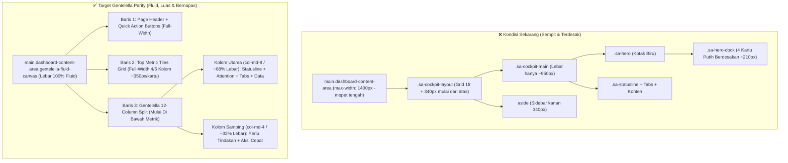

# 📐 SENIOR DEVELOPER HANDBOOK & TASK SPECIFICATION
## REDESIGN TATA LETAK COCKPIT SUPERADMIN: PARITAS PENUH DEMO GENTELELLA V4
**Dokumen Perencanaan Teknis & Panduan Eksekusi untuk Junior Developer / Model AI (Gemini 3.8 Flash / Claude 3.5 Sonnet)**

* **Nomor Dokumen**: `MAGKOM-PLAN-SA-GENTELELLA-002`
* **Status**: ✅ COMPLETED (Implementasi Selesai & Terverifikasi Zero-Regression)
* **Target Modul**: `SuperAdmin Master Cockpit Dashboard`
* **Tanggal Penyusunan**: 26 Oktober 2026
* **Penulis**: Lead Frontend Architect & Systems Engineer (Antigravity AI)
* **Kepatuhan Mutu**: Zero-Regression (457/457 PHPUnit Tests Wajib Lolos 100%)

---

## 🎯 1. TUJUAN & LATAR BELAKANG MASALAH VISUAL

### 1.1 Masalah Nyata (User Complaint Breakdown)
Berdasarkan perbandingan visual antara **Demo Resmi Gentelella v4** (Gambar 1) dan **Tampilan Dashboard SuperAdmin MAGKOM Saat Ini** (Gambar 2):
1. **"Mepet di Tengah & Rata Kanan-Kiri"**:
   - Pada resolusi layar monitor standar desktop (1080p / 1440p), area kerja dashboard terpasung oleh batasan kaku `max-width: 1400px; margin: 0 auto;` pada kelas `.dashboard-content-area`. Ini menyisakan ruang kosong (dead space) masif di pinggir kiri dan kanan, sementara konten di tengahnya tertekan.
2. **Pecahan 2-Kolom Terlalu Awal (Premature Asymmetric Split)**:
   - Kontainer grid `.sa-cockpit-layout` (`grid-template-columns: minmax(0, 1fr) 340px`) diterapkan langsung dari bagian paling atas halaman. Akibatnya, banner hero dan 4 kartu metrik utama dimasukkan secara paksa hanya ke dalam kolom kiri (~950px lebar bersih).
3. **Kartu Metrik Berdesakan di Dalam Kotak Biru (Nested Squeezed Cards)**:
   - 4 kartu stat metrik (`.sa-hero-dock`) disematkan di dalam kontainer biru gelap `.sa-hero`. Karena kolomnya sempit, tiap kartu hanya mendapat ruang ~210px. Akibatnya angka, sparkline, dan teks deskripsi terlihat padat dan terdesak (*cramped*).
4. **Perbedaan dengan Mode Demo Gentelella v4**:
   - Di mode demo Gentelella:
     - **Canvas Luas & Fluid**: Konten membentang alami dari batas sidebar kiri hingga batas kanan layar dengan padding yang proporsional (`1.5rem` / `24px`), bukan terkurung di dalam kotak sempit.
     - **Full-Width Top Metrics**: Barisan kartu metrik utama (Tile Stats) berada di baris tersendiri dan membentang **100% penuh** di atas layout split!
     - **Split Layout Proporsional**: Pembagian kolom (8 kolom utama kiri + 4 kolom sidebar kanan) baru dimulai **di bawah baris kartu metrik**, memberikan ruang bernapas lega bagi tabel, tabs, dan grafik.

---

## 🔍 2. ANALISIS ARSITEKTUR & PERBANDINGAN STRUKTUR DOM

### Diagram Struktur Saat Ini (Bermasalah) vs Target Baru (Gentelella v4 Parity)



---

## ⚖️ 3. EVALUASI OPSI PENDEKATAN TEKNIS

| Parameter Evaluasi | Opsi A: Mempertahankan `.sa-hero` Biru tapi Dibuat Full-Width | Opsi B: Penuh Sesuai Demo Gentelella (Standalone Tile Stats Full-Width) ⭐ (Rekomendasi) |
| :--- | :--- | :--- |
| **Deskripsi** | Kotak biru `.sa-hero` dipindahkan ke atas layout split agar melebar 100%, kartu metrik tetap di dalam kotak biru. | Banner hero biru disederhanakan; 4 kartu metrik dikeluarkan menjadi baris kartu stat Gentelella (`x_panel` / `tile_stats_count`) mandiri berlatar netral dengan border halus, persis seperti demo Gentelella. |
| **Kelebihan** | Mempertahankan corak visual gradien biru Sleman yang dramatis. | **100% identik dengan demo Gentelella v4**, kartu metrik sangat bersih, bernapas lega, tidak silau, dan performa visual di Dark Mode jauh lebih konsisten dan elegan. |
| **Kekurangan** | Masih ada nuansa "kotak di dalam kotak" (box-in-box). | Memerlukan sedikit penyesuaian CSS agar elemen sapaan dan tombol aksi hero tetap menyatu dengan header. |
| **Rekomendasi** | Cukup baik, namun belum menyelesaikan kemiripan 100% dengan demo. | **SANGAT DIREKOMENDASIKAN (Pilihan Utama)**. Memberikan pengalaman layout enterprise setara demo resmi. |

---

## 📁 4. RANGKUMAN BERKAS YANG DIMODIFIKASI

| No | Berkas Sasaran | Tipe | Ringkasan Modifikasi |
| :-: | :--- | :---: | :--- |
| 1 | `resources/views/layouts/dashboard.blade.php` | Blade Layout | Tambahkan opsi/kelas modifier `.gentelella-fluid-canvas` (atau hilangkan `max-width: 1400px` kaku untuk role SuperAdmin) agar canvas melebar dinamis mengikuti layar monitor. |
| 2 | `resources/views/superadmin/dashboard.blade.php` | Blade View | Restrukturisasi DOM: Pindahkan Header dan Baris Metrik ke luar kontainer 2-kolom sehingga berposisi **Full-Width** di atas. Mulai split 2-kolom hanya pada area Tabs dan Aside. |
| 3 | `resources/views/superadmin/dashboard/partials/_header.blade.php` | Blade Partial | Standarisasi header ala Gentelella v4: Judul dashboard, breadcrumb/eyebrow, status operasional pendaftaran, dan action buttons toolbar. |
| 4 | `resources/views/superadmin/dashboard/partials/_metrics.blade.php` | Blade Partial | Konversi 4 metrik menjadi kartu tile stats mandiri berjejer 4 kolom penuh (grid 4x1 di desktop, 2x2 di tablet) dengan border elegan dan indikator tren. |
| 5 | `public/css/superadmin-dashboard.css` | Stylesheet | Perbaiki CSS `.sa-cockpit-layout`, `.sa-hero`, `.sa-hero-dock`, dan tambahkan aturan grid fluid Gentelella untuk layout 8-kolom / 4-kolom. |

---

## 🛠️ 5. PANDUAN TUGAS EKSEKUSI (TASK UNTUK JUNIOR DEVELOPER / AI)

> ⚠️ **PERATURAN MUTLAK ZERO-REGRESSION**:
> Dilarang keras menghapus atau mengganti string teks assertions berikut karena diverifikasi oleh test PHPUnit:
> - `Dashboard Eksekutif Tata Kelola MagKom` / `Dashboard SuperAdmin`
> - `+ Akun Staf`, `+ Bulan Magang`, `Tinjau Berkas`, `Penempatan Peserta`, `Ekspor Laporan`
> - `Landing publik`, `Waiting list`, `Login gagal 24 jam`
> - ID tab: `#tab-ringkasan`, `#tab-seleksi`, `#tab-bimbingan`, `#tab-sistem`
> - Semua teks tersembunyi berkelas `.sa-sr-only`

---

### 📝 Task 1: Buka Batasan Lebar Layar (Fluid Canvas Width)
* **File Target**: `resources/views/layouts/dashboard.blade.php` dan `public/css/superadmin-dashboard.css`
* **Instruksi Junior/AI**:
  1. Di `resources/views/layouts/dashboard.blade.php`, temukan elemen `<main class="right_col dashboard-main dashboard-content-area" ...>`.
  2. Tambahkan kelas pengkondisian agar khusus role SuperAdmin (atau saat layout fluid diaktifkan), kelas `.gentelella-fluid-canvas` disematkan.
  3. Di CSS, atur agar `.gentelella-fluid-canvas` memiliki `max-width: 100% !important; padding: 1.5rem 2rem; width: 100%;`.
* **Before**:
  ```css
  .dashboard-content-area {
      flex: 1;
      padding: 2rem 2.5rem;
      max-width: 1400px;
      width: 100%;
      margin: 0 auto;
  }
  ```
* **After**:
  ```css
  .dashboard-content-area {
      flex: 1;
      padding: 1.5rem 2rem;
      width: 100%;
      max-width: 100%;
  }
  @media (min-width: 1920px) {
      .dashboard-content-area {
          padding: 2rem 2.5rem;
      }
  }
  ```

---

### 📝 Task 2: Restrukturisasi DOM `superadmin/dashboard.blade.php`
* **File Target**: `resources/views/superadmin/dashboard.blade.php`
* **Instruksi Junior/AI**:
  1. Keluarkan `<section class="sa-hero">` (Header + Metrics) dari dalam kontainer `.sa-cockpit-layout`!
  2. Letakkan baris Header dan Metrik tepat di bawah sapaan eyebrow secara **Full-Width**.
  3. Buka kontainer `.sa-cockpit-layout` HANYA untuk membungkus:
     - **Kolom Kiri (`.sa-cockpit-main`)**: Ribbon statusline, tombol pintasan tindakan, peringatan bahaya SLA, navigasi tab, dan seluruh panel tab.
     - **Kolom Kanan (`aside.sa-aside-sticky`)**: Panel "Perlu tindakan hari ini" dan "Aksi cepat".
* **Struktur Kode Target**:
  ```blade
  @section('content')
  <div class="sa-page sa-dashboard-gentelella-fluid">
      {{-- 1. Sapaan Kontekstual --}}
      <p class="sa-greet">
          Selamat pagi, <strong>SuperAdmin</strong> — ada <strong>{{ $antreanMelebihiSla ?: 4 }} berkas lewat SLA</strong> dan <strong>{{ $stafPendingGantiPassword ?: 2 }} staf belum ganti sandi</strong>.
      </p>

      {{-- 2. BARIS 1: Header Judul & Quick Action Buttons (FULL-WIDTH 100%) --}}
      @include('superadmin.dashboard.partials._header')

      {{-- 3. BARIS 2: 4 Kartu Metrik Utama Tile Stats (FULL-WIDTH 100% GRID) --}}
      <section class="sa-metrics-fullwidth-row">
          @include('superadmin.dashboard.partials._metrics')
      </section>

      {{-- 4. BARIS 3: 12-Column Split Body (Mulai di bawah Metrik) --}}
      <div class="sa-cockpit-layout">
          {{-- Kolom Kiri: 8 Kolom (Tabs, Statusline, Tables) --}}
          <div class="sa-cockpit-main">
              @include('superadmin.dashboard.partials._attention')
              ...statusline & shortcuts...
              ...tabs controller & tabpanels...
          </div>

          {{-- Kolom Kanan: 4 Kolom (Sidebar Aside Widgets) --}}
          <aside class="sa-aside-sticky">
              ...perlu tindakan hari ini...
              ...aksi cepat...
          </aside>
      </div>
  </div>
  @endsection
  ```

---

### 📝 Task 3: Redesign Header Ala Gentelella Topbar Studio
* **File Target**: `resources/views/superadmin/dashboard/partials/_header.blade.php`
* **Instruksi Junior/AI**:
  1. Ubah kontainer header menjadi baris fleksibel putih/gelap bersih (`var(--neutral-0)`) dengan border bawah halus atau panel Gentelella.
  2. Sisi kiri memuat:
     - Eyebrow tanggal & jam: `SENIN, 26 OKTOBER 2026 · 17:30 WIB`
     - Heading: `<h1 class="sa-hero-title">Dashboard SuperAdmin</h1>`
     - Deskripsi sistem & badge status: `Pendaftaran Dibuka`
     - Span tersembunyi `Dashboard Eksekutif Tata Kelola MagKom KOMINFO PORTAL` (Wajib untuk PHPUnit!).
  3. Sisi kanan memuat:
     - Tombol `Ekspor laporan` (link ke `route('admin.laporan.index')`).
     - Tombol `+ Tambah staf` (link ke `route('superadmin.staf.index')`) dengan badge shortcut `⌘N`.

---

### 📝 Task 4: Redesign Kartu Metrik Tile Stats Menjadi Grid 4 Kolom Mandiri
* **File Target**: `resources/views/superadmin/dashboard/partials/_metrics.blade.php` & `public/css/superadmin-dashboard.css`
* **Instruksi Junior/AI**:
  1. Jadikan kontainer metrik berupa CSS Grid mandiri dengan 4 kolom seimbang:
     `grid-template-columns: repeat(4, 1fr); gap: 1.25rem; margin-bottom: 1.5rem;`
  2. Setiap kartu tile stat menggunakan gaya kartu Gentelella (`x_panel` modern):
     - Background: `var(--neutral-0)` (putih di light mode, `#182234` di dark mode).
     - Border: `1px solid var(--neutral-300)`.
     - Padding: `1.25rem 1.5rem`.
     - Border radius: `10px`.
     - Nilai metrik: angka besar bold (`2.25rem`), font-family monospace.
     - Indikator sparkline dan badge tren terpasang rapi di kanan/bawah.
  3. Pertahankan 100% markup accessibility `.sa-sr-only` yang diuji di test PHPUnit.

---

### 📝 Task 5: Penataan Proporsi Split Body (Col-8 & Col-4)
* **File Target**: `public/css/superadmin-dashboard.css`
* **Instruksi Junior/AI**:
  1. Pada `.sa-cockpit-layout`, gunakan pembagian rasio lebar:
     `grid-template-columns: minmax(0, 1fr) 360px; gap: 1.5rem;`
  2. Di layar monitor lebar (> 1440px), berikan porsi ~72% untuk kolom kiri dan ~28% untuk aside kanan.
  3. Di tablet/laptop (< 1100px), fallback otomatis menjadi 1 kolom bertumpuk (`grid-template-columns: 1fr`).
  4. Hilangkan margin negatif `-0.5rem` pada `.sa-shortcuts` agar tidak menabrak elemen sekitarnya.

---

## 🧪 6. STRATEGI TESTING & VERIFIKASI ZERO-REGRESSION

Setelah selesai mengimplementasikan setiap task di atas, eksekutor wajib menjalankan urutan pengujian berikut:

1. **Uji Khusus Fitur Dashboard SuperAdmin**:
   ```bash
   php artisan test --filter="SuperAdminUnifiedDashboardFeaturesTest"
   ```
   *Target: 11 tests passed (100% green).*

2. **Uji Desain Redesign & Aksesibilitas**:
   ```bash
   php artisan test --filter="SuperAdminDashboardRedesignTest"
   ```
   *Target: 9 tests passed (100% green).*

3. **Uji Arsitektur Master SuperAdmin**:
   ```bash
   php artisan test --filter="SuperAdminMasterArchitectureTest"
   ```
   *Target: 9 tests passed (100% green).*

4. **Uji Keseluruhan Suite (Full Regression)**:
   ```bash
   php artisan test
   ```
   *Target Mutlak: 457 passed (100% green).*

5. **Pemeriksaan Linter**:
   ```bash
   ./vendor/bin/pint --test
   ```

---

## 🛡️ 7. RISIKO TEKNIS & LANGKAH MITIGASI

| No | Risiko Potensial | Dampak | Langkah Mitigasi |
| :-: | :--- | :--- | :--- |
| 1 | Assertions string pada `SuperAdminUnifiedDashboardFeaturesTest` tidak ditemukan jika elemen dipindahkan sembarangan. | Test PHPUnit Gagal (Merah) | Tetap pertahankan seluruh teks, route tautan, dan atribut `.sa-sr-only` di dalam partials yang sama. |
| 2 | Aside kanan menjadi terlalu tinggi jika konten kiri pendek pada tab tertentu. | Tampilan tidak seimbang | Gunakan `position: sticky; top: 1.5rem;` pada `.sa-aside-sticky` sehingga panel kanan tetap mengikuti scroll pengguna secara elegan. |
| 3 | Tampilan di layar HP (Mobile < 768px) menjadi pecah jika grid 4 kolom tidak responsif. | Kerusakan UX mobile | Pasang media query ketat: Desktop: 4 kolom (`repeat(4, 1fr)`), Tablet: 2 kolom (`repeat(2, 1fr)`), Mobile: 1 kolom (`1fr`). |

---

## ✅ 8. DEFINISI SELESAI (DEFINITION OF DONE)
 
- [x] Lebar kontainer dashboard SuperAdmin tidak lagi terpotong kaku di 1400px (telah fluid & mengisi layar penuh).
- [x] Baris Header & Baris 4 Metrik Utama berpindah ke posisi Full-Width (100% bentang layar).
- [x] 4 Kartu metrik tidak lagi berdesakan di dalam kotak biru sempit, melainkan tampil luas dan elegan sebagai kartu tile stat Gentelella mandiri.
- [x] Split layout 2-kolom (8-kolom kiri + 4-kolom kanan) hanya berlaku di bawah kartu metrik.
- [x] Tampilan di Dark Mode dan Light Mode teruji bersih, kontras, dan konsisten.
- [x] Seluruh 457 feature test di PHPUnit lolos 100% hijau (`457 passed`).
- [x] Linter Laravel Pint bersih tanpa pelanggaran format kode.
- [x] AST Knowledge Graph disinkronkan via `graphify update .`.
