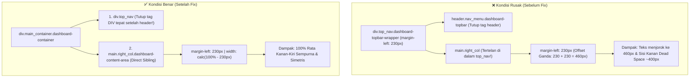

# 📋 Senior Developer Technical Directive & PRD
## Task Refactor: Rata Kanan-Kiri Fluid Layout SuperAdmin & Pembersihan Sidebar Status

- **Author**: Senior Lead Developer (Antigravity Architecture Team)
- **Assignee**: Junior Developer / AI Model (Gemini 3.8 Flash / Autonomous Agent)
- **Status**: Ready for Implementation (Draft Plan)
- **Date**: 27 Oktober 2026
- **Target Subsystem**: Master Layout & Seluruh View SuperAdmin MagKom

---

## 🎯 1. Ringkasan Eksekutif & Objektif Tugas

Dokumen ini disusun sebagai panduan teknis operasional (Actionable Technical Directive) yang presisi, mudah dipahami, dan langsung dapat dieksekusi tanpa kebingungan bagi Junior Developer atau model AI.

### Masalah yang Ditemukan (Current Problem):
1. **Layout Masih Belum "Rata Kanan-Kiri" (Double Offset & Dead Space Masif)**:
   - Pada monitor desktop (1080p / 1440p / 4K), konten dashboard SuperAdmin bergeser terlalu jauh ke kanan pada titik `x = 460px` (bukan di samping sidebar `x = 230px`), dan menyisakan ruang kosong abu-abu mati (*dead space*) selebar ~400px–600px di sisi kanan layar.
   - **Akar Penyebab Fatal**: Pada file master layout [`resources/views/layouts/dashboard.blade.php`](file:///g:/MAGKOM/resources/views/layouts/dashboard.blade.php), tag pembungkus `<div class="top_nav dashboard-topbar-wrapper">` (baris 2961) **TIDAK DITUTUP** sebelum elemen `<main>`. Akibatnya, browser menganggap `<main>` berada di dalam topbar! Karena topbar memiliki `margin-left: 230px` dan `<main>` juga memiliki `margin-left: 230px`, terjadi penumpukan margin ganda `230px + 230px = 460px` yang menjepit seluruh halaman SuperAdmin ke tengah.
2. **Elemen Tidak Diinginkan di Sidebar Kiri**:
   - Di bagian bawah sidebar navigasi terdapat kotak status hijau dengan tulisan `• Sistem internal Kominfo` yang diminta untuk dihapus sepenuhnya.
3. **Inkistensi Lebar Konten di Sub-Modul SuperAdmin**:
   - Beberapa halaman sub-modul SuperAdmin (seperti Arsip, Pengaturan, Profil) masih terkunci oleh inline style `max-width: 1080px/1280px; margin: 0 auto;`, sehingga tidak rata kanan-kiri.

### Sasaran Akhir (Target State):
- Seluruh tampilan modul SuperAdmin (Dashboard, Modul Operasional, Modul Sistem, dan Akun) membentang penuh 100% (*fluid edge-to-edge* / rata kanan-kiri) dari batas sidebar (`x = 230px`) hingga ujung kanan layar (`100vw`) dengan padding standar `1.5rem 2rem`.
- Kotak status `• Sistem internal Kominfo` di sidebar kiri bersih dan terhapus tanpa merusak navigasi lainnya.

---

## 🔍 2. Akar Masalah Teknis (Deep Root-Cause Analysis)



---

## 🛠️ 3. Rencana Kerja Eksekusi (Step-by-Step Action Plan)

### Task 1: Perbaiki Penutupan Tag `<div class="top_nav">` di Master Layout
- **File Target**: [`resources/views/layouts/dashboard.blade.php`](file:///g:/MAGKOM/resources/views/layouts/dashboard.blade.php)
- **Lokasi Baris**: Sekitar baris 3105–3108
- **Instruksi**:
  Tutup tag `</div>` untuk `.top_nav` segera setelah penutup tag `</header>`, sebelum elemen `<main>` dimulai.

```diff
                      </div>
                  </div>
              </header>
+         </div>
  
          <!-- Container Konten Dinamis (Gentelella right_col) -->
          <main class="right_col dashboard-main dashboard-content-area {{ $isSuperAdmin ? 'gentelella-fluid-canvas' : '' }} @yield('content_area_class')" role="main" id="mainContent">
```

> **Catatan Penting**: Karena kita menambahkan satu `</div>` penutup di atas, pastikan tag `</div>` penutup di akhir layout (baris 3176-3177) tetap seimbang:
> Tag pembuka:
> 1. `<div class="container body">`
> 2. `<div class="main_container dashboard-container">`
> 3. `<div class="top_nav dashboard-topbar-wrapper">` &rarr; ditutup di baris 3106!
> 4. `<main ...>` &rarr; ditutup di baris 3165 (`</main>`).
> 5. `<footer ...>` &rarr; ditutup di baris 3175 (`</footer>`).
> 6. Di bawah footer terdapat 2 penutup `</div>`: satu menutup `.main_container` dan satu menutup `.container.body`.

---

### Task 2: Hapus Tampilan "Sistem internal Kominfo" di Sidebar Kiri
- **File Target**: [`resources/views/layouts/dashboard.blade.php`](file:///g:/MAGKOM/resources/views/layouts/dashboard.blade.php)
- **Lokasi Baris**: Baris 2935–2940
- **Instruksi**:
  Hapus blok HTML `.sidebar-status-box` berikut secara bersih:

```diff
-                 <!-- Status Box: Indikator Sistem Internal Kominfo (Figma Node 560-24892) -->
-                 <div class="sidebar-status-box" style="margin: 0.5rem 0.75rem 0.25rem; padding: 0.4rem 0.6rem; display: flex; align-items: center; gap: 0.5rem; background: rgba(255, 255, 255, 0.06); border: 1px solid rgba(255, 255, 255, 0.12); border-radius: 8px;">
-                     <span class="status-dot-pulse"></span>
-                     <span style="font-size: 0.75rem; font-weight: 500; color: rgba(255, 255, 255, 0.85); letter-spacing: 0.01em;">Sistem internal Kominfo</span>
-                 </div>
```

---

### Task 3: Normalisasi CSS Fluid Engine & Pembersihan Inline `max-width`

#### 3.1 Pastikan CSS Fluid Master Layout Konsisten
Di [`resources/views/layouts/dashboard.blade.php`](file:///g:/MAGKOM/resources/views/layouts/dashboard.blade.php#L1190-L1225):
```css
/* Dashboard Canvas: Fluid 100% untuk SuperAdmin */
body.role-superadmin .dashboard-content-area,
body.gentelella-fluid-body .dashboard-content-area,
.dashboard-content-area.gentelella-fluid-canvas {
    max-width: none !important;
    width: calc(100% - var(--sidebar-width)) !important;
    margin-left: var(--sidebar-width) !important;
    margin-right: 0 !important;
    margin-top: 0 !important;
    margin-bottom: 0 !important;
    padding: 1.5rem 2rem !important;
    box-sizing: border-box !important;
}
```

#### 3.2 Pembersihan Inline Style `max-width` pada Sub-Modul SuperAdmin
Periksa dan netralisir elemen pembungkus di modul berikut agar tidak membatasi lebar layout:
1. **[`resources/views/superadmin/arsip/show.blade.php`](file:///g:/MAGKOM/resources/views/superadmin/arsip/show.blade.php#L48)**:
   - Ganti `max-width: 1280px; margin: 0 auto;` menjadi `max-width: 100%; margin: 0;`.
2. **[`resources/views/superadmin/pengaturan/index.blade.php`](file:///g:/MAGKOM/resources/views/superadmin/pengaturan/index.blade.php#L84)**:
   - Ganti `max-width: 1080px;` menjadi `max-width: 100%;`.
3. **[`resources/views/superadmin/profil/show.blade.php`](file:///g:/MAGKOM/resources/views/superadmin/profil/show.blade.php#L275)**:
   - Ganti `max-width: 1240px;` menjadi `max-width: 100%;`.

---

## 🧪 4. Kriteria Keberhasilan & Validasi (Definition of Done)

| No | Pengujian | Lokasi Cek | Kriteria Lolos (Pass) |
|---|---|---|---|
| 1 | **Sidebar Statusline** | Sidebar Bawah | Tulisan `Sistem internal Kominfo` dan indikator hijau tidak lagi tampil. |
| 2 | **Offset Awal Konten** | Elemen `<main>` | `main.getBoundingClientRect().left === 230` (tepat di tepi kanan sidebar pada layar desktop). |
| 3 | **Lebar Konten Penuh** | Elemen `<main>` | `main.getBoundingClientRect().right === window.innerWidth` (menyentuh tepi kanan layar tanpa dead space). |
| 4 | **Banner & Metrik SuperAdmin** | `.sa-hero`, `.sa-metrics-row` | Membentang proporsional dari kiri ke kanan dengan padding `2rem` simetris. |
| 5 | **Sub-Modul SuperAdmin** | Pengaturan, Staf, Role, Modul Builder, Arsip | Semua halaman konsisten melebar penuh (rata kanan-kiri). |

---

## ⚡ 5. Perintah Pasca-Implementasi
Setelah kode diubah, junior dev atau AI eksekutor **WAJIB** menjalankan:
```powershell
php artisan view:clear
php artisan config:clear
```
Lalu minta pengguna melakukan **Hard Refresh (`Ctrl + F5`)** di peramban web.
