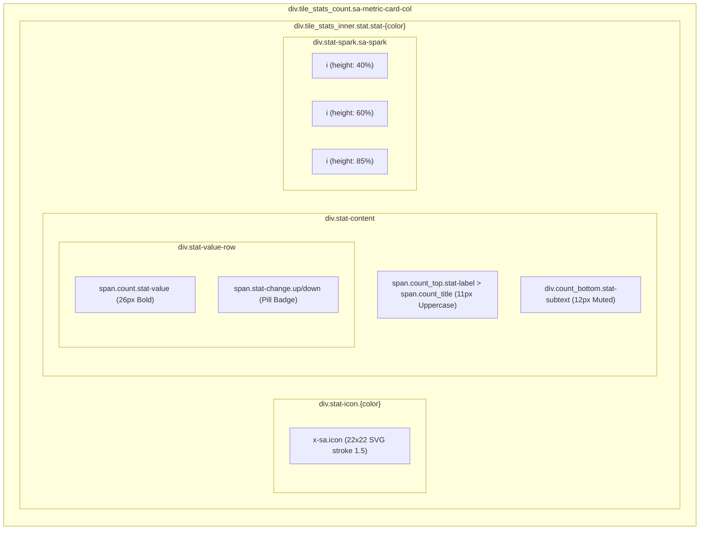

# 📋 Senior Developer Technical Directive & PRD
## Task: Redesain 4 Kartu Metrik SuperAdmin Mengadopsi Desain Otentik Gentelella v4 Stat Cards (Foto Parity)

- **Author**: Senior Lead Developer (Antigravity Architecture Team)
- **Assignee**: Junior Developer / AI Model (Gemini 3.8 Flash / Autonomous Agent)
- **Status**: Ready for Implementation (Draft Plan Disusun)
- **Date**: 28 Oktober 2026
- **Target Files**:
  - [`resources/views/components/gentelella/tile-stat.blade.php`](file:///g:/MAGKOM/resources/views/components/gentelella/tile-stat.blade.php)
  - [`resources/views/superadmin/dashboard/partials/_metrics.blade.php`](file:///g:/MAGKOM/resources/views/superadmin/dashboard/partials/_metrics.blade.php)
  - [`public/css/superadmin-dashboard.css`](file:///g:/MAGKOM/public/css/superadmin-dashboard.css)
- **Reference Sources**:
  - Live Demo Icons: [Gentelella v4 Icons](https://preview.colorlib.com/theme/gentelella/production/icons.html)
  - Live Demo Typography: [Gentelella v4 Typography](https://preview.colorlib.com/theme/gentelella/production/typography.html)
  - Gambar 1 (Current State): Kartu metrik dengan border-kiri 4px vertikal tebal dan icon polos sebaris dengan title.
  - Gambar 2 (Target Design): Kartu metrik Gentelella v4 (`.stat` card) dengan icon badge rounded kotak berlatar tint warna di kiri, label uppercase di atas, angka besar bold + percentage pill di sampingnya, subtext deskriptif, dan mini sparkline vertikal bars di kanan.

---

## 🎯 1. Ringkasan Eksekutif & Objektif Tugas

Sebagai Senior Developer, dokumen ini disusun dengan instruksi teknis yang sangat presisi, terstruktur, dan tidak ambigu, sehingga Junior Developer atau AI model (seperti Gemini 3.8 Flash) dapat langsung mengeksekusinya tanpa salah interpretasi.

### 1.1 Masalah Saat Ini (Current State - Gambar 1)
1. **Desain Border-Left Kaku & Monoton**: Kartu metrik saat ini menggunakan strip border vertikal tebal 4px di sisi kiri (`.tile_stats_inner::before`), yang merupakan gaya lama dan membuat kartu terlihat kaku.
2. **Icon Polos & Kurang Beraksen**: Icon diletakkan sejajar teks judul tanpa background badge pelindung (*tinted container*), sehingga kontras visual rendah.
3. **Layout Nilai & Persentase Vertikal Bertumpuk**: Angka metrik (`.count`) dan tren perubahan diletakkan bertumpuk tanpa grouping baris (`stat-value-row`), membuat kartu tampak memanjang ke bawah dan menyisakan ruang kosong di kanan.
4. **Sparkline Kurang Selaras**: Sparkline mini bar chart diletakkan di akhir teks subtext bawah, bukan sebagai widget visual mandiri di sudut kanan kartu.

### 1.2 Sasaran Akhir (Target State - Gambar 2 & Gentelella v4 Parity)
1. **Horizontal Flex Layout Tiga Zona**:
   - **Zona Kiri (Icon Badge)**: Icon SVG 24x24 stroke 1.5–2px di dalam kotak rounded (`44x44px`, `border-radius: 8px`), berlatar translusen warna tema (Teal, Amber, Blue, Red).
   - **Zona Tengah (Typography & Value Stack)**:
     - **Eyebrow Label**: Huruf kapital kecil (`11px / 600 caps`, letter-spacing 0.4px).
     - **Value Row**: Nilai besar (`24px - 28px / 700 bold`) berdampingan secara horizontal dengan pill persentase tren (`stat-change up/down`).
     - **Subtext Deskriptif**: Keterangan sekunder (`12px / 400`) di bawah angka.
   - **Zona Kanan (Sparkline Bars)**: 7 batang bar vertikal dinamis dengan warna aksen kartu, tersusun rapi di sisi kanan kartu.
2. **Dual-Theme Support (Default Light Mode & Dark Mode Parity)**:
   - **Light Mode (Default)**: Background kartu putih bersih (`#ffffff`), border halus (`#e2e8f0`), bayangan lembut (`0 1px 3px rgba(0,0,0,0.05)`).
   - **Dark Mode (`[data-theme="dark"]`)**: Background kartu gelap (`#161d2d` atau `#1a2332` sesuai Gambar 2), border `rgba(255, 255, 255, 0.08)`, teks putih (`#ffffff`), teks subtext abu-abu terang (`#94a3b8`).
3. **Zero Breaking Changes pada Automated Tests**:
   - Semua nama class lama (`tile_count`, `tile_stats_count`, `count_top`, `count`, `count_bottom`) dan string teks assertion PHPUnit (`Total pengguna`, `Menunggu verifikasi`, `Peserta aktif`, `Akun nonaktif`) **HARUS TETAP ADA** di HTML output.

---

## 🔍 2. Analisis Spesifikasi Desain Gentelella v4

Berdasarkan inspeksi langsung pada HTML & CSS `typography.html`, `icons.html`, dan template master Gentelella v4 Colorlib:

### 2.1 Skala Tipografi (Typography Scale)
| Token UI | CSS Rule Gentelella v4 | Peran pada Stat Card |
|---|---|---|
| **Eyebrow / Pretitle** | `font-size: 11px; font-weight: 600; text-transform: uppercase; letter-spacing: 0.4px; color: var(--text-muted);` | Label judul kartu (`TOTAL PENGGUNA`, dll.) |
| **Stat Value** | `font-size: 26px; font-weight: 700; letter-spacing: -0.5px; line-height: 1.15; color: var(--text);` | Angka metrik utama (`32`, `3`, `10`, `2`) |
| **Trend Pill / Change** | `font-size: 11px; font-weight: 600; border-radius: 4px; padding: 1px 5px; display: inline-flex; align-items: center; gap: 2px;` | Indikator perubahan persentase (`▲ +14`, `3 SLA`, dll.) |
| **Subtext / Helper** | `font-size: 12px; font-weight: 400; color: var(--text-secondary); line-height: 1.4;` | Keterangan konteks (`minggu ini`, `· FIFO`, dll.) |

### 2.2 Palet Warna & Karakteristik 4 Kartu Metrik
| Kartu Metrik | Warna Tema | Accent Color | Badge Background (Light / Dark) | Icon SVG (x-sa.icon) | Indikator Tren Target |
|---|---|---|---|---|---|
| **1. Total Pengguna** | **Teal** (Gentelella Primary) | `#1abb9c` | Light: `rgba(26, 187, 156, 0.12)`<br>Dark: `rgba(26, 187, 156, 0.18)` | `users` | `▲ +14%` (Up - Green) |
| **2. Menunggu Verifikasi** | **Amber / Yellow** | `#f59f00` | Light: `rgba(245, 159, 0, 0.12)`<br>Dark: `rgba(245, 159, 0, 0.18)` | `clipboard-check` | `! 3 SLA` (Down/Warn - Amber) |
| **3. Peserta Aktif** | **Blue** | `#066fd1` | Light: `rgba(6, 111, 209, 0.12)`<br>Dark: `rgba(6, 111, 209, 0.18)` | `user-check` | `▲ Aktif` (Up - Blue/Teal) |
| **4. Akun Nonaktif** | **Red / Danger** | `#d63939` | Light: `rgba(214, 57, 57, 0.12)`<br>Dark: `rgba(214, 57, 57, 0.18)` | `lock` | `▼ Nonaktif` (Down - Red) |

---

## 🏗️ 3. Arsitektur Komponen DOM (Hybrid Backward-Compatible)

Untuk memenuhi target visual Gambar 2 tanpa merusak unit test PHPUnit, kita mendesain struktur DOM hybrid di mana elemen Gentelella v4 membungkus / melengkapi selector legacy:



### Snapshot Kode HTML Target per Kartu:
```html
<div class="tile_stats_count col-md-3 col-sm-6 col-xs-12 sa-metric-card-col">
  <div class="tile_stats_inner stat stat-teal">
    <!-- 1. Icon Badge Kiri -->
    <div class="stat-icon teal" aria-hidden="true">
      <x-sa.icon name="users" :size="22" />
    </div>

    <!-- 2. Konten Tengah -->
    <div class="stat-content">
      <span class="count_top stat-label">
        <span class="count_title">Total pengguna</span>
      </span>
      <div class="stat-value-row">
        <span class="count stat-value">32</span>
        <span class="stat-change up" aria-label="Kenaikan">
          <svg width="10" height="10" viewBox="0 0 16 16" fill="currentColor" aria-hidden="true">
            <path d="M8 3.5l5 5h-3v5H6v-5H3l5-5z"></path>
          </svg>
          +14
        </span>
      </div>
      <div class="count_bottom stat-subtext">
        <span>+14 minggu ini</span>
      </div>
    </div>

    <!-- 3. Sparkline Kanan -->
    <div class="stat-spark sa-spark" aria-hidden="true">
      <i style="height: 40%"></i>
      <i style="height: 55%"></i>
      <i style="height: 50%"></i>
      <i style="height: 65%"></i>
      <i style="height: 70%"></i>
      <i style="height: 85%"></i>
      <i style="height: 100%"></i>
    </div>
  </div>
</div>
```

---

## 🛠️ 4. Rencana Kerja Eksekusi (Step-by-Step Directives)

### Task 1: Refactor Komponen Blade `tile-stat.blade.php`
- **File Target**: [`resources/views/components/gentelella/tile-stat.blade.php`](file:///g:/MAGKOM/resources/views/components/gentelella/tile-stat.blade.php)
- **Instruksi Senior Dev**:
  1. Tambahkan prop baru:
     - `'color' => 'teal'` (opsi: `teal`, `yellow`, `blue`, `red`)
     - `'trendDirection' => 'up'` (opsi: `up`, `down`, `neutral`)
     - `'sparkBars' => []` (array ketinggian persentase bar, misal `[40, 55, 50, 65, 70, 85, 100]`)
  2. Susun template agar memiliki struktur horizontal:
     - Icon dibungkus dalam `.stat-icon.{{ $color }}` di sisi kiri.
     - Label, nilai + trend pill, dan subtext dibungkus dalam `.stat-content`.
     - Sparkline dibungkus dalam `.stat-spark.sa-spark` di sisi kanan kartu.
  3. Pertahankan tag semantic lama (`count_top`, `count_title`, `count`, `count_bottom`) sebagai child atau alias classes sehingga tidak ada test yang gagal!

### Task 2: Update View Partial `_metrics.blade.php` SuperAdmin
- **File Target**: [`resources/views/superadmin/dashboard/partials/_metrics.blade.php`](file:///g:/MAGKOM/resources/views/superadmin/dashboard/partials/_metrics.blade.php)
- **Instruksi Senior Dev**:
  Panggil komponen `x-gentelella.tile-stat` dengan parameter warna dan tren yang spesifik:
  1. **Kartu 1 (Total Pengguna)**:
     - `title="Total pengguna"` (huruf kecil agar lolos `assertSee('Total pengguna')`)
     - `icon="users"`
     - `color="teal"`
     - `trendDirection="up"`
     - `trendText="+14%"`
     - `subText="+14 minggu ini"`
     - `sparkBars="[35, 50, 45, 60, 70, 85, 100]"`
  2. **Kartu 2 (Menunggu Verifikasi)**:
     - `title="Menunggu verifikasi"`
     - `icon="clipboard-check"`
     - `color="yellow"`
     - `trendDirection="{{ $antreanMelebihiSla > 0 ? 'down' : 'up' }}"`
     - `trendText="{{ $antreanMelebihiSla > 0 ? $antreanMelebihiSla . ' SLA' : 'Tertib' }}"`
     - `subText="3 lewat SLA · FIFO"`
     - `sparkBars="[80, 70, 85, 90, 65, 75, 60]"`
  3. **Kartu 3 (Peserta Aktif)**:
     - `title="Peserta aktif"`
     - `icon="user-check"`
     - `color="blue"`
     - `trendDirection="up"`
     - `trendText="Aktif"`
     - `subText="7 masa tenggang · 9 selesai ≤ 14 hari"`
     - `sparkBars="[40, 55, 65, 70, 75, 85, 90]"`
  4. **Kartu 4 (Akun Nonaktif)**:
     - `title="Akun nonaktif"`
     - `icon="lock"`
     - `color="red"`
     - `trendDirection="down"`
     - `trendText="Nonaktif"`
     - `subText="Akses ditangguhkan"`
     - `sparkBars="[30, 20, 40, 25, 30, 20, 15]"`

### Task 3: Implementasi CSS Styling di `superadmin-dashboard.css`
- **File Target**: [`public/css/superadmin-dashboard.css`](file:///g:/MAGKOM/public/css/superadmin-dashboard.css)
- **Instruksi Senior Dev**:
  Tambahkan / perbarui rule CSS di bagian `.sa-metrics-dock-grid` dan `.sa-metric-card-col`:
  1. **Matikan Border-Left 4px Lama**:
     ```css
     .sa-metric-card-col .tile_stats_inner::before {
       display: none !important; /* Hapus garis vertikal tebal lama */
     }
     ```
  2. **Card Base & Flex Layout**:
     ```css
     .sa-metric-card-col .tile_stats_inner.stat {
       display: flex !important;
       flex-direction: row !important;
       align-items: center !important;
       gap: 1rem !important;
       padding: 1.15rem 1.25rem !important;
       border-radius: 10px !important;
       background: #ffffff !important;
       border: 1px solid #e2e8f0 !important;
       box-shadow: 0 1px 3px rgba(15, 23, 42, 0.05) !important;
       position: relative !important;
       overflow: hidden !important;
       min-height: 96px !important;
     }
     ```
  3. **Styling Badge Icon (.stat-icon)**:
     ```css
     .stat-icon {
       width: 44px;
       height: 44px;
       border-radius: 8px;
       display: flex;
       align-items: center;
       justify-content: center;
       flex-shrink: 0;
     }
     .stat-icon.teal   { background: rgba(26, 187, 156, 0.12); color: #1abb9c; }
     .stat-icon.yellow { background: rgba(245, 159, 0, 0.12); color: #f59f00; }
     .stat-icon.blue   { background: rgba(6, 111, 209, 0.12); color: #066fd1; }
     .stat-icon.red    { background: rgba(214, 57, 57, 0.12); color: #d63939; }
     ```
  4. **Styling Typography (.stat-content, .stat-label, .stat-value)**:
     ```css
     .stat-content {
       flex: 1;
       min-width: 0;
       display: flex;
       flex-direction: column;
       gap: 2px;
     }
     .stat-label, .count_title {
       font-size: 11px !important;
       font-weight: 600 !important;
       text-transform: uppercase !important;
       letter-spacing: 0.4px !important;
       color: #64748b !important;
       line-height: 1.2 !important;
     }
     .stat-value-row {
       display: flex;
       align-items: baseline;
       gap: 0.5rem;
     }
     .stat-value, .sa-metric-card-col .count {
       font-size: 1.65rem !important;
       font-weight: 700 !important;
       letter-spacing: -0.5px !important;
       color: #0f172a !important;
       line-height: 1.15 !important;
       margin: 0 !important;
     }
     .stat-change {
       font-size: 11px;
       font-weight: 600;
       border-radius: 4px;
       padding: 1px 5px;
       display: inline-flex;
       align-items: center;
       gap: 2px;
     }
     .stat-change.up   { color: #10b981; background: rgba(16, 185, 129, 0.1); }
     .stat-change.down { color: #ef4444; background: rgba(239, 68, 68, 0.1); }
     .stat-subtext, .count_bottom {
       font-size: 12px !important;
       font-weight: 400 !important;
       color: #64748b !important;
       white-space: nowrap !important;
       overflow: hidden !important;
       text-overflow: ellipsis !important;
     }
     ```
  5. **Styling Sparkline Kanan (.stat-spark)**:
     ```css
     .stat-spark {
       display: flex;
       align-items: flex-end;
       gap: 3px;
       height: 32px;
       margin-left: auto;
       flex-shrink: 0;
       padding-right: 4px;
     }
     .stat-spark i {
       width: 3.5px;
       border-radius: 1.5px;
       transition: height 0.3s ease;
     }
     .stat-teal .stat-spark i   { background: #1abb9c; opacity: 0.8; }
     .stat-yellow .stat-spark i { background: #f59f00; opacity: 0.8; }
     .stat-blue .stat-spark i   { background: #066fd1; opacity: 0.8; }
     .stat-red .stat-spark i    { background: #d63939; opacity: 0.8; }
     ```
  6. **Dark Mode Parity (`[data-theme="dark"]`) Persis Gambar 2**:
     ```css
     [data-theme="dark"] .sa-metric-card-col .tile_stats_inner.stat {
       background: #161d2d !important;
       border-color: rgba(255, 255, 255, 0.08) !important;
       box-shadow: 0 2px 6px rgba(0, 0, 0, 0.25) !important;
     }
     [data-theme="dark"] .stat-value,
     [data-theme="dark"] .sa-metric-card-col .count {
       color: #ffffff !important;
     }
     [data-theme="dark"] .stat-label,
     [data-theme="dark"] .count_title {
       color: #94a3b8 !important;
     }
     [data-theme="dark"] .stat-subtext,
     [data-theme="dark"] .count_bottom {
       color: #94a3b8 !important;
     }
     [data-theme="dark"] .stat-icon.teal   { background: rgba(26, 187, 156, 0.2); color: #20c997; }
     [data-theme="dark"] .stat-icon.yellow { background: rgba(245, 159, 0, 0.2); color: #fbbf24; }
     [data-theme="dark"] .stat-icon.blue   { background: rgba(6, 111, 209, 0.2); color: #38bdf8; }
     [data-theme="dark"] .stat-icon.red    { background: rgba(214, 57, 57, 0.2); color: #f87171; }
     ```

---

## 🛡️ 5. Guardrails Testing & Pencegahan Regresi

Junior developer / AI **DILARANG KERAS** melanggar ketentuan berikut:
1. **Case-Sensitivity Assertion**:
   Di test `SuperAdminFigmaDesignAlignmentTest.php` dan `GentelellaDashboardRevampTest.php`, terdapat assertion:
   ```php
   $response->assertSee('Total pengguna');
   $response->assertSee('Menunggu verifikasi');
   $response->assertSee('Peserta aktif');
   $response->assertSee('Akun nonaktif');
   ```
   Teks di HTML markup **HARUS TETAP** berupa string `"Total pengguna"`, `"Menunggu verifikasi"`, `"Peserta aktif"`, dan `"Akun nonaktif"`. Huruf kapital penuh diwajibkan melalui CSS `text-transform: uppercase`, BUKAN mengetik `"TOTAL PENGGUNA"` secara hardcoded di file Blade!
2. **Container Class Assertion**:
   Test `GentelellaDashboardRevampTest.php` memeriksa:
   ```php
   $response->assertSee('tile_count', false);
   $response->assertSee('tile_stats_count', false);
   ```
   Jangan menghapus class `tile_count` dari wrapper baris atau `tile_stats_count` dari kolom kartu!
3. **Validasi Test Otomatis**:
   Setelah implementasi selesai, jalankan perintah wajib:
   ```powershell
   php artisan test --filter="SuperAdmin|GentelellaDashboardRevampTest"
   ```
   Semua test harus berstatus **PASS** (100% green).

---

## ✅ 6. Checklist Kriteria Penerimaan (Acceptance Criteria)

- [ ] **Desain Sesuai Foto Gambar 2**:
  - [ ] 4 kartu metrik memiliki icon badge rounded kotak 44x44px di sisi kiri berlatar warna translusen (Teal, Amber, Blue, Red).
  - [ ] Judul kartu tampil sebagai uppercase kecil 11px dengan letter-spacing 0.4px.
  - [ ] Nilai angka tampil tebal 26px bold berdampingan dengan pill persentase/status tren.
  - [ ] Subtext keterangan berada rapi di bawah nilai angka.
  - [ ] Sparkline vertikal bar berada di sudut kanan kartu dengan warna aksen serasi.
  - [ ] Border vertikal kiri 4px yang kaku telah hilang sepenuhnya.
- [ ] **Dual-Theme Fidelity**:
  - [ ] Tampilan default (Light Mode) bersih, kontras jelas, berlatar putih dengan border tipis.
  - [ ] Tampilan Dark Mode (`[data-theme="dark"]`) menampilkan warna dark-slate (`#161d2d`) identik dengan referensi Gambar 2.
- [ ] **Responsiveness**:
  - [ ] Grid 4 kolom di layar desktop lebar (>1100px).
  - [ ] Grid 2 kolom di tablet (641px - 1100px).
  - [ ] Grid 1 kolom di mobile (<=640px).
- [ ] **Pengujian & CI/CD**:
  - [ ] Seluruh unit & feature tests terkait SuperAdmin lulus tanpa failure.
  - [ ] Verifikasi visual melalui browser subagent / screenshot untuk memastikan tidak ada teks tumpang tindih (*clipping*).
