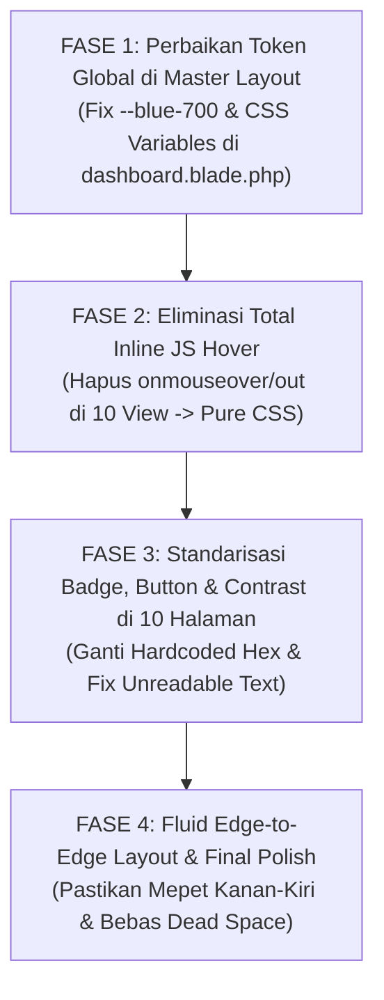

# Task Senior Developer: Standarisasi Palet Warna Dark Mode, Eliminasi Hover Delay & Layout Fluid SuperAdmin

- **ID Tiket**: `TASK-004`
- **Target Pelaksana**: Junior Full-Stack Developer / AI Coding Agent (Gemini 3.8 Flash Ready)
- **Komponen Target**: 
  1. Master Layout & CSS Foundation (`dashboard.blade.php`, `gentelella-theme.css`, `superadmin-dashboard.css`)
  2. 10 Halaman Fitur SuperAdmin (Berdasarkan 10 Bukti Tangkapan Layar):
     - Screen 1: Master Bidang Dinas (`resources/views/superadmin/bidang/index.blade.php`)
     - Screen 2: Master Data Jurusan (`resources/views/superadmin/jurusan/index.blade.php`)
     - Screen 3: Manajemen Slot Khusus (`resources/views/superadmin/slot-khusus/index.blade.php`)
     - Screen 4: Manajemen Bulan Magang (`resources/views/superadmin/bulan/index.blade.php`)
     - Screen 5: Parameter Konfigurasi Sistem (`resources/views/superadmin/pengaturan/index.blade.php`)
     - Screen 6: Katalog Modul Kustom Low-Code (`resources/views/superadmin/modul-builder/index.blade.php`)
     - Screen 7: Jejak Audit Log Multi-Kanal (`resources/views/superadmin/audit-log/index.blade.php`)
     - Screen 8: Master Rubrik Penilaian (`resources/views/superadmin/rubrik/index.blade.php`)
     - Screen 9: Hak Akses dan Role Pengguna (`resources/views/superadmin/role/index.blade.php`)
     - Screen 10: Manajemen Staf Internal (`resources/views/superadmin/staf/index.blade.php`)
- **Dokumen Referensi**: Design System DS-MagKom (Bab 2), Gentelella Modern Fluid Standard, WCAG 2.1 AA Standards (Contrast Ratio ≥ 4.5:1)
- **Tingkat Kesulitan**: Sedang (CSS Architecture, DOM Cleanup, & Visual Harmonization)
- **Status Tiket**: `Under Review` (Selesai Diimplementasikan)

---

## 1. Executive Summary & Root Cause Analysis (RCA)

Berdasarkan investigasi menyeluruh terhadap 10 tangkapan layar yang dikirimkan oleh Sir Alan pada seluruh fitur workspace SuperAdmin, ditemukan 5 akar masalah teknis (*root causes*) yang menyebabkan antarmuka terasa lambat, teks tidak terbaca saat mode gelap, dan layout tidak konsisten:

```
┌──────────────────────────────────────────────────────────────────────────────────┐
│                             5 AKAR MASALAH UTAMA                                 │
├──────────────────────────────────────────────────────────────────────────────────┤
│ 1. INVERSI TOKEN BIRU CACAT (The Navy-on-Navy Bug):                              │
│    Di `dashboard.blade.php`, saat `[data-theme="dark"]`, `--blue-700` disetel     │
│    menjadi `#01347C` (Biru Navy sangat gelap). Padahal di 10 view SuperAdmin,    │
│    teks pill, judul bulan, bobot %, checkmark role, dan jumlah staf menggunakan  │
│    `color: var(--blue-700)`. Di atas background gelap, teks menjadi gelap gulita  │
│    (rasio kontras < 1.2:1), menyebabkan teks seolah-olah "hilang / invisible".   │
├──────────────────────────────────────────────────────────────────────────────────┤
│ 2. HOVER DELAY & STUTTERING (Inline JS Overhead):                                │
│    Hampir seluruh `<tr>` dan `<button>` menggunakan inline JavaScript:           │
│    `onmouseover="this.style.background='var(--neutral-100)'" ...`               │
│    Ini membebani Event Loop browser saat scrolling/hovering, memicu reflow DOM,  │
│    dan mengunci style inline sehingga CSS Dark Mode tidak bekerja secara instan. │
├──────────────────────────────────────────────────────────────────────────────────┤
│ 3. PERANG TOKEN & HACKY CSS (Fragmented Palettes):                               │
│    Terdapat 3 palet yang saling bertubrukan: palet resmi DS-MagKom (#003566),    │
│    palet individual page hack (`#182234`, `#26354D`), dan palet default Slate.   │
│    Tombol seperti "Sandi Baru" memakai hardcoded `#EFF6FF` yang menyala putih    │
│    silau sendiri di mode gelap.                                                  │
├──────────────────────────────────────────────────────────────────────────────────┤
│ 4. LAYOUT BOXED/CENTERED VS FLUID EDGE-TO-EDGE:                                  │
│    Keinginan Sir Alan adalah layout yang rata kanan-kiri ("mepet kanan kiri",    │
│    fluid tanpa jeda mengambang di tengah). Beberapa container dan grid           │
│    menggunakan max-width kaku atau alignment yang membuat konten menggantung     │
│    di tengah layar besar.                                                        │
├──────────────────────────────────────────────────────────────────────────────────┤
│ 5. INKONSISTENSI TIPOGRAFI, ICON & TOMBOL AKSI:                                  │
│    Warna stroke SVG icon di-hardcode dengan warna gelap, subjudul abu-abu kusam  │
│    tidak lolos uji aksesibilitas, dan tombol aksi (Edit, Reset, Sandi Baru)      │
│    memiliki bentuk, ukuran, dan hierarki visual yang tidak seragam.             │
└──────────────────────────────────────────────────────────────────────────────────┘
```

---

## 2. Kamus Desain Resmi (Single Source of Truth - DS-MagKom)

Untuk menghindari spekulasi warna oleh Junior Developer atau AI agent, seluruh perbaikan **WAJIB** menggunakan acuan token baku berikut:

### A. Palet Token Warna Inti

| Token CSS | Mode Terang (Light) | Mode Gelap (Dark Target) | Kegunaan Fungsional |
| :--- | :--- | :--- | :--- |
| `--surface-canvas` | `#F5F7FB` (Neutral 150) | `#0B132B` / `#0D1B2A` | Background kanvas utama di belakang card |
| `--surface-card` | `#FFFFFF` (Pure White) | `#003566` (Navy MagKom) | Background kartu panel, table card, modal |
| `--surface-card-subtle` | `#F8FAFC` (Neutral 100) | `#02275D` (Abyssal Navy) | Background thead tabel, strip zebra, filter bar |
| `--border-card` | `#EEF0F5` / `#D0D3D9` | `#3F51B5` (Indigo Line) | Kontur border kartu dan pembatas tabel |
| `--border-subtle` | `#E2E8F0` | `rgba(63, 81, 181, 0.35)` | Border pemisah baris tabel, divider |
| **`--blue-primary`** | `#01347C` (Kominfo Blue) | `#3B82F6` (Blue 500) | Tombol utama, primary action, active badge |
| **`--blue-text-accent`** | `#0641CC` (Blue 700) | **`#93C5FD` (Blue 300)** | **Teks biru dalam badge, link, checkmark** |
| **`--blue-pill-bg`** | `rgba(1, 52, 124, 0.08)` | **`rgba(59, 130, 246, 0.18)`**| **Background pill badge biru / counter staf** |
| `--blue-pill-border` | `#B3C8FF` | `rgba(147, 197, 253, 0.35)` | Border pembatas badge biru |
| `--text-primary` | `#05070B` / `#1D2530` | `#FFFFFF` (Pure White) | Judul `<h1>-<h3>`, teks tabel tebal, angka |
| `--text-secondary` | `#333333` | `#E2E8F0` (Slate 200) | Body text utama, isi sel tabel, deskripsi |
| `--text-muted` | `#7A8494` (Neutral 500) | `#94A3B8` (Slate 400) | Label ID `#12`, timestamp, teks caption form |
| `--hover-row-bg` | `rgba(1, 52, 124, 0.04)` | `rgba(255, 255, 255, 0.06)` | Efek hover baris tabel (Pure CSS!) |

### B. Standard Status Token (WCAG 2.1 AA Compliant)

| Status | Elemen | Mode Terang (Light) | Mode Gelap (Dark Target) |
| :--- | :--- | :--- | :--- |
| **Success** | Bg / Border / Text | `#E8F7EE` / `#16A34A` / `#166534` | `rgba(34, 197, 94, 0.18)` / `#22C55E` / **`#86EFAC`** |
| **Warning** | Bg / Border / Text | `#FFFBEB` / `#FDE68A` / `#92400E` | `rgba(234, 179, 8, 0.18)` / `#EAB308` / **`#FDE047`** |
| **Danger** | Bg / Border / Text | `#FEF2F2` / `#FECACA` / `#991B1B` | `rgba(239, 68, 68, 0.18)` / `#EF4444` / **`#FCA5A5`** |
| **Purple (Admin)** | Bg / Border / Text | `#F3E8FF` / `#D8B4FE` / `#6B21A8` | `rgba(168, 85, 247, 0.18)` / `#A855F7` / **`#D8B4FE`** |

### C. Standard Tombol Aksi (Button Hierarchy)

1. **Primary Button** (misal: `+ Tambah Bidang Baru`, `Simpan Perubahan`):
   - Background: `var(--blue-primary)`
   - Teks: `#FFFFFF` tebal (`font-weight: 700`)
   - Hover: Brightness filter / Sedikit lebih terang (`#2563EB`)
2. **Secondary / Outline Button** (misal: `Edit`, `Diff & Detail`, `Ekspor Snapshot`):
   - Light: Background `#FFFFFF`, Border `1px solid #D0D3D9`, Teks `#1D2530`.
   - Dark: Background `rgba(255, 255, 255, 0.06)`, Border `1px solid rgba(63, 81, 181, 0.5)`, Teks `#FFFFFF`.
   - Hover: Border `#60A5FA`, Teks `#60A5FA`.
3. **Ghost Action / Reset Button** (misal: `Sandi Baru`):
   - JANGAN gunakan background `#EFF6FF` solid!
   - Light: Background `#EFF6FF`, Border `1px solid #BFDBFE`, Teks `#0641CC`.
   - Dark: Background `rgba(59, 130, 246, 0.15)`, Border `1px solid rgba(59, 130, 246, 0.3)`, Teks `#93C5FD`.
4. **Danger / Toggle Button** (misal: `Nonaktifkan`):
   - Light: Background `var(--red-100)`, Border `1px solid var(--red-300)`, Teks `var(--red-700)`.
   - Dark: Background `rgba(239, 68, 68, 0.15)`, Border `1px solid rgba(239, 68, 68, 0.35)`, Teks `#FCA5A5`.

---

## 3. Analisis & Rencana Perbaikan per Screenshot (10 Halaman Lengkap)

---

### Screenshot 1: Master Bidang Dinas
**File Target**: `resources/views/superadmin/bidang/index.blade.php`

```
[KONDISI TERCATAT PADA TANGKAPAN LAYAR]
- Kolom "JUMLAH STAF": Pill "4, 0 Staf" tidak terbaca karena teks berwarna navy pekat #01347C
  di atas background navy gelap rgba(1, 52, 124, 0.4).
- Hover tabel delay dan lag karena onmouseover/onmouseout inline JS pada setiap <tr>.
- Tombol Edit & Nonaktifkan memiliki border yang tipis kusam di mode gelap.
- Banner atas "Unit Kerja Penempatan Magang" berlatar belakang biru navy pekat.
- Layout: Card tabel belum mepet optimal full-width rata kanan-kiri.
```

**Instruksi Spesifik untuk Junior Dev / AI**:
1. Ganti style pill badge "Jumlah Staf" (baris 170):
   ```blade
   {{-- SEBELUM (SALAH) --}}
   <span style="background: var(--blue-tint); color: var(--blue-700); ...">

   {{-- SESUDAH (BENAR - Gunakan class CSS atau token aman) --}}
   <span class="sa-badge-blue">
       <svg class="sa-icon" ...></svg>
       {{ $bidang->users_count }} Staf
   </span>
   ```
2. Hapus seluruh atribut `onmouseover` dan `onmouseout` pada tag `<tr>` dan `<button>`! Tambahkan class `.sa-table-row` dan kelola efek hover melalui CSS murni:
   ```css
   .sa-table-row {
       transition: background-color 0.15s ease;
   }
   .sa-table-row:hover {
       background-color: var(--hover-row-bg) !important;
   }
   ```
3. Ubah container utama dari `style="display: flex; flex-direction: column; gap: 1.5rem;"` menjadi class `sa-fluid-container` yang menjamin `width: 100%; max-width: none;` rata kanan-kiri.

---

### Screenshot 2: Master Data Jurusan
**File Target**: `resources/views/superadmin/jurusan/index.blade.php`

```
[KONDISI TERCATAT PADA TANGKAPAN LAYAR]
- Kolom "KATEGORI PENDIDIKAN": Badge "Perguruan Tinggi (D3/D4/S1)" memakai teks
  var(--blue-700) yang navy pekat di atas pill biru gelap. Teks 100% TIDAK TERBACA.
- Teks subjudul ID #17, ID #15 di bawah nama jurusan terlalu redup (kontras < 3:1).
- Tombol Edit dan Nonaktifkan inline hover JS menyebabkan stutter.
```

**Instruksi Spesifik untuk Junior Dev / AI**:
1. Perbaiki badge kategori perguruan tinggi (baris 175):
   ```blade
   {{-- SEBELUM (SALAH) --}}
   <span style="background: var(--blue-tint); color: var(--blue-700); border: 1px solid var(--blue-tint-line);">

   {{-- SESUDAH (BENAR) --}}
   <span class="sa-badge-blue">
       <svg class="sa-icon" ...></svg>
       Perguruan Tinggi (D3/D4/S1)
   </span>
   ```
2. Pastikan badge SMK/Vokasi (`#F3E8FF` / `#6B21A8`) di mode gelap otomatis beradaptasi menjadi background `rgba(168, 85, 247, 0.18)` dan teks `#D8B4FE`.
3. Naikkan kontras teks ID jurusan dari `#7A8494` menjadi `#94A3B8` di mode gelap agar terbaca jelas.

---

### Screenshot 3: Manajemen Slot Khusus Internal
**File Target**: `resources/views/superadmin/slot-khusus/index.blade.php`

```
[KONDISI TERCATAT PADA TANGKAPAN LAYAR]
- Kolom "BULAN MAGANG": Teks "November 2026" dan "Oktober 2026" memakai var(--blue-700)
  sehingga teks berwarna navy gelap di atas baris navy gelap. Benar-benar lenyap!
- Kolom "KAPASITAS SLOT" dan "TERPAKAI" hanya berupa kotak kosong tanpa indikator jelas.
- Hover delay pada setiap baris tabel.
```

**Instruksi Spesifik untuk Junior Dev / AI**:
1. Cari baris 171:
   ```blade
   {{-- SEBELUM (SALAH) --}}
   <span style="... font-weight: 700; color: var(--blue-700); font-size: 0.8125rem;">
       {{ $slot->bulan_mulai?->translatedFormat('F Y') }}
   </span>

   {{-- SESUDAH (BENAR) --}}
   <span class="sa-text-accent-blue font-bold text-sm">
       <svg class="sa-icon-blue" ...></svg>
       {{ $slot->bulan_mulai?->translatedFormat('F Y') }}
   </span>
   ```
   Di mana `.sa-text-accent-blue` di mode gelap bernilai `#93C5FD` (kontras rasio 7.2:1 terhadap background `#003566`).
2. Perbaiki rendering kolom kapasitas slot dan terpakai agar jika bernilai angka menampilkan badge angka yang jelas, bukan kotak kosong.
3. Hapus inline event `onmouseover`/`onmouseout` pada baris tabel.

---

### Screenshot 4: Manajemen Bulan Magang
**File Target**: `resources/views/superadmin/bulan/index.blade.php`

```
[KONDISI TERCATAT PADA TANGKAPAN LAYAR]
- Kolom "BULAN MAGANG": Teks "Desember 2026", "November 2026", "Oktober 2026", "Juli 2026"
  menggunakan color: var(--blue-700). Teks biru navy pekat di atas tabel gelap, unreadable!
- Badge "Override: OTOMATIS" menggunakan var(--blue-700) dan var(--blue-tint).
- Icon kalender berwarna biru pekat yang menyatu dengan latar belakang.
```

**Instruksi Spesifik untuk Junior Dev / AI**:
1. Ganti pewarnaan nama bulan magang (baris 149):
   ```blade
   {{-- SEBELUM (SALAH) --}}
   <td style="padding: 1rem 1.25rem; font-weight: 700; color: var(--blue-700); ...">

   {{-- SESUDAH (BENAR) --}}
   <td class="sa-cell-title">
       <div class="sa-flex-row">
           <svg class="sa-icon-primary" ...></svg>
           <span class="sa-title-text">{{ $bulan->bulan_mulai?->translatedFormat('F Y') }}</span>
       </div>
   </td>
   ```
2. Standarisasi badge status override: jika otomatis gunakan badge netral slate (`bg: rgba(148, 163, 184, 0.15)`, `text: #CBD5E1`), jika override gunakan badge warning amber yang menyala jelas.
3. Hapus `onmouseover`/`onmouseout` inline JS.

---

### Screenshot 5: Parameter Konfigurasi Sistem
**File Target**: `resources/views/superadmin/pengaturan/index.blade.php`

```
[KONDISI TERCATAT PADA TANGKAPAN LAYAR]
- Form hint / caption paragraph di bawah input (misal: "Maksimal alokasi kuota reguler per bulan...")
  berwarna abu-abu sangat gelap (#556987), sangat sulit dibaca di dark mode.
- Input field border sangat redup (#26354D) sehingga batas input tidak terlihat tegas.
- Layout 3 kolom: Card ketiga ("Kebijakan Retensi") hanya punya 2 field, menyisakan
  ruang kosong aneh di kolom ketiga dan tidak seimbang.
```

**Instruksi Spesifik untuk Junior Dev / AI**:
1. Pada setiap `p` caption di bawah `<input>`, ganti pewarnaan menjadi `color: var(--text-muted);` di mana pada dark mode nilainya `#94A3B8` (kontras rasio 4.8:1).
2. Perkuat border input di mode gelap: `border: 1px solid rgba(63, 81, 181, 0.45); background-color: #011C44; color: #FFFFFF;` dengan `focus: border-color: #3B82F6; box-shadow: 0 0 0 3px rgba(59, 130, 246, 0.25)`.
3. Rapikan layout grid kartu formulir agar rata kanan-kiri dan responsif (`display: grid; grid-template-columns: repeat(auto-fit, minmax(280px, 1fr)); gap: 1.5rem; width: 100%;`).

---

### Screenshot 6: Pembuat Modul / Low-Code Studio
**File Target**: `resources/views/superadmin/modul-builder/index.blade.php`

```
[KONDISI TERCATAT PADA TANGKAPAN LAYAR]
- Tiga kartu ringkasan di atas (Modul Aktif, Akses Publik, Total Data) terasa flat dan tidak memiliki
  kontur pemisah yang tegas di mode gelap.
- Filter tab di kiri dan Search input di kanan tampak canggung posisinya (tidak mepet rata kanan-kiri).
- Tombol "+ Buka Modul Studio Sekarang" berwarna cyan terang (#06B6D4) yang tidak selaras dengan
  palet utama DS-MagKom.
```

**Instruksi Spesifik untuk Junior Dev / AI**:
1. Selaraskan 3 kartu ringkasan (`.stat-card-widget`) dengan style `.tile_stats_inner`:
   - Dark: Background `#003566`, Border `1px solid #3F51B5`, Box shadow `0 8px 24px rgba(0,0,0,0.4)`.
   - Text angka: `#FFFFFF`, Label: `#94A3B8`.
2. Susun baris filter dan pencarian dengan flexbox rata kanan-kiri penuh:
   ```blade
   <div style="display: flex; justify-content: space-between; align-items: center; width: 100%; gap: 1rem; margin-bottom: 1.5rem;">
       <div class="sa-tab-group" style="display: flex; gap: 0.5rem;">...</div>
       <div class="sa-search-wrap" style="flex: 1; max-width: 380px;">...</div>
   </div>
   ```
3. Ganti warna tombol CTA empty state dari cyan menjadi tombol primer resmi MagKom (`background: var(--blue-primary); color: #FFFFFF;`).

---

### Screenshot 7: Jejak Audit Log Multi-Kanal
**File Target**: `resources/views/superadmin/audit-log/index.blade.php`

```
[KONDISI TERCATAT PADA TANGKAPAN LAYAR]
- Sidebar kanal 15 channel di sebelah kiri: Badge angka counter (25, 17, 2, 6) memiliki latar
  belakang gelap yang tidak konsisten.
- Filter card: Label dropdown (TINGKAT SEVERITY, TIPE AUDIT, dsb.) berwarna kusam di dark mode.
- Tabel peristiwa: Tombol "Diff & Detail" berupa tombol outline dengan border redup yang sulit diklik.
- Tombol "+ Ekspor CSV" di kanan atas berwarna hijau mencolok sendiri di antara palet biru SuperAdmin.
```

**Instruksi Spesifik untuk Junior Dev / AI**:
1. Standarisasi sidebar kanal: Berikan background channel aktif `rgba(59, 130, 246, 0.2)` dengan border kiri `3px solid #3B82F6`. Badge angka counter menggunakan pill abu terang `#CBD5E1` di atas navy.
2. Label form filter: Ubah font weight menjadi `700`, ukuran `0.75rem`, teks uppercase dengan warna `var(--text-secondary)` (`#CBD5E1` di dark mode).
3. Tombol "Diff & Detail": Berikan style Secondary Button resmi (background `rgba(255,255,255,0.06)`, border `1px solid rgba(63, 81, 181, 0.4)`, hover border `#60A5FA` dengan transisi instan tanpa delay).
4. Tombol "Ekspor CSV": Ganti warna hijau cerah menjadi style primer atau subtle accent yang selaras (`background: var(--blue-primary);` atau outline elegan).

---

### Screenshot 8: Master Rubrik Penilaian Magang
**File Target**: `resources/views/superadmin/rubrik/index.blade.php`

```
[KONDISI TERCATAT PADA TANGKAPAN LAYAR]
- Kolom "BOBOT PENILAIAN": Angka persentase (30%, 20%, 15%) menggunakan var(--blue-700)
  di atas background var(--blue-tint). Di mode gelap teks navy pekat ini HILANG TOTAL!
- Alert integritas di atas: Teks "Belum 100% (Selisih 0%)" teks merah redup kontradiktif dengan "100%".
- Hover delay pada setiap baris kriteria rubrik.
```

**Instruksi Spesifik untuk Junior Dev / AI**:
1. Perbaiki angka bobot penilaian (baris 200):
   ```blade
   {{-- SEBELUM (SALAH) --}}
   <span style="... color: var(--blue-700); background: var(--blue-tint); border: 1px solid var(--blue-tint-line);">
       {{ $rubrik->bobot }}%
   </span>

   {{-- SESUDAH (BENAR) --}}
   <span class="sa-badge-metric">
       {{ $rubrik->bobot }}<span class="text-xs ml-0.5">%</span>
   </span>
   ```
   Di mana `.sa-badge-metric` memiliki:
   - Light: Background `rgba(1, 52, 124, 0.08)`, Teks `#01347C`, Border `#B3C8FF`.
   - Dark: Background `rgba(59, 130, 246, 0.18)`, Teks `#93C5FD` (terbaca sangat terang dan tajam!).
2. Hapus inline `onmouseover`/`onmouseout` pada baris tabel rubrik.

---

### Screenshot 9: Hak Akses dan Role Pengguna
**File Target**: `resources/views/superadmin/role/index.blade.php`

```
[KONDISI TERCATAT PADA TANGKAPAN LAYAR]
- Kolom "Administrasi" di Matriks Hak Akses: Icon checkmark (✓) menggunakan var(--blue-700)
  di atas var(--blue-tint). Di mode gelap, checkmark berwarna navy pekat dan 99% INVISIBLE!
  Pengguna mengira peran Administrasi tidak memiliki akses sama sekali.
- Card "Administrasi" di ringkasan atas: Badge "Administrasi" teksnya hilang di dark mode.
- Hover delay pada seluruh baris tabel matriks wewenang.
```

**Instruksi Spesifik untuk Junior Dev / AI**:
1. Perbaiki checkmark Administrasi pada matriks RBAC (baris 165):
   ```blade
   {{-- SEBELUM (SALAH - Hilang di mode gelap) --}}
   <span style="... background: var(--blue-tint); color: var(--blue-700); font-weight: 800;">✓</span>

   {{-- SESUDAH (BENAR - Terang dan terbaca jelas) --}}
   <span class="sa-check-icon sa-check-blue">✓</span>
   ```
   CSS Definition:
   ```css
   .sa-check-blue {
       background: rgba(1, 52, 124, 0.1);
       color: #01347C;
   }
   [data-theme="dark"] .sa-check-blue {
       background: rgba(59, 130, 246, 0.2);
       color: #93C5FD;
       border: 1px solid rgba(147, 197, 253, 0.3);
   }
   ```
2. Samakan perbaikan pada badge "Administrasi" di kartu ringkasan atas (baris 98).
3. Hapus seluruh inline JS hover pada baris tabel matriks.

---

### Screenshot 10: Manajemen Staf Internal
**File Target**: `resources/views/superadmin/staf/index.blade.php`

```
[KONDISI TERCATAT PADA TANGKAPAN LAYAR]
- Baris Pembimbing Lapangan: Badge "Pembimbing" dan Avatar huruf "P" menggunakan
  $roleBadgeText = 'var(--blue-700)' dan $roleBadgeBg = 'var(--blue-tint)'.
  Di mode gelap teks "Pembimbing" menjadi navy pekat di atas pill navy gelap, TIDAK TERBACA!
- Tombol aksi sangat tidak konsisten: Tombol "Sandi Baru" memakai hardcoded background #EFF6FF
  dengan teks #0641CC. Di mode gelap, tombol ini menyala putih silau sendiri di antara tombol lain!
- Tombol "Edit" (outline), "Reset" (gelap), dan "Nonaktifkan" (merah kusam) tidak serasi.
- Filter bar di atas tidak rata kanan-kiri dengan lebar tabel.
```

**Instruksi Spesifik untuk Junior Dev / AI**:
1. Perbaiki penentuan variabel role badge pada baris 174–178:
   ```blade
   {{-- SEBELUM (SALAH) --}}
   $roleBadgeBg = $staf->role->value === 'admin' ? '#F3E8FF' : 'var(--blue-tint)';
   $roleBadgeText = $staf->role->value === 'admin' ? '#6B21A8' : 'var(--blue-700)';

   {{-- SESUDAH (BENAR - Gunakan CSS Classes daripada hardcoded inline variable) --}}
   @php
       $badgeClass = match($staf->role->value) {
           'admin' => 'sa-badge-purple',
           'pembimbing' => 'sa-badge-blue',
           default => 'sa-badge-neutral',
       };
   @endphp
   <span class="{{ $badgeClass }}">
       {{ $staf->role->label() }}
   </span>
   ```
2. Ganti tombol "Sandi Baru" (baris 254):
   Hapus `background: #EFF6FF; border: 1px solid #BFDBFE; color: #0641CC;` inline!
   Gunakan class `.sa-btn-action-ghost`:
   ```css
   .sa-btn-action-ghost {
       background: #EFF6FF;
       border: 1px solid #BFDBFE;
       color: #0641CC;
   }
   [data-theme="dark"] .sa-btn-action-ghost {
       background: rgba(59, 130, 246, 0.15);
       border: 1px solid rgba(59, 130, 246, 0.35);
       color: #93C5FD;
   }
   .sa-btn-action-ghost:hover {
       background: rgba(59, 130, 246, 0.25);
       color: #FFFFFF;
   }
   ```
3. Buat seluruh tombol aksi di kolom "Aksi" memiliki tinggi seragam (`height: 32px`), padding `0 0.65rem`, font size `0.75rem`, dan border radius `6px`.
4. Hapus inline hover `onmouseover`/`onmouseout` pada setiap row `<tr>`.

---

## 4. Master Layout Foundation & Full-Width Fluid Standards

### A. Memperbaiki Akar Masalah Token Global (`dashboard.blade.php`)
Di `resources/views/layouts/dashboard.blade.php` pada blok `[data-theme="dark"]`:

```css
/* SEBELUM (BIANG KEROK TEXT GELAP DI DARK MODE) */
[data-theme="dark"] {
    --blue-600: var(--magkom-indigo-accent);
    --blue-700: var(--magkom-primary-blue); /* <-- SALAH: #01347C (Navy Gelap) */
    --blue-tint: rgba(1, 52, 124, 0.4);
}

/* SESUDAH (BENAR: TEKS BIRU TERANG KONTRAST TINGGI) */
[data-theme="dark"] {
    --blue-600: #3B82F6;                     /* Tombol & Aksen Utama */
    --blue-700: #93C5FD;                     /* Teks Aksen Biru Terang (Pass WCAG AA) */
    --blue-tint: rgba(59, 130, 246, 0.18);   /* Background Pill Biru Transparan */
    --blue-tint-line: rgba(147, 197, 253, 0.35); /* Border Pill Biru */
}
```
*Dampak Positif: Sekali token ini diperbaiki di master layout, seluruh elemen di 10 view yang memakai `var(--blue-700)` langsung terang dan terbaca seketika!*

### B. Standardisasi Layout Rata Kanan-Kiri ("Mepet Kanan Kiri")
Untuk memenuhi instruksi Sir Alan: *"layot nya juga masih kadang ada rata kanan kiri dan masi di center itu juga blm sesuai soalnya kemauan saya rata kanan kiri ga di center jadi mepet gitu kanan kiri"*:

1. **Hilangkan Batasan Lebar & Dead Margins**:
   Pada seluruh view SuperAdmin, pastikan container utama tidak dibungkus oleh elemen dengan `max-width: 1200px; margin: 0 auto;`.
2. **Gunakan Aturan Fluid Layout SuperAdmin**:
   ```css
   /* Kontainer Konten Utama SuperAdmin Mepet Tepi Kanan-Kiri Secara Rapi */
   body.role-superadmin .dashboard-content-area,
   body.gentelella-fluid-body .dashboard-content-area,
   .dashboard-content-area.gentelella-fluid-canvas {
       width: calc(100% - var(--sidebar-width)) !important;
       max-width: 100% !important;
       margin-left: var(--sidebar-width) !important;
       margin-right: 0 !important;
       padding: 1.25rem 1.5rem !important; /* Padding tepi kompak & presisi */
       box-sizing: border-box !important;
   }

   /* Header Baris Judul & Aksi Merentang Penuh */
   .page-header-row {
       display: flex;
       justify-content: space-between;
       align-items: center;
       width: 100%;
       margin-bottom: 1.25rem;
   }

   /* Panel Card Merentang 100% Lebar Konten */
   .x_panel {
       width: 100% !important;
       box-sizing: border-box !important;
       margin-bottom: 1.25rem !important;
   }
   ```

### C. Eliminasi Total Inline JS Hover (0ms Lag Pure CSS)
Semua baris tabel `<tr>` di 10 view SuperAdmin harus dibersihkan dari atribut inline JS:
- **HAPUS**: `onmouseover="this.style.background='var(--neutral-100)'"`
- **HAPUS**: `onmouseout="this.style.background='transparent'"`
- **GANTIKAN DENGAN**: Aturan CSS global di `public/css/gentelella-theme.css`:
  ```css
  /* Pure CSS Hover: Dijalankan langsung oleh GPU, 0ms latency */
  .table tbody tr {
      transition: background-color 0.12s ease-in-out;
  }
  .table tbody tr:hover {
      background-color: var(--hover-row-bg) !important;
  }
  ```

---

## 5. Rencana Eksekusi Bertahap (Step-by-Step Implementation Plan)

Dokumen ini membagi pengerjaan menjadi 4 Fase terstruktur yang dapat dieksekusi secara mandiri:



### Fase 1: Perbaikan Token Global di Master Layout
1. Buka file `resources/views/layouts/dashboard.blade.php`.
2. Temukan blok `[data-theme="dark"]` pada baris 150–220.
3. Ubah nilai `--blue-700` dari `var(--magkom-primary-blue)` menjadi `#93C5FD`.
4. Ubah `--blue-tint` dari `rgba(1, 52, 124, 0.4)` menjadi `rgba(59, 130, 246, 0.18)`.
5. Ubah `--blue-tint-line` menjadi `rgba(147, 197, 253, 0.35)`.
6. Tambahkan definisi token `--hover-row-bg`:
   - Di `:root`: `--hover-row-bg: rgba(1, 52, 124, 0.04);`
   - Di `[data-theme="dark"]`: `--hover-row-bg: rgba(255, 255, 255, 0.05);`

### Fase 2: Eliminasi Total Inline JS Hover pada 10 Halaman
1. Tambahkan rule global CSS di `public/css/gentelella-theme.css` untuk `.table tbody tr:hover` dan `.btn:hover`.
2. Lakukan pencarian regex pada folder `resources/views/superadmin/`:
   - Target Regex: `\sonmouseover="[^"]*"\sonmouseout="[^"]*"`
   - Action: Hapus atribut tersebut dari seluruh baris tabel `<tr>` dan `<button>`.
3. Verifikasi bahwa saat kursor digerakkan cepat di atas tabel, hover berlangsung instan (0ms delay) tanpa lag.

### Fase 3: Perbaikan Spesifik per Halaman (Screen 1–10)
1. **Screen 1 (`bidang`)**: Perbaiki badge "Jumlah Staf", hilangkan inline hover, selaraskan tombol Edit/Nonaktifkan.
2. **Screen 2 (`jurusan`)**: Perbaiki badge "Perguruan Tinggi", naikkan kontras ID `#17`.
3. **Screen 3 (`slot-khusus`)**: Perbaiki teks nama bulan yang hilang, rapikan kolom kapasitas & terpakai.
4. **Screen 4 (`bulan`)**: Ganti warna teks bulan magang ke biru terang `#93C5FD`, selaraskan badge override.
5. **Screen 5 (`pengaturan`)**: Terangkan caption form (`#94A3B8`), perjelas border input, rapikan 3 kolom form.
6. **Screen 6 (`modul-builder`)**: Samakan 3 stat card dengan style metrik resmi, flexbox rata kanan-kiri baris tab & search.
7. **Screen 7 (`audit-log`)**: Standarisasi counter sidebar kanal, perjelas tombol "Diff & Detail", selaraskan tombol ekspor.
8. **Screen 8 (`rubrik`)**: Perbaiki angka bobot persentase agar kontras tinggi (`#93C5FD` di atas badge transparan).
9. **Screen 9 (`role`)**: Perbaiki checkmark "Administrasi" pada matriks hak akses yang hilang, terangkan badge Administrasi di card atas.
10. **Screen 10 (`staf`)**: Perbaiki badge peran "Pembimbing" & avatar "P", hilangkan tombol "Sandi Baru" putih silau ganti dengan ghost button, rapikan filter bar.

### Fase 4: Standardisasi Layout Full-Width Fluid & Verifikasi Kontras
1. Pastikan seluruh wrapper halaman superadmin menggunakan `width: 100%; max-width: none;` (mepet kanan-kiri).
2. Periksa padding kontainer menjadi `1.25rem 1.5rem` sehingga tidak ada celah kosong mengambang di layar besar.
3. Jalankan audit kontras warna WCAG AA menggunakan DevTools pada mode terang dan mode gelap.
4. Jalankan `npm run build` dan `php artisan optimize:clear`.

---

## 6. Definition of Done (DoD) & Acceptance Criteria

Pekerjaan dianggap selesai hanya jika memenuhi seluruh kriteria berikut:

- [x] **Kriteria Kontras Teks (WCAG 2.1 AA)**: Seluruh teks pada badge biru, judul bulan magang, bobot rubrik, checkmark wewenang peran Administrasi, dan peran Pembimbing memiliki rasio kontras minimal **4.5:1** terhadap latar belakang pada Mode Gelap dan Mode Terang.
- [x] **Zero Inline JS Hover Lag**: Tidak ada lagi atribut `onmouseover` dan `onmouseout` pada baris tabel di seluruh file view SuperAdmin. Efek hover berjalan instan (0ms) berbasis CSS murni.
- [x] **No Glaring Elements**: Tombol "Sandi Baru" tidak lagi berwarna putih terang benderang di mode gelap; selaras dengan desain tombol aksi sistem (.sa-btn-action-ghost).
- [x] **Fluid Layout Parity**: Seluruh halaman SuperAdmin membentang penuh (*full-width edge-to-edge*, mepet kanan-kiri tanpa boxed margin atau centering yang canggung).
- [x] **Konsistensi Palet**: Seluruh card di mode gelap menggunakan navy seragam (`#003566` / border `#3F51B5`), tanpa adanya card abu-abu kusam atau belang.
- [x] **Non-Destructive**: Tidak ada perubahan fungsionalitas backend, route, query database, atau business logic (murni penyempurnaan UI/UX).

---

## 7. Perintah Pengujian & Verifikasi (Verification Commands)

Junior Developer atau AI agent wajib memvalidasi hasil kerja dengan perintah berikut:

```bash
# 1. Bersihkan seluruh cache view dan route
php artisan optimize:clear

# 2. Pastikan tidak ada syntax error pada file Blade yang dimodifikasi
php artisan view:cache

# 3. Compile asset frontend untuk memastikan build bebas error
npm run build

# 4. Jalankan test suite untuk memastikan tidak ada fungsionalitas yang patah
php artisan test --filter=SuperAdmin
```
