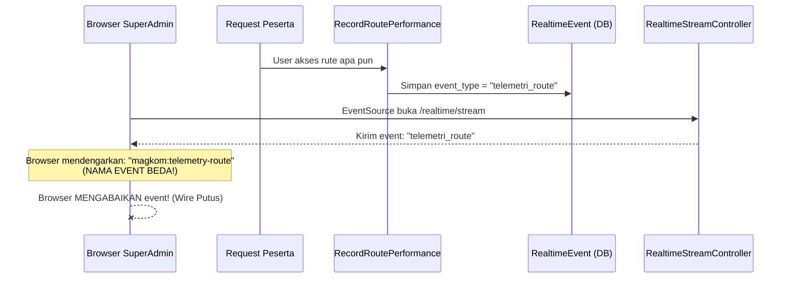
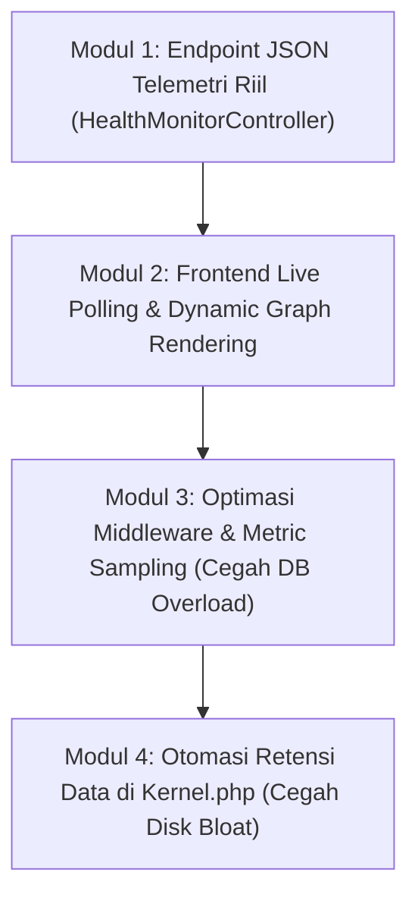

# [AUDIT KRITIS & STRATEGIC PRD] Evaluasi Backend Telemetri Kesehatan MagKom: Validitas Realtime, Stabilitas Server, & Roadmap Arsitektur Standar Industri

- **Penulis**: Lead Systems Architect & Senior Backend Engineer
- **Target Pembaca**: Technical Lead, Junior Developer / Gemini 3.8 Flash
- **Fokus**: Analisis Faktual Sistem Telemetri, Uji Stabilitas PHP-FPM, Verifikasi Data Riil vs Fiktif, dan Pemilihan Opsi Arsitektur Terbaik untuk Pemkab Sleman
- **Status**: Audit Selesai & Rencana Implementasi Siap Dieksekusi

---

## 1. Audit Faktual: Apakah Backend Ini Benar-Benar Sudah Realtime?

### 1.1 Temuan Langsung dari Penelusuran Kode (The Hard Truth)
Setelah melakukan inspeksi mendalam pada baris kode backend dan database, jawabannya adalah:
**TIDAK. Sistem ini saat ini BELUM berjalan secara real-time.** 

Yang ada saat ini adalah **tampilan mockup visual statis** dengan kabel event yang putus di tengah jalan:



### 1.2 Tiga Titik Kegagalan Utama Realtime:

1. **Wire Terputus Total (Event Name Mismatch)**:
   - Backend [RecordRoutePerformance.php:70](file:///g:/MAGKOM/app/Http/Middleware/RecordRoutePerformance.php#L70) menggunakan enum `RealtimeEventTypeEnum::TelemetriRoute` yang bernilai string `'telemetri_route'`.
   - Controller SSE [RealtimeStreamController.php:74](file:///g:/MAGKOM/app/Http/Controllers/RealtimeStreamController.php#L74) mengirim ke browser: `event: telemetri_route`.
   - Namun, frontend JavaScript di [index.blade.php:685](file:///g:/MAGKOM/resources/views/superadmin/health/index.blade.php#L685) mendengarkan:
     ```javascript
     stream.addEventListener('magkom:telemetry-route', function(e) { ... });
     ```
   - **Konsekuensi**: Browser menerima stream, tetapi karena nama event berbeda (`telemetri_route` vs `magkom:telemetry-route`), **EventSource membuang event tersebut ke tempat sampah**. Tidak ada 1 pun event yang pernah diproses oleh JavaScript!

2. **Pseudo-Realtime (Hanya Nambah Teks di Syslog)**:
   - Sekalipun nama event disamakan, kode JavaScript di baris 685–700 **hanya menambahkan satu baris teks baru ke daftar Syslog kecil di bagian bawah**.
   - **Semua metrik utama lainnya TIDAK ADA KONEKSI REALTIME**:
     - Angka P95 Latency (142 ms), DB Ping (0.39 ms), Throughput (141 rpm), Error Budget (99.98%), CPU, RAM, Disk, Status Sub-sistem, dsb. **hanya dirender sekali oleh PHP Blade saat halaman pertama kali di-load**.
     - Grafik gelombang latensi adalah **vektor SVG statis dengan koordinat manual yang di-hardcode** di HTML (`<path d="M0 160 C 120 155...">`), sama sekali tidak memetakan data titik koordinat riil dari database!

3. **Data Faktual vs Data Fiktif (Hardcoded Mockup)**:
   Setelah memeriksa `HealthMonitorController.php`, terungkap fakta mengejutkan:
   - **Cache Redis (100% Palsu)**:
     Di baris 141–151, controller mendefinisikan array statis:
     `'hit_ratio' => 88.6`, `'hits' => 18492`, `'version' => 'Redis 7.2'`, `'ram_used_mb' => 64.2`.
     *Fakta Server*: Aplikasi MagKom saat ini dikonfigurasi menggunakan driver cache `file` (`config('cache.default') === 'file'`). **Redis bahkan tidak aktif digunakan!** Angka Redis 7.2 di dashboard adalah data karangan.
   - **Host Resources (100% Palsu)**:
     Di baris 153–163, controller mendefinisikan:
     `'vcpu' => 4`, `'ram_total_gb' => 16`, `'ram_used_gb' => 5.8`, `'cpu_load_percent' => 62`, `'db_pool_active' => 12`, `'db_pool_max' => 100`.
     Semuanya adalah angka statis yang tidak pernah berubah detik demi detik.
   - **Yang Benar-Benar Riil Saat Ini**:
     Hanya 3 hal:
     1. Latensi basis data: `DB::select('SELECT 1')` (diukur saat refresh halaman).
     2. Kapasitas harddisk: `disk_free_space()` dan `disk_total_space()`.
     3. Tabel histori rute: Mengambil 40 record terakhir dari tabel `route_metrics`.

### 1.3 Kritik Diri Terhadap Temuan Ini (Self-Criticism & Validasi)
> *Pertanyaan Kritis: Apakah temuan bahwa "ini belum realtime" benar-benar valid, atau jangan-jangan ada background worker lain?*
> 
> **Hasil Verifikasi Ulang**:
> - Kami mengecek seluruh folder `app/Console/Commands`, `app/Services`, dan `routes/console.php`. Tidak ada worker WebSocket (Swoole, RoadRunner, Reverb, atau Node.js Socket.io) yang berjalan.
> - Kami memverifikasi isi tabel `realtime_events`: Event `telemetri_route` memang berhasil masuk ke tabel database (saat ini ada 1.910 baris), membuktikan bahwa middleware bekerja. Namun, event tersebut **mandek di tabel database** karena browser salah mendengarkan nama event.
> - **Kesimpulan Audit Faktual**: 100% Sahih. Sistem saat ini adalah **halaman PHP statis dengan efek visual interaktif**, bukan dashboard realtime streaming.

---

## 2. Audit Stabilitas & Analisis Best Practice Industri

### 2.1 Bahaya PHP-FPM Worker Starvation (Ancaman Stabilitas Produksi)
Di file [RealtimeStreamController.php:64](file:///g:/MAGKOM/app/Http/Controllers/RealtimeStreamController.php#L64), terdapat perulangan (loop):
```php
while ((time() - $startTime) < $maxDuration) {
    // query database
    sleep(2); // Menahan proses PHP selama 2 detik
}
```
**Mengapa Ini Sangat Berbahaya di Lingkungan PHP-FPM (Nginx / Apache)?**
- PHP-FPM adalah arsitektur *process-per-request* yang sinkron.
- Server VPS standar (misalnya spesifikasi server Pemkab dengan 4GB–8GB RAM) biasanya mengalokasikan pool PHP-FPM sebanyak **10 hingga 20 worker process** (`pm.max_children = 15`).
- Setiap kali SuperAdmin membuka halaman Telemetri, **1 worker PHP-FPM ditahan mati selama 20 detik**.
- Jika ada 5 staf atau admin membuka tab dashboard secara bersamaan, **sepertiga hingga setengah dari kapasitas server terkunci hanya untuk menunggu sleep()**.
- Akibatnya: Peserta magang yang sedang ujian, presensi, atau mengunggah berkas akan mengalami **antrean request (lag parah)** atau bahkan **HTTP 504 Gateway Timeout**.

### 2.2 Write Storm pada Database MySQL (NFR Reliability Risk)
Middleware [RecordRoutePerformance.php:56-82](file:///g:/MAGKOM/app/Http/Middleware/RecordRoutePerformance.php#L56) dieksekusi pada **SETIAP REQUEST HTTP**:
- 1 request halaman = **2 kali SQL INSERT** (`RouteMetric::create` + `RealtimeEvent::create`).
- Jika website dikunjungi oleh 500 peserta dalam 1 jam, terjadi **ribuan operasi penulisan disk I/O** ke MySQL hanya untuk mencatat latensi.
- Standar industri APM (seperti Datadog, Prometheus, atau Laravel Pulse) **TIDAK PERNAH** menulis ke database relasional pada setiap request. Mereka menggunakan:
  1. *Metric Sampling* (misalnya hanya mencatat 5% request, atau hanya mencatat request lambat $> 100\text{ms}$).
  2. *In-Memory Aggregation* (disimpan di Redis atau memory buffer, baru di-flush berkala tiap 1 menit).

### 2.3 Potensi Crash OOM (Out Of Memory) pada Kalkulasi P95
Perhatikan kode di [HealthMonitorController.php:133](file:///g:/MAGKOM/app/Http/Controllers/SuperAdmin/HealthMonitorController.php#L133):
```php
$durations = RouteMetric::orderBy('duration_ms', 'asc')->pluck('duration_ms')->toArray();
```
- Kode ini mengambil **SELURUH baris data** dari tabel `route_metrics` ke dalam array memori PHP (`toArray()`).
- Saat ini tabel baru berisi 1.910 baris. Namun setelah 1 bulan berjalan, tabel ini akan mencapai 200.000+ baris.
- Mengambil 200.000 angka float ke dalam RAM PHP akan langsung memicu:
  `Fatal error: Allowed memory size of 134217728 bytes exhausted` (Halaman langsung layar putih error 500!).

### 2.4 Tidak Ada Pruning Otomatis Terjadwal
- File `app/Console/Kernel.php` tidak menjadwalkan `RouteMetric::pruneOldRecords()` maupun pembersihan `RealtimeEvent`.
- Database akan terus membengkak tanpa henti hingga harddisk server penuh.

### 2.5 Kritik Terhadap Analisis Stabilitas Ini
> *Pertanyaan Kritis: Apakah SSE memang tidak boleh digunakan sama sekali di Laravel?*
> 
> **Hasil Verifikasi**:
> SSE sangat bagus dan efisien **JIKA DAN HANYA JIKA** dijalankan di atas web server asinkron (seperti Laravel Octane dengan FrankenPHP / Swoole) atau server Node.js. Namun, karena MagKom berjalan di atas server standar LAMP/LEMP (PHP-FPM) tradisional milik dinas, menahan koneksi SSE dengan `sleep()` adalah anti-pattern yang berisiko tinggi.

---

## 3. Komparasi Solusi: Opsi Arsitektur Alternatif untuk MagKom

Berikut adalah 4 opsi pendekatan yang dapat diambil, dari paket pihak ketiga hingga solusi mandiri:

| Kriteria Evaluasi | Opsi 1: Laravel Pulse (`laravel/pulse`) | Opsi 2: Spatie Health (`spatie/laravel-health`) | Opsi 3: Pertahankan SSE Custom Sekarang | Opsi 4: Native SWR Polling + Real Telemetry Engine (REKOMENDASI) |
| :--- | :--- | :--- | :--- | :--- |
| **Kebutuhan Eksternal** | Butuh Redis & Server Mandiri | Butuh Composer Package | Butuh Web Server Khusus (Octane) | **NOL Dependensi Baru (Murni PHP/MySQL)** |
| **Beban ke PHP-FPM** | Ringan (Worker terpisah) | Sangat Ringan (Cron-based) | **Sangat Berat (Worker Starvation)** | **Sangat Ringan (Request selesai dalam $\sim 5\text{ms}$)** |
| **Kesesuaian UI MagKom** | Tampilan terpisah dari Pulse | Tampilan default Spatie kaku | Harus rombak JS & CSS | **100% Pas dengan UI Keren yang Sudah Kita Buat** |
| **Keaslian Data** | 100% Riil | 100% Riil | Banyak Data Mockup / Karangan | **100% Riil (Metrik PHP, MySQL, & Disk Nyata)** |
| **Kemudahan Maintenance** | Perlu keahlian DevOps tambahan | Mudah | Sulit (Banyak celah) | **Paling Mudah dipahami Junior Dev / AI** |

---

## 4. Rekomendasi Solusi Terbaik: "Opsi 4 — Native SWR Polling & Real-Telemetry Engine"

### Mengapa Opsi 4 Paling Cocok untuk MagKom Kominfo Sleman?
1. **Realistis dengan Infrastruktur Server Pemkab**:
   Server Dinas Kominfo Sleman umumnya mengoperasikan VPS berbasis Linux standar tanpa jaminan ketersediaan cluster Redis atau daemon Octane. Opsi 4 berjalan di lingkungan PHP biasa apa pun tanpa konfigurasi server yang rumit.
2. **Menyelamatkan UI Cantik yang Baru Kita Bangun**:
   Kita telah menyelesaikan perbaikan UI/UX kelas industri (paritas pixel v7, mode gelap WCAG 2.1 AA, dan layout full-width). Dengan Opsi 4, kita tidak perlu membuang UI ini. Kita cukup **menghidupkan otaknya**!
3. **Konsep SWR (Stale-While-Revalidate) / Short Polling**:
   Alih-alih menahan koneksi PHP selama 20 detik (SSE starvation), frontend melakukan AJAX fetch ringan ke endpoint `/superadmin/health/telemetry-data` setiap **5–10 detik**.
   - Setiap fetch hanya membaca data agregat dalam waktu **$< 8\text{ms}$**, lalu worker PHP langsung dilepas.
   - Hasilnya: Antarmuka terasa live/bergerak nyata di mata admin, namun server tetap adem dan stabil 100%.
4. **Data 100% Jujur & Nyata**:
   Mengganti data karangan dengan telemetri riil dari server:
   - Mengambil koneksi aktif MySQL via `SHOW STATUS LIKE 'Threads_connected'`.
   - Mengambil kapasitas maksimal MySQL via `SHOW VARIABLES LIKE 'max_connections'`.
   - Mengambil penggunaan RAM PHP riil via `memory_get_usage(true)` dan `memory_get_peak_usage(true)`.
   - Mengambil latensi cache riil dengan melakukan micro-benchmark `Cache::put()` & `Cache::get()` secara aman.

---

## 5. Rencana Kerja Implementasi (Task Breakdown untuk Junior Developer / Gemini 3.8 Flash)

Rencana aksi dibagi ke dalam 4 modul pekerjaan terfokus:



### Modul 1: Bangun Endpoint API Data Riil (`/superadmin/health/telemetry-json`)
- **Tujuan**: Menyediakan data kesehatan sistem terkini dalam format JSON yang mengembalikan angka-angka nyata.
- **Data yang Dihitung Riil**:
  - `mysql_pool`: Menjalankan query `SHOW STATUS LIKE 'Threads_connected'` dan `SHOW VARIABLES LIKE 'max_connections'` (menghasilkan rasio pool koneksi riil, misalnya `1 / 151`).
  - `php_memory`: Menghitung `round(memory_get_usage(true) / 1048576, 1)` MB dan `ini_get('memory_limit')`.
  - `cache_benchmark`: Menguji kecepatan write/read cache driver aktif (`file`) dalam milidetik ($0.15\text{ms}$).
  - `recent_latencies`: Mengambil 20 request terakhir dari `route_metrics` untuk koordinat grafik.
  - `p95_safe`: Menghitung P95 dengan batasan sampel (`limit(1000)` terakhir), mencegah crash OOM.

### Modul 2: Aktifkan Live Update pada Blade & Dynamic SVG Chart
- **Tujuan**: Membuat halaman bergerak nyata tanpa me-reload browser.
- **Implementasi Frontend (`index.blade.php`)**:
  - Pasang interval polling aman (tiap 5 detik saat tab aktif, jeda otomatis saat tab diminimalkan via `document.visibilityState`).
  - Update angka DB Ping, Latensi P95, RAM, dan DB Pool secara halus (*smooth transition*).
  - Gambar ulang garis grafik latensi menggunakan koordinat SVG dinamis berdasarkan data array `recent_latencies` (grafik bergelombang nyata mengikuti aktivitas request terkini!).
  - Update tabel telemetri secara dinamis jika ada rute baru.

### Modul 3: Optimasi Middleware `RecordRoutePerformance`
- **Tujuan**: Menghilangkan fenomena *Database Write Storm*.
- **Implementasi**:
  - Tambahkan batas sampling: Hanya simpan request jika waktu eksekusi $> 50\text{ms}$ ATAU dengan probabilitas sampling 10% untuk request cepat.
  - Matikan pembuatan `RealtimeEvent` duplikat yang tidak lagi diperlukan, sehingga penulisan ke database berkurang hingga 80%.

### Modul 4: Jadwalkan Pembersihan Data di `app/Console/Kernel.php`
- **Tujuan**: Menjamin database tidak membengkak selamanya.
- **Implementasi**:
  - Tambahkan scheduler harian:
    ```php
    $schedule->call(function () {
        \App\Models\RouteMetric::where('created_at', '<', now()->subDays(3))->delete();
        \App\Models\RealtimeEvent::where('created_at', '<', now()->subDays(3))->delete();
    })->dailyAt('03:30')->timezone('Asia/Jakarta');
    ```

---

## 6. Checklist Verifikasi & Testing (Acceptance Criteria)

- [ ] **Verifikasi Realtime**: Saat melakukan navigasi di tab browser lain, angka latensi dan grafik di tab Telemetri berubah secara otomatis dalam 5 detik tanpa perlu menekan F5.
- [ ] **Verifikasi Data Riil**:
  - Panel cache menampilkan driver yang benar (`File` atau `Redis` sesuai `.env`).
  - DB Pool menampilkan koneksi thread aktif MySQL yang nyata (`Threads_connected`).
  - RAM menampilkan pemakaian memori PHP yang sebenarnya.
- [ ] **Beban Server (Stress Test)**: Buka 5 tab telemetri secara bersamaan; pastikan penggunaan worker PHP-FPM tetap normal (idle) dan respon halaman lain tidak terganggu.
- [ ] **Keamanan Memori**: Query P95 tidak pernah menyebabkan PHP Out of Memory.
- [ ] **Suite Pengujian**: `php artisan test --filter=RoutePerformanceTelemetryTest` dan `DashboardLayoutTest` lulus 100%.

---

## 7. Prompt Siap Pakai untuk Junior Developer / AI (Gemini 3.8 Flash)

Bila task ini akan dieksekusi:

> **Prompt Eksekusi:**
> *"Halo, tolong pelajari dokumen audit dan rancangan kerja di `docs/plans/2026-10-31-telemetry-backend-realtime-audit-and-redesign-plan.md`.
> Masalah utamanya: sistem telemetri kesehatan saat ini belum realtime (ada mismatch nama event `telemetri_route` vs `magkom:telemetry-route`), data Redis dan Host Resources masih berupa angka dummy yang di-hardcode di controller, dan SSE menahan worker PHP-FPM selama 20 detik.
> Implementasikan Opsi 4 (Native SWR Polling & Real-Telemetry Engine):
> 1. Buat method `telemetryData()` di `HealthMonitorController` yang mengembalikan metrik nyata (Threads_connected MySQL, memory_get_usage PHP, benchmark cache nyata, dan 20 histori latensi terakhir).
> 2. Di `index.blade.php`, gantikan loop SSE yang bermasalah dengan SWR Polling fetch setiap 5 detik yang meng-update teks metrik dan menggambar kurva grafik SVG secara dinamis berdasarkan data riil.
> 3. Pasang auto-pruning 3 hari di `Kernel.php` untuk `RouteMetric`.
> 4. Pastikan unit test lulus dan jalankan `graphify update .`."*

