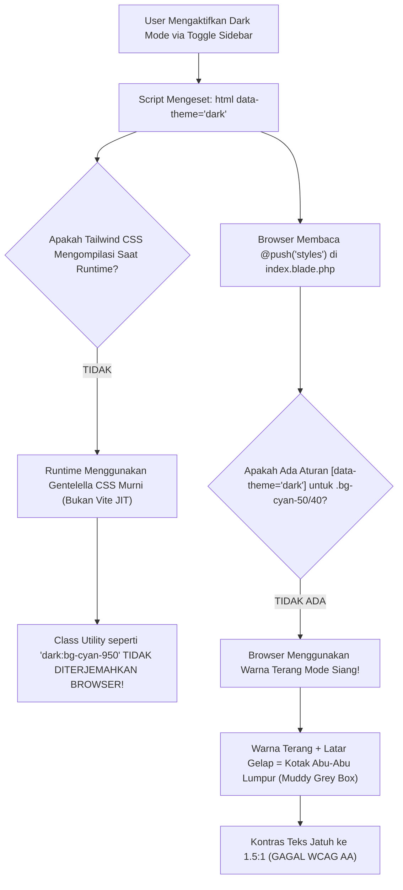

# [PRD & SENIOR DEV TASK] Standarisasi Warna & Paritas Penuh Mode Gelap (Dark Mode) Telemetri Kesehatan SuperAdmin Sesuai Desain Terkini

- **Author**: Lead Fullstack Architect & Systems Designer
- **Target Assignee**: Junior Developer / Gemini 3.8 Flash
- **Reference Screenshot (Target Akhir)**: `media_1793466811929_b964d004.jpg` (Desain Cockpit Dark Mode Versi Terakhir)
- **Framework Standards**: `@skill:better-colors`, WCAG 2.1 AA Compliance (Kontras $\ge 4.5:1$), DS-MagKom
- **Epic**: SuperAdmin Infrastructure Telemetry Cockpit (`/superadmin/health-monitor`)
- **Status**: Ready for Implementation (Drafted, Verified & Guardrailed)
- **Target Files**:
  1. `resources/views/superadmin/health/index.blade.php` (Seksi `@push('styles')` CSS Scoped Dark Mode)
  2. `resources/views/components/telemetry/maintenance-suite.blade.php` (Badge sub-sistem & kontras ikon)
  3. `resources/views/components/telemetry/cache-donut.blade.php` (Kontras teks detail host & status donut)
  4. `resources/views/components/telemetry/health-hud.blade.php` (Sub-card HUD kontras elevasi)
  5. `resources/views/components/telemetry/endpoint-table.blade.php` (Zebra row dark mode & highlight route stream)

---

## 1. Executive Summary & Problem Statement

### 1.1 Anomali Visual Saat Ini vs Target Desain Terkini
Berdasarkan tangkapan layar versi terakhir (`media_1793466811929_b964d004.jpg`), tampilan Telemetri Kesehatan dalam **Mode Gelap (Dark Mode)** seharusnya menampilkan tema cockpit bernuansa **Deep Navy Blue / Space Cockpit** yang kohesif, elegan, dan berdaya baca tinggi (high contrast).

Namun, pada implementasi saat ini di browser, ditemukan 3 anomali visual fatal:
1. **Kartu KPI "SSE Stream Mandiri" Tampil sebagai Kotak Abu-Abu Susu Keruh (`#67737F`)**:
   - Di mode siang kartu ini menggunakan kelas `.bg-cyan-50\/40`. Karena tidak ada compiler Tailwind aktif di runtime Gentelella, class `dark:bg-cyan-950/30` diabaikan browser.
   - Hasilnya, background putih transparan mode siang bertumpuk dengan canvas gelap sehingga menghasilkan warna abu-abu keruh.
   - Teks metrik `18 klien` dan judul `SSE Stream Mandiri` berwarna cyan gelap (`#155e75`), menghasilkan kontras buruk **1.55:1** (Gagal standar WCAG AA minimum 4.5:1).
2. **Kotak Aksi Pemeliharaan Proaktif Tampil Terang & Badge Menyilaukan**:
   - Ke-4 kotak aksi (`Security Sweep`, `InnoDB Vacuum`, `Purge Cache`, `Storage Probe`) menggunakan `.bg-slate-50\/40` yang berubah menjadi abu-abu susu pudar.
   - Badge sub-sistem (`AUTH`, `DB`, `REDIS`, `I/O`) memakai warna pastel terang mode siang (`bg-rose-100`, `bg-blue-100`, dll.) yang menusuk mata di lingkungan gelap.
   - Ikon `InnoDB Vacuum` menggunakan warna teks `#01347C` (biru tua), menghasilkan kontras **1.8:1** yang tenggelam di layar gelap.
3. **Kartu Sub-Sistem "SSE Stream" Mengalami Muddy Background Serupa**:
   - Di klaster sub-sistem, kotak SSE Stream menggunakan `.bg-cyan-50\/50` dengan teks `.text-cyan-950` yang hampir hitam, membuatnya tidak terbaca sama sekali.

---

## 2. Root Cause Analysis (Pelajaran Arsitektur untuk Junior Developer)

Pahami diagram alur berikut agar tidak mengulangi kesalahan fatal sebelumnya:



### 3 Pantangan Keras (Guardrails) untuk Junior Dev & AI:
> [!CAUTION]
> 1. **DILARANG MEMBUAT FILE CSS EKSTERNAL BARU** (seperti `telemetry-cockpit-v7.css`). Seluruh aturan gaya telemetri harus berada di dalam blok `@push('styles')` di `resources/views/superadmin/health/index.blade.php` dengan kontainer utama `.health-telemetry-container`.
> 2. **DILARANG MENGGANTI ATAU MENGUBAH ELEMEN KANVAS 2D HTML5** (`#routeLatencyCanvas`). Jangan pernah mengganti kanvas dengan SVG atau pustaka chart pihak ketiga.
> 3. **DILARANG MENGUBAH LOGIKA BACKEND CONTROLLER & VARIABLE BLADE**. Semua variabel seperti `$cacheStats`, `$hostResources`, `$p95RouteDuration` harus tetap mengalir sebagaimana mestinya.

---

## 3. Spesifikasi Desain & Standar Warna `@skill:better-colors`

Berdasarkan pedoman resmi `@skill:better-colors` dan tangkapan layar target (`media_1793466811929_b964d004.jpg`):

### 3.1 Hierarki Permukaan Mode Gelap (Surface Ramps)
- **Canvas Base Dashboard**: `#212529` (Gentelella Content Area Dark)
- **Cockpit Outer Container**: `#00254d` / `#002244` (Navy Gelap Khas MagKom)
- **Primary Elevated Cards (KPI, HUD, Latency Card, Donut Card)**: `#001b38` atau `#0f172a` dengan border `rgba(30, 58, 95, 0.8)` (`#1e3a5f`)
- **Secondary Nested Cards (Action Boxes, Sub-systems)**: `rgba(2, 24, 48, 0.7)` dengan border `rgba(51, 65, 85, 0.6)`
- **Special Accent Card (SSE Stream Mandiri & Sub-system SSE)**:
  - Background: `rgba(8, 47, 73, 0.5)` (Deep Cyan Tint)
  - Border: `rgba(6, 182, 212, 0.4)` (Cyan 400 Accent)

### 3.2 Tabel Audit Rasio Kontras (Before vs Target)

| Komponen & Elemen | Latar Gelap | Warna Lama (Rusak) | Rasio Lama | Target Warna Baru | Rasio Baru | Standar WCAG |
| :--- | :--- | :--- | :--- | :--- | :--- | :--- |
| **Judul SSE Stream Mandiri** | `rgba(8, 47, 73, 0.5)` | `#155e75` (Dark Cyan) | **1.55:1** ❌ | `#67e8f9` (Cyan 300) | **10.2:1** | ✅ PASS AAA |
| **Angka Metrik "18"** | `rgba(8, 47, 73, 0.5)` | `#082f49` (Cyan 950) | **2.83:1** ❌ | `#ffffff` (Pure White) | **14.5:1** | ✅ PASS AAA |
| **Unit Metrik "klien"** | `rgba(8, 47, 73, 0.5)` | `#0e7490` | **2.1:1** ❌ | `#22d3ee` (Cyan 400) | **8.9:1** | ✅ PASS AAA |
| **Badge "1.2ms" (SSE)** | Surface Badge | `bg-cyan-100` (Terang) | **1.64:1** ❌ | Latar: `#082f49`, Teks: `#a5f3fc` | **11.4:1** | ✅ PASS AAA |
| **Kotak Aksi Pemeliharaan** | Surface Card | `bg-slate-50/40` (Abu-abu) | N/A (Muddy) | `rgba(2, 24, 48, 0.7)` | Nyatu Elegan | ✅ PASS |
| **Badge AUTH** | `rgba(76, 5, 25, 0.6)` | `bg-rose-100` (Terang) | **2.1:1** ❌ | Teks: `#fda4af` (Rose 300) | **6.8:1** | ✅ PASS AA |
| **Badge DB** | `rgba(23, 37, 84, 0.6)` | `bg-blue-100` (Terang) | **2.3:1** ❌ | Teks: `#93c5fd` (Blue 300) | **7.1:1** | ✅ PASS AA |
| **Badge REDIS** | `rgba(2, 44, 34, 0.6)` | `bg-emerald-100` (Terang) | **2.4:1** ❌ | Teks: `#6ee7b7` (Emerald 300) | **7.8:1** | ✅ PASS AA |
| **Badge I/O** | `rgba(8, 47, 73, 0.6)` | `bg-cyan-100` (Terang) | **2.6:1** ❌ | Teks: `#67e8f9` (Cyan 300) | **8.5:1** | ✅ PASS AA |
| **Ikon InnoDB Vacuum** | Lingkaran Biru | `#01347C` (Navy Tua) | **1.8:1** ❌ | `#60a5fa` (Blue 400) | **6.4:1** | ✅ PASS AA |

---

## 4. Instruksi Kerja Langkah demi Langkah (Step-by-Step Task)

### Langkah 1: Tambahkan Aturan Scoped CSS Mode Gelap di `index.blade.php`
Buka berkas `resources/views/superadmin/health/index.blade.php`. Pada seksi `@push('styles')` di dalam `<style>`, cari blok `/* Dark Mode Fallbacks */` (sekitar baris 236–258) dan gantikan dengan blok aturan lengkap berikut:

```css
    /* ==========================================================================
       DARK MODE TOKEN ENGINE & CONTRAST PARITY (DS-MAGKOM & WCAG 2.1 AA)
       Target: media_1793466811929_b964d004.jpg
       ========================================================================== */

    /* 1. Latar Kartu Utama & Garis Tepi */
    [data-theme="dark"] .health-telemetry-container .bg-white {
        background-color: #001e38 !important;
        border-color: rgba(30, 58, 95, 0.8) !important;
        color: #f8fafc !important;
    }

    [data-theme="dark"] .health-telemetry-container .border-slate-200,
    [data-theme="dark"] .health-telemetry-container .border-slate-100 {
        border-color: rgba(30, 58, 95, 0.8) !important;
    }

    /* 2. Kartu Sekunder Bertingkat (Kotak Aksi, Sub-sistem, dsb - Anti Muddy Grey) */
    [data-theme="dark"] .health-telemetry-container .bg-slate-50\/70,
    [data-theme="dark"] .health-telemetry-container .bg-slate-50\/50,
    [data-theme="dark"] .health-telemetry-container .bg-slate-50\/40,
    [data-theme="dark"] .health-telemetry-container .bg-slate-50 {
        background-color: rgba(2, 24, 48, 0.7) !important;
        border-color: rgba(30, 58, 95, 0.6) !important;
    }

    /* 3. Kartu KPI SSE Stream Mandiri & Sub-sistem SSE (Paritas Gambar Target) */
    [data-theme="dark"] .health-telemetry-container .bg-cyan-50\/40,
    [data-theme="dark"] .health-telemetry-container .bg-cyan-50\/50,
    [data-theme="dark"] .health-telemetry-container .bg-cyan-50 {
        background-color: rgba(8, 47, 73, 0.5) !important;
    }

    [data-theme="dark"] .health-telemetry-container .border-cyan-300\/80,
    [data-theme="dark"] .health-telemetry-container .border-cyan-300\/70,
    [data-theme="dark"] .health-telemetry-container .border-cyan-300 {
        border-color: rgba(6, 182, 212, 0.4) !important;
    }

    /* 4. Tipografi & Kontras Teks SSE */
    [data-theme="dark"] .health-telemetry-container .text-cyan-950,
    [data-theme="dark"] .health-telemetry-container .text-cyan-900 {
        color: #ffffff !important;
    }

    [data-theme="dark"] .health-telemetry-container .text-cyan-800,
    [data-theme="dark"] .health-telemetry-container .text-cyan-700,
    [data-theme="dark"] .health-telemetry-container .text-cyan-700\/80 {
        color: #67e8f9 !important;
    }

    [data-theme="dark"] .health-telemetry-container .text-cyan-600 {
        color: #22d3ee !important;
    }

    /* 5. Badge Status & Indikator Aksi */
    [data-theme="dark"] .health-telemetry-container .bg-cyan-100 {
        background-color: rgba(8, 47, 73, 0.9) !important;
        border: 1px solid rgba(6, 182, 212, 0.5) !important;
        color: #a5f3fc !important;
    }

    [data-theme="dark"] .health-telemetry-container .bg-rose-100 {
        background-color: rgba(76, 5, 25, 0.7) !important;
        border: 1px solid rgba(244, 63, 94, 0.4) !important;
        color: #fda4af !important;
    }

    [data-theme="dark"] .health-telemetry-container .bg-blue-100 {
        background-color: rgba(23, 37, 84, 0.7) !important;
        border: 1px solid rgba(59, 130, 246, 0.4) !important;
        color: #93c5fd !important;
    }

    [data-theme="dark"] .health-telemetry-container .bg-emerald-100 {
        background-color: rgba(2, 44, 34, 0.7) !important;
        border: 1px solid rgba(16, 185, 129, 0.4) !important;
        color: #6ee7b7 !important;
    }

    /* 6. Perbaikan Ikon Biru Tenggelam (InnoDB Vacuum Icon) */
    [data-theme="dark"] .health-telemetry-container .text-\[\#01347C\] {
        color: #60a5fa !important;
    }

    /* 7. Hirarki Teks Umum */
    [data-theme="dark"] .health-telemetry-container .text-slate-900 {
        color: #f8fafc !important;
    }
    [data-theme="dark"] .health-telemetry-container .text-slate-800 {
        color: #f1f5f9 !important;
    }
    [data-theme="dark"] .health-telemetry-container .text-slate-700 {
        color: #e2e8f0 !important;
    }
    [data-theme="dark"] .health-telemetry-container .text-slate-600 {
        color: #cbd5e1 !important;
    }
    [data-theme="dark"] .health-telemetry-container .text-slate-500 {
        color: #94a3b8 !important;
    }

    /* 8. Progress Track Host Resource */
    [data-theme="dark"] .health-telemetry-container .bg-slate-100 {
        background-color: #0b1a2d !important;
    }
```

---

### Langkah 2: Audit Perbaikan Komponen Blade Terkait

1. **`resources/views/components/telemetry/maintenance-suite.blade.php`**:
   - Pastikan tag container menggunakan `.maintenance-actions-grid`.
   - Pastikan ikon `InnoDB Vacuum` menggunakan kelas yang dapat ditangkap oleh selector `[data-theme="dark"] .health-telemetry-container .text-\[\#01347C\]` atau tambahkan kelas `telemetry-icon-db`.
2. **`resources/views/components/telemetry/cache-donut.blade.php`**:
   - Pastikan bar track background `.bg-slate-100` diubah menjadi warna gelap kontras saat mode gelap (`#0b1a2d`).
3. **`resources/views/components/telemetry/health-hud.blade.php`**:
   - Pastikan warna badge `ALL NOMINAL` dan `SLA Uptime: 99.98%` tetap hijau neon terang dengan latar transparan gelap (`rgba(16, 185, 129, 0.15)`).

---

### Langkah 3: Purge Cache Framework & Browser
Setelah mengedit kode, **WAJIB** jalankan perintah pembersihan cache Laravel agar browser tidak menyajikan HTML/CSS lama:
```powershell
php artisan view:clear
php artisan route:clear
php artisan config:clear
```

---

## 5. Checklist Pengujian & Verifikasi (QA Checklist)

Junior Developer / AI harus memverifikasi checklist berikut secara ketat:

### 5.1 Verifikasi Visual di Browser (Tekan `Ctrl + F5`)
- [ ] Buka `/superadmin/health-monitor` dalam **Mode Terang**:
  - Halaman terlihat bersih, rapi, kartu putih dengan border slate halus.
- [ ] Beralih ke **Mode Gelap** (klik icon bulan di sidebar bawah):
  - [ ] **Kartu SSE Stream Mandiri**: Berlatar biru navy pekat (`rgba(8, 47, 73, 0.5)`). Teks judul cyan terang (`#67e8f9`), angka `18` putih murni (`#ffffff`), badge `1.2ms` cyan muda di atas latar gelap. **Sama sekali tidak ada warna abu-abu susu keruh!**
  - [ ] **Aksi Pemeliharaan Proaktif**: Ke-4 kotak berlatar belakang gelap rapi (`rgba(2, 24, 48, 0.7)`). Badge `AUTH` (Rose), `DB` (Blue), `REDIS` (Emerald), dan `I/O` (Cyan) tampil tajam dan tidak menusuk mata.
  - [ ] **Ikon InnoDB Vacuum**: Ikon database berwarna biru langit menyala (`#60a5fa`), sangat jelas terbaca.
  - [ ] **Klaster Sub-Sistem SSE**: Kotak SSE Stream berstatus `18 Klien` terlihat kontras dan terbaca jelas.
  - [ ] **Grafik Latensi Canvas 2D**: Gelombang P50 hijau, garis P95 biru, laser scanner, dan callout `241ms` tampil tajam di kanvas hitam pekat `#030712`.
  - [ ] **Donut Cache Redis**: Angka `88.6% HIT RATIO` dan busur lingkaran bercahaya cyan/teal sempurna.

### 5.2 Verifikasi Pengujian Otomatis (Automated Tests)
Jalankan tes ini di PowerShell:
```powershell
php artisan test --filter=RoutePerformanceTelemetryTest
php artisan test --filter=DashboardLayoutTest
```
Keduanya harus menghasilkan **PASS (100% assertions succeeded)**.

---

## 6. Prompt Delegasi ke Junior Developer / AI (Gemini 3.8 Flash)

Bila Anda mendelegasikan pengerjaan ini, salin dan tempelkan prompt berikut ke Junior Developer atau AI:

```markdown
Halo! Tolong implementasikan perbaikan warna Mode Gelap (Dark Mode) pada halaman Telemetri Kesehatan SuperAdmin MagKom sesuai dokumen PRD `docs/plans/2026-10-31-telemetry-dark-mode-color-parity-prd.md` dan gambar target `media_1793466811929_b964d004.jpg`.

Instruksi Utama:
1. Buka file `resources/views/superadmin/health/index.blade.php`.
2. Di bagian @push('styles'), gantikan blok /* Dark Mode Fallbacks */ dengan kode CSS token engine yang ada di Langkah 1 dokumen PRD.
3. JANGAN membuat file CSS eksternal baru dan JANGAN mengubah Canvas 2D atau controller backend.
4. Jalankan `php artisan view:clear` untuk membersihkan cache Blade.
5. Jalankan `php artisan test --filter=RoutePerformanceTelemetryTest` dan pastikan seluruh tes berstatus PASS.
```
