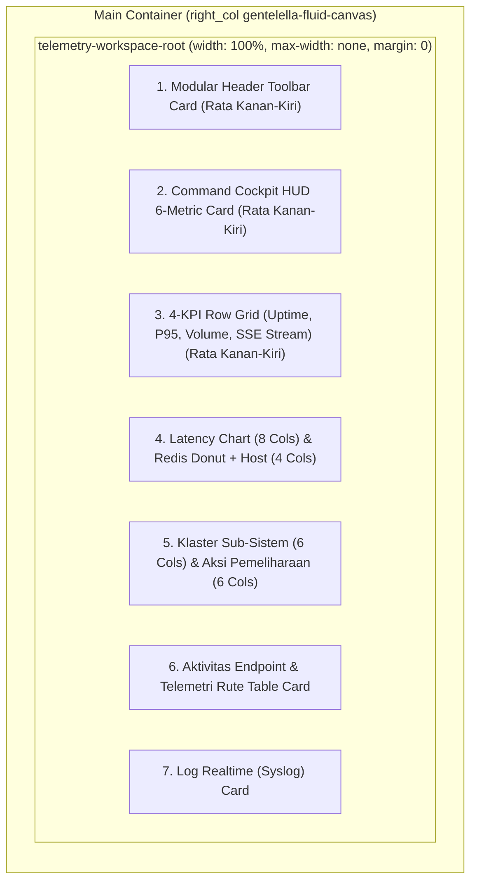

# [PRD & SENIOR DEV TASK] Transformasi Layout Telemetri Kesehatan ke Sistem Rata Kanan-Kiri (Full-Width Fluid Workspace) — Paritas Jejak Audit

- **Author**: Lead Fullstack Architect & Systems Designer
- **Target Assignee**: Junior Developer / Gemini 3.8 Flash
- **Reference Standard**: Pola Ruang Kerja Full-Width Jejak Audit (`resources/views/superadmin/audit-log/`)
- **Epic**: SuperAdmin Infrastructure Telemetry Cockpit (`/superadmin/health-monitor`)
- **Status**: Ready for Planning Review & Execution
- **Target Files**:
  1. `public/css/telemetry-cockpit-v7.css`
  2. `resources/views/superadmin/health/index.blade.php`
  3. `resources/views/components/telemetry/maintenance-suite.blade.php`
  4. `resources/views/components/telemetry/cache-donut.blade.php`

---

## 1. Problem Statement & Visual Analysis

### 1.1 Masalah Saat Ini (Screenshot 1: `media_1793462090955_2e9225e3.jpg`)
Pada tangkapan layar pertama (Telemetri Kesehatan saat ini):
- Tampilan telemetri terkurung di dalam satu kotak kartu raksasa (`health-telemetry-canvas-card`) yang memiliki `max-width: 1440px` dan `margin: 0 auto`.
- Di layar monitor desktop (1080p / 1920px atau lebih lebar), tampilan ini **mengapung di tengah-tengah ("di-center gitu")**, menyisakan ruang kosong (dead gutters) yang sangat lebar di sisi kiri dan kanan.
- Pada mode gelap, background kanvas dashboard (`#212529`) membingkai kartu tengah tersebut dengan kontras ganda yang aneh dan membuat dashboard terlihat sempit/terpotong.

### 1.2 Target Acuan (Screenshot 2: `media_1793462131830_a8f20f3d.jpg`)
Pada tangkapan layar kedua (Halaman Jejak Audit & Kepatuhan):
- Layout membentang **penuh rata kanan-kiri (fluid edge-to-edge)** dari batas sidebar hingga batas kanan layar.
- Menggunakan padding kanvas dashboard resmi (`padding: 1.5rem 2rem` bawaan `.gentelella-fluid-canvas`).
- **Tidak ada pembungkus monolitik raksasa**. Setiap seksi (Header Toolbar, Strip KPI, Matriks 2-Kolom Tabel, dsb.) merupakan kartu independen yang tertata rapi dalam workspace vertikal (`gap: 1.5rem`).

---

## 2. Root Cause Analysis (Mengapa Telemetri Ter-Center?)

Sebagai Junior Developer / AI, perhatikan kode yang menjadi biang kerok di bawah ini:

### Biang Kerok 1: `public/css/telemetry-cockpit-v7.css` (Baris 38–51)
```css
/* KODE LAMA YANG MENYEBABKAN TER-CENTER: */
.health-telemetry-canvas-card {
  width: 100% !important;
  max-width: 1440px !important;       /* <-- INI MEMBATASI LEBAR MAKSIMAL 1440px */
  margin: 0 auto 2rem auto !important; /* <-- INI MEMAKSA KONTEN DI-CENTER DENGAN MARGIN KIRI-KANAN AUTO */
  background-color: #ffffff !important;
  border-radius: 24px !important;
  border: 1px solid rgba(226, 232, 240, 0.8) !important;
  padding: 24px 28px !important;
  box-shadow: 0 1px 3px rgba(0, 0, 0, 0.05) !important;
}
```

### Biang Kerok 2: `resources/views/superadmin/health/index.blade.php` (Baris 42–46)
```css
/* DUPLIKASI RULE DI FILE BLADE: */
.health-telemetry-canvas-card {
    width: 100%;
    max-width: 1440px; /* <-- IKUT MEMBATASI LEBAR */
    margin: 0 auto;    /* <-- IKUT MEMAKSA CENTER */
}
```

### Biang Kerok 3: Pembungkus Luar Monolitik
Di `index.blade.php`, seluruh seksi (Header, Cockpit HUD, KPI 4-Card, Grafik, Donut, Sub-sistem, Pemeliharaan, Tabel Endpoint, dan Syslog) dibungkus di dalam SATU elemen `<div class="health-telemetry-canvas-card ...">`.

Di halaman Audit Log, pola yang digunakan adalah **Workspace Root** (`.audit-workspace-root`):
```css
.audit-workspace-root {
    display: flex;
    flex-direction: column;
    gap: 1.5rem;
    width: 100%;
    /* Tanpa max-width dan tanpa margin: 0 auto! */
}
```

---

## 3. Desain Arsitektur Baru: Pola Fluid Workspace Paritas Audit Log



### Keuntungan Pola Ini:
1. **Edge-to-Edge Fluidity**: Konten melebar secara proporsional mengisi 100% ruang kerja dashboard yang disediakan oleh Gentelella layout SuperAdmin.
2. **Visual Hierarchy yang Bersih**: Tidak ada kartu ganda (kartu di dalam kartu dengan double-border) yang membuat mata lelah.
3. **Paritas 1:1 dengan Modul SuperAdmin Lain**: Pengguna merasakan konsistensi layout saat berpindah antara halaman *Jejak Audit* dan *Telemetri Kesehatan*.

---

## 4. Rencana Eksekusi Langkah demi Langkah (Step-by-Step Task for Junior Dev / AI)

### Langkah 1: Ubah Definisi `.health-telemetry-canvas-card` di `public/css/telemetry-cockpit-v7.css`
Ubah kelas `.health-telemetry-canvas-card` dari yang tadinya kartu monolitik sempit menjadi kontainer kerja fleksibel (*fluid workspace root*):

```css
/* ==========================================================================
   0. Outer Workspace Wrapper (Audit Log Parity - Full Width Fluid System)
   ========================================================================== */
.health-telemetry-canvas-card {
  width: 100% !important;
  max-width: none !important;            /* Hapus batasan 1440px */
  margin: 0 0 2rem 0 !important;         /* Hapus margin: auto agar rata kiri-kanan */
  background-color: transparent !important; /* Latar belakang transparan mengikuti kanvas */
  border-radius: 0 !important;
  border: none !important;              /* Hapus border pembungkus luar */
  padding: 0 !important;                 /* Padding diatur oleh gentelella-fluid-canvas */
  box-shadow: none !important;
  color: #1e293b !important;
  font-family: 'Open Sans', system-ui, -apple-system, sans-serif !important;
  box-sizing: border-box !important;
  display: flex !important;
  flex-direction: column !important;
  gap: 1.25rem !important;
}

[data-theme="dark"] .health-telemetry-canvas-card {
  background-color: transparent !important;
  border: none !important;
  color: #f8fafc !important;
}
```

### Langkah 2: Bungkus Header Toolbar Menjadi Kartu Mandiri di `resources/views/superadmin/health/index.blade.php`
Di halaman Audit Log, header memiliki kartu tersendiri (`.audit-header-card`).
Di `index.blade.php`, seksi 1 (Header Toolbar) sebelumnya hanya berupa `<header class="mb-5 flex ...">`.
Ubah header tersebut menjadi kartu mandiri berlatar belakang putih/gelap dengan border halus:

```html
<!-- 1. Header Toolbar (Audit Log Header Card Parity) -->
<header class="rounded-xl border border-slate-200 bg-white p-4 shadow-xs dark:border-slate-800 dark:bg-slate-900 transition-all mb-4 flex flex-col gap-3 sm:flex-row sm:items-center sm:justify-between">
    <!-- Konten header: Logo MK, Judul, Badge Live, Controls Strip -->
</header>
```

### Langkah 3: Hapus Rule Ter-Center pada Blok `<style>` di `resources/views/superadmin/health/index.blade.php`
Hapus:
```css
    .health-telemetry-canvas-card {
        width: 100%;
        max-width: 1440px;
        margin: 0 auto;
    }
```
Ganti menjadi:
```css
    .health-telemetry-canvas-card {
        width: 100%;
        max-width: none;
        margin: 0 0 2rem 0;
        background: transparent;
        border: none;
        padding: 0;
    }
```

### Langkah 4: Sesuaikan Class pada Elemen Root di `resources/views/superadmin/health/index.blade.php`
Di baris awal `@section('content')`:
Ubah:
```html
<div class="health-telemetry-canvas-card bg-white rounded-2xl sm:rounded-3xl p-5 sm:p-6 lg:p-8 shadow-sm border border-slate-200/80 text-slate-800 antialiased font-sans dark:bg-slate-900 dark:border-slate-800 dark:text-slate-100 transition-colors duration-200">
```
Menjadi:
```html
<div class="health-telemetry-canvas-card w-full text-slate-800 antialiased font-sans dark:text-slate-100 transition-colors duration-200">
```
*(Menghapus `bg-white`, `border`, `shadow-sm`, dan `p-5 sm:p-6 lg:p-8` dari root, karena masing-masing seksi di dalamnya sudah memiliki kartunya sendiri!)*

---

## 5. Matriks Verifikasi & Checklist Pengujian (Testing Matrix)

Sebagai Junior Developer / AI, kamu **WAJIB** memverifikasi poin-poin ini setelah implementasi:

| No | Poin Pengujian | Kriteria Lulus (Acceptance Criteria) | Status |
| :--- | :--- | :--- | :--- |
| 1 | **Rata Kanan-Kiri (Fluid Width)** | Di layar lebar (resolusi $\ge 1440\text{px}$ atau $1920\text{px}$), tidak ada lagi ruang kosong menganggur di sisi kiri dan kanan. Konten sejajar dengan margin layout dashboard utama. | [ ] |
| 2 | **Header Card Mandiri** | Header Toolbar berada di dalam kartu tersendiri dengan latar putih (mode terang) atau `#0f172a` (mode gelap), serasi dengan `.audit-header-card`. | [ ] |
| 3 | **Cockpit HUD Grid** | Ke-6 metrik di Pusat Telemetri Infrastruktur melebar secara proporsional tanpa ada pemotongan teks atau overflow horizontal. | [ ] |
| 4 | **Sistem Grid 8:4 & 6:6** | Grafik Latensi (8 kolom) & Donut Cache (4 kolom) tetap sejajar tingginya dan melebar mengisi kanvas. Klaster Sub-Sistem & Aksi Pemeliharaan tetap 50%:50%. | [ ] |
| 5 | **Mode Gelap Tetap Tajam** | Seluruh aturan warna Mode Gelap (kontras WCAG AA $\ge 4.5:1$) yang telah dikerjakan sebelumnya tetap berfungsi sempurna tanpa regresi. | [ ] |
| 6 | **Unit & Feature Tests** | `RoutePerformanceTelemetryTest`, `SecuritySuperAdminAccessControlTest`, dan `DashboardLayoutTest` lulus 100%. | [ ] |

---

## 6. Prompt Siap Pakai untuk Junior Developer / AI (Gemini 3.8 Flash)

Bila task ini akan didelegasikan, kirimkan prompt ini:

> **Prompt Eksekusi:**
> *"Halo, tolong ubah layout halaman Telemetri Kesehatan (`/superadmin/health-monitor`) agar membentang rata kanan-kiri (full-width fluid workspace) sama persis seperti halaman Jejak Audit (`/superadmin/audit-log`), sesuai PRD `docs/plans/2026-10-31-telemetry-fullwidth-edge-to-edge-plan.md`.
> Masalah utamanya: saat ini halaman terkurung dalam `max-width: 1440px` dan `margin: 0 auto`, sehingga mengapung di tengah-tengah pada monitor lebar.
> Ikuti Langkah 1 s.d. 4 pada dokumen PRD:
> 1. Ubah `.health-telemetry-canvas-card` di `public/css/telemetry-cockpit-v7.css` menjadi `max-width: none !important`, `margin: 0 !important`, `background: transparent !important`, dan `border: none !important`.
> 2. Bersihkan rule serupa di blok `<style>` file `resources/views/superadmin/health/index.blade.php`.
> 3. Hapus class `bg-white`, `border`, dan `padding` pada tag pembungkus root di `index.blade.php`, lalu bungkus `<header>` toolbar dengan class kartu mandiri (`rounded-xl border border-slate-200 bg-white p-4 dark:border-slate-800 dark:bg-slate-900 mb-4`).
> 4. Jalankan `php artisan test --filter=RoutePerformanceTelemetryTest` dan `graphify update .`."*

