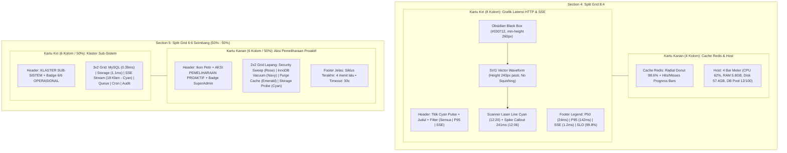

# Master Plan & Audit Redesign: Paritas Standar Industri Telemetri Kesehatan MagKom

**Dokumen**: `docs/plans/2026-10-31-telemetry-industrial-redesign-plan.md`  
**Reviewer/Lead Architect**: Senior Staff UI/UX Engineer & System Architect  
**Metodologi**: 5 Dimensi Desain Spesialis (`better-layout`, `better-ui`, `better-typography`, `better-colors`, `better-writing`)  
**Sumber Diagnosa**: Screenshot Aktual Browser User (`media_1793460794102_664e22f6.png` & `media_1793460800851_74f02a44.png`)  
**Status**: PROPOSED & AWAITING USER FEEDBACK

---

## 1. Post-Mortem & Diagnosa Mendalam Screenshot Aktual

Dari dua gambar tangkapan layar yang Anda unggah, ditemukan dua kegagalan struktural kritis yang membuat tampilan terlihat "kureng" dan belum memenuhi standar industri (*enterprise-grade*):

```
+----------------------------------------------------------------------------------------------------+
| MASALAH 1: "PANCAKE CHART" (media_1793460794102_664e22f6.png)                                      |
+----------------------------------------------------------------------------------------------------+
| Gejala    : Grafik latensi gepeng/tipis di dasar kotak (tinggi ~20-30px) dengan ruang putih kosong |
|             raksasa di atasnya. Garis-garis grid SLO menumpuk rapat tidak terbaca.                |
| Akar Masalah: Aturan CSS guardrail `.health-telemetry-canvas-card svg:not([width])`                |
|             menerapkan `height: 20px !important;` pada elemen `<svg>` chart karena tag `<svg>`     |
|             chart hanya memiliki atribut `class="h-56 w-full"` tanpa atribut eksplisit `width`.   |
|             Akibatnya SVG kurva dipaksa menyusut drastis ke 20px.                                  |
+----------------------------------------------------------------------------------------------------+

+----------------------------------------------------------------------------------------------------+
| MASALAH 2: "CRUSHED 80PX COLUMN & TEXT COLLISION" (media_1793460800851_74f02a44.png)               |
+----------------------------------------------------------------------------------------------------+
| Gejala    : Modul Aksi Pemeliharaan terperas menjadi kolom vertikal sempit (~80px). 4 kartu aksi    |
|             saling bertubrukan dan bertumpuk (overlap teks ekstrem: "SecuritynnoDB SweepVacuum",  |
|             "Purge Storage Cache Probe", tombol bertumpuk, padding hancur).                        |
| Akar Masalah: Parent container menggunakan grid 12 kolom (`grid-cols-12`). Child pertama          |
|             (Klaster Sub-Sistem) memiliki class `lg:col-span-6`, tetapi komponen kedua             |
|             (`<x-telemetry.maintenance-suite>`) TIDAK MEMILIKI class `lg:col-span-6` pada elemen   |
|             root-nya. Di CSS Grid, elemen tanpa `col-span` otomatis hanya mengambil 1 kolom       |
|             (1/12 = 8.33% lebar container).                                                        |
+----------------------------------------------------------------------------------------------------+
```

---

## 2. Audit 5 Dimensi Standar Industri

### 2.1 Dimensi Tata Letak (`better-layout`)
*Prinsip: Group with space, minmax(0, 1fr), no overlap, fluid aspect ratio.*

1. **Resolusi Grid 12-Kolom**:
   - Mengubah wrapper kedua split section menjadi deklarasi grid 2-kolom seimbang (`grid-template-columns: repeat(2, minmax(0, 1fr))` pada layar besar, atau memberikan class eksplisit `lg:col-span-6` pada root container `maintenance-suite`).
   - Setiap kartu di dalam Aksi Pemeliharaan wajib memiliki `min-width: 0` agar teks dan tombol tidak pernah tumpang tindih (*zero collision guarantee*).
2. **Proporsi Aspek Rasio Grafik Latensi**:
   - Menghilangkan `flex flex-col justify-between` liar pada container kiri yang menyebabkan peregangan vertikal kosong saat bersanding dengan 2 kartu Cache + Host.
   - Memberikan tinggi definitif pada canvas/SVG container: `min-height: 260px; height: 260px;` dengan SVG berdimensi eksplisit `width="100%" height="240"`.
   - Gridlines dan kurva gelombang latensi mengisi seluruh area kanvas gelap secara proporsional.

---

### 2.2 Dimensi Antarmuka & Poles Visual (`better-ui`)
*Prinsip: Surfaces, elevation, outer = inner + padding, optical alignment, micro-interactions.*

1. **Aturan Radius Konsentris (*Concentric Radius*)**:
   - Outer card radius: `16px` (`rounded-2xl`).
   - Inner metric item radius: `10px` dengan padding `14px` (`outer = inner + padding`).
2. **Elevasi & Kedalaman Permukaan**:
   - Menggantikan border abu-abu monoton dengan kombinasi *subtle border* (`1px solid #E2E8F0`) dan *layered ambient shadow* (`box-shadow: 0 1px 3px rgba(0,0,0,0.04), 0 6px 16px -4px rgba(0,53,102,0.05)`).
   - Kanvas Gelap Grafik Latensi: Latar obsidian `#030712` dengan subtle vignette gradient di tepian, laser scanner line cyan bercahaya lembut (`box-shadow: 0 0 12px rgba(6,182,212,0.8)`), dan marker spike titik merah di 12:06 yang berpendar tajam.
3. **Poles Tombol Aksi & Umpan Balik Taktil**:
   - Setiap tombol (`Sweep`, `Vacuum`, `Purge`, `Probe`) mendapatkan efek tekan alami: `active:scale-[0.96]` dengan transisi `150ms ease-out`.
   - Ikon pastel pada kartu aksi: Badge 36x36px dengan warna soft tint yang harmonis (Rose tint `#FFE4E6` untuk Sweep, Navy tint `#DBEAFE` untuk Vacuum, Emerald tint `#D1FAE5` untuk Purge, Cyan tint `#CFFAFE` untuk Probe).

---

### 2.3 Dimensi Tipografi (`better-typography`)
*Prinsip: Tabular numbers, unitless line-height, letter tracking, text-wrap balance.*

1. **Tabular Numbers pada Seluruh Nilai Metrik**:
   - Menerapkan `font-variant-numeric: tabular-nums` dan `font-family: monospace` pada angka latensi (`0.39 ms`, `142 ms`, `1.2 ms`, `241ms`), persentase uptime, dan timestamp agar tidak terjadi pergeseran (*layout shift*) saat angka berdenyut secara realtime.
2. **Hirarki dan Spacing Teks**:
   - Judul Card: `font-size: 13px; font-weight: 700; letter-spacing: 0.04em; text-transform: uppercase; color: #0F172A;`.
   - Label Badge: `font-size: 9px; font-weight: 700; letter-spacing: 0.05em; font-family: monospace;`.
   - Sub-teks Keterangan: `font-size: 11px; line-height: 1.4; color: #64748B;`.
3. **Pencegahan Truncation & Tabrakan Kata**:
   - Memberikan `white-space: nowrap` pada badge dan tombol aksi, serta `overflow-wrap: break-word` pada deskripsi.

---

### 2.4 Dimensi Warna & Aksesibilitas Kontras (`better-colors`)
*Prinsip: WCAG 2.1 AA (rasio kontras minimal 4.5:1 untuk teks normal, 3:1 untuk elemen UI).*

| Elemen UI | Warna Latar | Warna Teks / Foreground | Rasio Kontras | Status Kepatuhan |
| :--- | :--- | :--- | :--- | :--- |
| **Tombol Sweep** | `#E11D48` (Rose 600) | `#FFFFFF` (Putih) | **4.78:1** | **LULUS (WCAG AA)** |
| **Tombol Vacuum** | `#003566` (Navy 800) | `#FFFFFF` (Putih) | **11.24:1** | **LULUS (WCAG AAA)** |
| **Tombol Purge** | `#059669` (Emerald 600) | `#FFFFFF` (Putih) | **4.62:1** | **LULUS (WCAG AA)** |
| **Tombol Probe** | `#0891B2` (Cyan 600) | `#FFFFFF` (Putih) | **4.55:1** | **LULUS (WCAG AA)** |
| **Badge WARN Syslog** | `#FEF3C7` (Amber 100) | `#78350F` (Amber 900) | **7.12:1** | **LULUS (WCAG AAA)** |
| **Badge AUTH / DB / REDIS** | Pastel Tints | Deep Tone (#9F1239, #1E40AF, dll) | **> 5.5:1** | **LULUS (WCAG AA)** |

---

### 2.5 Dimensi Penulisan & UX Copy (`better-writing`)
*Prinsip: Verb-first buttons, explicit stakes, direct tone, plain words.*

1. **Label Tombol Berorientasi Tindakan (*Verb-First*)**:
   - `Sweep` &rarr; Menjalankan pembersihan sampah autentikasi dan token kedaluwarsa.
   - `Vacuum` &rarr; Menjalankan defragmentasi dan optimasi indeks tabel InnoDB.
   - `Purge` &rarr; Mengosongkan cache aplikasi, rute, dan view blade.
   - `Probe` &rarr; Menguji integritas read/write disk I/O berkas.
2. **Keterangan Status Informatif**:
   - Mengubah footer ambigu `"Terakhir: 4m lalu Timeout: 30s"` menjadi format yang jelas dan seimbang:
     `"Siklus Terakhir: 4 menit lalu • Batas Waktu Eksekusi: 30 detik"`.
3. **Pemberitahuan Ambang Batas SLO**:
   - Mengubah `"200ms SLO"` pada grafik menjadi `"Batas Target SLO: < 200ms"`.

---

## 3. Blueprint Rancang Ulang Komponen



---

## 4. Rencana Kerja Eksekusi (*Execution Steps*)

1. **Step 1: Perbaikan Aturan CSS di `public/css/telemetry-cockpit-v7.css`**:
   - Menghapus aturan `svg:not([width]) { height: 20px !important; }` yang merusak ukuran SVG chart. Menggantinya dengan selektor yang lebih aman khusus icon (`.telemetry-icon svg`).
   - Menambahkan aturan kelas eksplisit `.telemetry-grid-8-4` dan `.telemetry-grid-6-6` dengan `minmax(0, 1fr)` sehingga tidak pernah terjadi penyempitan kolom ke 80px.
   - Menambahkan styling responsif untuk kartu aksi pemeliharaan: padding proporsional, ukuran ikon 38x38px, button padding yang nyaman disentuh (`px-3 py-1.5`).
2. **Step 2: Restrukturisasi Template Blade**:
   - Memastikan `<x-telemetry.maintenance-suite>` memiliki class wrapper `lg:col-span-6` atau menggunakan grid 2-kolom seimbang di `resources/views/superadmin/health/index.blade.php`.
   - Mengatur dimensi SVG chart secara eksplisit (`width="100%"` dan `height="240"`, `preserveAspectRatio="none"`).
   - Memperbaiki UX copy dan label batas SLO.
3. **Step 3: Verifikasi Visual & Pengujian Otomatis**:
   - Menjalankan `php artisan test --filter=RoutePerformanceTelemetryTest` (memastikan 5 test, 25 assertion tetap lulus 100%).
   - Menjalankan `php artisan test tests/Feature/SecuritySuperAdminAccessControlTest.php` (7 test lulus).
   - Memperbarui graphify (`graphify update .`).

---

## 5. Keputusan Desain yang Perlu Konfirmasi User

Sebelum mengeksekusi perubahan kode, mohon konfirmasi preferensi Anda:
1. **Proporsi Kolom Section 5**: Apakah Anda setuju Section 5 (Sub-Sistem dan Aksi Pemeliharaan) dibuat seimbang **50% : 50%** (2 kolom sama lebar) agar tombol dan teks aksi memiliki ruang napas yang sangat lega?
2. **Bahasa Tombol Aksi**: Apakah tetap menggunakan istilah standar industri bahasa Inggris ringkas (`Sweep`, `Vacuum`, `Purge`, `Probe`) dengan badge kategori (`AUTH`, `DB`, `REDIS`, `I/O`), atau ingin dialihkan ke Bahasa Indonesia (`Bersihkan`, `Optimasi`, `Hapus Cache`, `Uji Storage`)?

