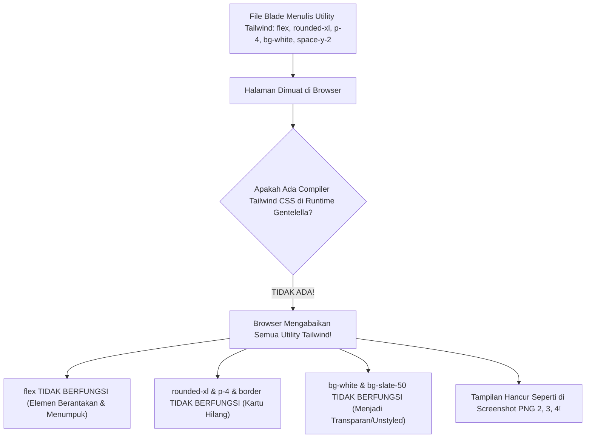
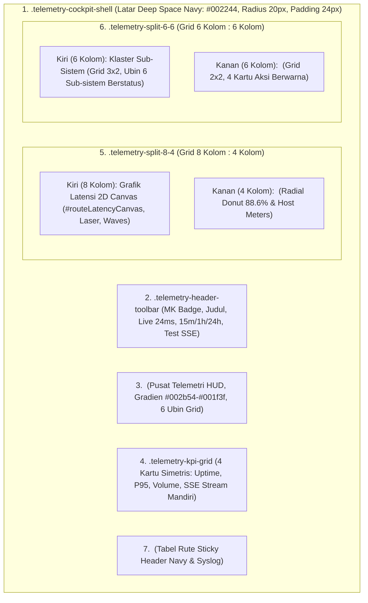

# [PRD & SENIOR DEV TASK] Redesign Total Cockpit Telemetri Kesehatan SuperAdmin Sesuai Desain Paritas Canvas

- **Author**: Lead Fullstack Architect & Systems Designer
- **Target Assignee**: Junior Developer / Gemini 3.8 Flash
- **Reference Spec**: 
  - `g:\MAGKOM\.sokudo\specs\superadmin-telemetry-canvas-parity\design.md`
  - `g:\MAGKOM\.sokudo\specs\superadmin-telemetry-canvas-parity\requirements.md`
- **Reference Images**:
  - **Target Acuan (Contoh JPG)**: `media_1793467604157_3a10b3b0.jpg` & `media_1793467726087_a82f2f13.jpg` (Cockpit Dark Mode Parity Penuh)
  - **Kondisi Rusak yang Harus Direvisi (Buggy PNGs)**:
    - `media_1793467718160_3f2b422e.png` (Header polos tanpa kartu pembungkus cockpit)
    - `media_1793467726087_a82f2f13.jpg` (Teks ubin HUD kontras gelap-di-atas-gelap)
    - `media_1793467734369_761fe845.png` (Sub-sistem & Pemeliharaan unstyled tanpa kartu & tombol raw HTML)
    - `media_1793467777031_bd96df7b.png` (Donut Redis tumpang-tindih teks & tombol tanpa card wrapper)
- **Status**: Ready for Implementation (Comprehensive & Fully Guardrailed)
- **Target Files**:
  1. `resources/views/superadmin/health/index.blade.php` (Scoped Pure CSS & Master Cockpit Shell)
  2. `resources/views/components/telemetry/health-hud.blade.php` (Elevated 6-Column Command Grid)
  3. `resources/views/components/telemetry/cache-donut.blade.php` (Donut SVG + Breakdown Bars Layout Isolation)
  4. `resources/views/components/telemetry/maintenance-suite.blade.php` (2x2 Matrix Action Cards & Styled Buttons)
  5. `resources/views/components/telemetry/endpoint-table.blade.php` (Sticky Table Card & Syslog)

---

## 1. Executive Summary & Root Cause Analysis

### 1.1 Mengapa Tampilan Saat Ini Rusak di Browser? (Analisis untuk Junior Dev & AI)
Jika kamu membuka halaman `/superadmin/health-monitor`, tampilannya terlihat seperti pada **3 screenshot PNG yang dikirim user**:
- **PNG 1 (`media_1793467718160_3f2b422e.png`)**: Header mengambang di atas kertas grafik putih/abu-abu tanpa bingkai cockpit.
- **PNG 2 (`media_1793467734369_761fe845.png`)**: Sub-sistem dan Aksi Pemeliharaan kehilangan tata letak kartu; teks berantakan dan tombol tampil sebagai tombol abu-abu bawaan browser Windows (`<button>Sweep</button>`).
- **PNG 3 (`media_1793467777031_bd96df7b.png`)**: Teks "88.6% HIT RATIO" tumpang-tindih (*overlapping*) dengan teks daftar "Hits", "Misses", dan progress bar karena ketiadaan flexbox layout.

### 1.2 Akar Masalah Teknis Utama:


> [!CRITICAL]
> **ATURAN ARSITEKTURAL GENTELELLA (SSOT)**:
> Dashboard MagKom berjalan di atas tema warisan Gentelella (Bootstrap 3). **TIDAK ADA TAILWIND COMPILER SAAT RUNTIME!**
> Kamu **DILARANG MENGANDALKAN UTILITY TAILWIND** seperti `flex`, `items-center`, `justify-between`, `rounded-xl`, `p-4`, `space-y-2`, `w-full` di dalam file Blade tanpa mendeklarasikan aturan CSS padanannya di dalam blok `<style>` scoped CSS!

---

## 2. Blueprint Desain: Paritas Penuh ke JPG Target (`media_1793467604157_3a10b3b0.jpg`)

Target akhir adalah mengubah halaman unstyled (PNG) menjadi **Cockpit Telemetri Luar Angkasa (Deep Space Navy)** yang rapi, solid, dan berdensitas tinggi seperti pada gambar JPG acuan.

### 2.1 Struktur Komponen Visual Cockpit:



---

## 3. Spesifikasi CSS Scoped Murni (Zero Tailwind Dependency)

Berikut adalah aturan CSS lengkap yang **WAJIB dimasukkan ke dalam seksi `@push('styles')` di file `resources/views/superadmin/health/index.blade.php`**:

```css
/* ==========================================================================
   COCKPIT TELEMETRI KESEHATAN SUPERADMIN (CANVAS a9ba81f3 PARITY)
   Pure Scoped CSS - Compatible with Gentelella Bootstrap 3
   ========================================================================== */

/* 1. Cockpit Outer Shell (Bingkai Luar Biru Gelap) */
.telemetry-cockpit-shell {
    background-color: #002244 !important;
    border: 1px solid rgba(63, 81, 181, 0.4) !important;
    border-radius: 20px !important;
    padding: 24px !important;
    box-shadow: 0 16px 40px rgba(0, 0, 0, 0.6) !important;
    display: flex !important;
    flex-direction: column !important;
    gap: 20px !important;
    width: 100% !important;
    color: #ffffff !important;
    box-sizing: border-box !important;
}

/* 2. Kartu Elevasi Primer (.telemetry-card) */
.telemetry-card {
    background-color: #001e38 !important;
    border: 1px solid rgba(30, 58, 95, 0.8) !important;
    border-radius: 14px !important;
    padding: 16px 18px !important;
    box-shadow: 0 4px 16px rgba(0, 0, 0, 0.3) !important;
    position: relative !important;
    box-sizing: border-box !important;
}

.telemetry-card-header {
    display: flex !important;
    align-items: center !important;
    justify-content: space-between !important;
    border-bottom: 1px solid rgba(30, 58, 95, 0.8) !important;
    padding-bottom: 10px !important;
    margin-bottom: 14px !important;
}

.telemetry-card-title {
    font-size: 12px !important;
    font-weight: 700 !important;
    text-transform: uppercase !important;
    letter-spacing: 0.5px !important;
    color: #ffffff !important;
    margin: 0 !important;
    display: flex !important;
    align-items: center !important;
    gap: 8px !important;
}

/* 3. Header Toolbar */
.telemetry-header-toolbar {
    display: flex !important;
    align-items: center !important;
    justify-content: space-between !important;
    flex-wrap: wrap !important;
    gap: 14px !important;
    padding-bottom: 16px !important;
    border-bottom: 1px solid rgba(30, 58, 95, 0.6) !important;
}

.telemetry-header-left {
    display: flex !important;
    align-items: center !important;
    gap: 12px !important;
}

.telemetry-logo-badge {
    width: 40px !important;
    height: 40px !important;
    border-radius: 10px !important;
    background-color: #003566 !important;
    color: #ffffff !important;
    display: flex !important;
    align-items: center !important;
    justify-content: center !important;
    font-weight: 800 !important;
    font-size: 14px !important;
    box-shadow: 0 4px 12px rgba(0, 53, 102, 0.5) !important;
    border: 1px solid rgba(63, 81, 181, 0.4) !important;
    flex-shrink: 0 !important;
}

.telemetry-title-main {
    font-size: 20px !important;
    font-weight: 700 !important;
    color: #ffffff !important;
    margin: 0 !important;
    line-height: 1.3 !important;
}

.telemetry-live-pill {
    display: inline-flex !important;
    align-items: center !important;
    gap: 6px !important;
    background-color: rgba(16, 185, 129, 0.15) !important;
    border: 1px solid rgba(16, 185, 129, 0.4) !important;
    color: #34d399 !important;
    padding: 3px 10px !important;
    border-radius: 20px !important;
    font-size: 11px !important;
    font-family: monospace !important;
    font-weight: 700 !important;
}

/* 4. Grid System Murni (Non-Tailwind) */
.telemetry-hud-grid {
    display: grid !important;
    grid-template-columns: repeat(6, 1fr) !important;
    gap: 12px !important;
}

.telemetry-kpi-grid {
    display: grid !important;
    grid-template-columns: repeat(4, 1fr) !important;
    gap: 14px !important;
}

.telemetry-split-8-4 {
    display: grid !important;
    grid-template-columns: minmax(0, 8fr) minmax(0, 4fr) !important;
    gap: 16px !important;
}

.telemetry-split-6-6 {
    display: grid !important;
    grid-template-columns: minmax(0, 1fr) minmax(0, 1fr) !important;
    gap: 16px !important;
}

.telemetry-subsystem-grid {
    display: grid !important;
    grid-template-columns: repeat(3, 1fr) !important;
    gap: 10px !important;
}

.telemetry-actions-grid {
    display: grid !important;
    grid-template-columns: repeat(2, 1fr) !important;
    gap: 12px !important;
}

/* Responsive Breakpoints */
@media (max-width: 1024px) {
    .telemetry-hud-grid { grid-template-columns: repeat(3, 1fr) !important; }
    .telemetry-kpi-grid { grid-template-columns: repeat(2, 1fr) !important; }
    .telemetry-split-8-4 { grid-template-columns: 1fr !important; }
    .telemetry-split-6-6 { grid-template-columns: 1fr !important; }
}
@media (max-width: 640px) {
    .telemetry-hud-grid { grid-template-columns: 1fr !important; }
    .telemetry-kpi-grid { grid-template-columns: 1fr !important; }
    .telemetry-subsystem-grid { grid-template-columns: 1fr !important; }
    .telemetry-actions-grid { grid-template-columns: 1fr !important; }
}

/* 5. Ubin Metrik HUD (.telemetry-hud-tile) */
.telemetry-hud-tile {
    background-color: rgba(2, 24, 48, 0.75) !important;
    border: 1px solid rgba(30, 58, 95, 0.8) !important;
    border-radius: 10px !important;
    padding: 12px 14px !important;
    display: flex !important;
    flex-direction: column !important;
    justify-content: space-between !important;
}

.telemetry-hud-tile-label {
    font-size: 10px !important;
    font-weight: 700 !important;
    text-transform: uppercase !important;
    letter-spacing: 0.5px !important;
    color: #94a3b8 !important;
    display: flex !important;
    align-items: center !important;
    justify-content: space-between !important;
}

.telemetry-hud-tile-val {
    font-size: 20px !important;
    font-weight: 800 !important;
    color: #ffffff !important;
    font-family: monospace !important;
    margin: 4px 0 !important;
}

.telemetry-hud-tile-sub {
    font-size: 10px !important;
    font-family: monospace !important;
    color: #64748b !important;
}

/* 6. Kartu Aksi Pemeliharaan (.telemetry-action-card & Tombol) */
.telemetry-action-card {
    background-color: rgba(2, 24, 48, 0.75) !important;
    border: 1px solid rgba(30, 58, 95, 0.7) !important;
    border-radius: 10px !important;
    padding: 12px 14px !important;
    display: flex !important;
    align-items: center !important;
    justify-content: space-between !important;
    gap: 12px !important;
}

.telemetry-action-left {
    display: flex !important;
    align-items: center !important;
    gap: 10px !important;
}

.telemetry-action-icon {
    width: 36px !important;
    height: 36px !important;
    border-radius: 8px !important;
    display: flex !important;
    align-items: center !important;
    justify-content: center !important;
    flex-shrink: 0 !important;
}

.telemetry-action-btn {
    border: none !important;
    border-radius: 6px !important;
    padding: 6px 14px !important;
    font-size: 11px !important;
    font-weight: 700 !important;
    font-family: monospace !important;
    color: #ffffff !important;
    cursor: pointer !important;
    transition: filter 0.2s ease !important;
    flex-shrink: 0 !important;
}
.telemetry-action-btn:hover {
    filter: brightness(1.15) !important;
}

.btn-sweep { background-color: #e11d48 !important; }
.btn-vacuum { background-color: #01347C !important; }
.btn-purge { background-color: #059669 !important; }
.btn-probe { background-color: #0891b2 !important; }

/* 7. Donut Chart Layout & Progress Bars (Anti Overlapping) */
.telemetry-donut-row {
    display: flex !important;
    align-items: center !important;
    gap: 20px !important;
}

.telemetry-donut-svg-wrap {
    position: relative !important;
    width: 112px !important;
    height: 112px !important;
    flex-shrink: 0 !important;
    display: flex !important;
    align-items: center !important;
    justify-content: center !important;
}

.telemetry-donut-center-text {
    position: absolute !important;
    top: 50% !important;
    left: 50% !important;
    transform: translate(-50%, -50%) !important;
    text-align: center !important;
    display: flex !important;
    flex-direction: column !important;
    align-items: center !important;
    justify-content: center !important;
    pointer-events: none !important;
}

.telemetry-progress-track {
    width: 100% !important;
    height: 6px !important;
    border-radius: 3px !important;
    background-color: #0b1a2d !important;
    overflow: hidden !important;
    margin-top: 4px !important;
}

.telemetry-progress-fill {
    height: 100% !important;
    border-radius: 3px !important;
}
```

---

## 4. Instruksi Kerja Langkah demi Langkah (Step-by-Step Task)

### Langkah 1: Bungkus Seluruh Halaman dengan `.telemetry-cockpit-shell`
Buka `resources/views/superadmin/health/index.blade.php`.
Ganti kontainer utama `<div class="health-telemetry-container">` menjadi:
```blade
<div class="telemetry-cockpit-shell">
    ... seluruh isi seksi telemetri ...
</div>
```

### Langkah 2: Ganti Class di `maintenance-suite.blade.php` dengan Pure Scoped CSS
Buka `resources/views/components/telemetry/maintenance-suite.blade.php`.
Gantikan kartu aksi dari yang sebelumnya menggunakan utility Tailwind menjadi semantic scoped CSS:
- Gunakan `<div class="telemetry-card">` sebagai kontainer utama.
- Gunakan `<div class="telemetry-actions-grid">` untuk grid 2x2.
- Gunakan `<div class="telemetry-action-card">` untuk setiap ubin aksi.
- Gunakan tombol `<button class="telemetry-action-btn btn-sweep">Sweep</button>`, `.btn-vacuum`, `.btn-purge`, `.btn-probe`.
- **Hasil:** Masalah tombol raw browser dan teks menumpuk (pada `media_1793467734369_761fe845.png`) 100% teratasi!

### Langkah 3: Isolasi Layout Donut & Stats di `cache-donut.blade.php`
Buka `resources/views/components/telemetry/cache-donut.blade.php`.
- Gunakan `<div class="telemetry-card">` untuk membungkus kartu Cache Redis dan Host Resources.
- Pada bagian radial donut, gunakan kontainer flex:
  `<div class="telemetry-donut-row">`
- Pastikan teks tengah berada di dalam `<div class="telemetry-donut-center-text">` dengan CSS `transform: translate(-50%, -50%)` agar teks tidak pernah tumpang-tindih dengan breakdown bar (pada `media_1793467777031_bd96df7b.png`).
- Gunakan `.telemetry-progress-track` dan `.telemetry-progress-fill` untuk bar progres CPU, RAM, Disk, dan DB Pool.

### Langkah 4: Harmonisasikan Klaster Sub-Sistem di `index.blade.php`
Di bagian `Klaster Sub-Sistem`:
- Gunakan `<div class="telemetry-card">` sebagai wrapper.
- Gunakan `<div class="telemetry-subsystem-grid">` untuk grid 3x2.
- Setiap ubin menggunakan style `.telemetry-hud-tile` yang berlatar gelap pekat `rgba(2, 24, 48, 0.75)` dengan border `rgba(30, 58, 95, 0.8)`.

### Langkah 5: Bersihkan Cache Framework
```powershell
php artisan view:clear
php artisan route:clear
php artisan config:clear
```

---

## 5. Checklist Verifikasi & Testing (QA Acceptance)

Junior Developer / AI wajib memverifikasi checklist berikut:

1. **Uji Tampilan Visual Manual (`Ctrl + F5`)**:
   - [ ] Tidak ada lagi latar putih/grid polos di balik telemetri (`media_1793467718160_3f2b422e.png` teratasi, kini terbungkus rapi dalam shell `#002244`).
   - [ ] Ubin HUD memiliki kontras tinggi, angka metrik putih terang `#ffffff` dan label `#94a3b8` (masalah gelap-di-atas-gelap `media_1793467726087_a82f2f13.jpg` teratasi).
   - [ ] Sub-sistem dan Aksi Pemeliharaan memiliki kartu bergaris tepi rapi dengan tombol warna-warni berpenampilan profesional (masalah `media_1793467734369_761fe845.png` teratasi).
   - [ ] Donut gauge Redis dan teks breakdown berada di posisinya masing-masing tanpa tumpang-tindih (masalah `media_1793467777031_bd96df7b.png` teratasi).
2. **Uji Otomatis Bebas Regresi**:
   ```powershell
   php artisan test --filter=RoutePerformanceTelemetryTest
   php artisan test --filter=DashboardLayoutTest
   ```
   Seluruh tes harus **PASS 100%**.
3. **Graphify AST Update**:
   ```powershell
   graphify update .
   ```

---

## 6. Prompt Delegasi ke Junior Developer / AI (Gemini 3.8 Flash)

```markdown
Halo! Tolong selesaikan perbaikan antarmuka Cockpit Telemetri Kesehatan SuperAdmin MagKom sesuai dokumen PRD `docs/plans/2026-11-01-senior-dev-task-telemetry-cockpit-redesign-prd.md` dan gambar target `media_1793467604157_3a10b3b0.jpg`.

Penyebab Masalah:
Lingkungan Gentelella Bootstrap 3 tidak mengompilasi utility Tailwind saat runtime, sehingga class seperti flex, rounded-xl, p-4, bg-white diabaikan dan membuat tombol menjadi unstyled raw browser button serta teks donut bertumpuk.

Instruksi:
1. Buka `resources/views/superadmin/health/index.blade.php`. Tambahkan seluruh aturan scoped CSS yang ada di Seksi 3 ke dalam blok @push('styles').
2. Bungkus container utama halaman dengan `<div class="telemetry-cockpit-shell">`.
3. Buka `resources/views/components/telemetry/maintenance-suite.blade.php` dan `cache-donut.blade.php`. Ganti utility class dengan class scoped `.telemetry-card`, `.telemetry-action-card`, `.telemetry-action-btn`, dan `.telemetry-donut-row` sesuai instruksi di Seksi 4.
4. Jalankan `php artisan view:clear` dan jalankan unit test `php artisan test --filter=RoutePerformanceTelemetryTest`.
```

