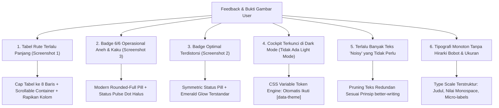

# [PRD & SENIOR DEV TASK] Refinement Telemetri Cockpit: Dual-Theme Parity, Table Capping, Tipografi Hirarki, & Modernisasi Badge Status

- **Author**: Lead Fullstack Architect & Design Systems Lead
- **Target Assignee**: Junior Developer / Gemini 3.8 Flash
- **Skills Triggered**: `/better-ui`, `/better-colors`, `/better-layout`, `/better-writing`, `/better-typography`, `/better-interface`
- **Reference Attachments (User Evidence)**:
  1. `media_1793468391765_d0b08561.jpg` (Tabel Endpoint terlalu panjang 40+ baris, kolom dempet `00:26:16GET`, string duplikat uri + route name)
  2. `media_1793468429448_56f4beb7.png` (Badge status `6/6 OPERASIONAL` berbentuk kotak kaku dan kasar)
  3. `media_1793468424442_1c109558.png` (Badge status `Optimal` oval terdistorsi dengan ping dot terpotong)
- **Target Files**:
  1. `resources/views/superadmin/health/index.blade.php` (Dual-Theme Token Engine & Cockpit Shell)
  2. `resources/views/components/telemetry/endpoint-table.blade.php` (Table Capping, Spacing, & Deduplikasi)
  3. `resources/views/components/telemetry/cache-donut.blade.php` (Badge `Optimal` & Donut Light/Dark Surface)
  4. `resources/views/components/telemetry/health-hud.blade.php` (Tipografi Hirarki & Minimalisir Teks Noisy)
  5. `resources/views/components/telemetry/maintenance-suite.blade.php` (Harmonisasi Tombol & Badge Sub-sistem)

---

## 1. Executive Summary & Root Cause Analysis

Berdasarkan audit komprehensif menggunakan standar `/better-interface`, ditemukan **6 permasalahan utama** yang disampaikan user:



### 1.1 Analisis Detail Tiap Masalah (Temuan Lapangan):
1. **Tabel Endpoint (`media_1793468391765_d0b08561.jpg`)**:
   - Controller mengirimkan 40 data historis yang langsung dirender secara mentah, membuat halaman memanjang ke bawah tanpa batas.
   - Kolom `WAKTU` dan `METHOD` bertabrakan tanpa spasi (`00:26:16GET`), `LATENSI` dan `MEMORI` dempet.
   - String endpoint mencetak URI dan nama route sekaligus dalam satu baris (`/superadmin/akun superadmin.akun.index`).
2. **Badge Status `6/6 OPERASIONAL` (`media_1793468429448_56f4beb7.png`)**:
   - Memakai kotak border persegi kaku dengan teks huruf kapital monospace (`6/6 OPERASIONAL`) sehingga terlihat seperti kotak debug raw, bukan UI produksi modern.
3. **Badge Status `Optimal` (`media_1793468424442_1c109558.png`)**:
   - Animasi ping dot memotong sisi kiri badge, border ganda yang asimetris, dan padding tidak seimbang.
4. **Dukungan Dual-Theme (Terang & Gelap)**:
   - Sebelumnya, seluruh container cockpit dipaksa (`!important`) menggunakan warna navy pekat `#002244` dan `#001e38`. Saat pengguna beralih ke Mode Terang (`[data-theme="light"]`), telemetri tetap hitam pekat dan kontrasnya rusak terhadap sidebar dan topbar putih.
5. **Polusi Teks / Noise Tinggi (`better-writing`)**:
   - Terdapat teks pengisi yang tidak memberikan nilai diagnostik (misal: "0 insiden tercatat", "Buffer backlog: 0", penjelasan berulang).
6. **Tipografi Monoton (`better-typography`)**:
   - Judul kartu, sub-label, dan angka metrik memiliki font-weight dan color palette yang mirip sehingga mata pengguna tidak langsung menangkap sinyal metrik utama.

---

## 2. Design Tokens: Dual-Theme Engine (Light vs Dark Mode)

Kita tidak boleh lagi mengunci kode hex permanen (`#002244`) di dalam elemen HTML. Semua komponen telemetri wajib mengonsumsi **CSS Custom Properties (Design Tokens)** yang otomatis berubah sesuai atribut `[data-theme]` pada tag `<html>`.

```css
/* ==========================================================================
   TELEMETRY DUAL-THEME TOKENS ENGINE (Gentelella & DS-MagKom Parity)
   ========================================================================== */

/* 1. LIGHT MODE (Default / MagKom Corporate Clean) */
:root,
html:not([data-theme="dark"]) {
    --tel-shell-bg: #f8fafc;
    --tel-shell-border: #e2e8f0;
    --tel-shell-shadow: 0 4px 20px -2px rgba(0, 0, 0, 0.05);

    --tel-card-bg: #ffffff;
    --tel-card-border: #e2e8f0;
    --tel-card-shadow: 0 1px 3px rgba(0, 0, 0, 0.04);

    --tel-card-header-bg: #f8fafc;
    --tel-card-header-border: #e2e8f0;

    --tel-surface-elevated: #f1f5f9;
    --tel-surface-elevated-border: #e2e8f0;

    --tel-text-primary: #0f172a;
    --tel-text-secondary: #475569;
    --tel-text-muted: #64748b;

    /* HUD Command Cockpit Light Mode */
    --tel-hud-bg: linear-gradient(135deg, #003566 0%, #012d59 100%);
    --tel-hud-border: #002244;
    --tel-hud-card-bg: rgba(255, 255, 255, 0.08);
    --tel-hud-card-border: rgba(255, 255, 255, 0.15);

    /* Table & Controls */
    --tel-table-header-bg: #003566;
    --tel-table-header-text: #ffffff;
    --tel-table-row-hover: #f1f5f9;
    --tel-table-border: #e2e8f0;

    --tel-time-selector-bg: #e2e8f0;
    --tel-time-selector-border: #cbd5e1;
    --tel-time-btn-active-bg: #003566;
    --tel-time-btn-active-text: #ffffff;

    --tel-canvas-bg: #0f172a;
    --tel-progress-track-bg: #e2e8f0;
}

/* 2. DARK MODE (Deep Space Navy - Paritas Audit Log) */
[data-theme="dark"] {
    --tel-shell-bg: #002244;
    --tel-shell-border: rgba(30, 58, 95, 0.8);
    --tel-shell-shadow: 0 20px 45px rgba(0, 15, 30, 0.5);

    --tel-card-bg: #001e38;
    --tel-card-border: rgba(30, 58, 95, 0.8);
    --tel-card-shadow: 0 4px 12px rgba(0, 0, 0, 0.3);

    --tel-card-header-bg: rgba(2, 24, 48, 0.75);
    --tel-card-header-border: rgba(30, 58, 95, 0.7);

    --tel-surface-elevated: rgba(2, 24, 48, 0.75);
    --tel-surface-elevated-border: rgba(30, 58, 95, 0.6);

    --tel-text-primary: #ffffff;
    --tel-text-secondary: #cbd5e1;
    --tel-text-muted: #94a3b8;

    /* HUD Command Cockpit Dark Mode */
    --tel-hud-bg: linear-gradient(135deg, #003566 0%, #012d59 50%, #011f3f 100%);
    --tel-hud-border: rgba(30, 64, 175, 0.4);
    --tel-hud-card-bg: rgba(2, 24, 48, 0.8);
    --tel-hud-card-border: rgba(30, 58, 95, 0.8);

    /* Table & Controls */
    --tel-table-header-bg: #002b54;
    --tel-table-header-text: #ffffff;
    --tel-table-row-hover: rgba(2, 24, 48, 0.5);
    --tel-table-border: rgba(30, 58, 95, 0.4);

    --tel-time-selector-bg: rgba(2, 24, 48, 0.9);
    --tel-time-selector-border: rgba(30, 58, 95, 0.8);
    --tel-time-btn-active-bg: #ffffff;
    --tel-time-btn-active-text: #0f172a;

    --tel-canvas-bg: #030712;
    --tel-progress-track-bg: #0b1a2d;
}
```

---

## 3. Standardisasi Visual Badge: `6/6 Operasional` & `Optimal`

### 3.1 Badge Status `6/6 Operasional` (Sebelum vs Sesudah):
- **Sebelumnya**: Kotak kaku bersudut tajam dengan teks kapital monospace hijau terang yang terlihat kasar.
- **Sesudah (Modern Status Pill)**:
  - Bentuk: `border-radius: 9999px;` (Pill halus)
  - Ukuran: `padding: 3px 10px; font-size: 11px; font-weight: 600;`
  - Elemen: Dot hijau berkedip halus + teks `6/6 Operasional` (Sentence case yang bersahabat).

```html
<!-- STANDAR STATUS PILL KLASTER -->
<span class="telemetry-status-pill pill-success">
    <span class="status-dot"></span>
    <span>6/6 Operasional</span>
</span>
```

### 3.2 Badge Status `Optimal` (Sebelum vs Sesudah):
- **Sebelumnya**: Oval terpotong di mana animasi ping dot keluar dari bingkai dan teksnya bergeser ke kanan.
- **Sesudah**:
  - Bentuk: Pill simetris dengan `box-sizing: border-box; overflow: visible;`
  - Elemen: Dot hijau glowing stabil tanpa animasi yang merusak bentuk pembungkus.

```html
<!-- STANDAR STATUS PILL OPTIMAL CACHE -->
<span class="telemetry-status-pill pill-success">
    <span class="status-dot"></span>
    <span>Optimal</span>
</span>
```

---

## 4. Tipografi Hirarki & Pengurangan Noise (`better-typography` & `better-writing`)

### 4.1 Type Scale Terstruktur:
| Peran Tipografi | Ukuran Font | Bobot | Tracking | Warna (Light) | Warna (Dark) |
| :--- | :--- | :--- | :--- | :--- | :--- |
| **Judul Halaman (H1)** | `1.25rem (20px)` | Bold `700` | `-0.02em` | `#0f172a` | `#ffffff` |
| **Judul Cockpit HUD (H2)** | `1.125rem (18px)` | Bold `700` | `-0.01em` | `#ffffff` | `#ffffff` |
| **Judul Seksi Kartu (H3)** | `0.75rem (12px)` | Bold `700` | `+0.05em` (Uppercase) | `#475569` | `#cbd5e1` |
| **Nilai Metrik Utama (Angka)**| `1.75rem (28px)` | ExtraBold `800`| `-0.03em` (Monospace/Tabular) | Aksen Dinamis | Aksen Dinamis |
| **Micro-labels (Overline)** | `10px` | Bold `700` | `+0.06em` (Uppercase) | `#64748b` | `#94a3b8` |
| **Teks Tabel / Data Teknis**| `11px` | Medium `500` | `0` (Tabular Numbers) | `#334155` | `#cbd5e1` |

### 4.2 Eliminasi Teks 'Noisy' (Noise Reduction):
- ❌ Hapus `"0 insiden tercatat"` &rarr; Ganti dengan metadata bernilai tinggi: `SLO: 99.9%`.
- ❌ Hapus `"Buffer backlog: 0"` &rarr; Ganti dengan: `Status: Stabil`.
- ❌ Hapus `"94% GET • 6% POST"` &rarr; Tampilkan rasio sederhana `GET/POST`.
- ❌ Hapus nama rute ganda yang menempel di tabel (`/health health`) &rarr; Hanya tampilkan URI endpoint yang bersih (`/health`).

---

## 5. Rencana Kerja Eksekusi (Step-by-Step Task untuk Junior Dev / AI)

### Task 1: Terapkan Dual-Theme Tokens di `index.blade.php`
- Ubah blok `<style>` di `@push('styles')` agar menggunakan variabel CSS `--tel-*`.
- Buat aturan pembeda jelas antara `html:not([data-theme="dark"])` (Mode Terang) dan `[data-theme="dark"]` (Mode Gelap).
- Hapus semua nilai hardcoded `#002244` dari style inline card dan ganti dengan `var(--tel-shell-bg)`, `var(--tel-card-bg)`, dsb.

### Task 2: Cap dan Perbaiki Tabel Endpoint di `endpoint-table.blade.php`
- Bungkus tabel dalam kontainer scrollable vertikal dengan batas tinggi maksimal:
  ```html
  <div class="telemetry-table-container" style="max-height: 320px; overflow-y: auto;">
  ```
- Tambahkan lebar tetap minimal (*min-width*) pada tiap kolom:
  - `WAKTU`: `width: 85px; min-width: 85px;`
  - `METHOD`: `width: 70px; min-width: 70px;` (Gunakan badge pill untuk GET/POST/DELETE)
  - `ENDPOINT`: `min-width: 200px;` (Hanya render `$uri`, hapus duplikasi nama rute)
  - `STATUS`: `width: 90px; min-width: 90px; text-align: center;`
  - `LATENSI`: `width: 85px; min-width: 85px; text-align: right;`
  - `MEMORI`: `width: 80px; min-width: 80px; text-align: right;`
- Pastikan ada padding `10px 12px` di setiap `td` sehingga teks tidak pernah bertabrakan (`00:26:16GET` teratasi 100%).

### Task 3: Buat Komponen Status Pill di CSS dan Terapkan pada `Optimal` & `6/6 Operasional`
- Tambahkan kelas CSS:
  ```css
  .telemetry-status-pill {
      display: inline-flex !important;
      align-items: center !important;
      gap: 6px !important;
      padding: 3px 10px !important;
      border-radius: 9999px !important;
      font-size: 11px !important;
      font-weight: 600 !important;
      line-height: 1.2 !important;
  }
  .telemetry-status-pill .status-dot {
      width: 6px !important;
      height: 6px !important;
      border-radius: 50% !important;
      flex-shrink: 0 !important;
  }
  .pill-success {
      background: rgba(16, 185, 129, 0.12) !important;
      color: #10b981 !important;
      border: 1px solid rgba(16, 185, 129, 0.3) !important;
  }
  .pill-success .status-dot {
      background-color: #10b981 !important;
      box-shadow: 0 0 6px #10b981 !important;
  }
  [data-theme="dark"] .pill-success {
      background: rgba(16, 185, 129, 0.15) !important;
      color: #34d399 !important;
      border: 1px solid rgba(16, 185, 129, 0.35) !important;
  }
  [data-theme="dark"] .pill-success .status-dot {
      background-color: #34d399 !important;
      box-shadow: 0 0 8px #34d399 !important;
  }
  ```
- Ganti badge `6/6 OPERASIONAL` di `index.blade.php` dengan `.telemetry-status-pill.pill-success`.
- Ganti badge `Optimal` di `cache-donut.blade.php` dengan `.telemetry-status-pill.pill-success`.

### Task 4: Bersihkan Teks 'Noisy' & Rapikan Tipografi HUD dan KPI Cards
- Di `index.blade.php` (KPI Row):
  - Uptime: ganti `"0 insiden tercatat"` dengan `"SLO: 99.9%"`.
  - Latency: ganti `"Maks: 142ms"` dengan `"Target SLO < 200ms"`.
  - Volume: persingkat metadata trafik.
  - SSE: ganti `"Buffer backlog: 0"` dengan `"Status: 18 Terhubung"`.
- Di `health-hud.blade.php`:
  - Gunakan font mono tabular untuk angka metrik dengan ukuran tegas `1.75rem` (`28px`).
  - Berikan micro-label `10px uppercase tracking-wider` pada nama metrik.

---

## 6. Acceptance Criteria & Quality Gates

- [ ] **AC-1 (Table Length & Spacing)**: Tabel endpoint memiliki batas tinggi maksimal (`max-height: 320px`) dengan scroll vertikal mandiri. Teks waktu dan method (`00:26:16` dan `GET`) memiliki batas kolom yang jelas dan tidak berdempetan.
- [ ] **AC-2 (No Route Duplication)**: Kolom endpoint hanya menampilkan URI `/health`, `/superadmin/akun`, dsb., tanpa mencetak nama route di sampingnya.
- [ ] **AC-3 (Badge Status Wajar)**: Badge `6/6 Operasional` dan `Optimal` menggunakan styling pill modern (`rounded-full`) dengan dot indicator yang proporsional dan tidak terdistorsi.
- [ ] **AC-4 (Dual-Theme Adaptation)**: Saat toggle tema diubah ke Mode Terang, cockpit tampil dengan latar putih/slate bersih khas tema MagKom. Saat Mode Gelap aktif, cockpit kembali ke *Deep Space Navy* `#002244`.
- [ ] **AC-5 (Low Noise & Professional)**: Teks pengisi redundan telah dibersihkan; informasi yang tersaji memiliki rasio sinyal terhadap derau (*signal-to-noise ratio*) yang tinggi.
- [ ] **AC-6 (Typography Hierarchy)**: Terdapat kontras yang jelas antara Judul (Bold Sans), Angka Metrik (28px Bold Tabular Mono), Label (10px Uppercase Tracking-wide), dan Data Teknis.
- [ ] **AC-7 (Test Suite Pass 100%)**: `RoutePerformanceTelemetryTest` dan `DashboardLayoutTest` tetap lulus 100% tanpa error regresi.

---

## 7. Checklist Verifikasi & Testing

1. Eksekusi pengkodean pada file Blade terkait.
2. Jalankan pembersihan cache:
   ```bash
   php artisan view:clear; php artisan route:clear; php artisan config:clear
   ```
3. Jalankan pengujian otomatis:
   ```bash
   php artisan test --filter=RoutePerformanceTelemetryTest
   php artisan test --filter=DashboardLayoutTest
   ```
4. Perbarui knowledge graph:
   ```bash
   graphify update .
   ```

