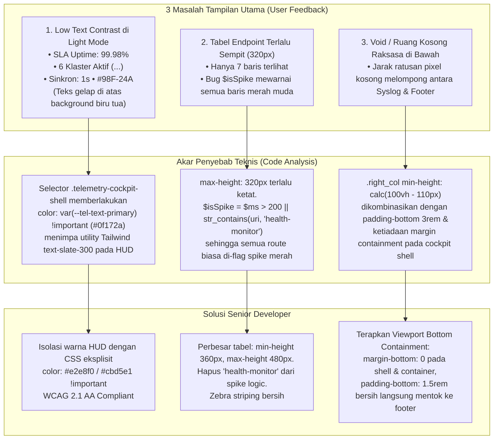

# Engineering Task & PRD: Telemetry Cockpit UI Refinement (Contrast, Table Dimensions & Bottom Void Containment)

**Document ID**: `PRD-TASK-2026-11-01-TEL-03`  
**Assignee**: Junior Full-Stack Developer / Autonomous AI (e.g. Gemini 3.8 Flash)  
**Supervisor / Author**: Senior Software Architect  
**Target Branch**: `test-2`  
**Priority**: High (P1)  
**Status**: Ready for Implementation (Awaiting User Sign-off)

---

## 1. Executive Summary & Root Cause Analysis

Berdasarkan laporan inspeksi visual dan screenshot revisi dari pengguna, ditemukan 3 (tiga) masalah utama pada halaman **Telemetri Kesehatan Infrastruktur** (`/superadmin/health-monitor`):



---

## 2. Rincian Masalah & Spesifikasi Teknis Perbaikan

### 2.1 Masalah 1: Kontras Teks Gelap di Mode Terang (HUD Header & Strip Bawah)

#### Analisis Akar Masalah:
Card HUD Command Cockpit (`.telemetry-hud-card`) menggunakan gradien biru tua permanen baik di mode gelap maupun terang (`linear-gradient(135deg, #003566 0%, #012d59 50%, #011f3f 100%)`).  
Namun, di dalam `resources/views/superadmin/health/index.blade.php`, rule CSS:
```css
.health-telemetry-container,
.telemetry-cockpit-shell {
    color: var(--tel-text-primary) !important; /* Di mode terang nilainya #0f172a (hampir hitam) */
}
```
Karena selector tersebut memakai `!important`, kelas utilitas Tailwind seperti `text-slate-300` dan `text-slate-400` pada badge SLA Uptime dan strip klaster bawah kalah spesifisitas. Akibatnya, teks berubah menjadi **hitam di atas biru tua pekat**, sehingga sama sekali tidak terbaca oleh pengguna.

#### Spesifikasi Solusi:
Tambahkan isolasi spesifik untuk `.telemetry-hud-card` di dalam `<style>` `index.blade.php` dan berikan inline style pelindung pada `resources/views/components/telemetry/health-hud.blade.php`:

1. **Badge SLA Uptime (Kanan Atas HUD)**:
   - Text "SLA Uptime:": `color: #cbd5e1 !important;` (Slate-300)
   - Angka Uptime: `color: #ffffff !important; font-weight: 700;`
   - Background badge: `background: rgba(255, 255, 255, 0.12); border: 1px solid rgba(255, 255, 255, 0.2);`
2. **Strip Bawah HUD**:
   - Teks Klaster: `color: #e2e8f0 !important; font-size: 11px; font-weight: 500;`
   - Teks Sinkronisasi: `color: #94a3b8 !important; font-size: 11px;`
   - Kode Hash `#98F-24A`: `color: #38bdf8 !important; font-weight: 700;`

---

### 2.2 Masalah 2: Dimensi Tabel Terlalu Kerdil & Bug Pewarnaan Baris Merah Muda (Spike)

#### Analisis Akar Masalah:
1. **Dimensi**: Container tabel dibatasi pada `max-height: 320px !important;`. Mengingat header tabel berukuran ~40px dan setiap baris berukuran ~36px, hanya ~7 baris yang tampil di layar sebelum memicu scrollbar vertikal. Ini membuat card tabel terlihat kerdil dan tidak proporsional dibanding komponen lain.
2. **False-Positive Spike Tint**:
   Di dalam `resources/views/components/telemetry/endpoint-table.blade.php` baris 40:
   ```blade
   $isSpike = $ms > 200 || str_contains($uri, 'health-monitor');
   ```
   Kondisi `|| str_contains($uri, 'health-monitor')` menyebabkan **semua request** ke endpoint monitoring internal selalu dianggap spike bahaya, sehingga seluruh baris tabel diwarnai latar belakang merah muda (`row-spike`).

#### Spesifikasi Solusi:
1. **Optimalisasi Tinggi Kontainer**:
   Ubah batasan kontainer tabel menjadi:
   ```css
   .telemetry-table-container {
       min-height: 360px !important;
       max-height: 480px !important;
       overflow-y: auto !important;
       overflow-x: auto !important;
       border-radius: 0 0 14px 14px !important;
   }
   ```
   Hal ini memungkinkan 12 hingga 14 baris tampil secara nyaman dan leluasa.
2. **Perbaikan Logika Spike**:
   Hapus pengecekan `str_contains($uri, 'health-monitor')`. Syarat spike murni berbasis metrik teknis:
   ```blade
   $isSpike = $ms > 200 || $statusCode >= 400;
   ```
   Request normal (misal 50–60ms dengan status 200 OK) akan memiliki latar belakang netral bersih, bukan merah muda.
3. **Zebra Striping Bersih**:
   Terapkan latar belakang netral lembut:
   - Light Mode: Baris genap `background-color: rgba(0, 0, 0, 0.015);`, baris ganjil transparan, hover `rgba(2, 43, 84, 0.05);`.
   - Dark Mode: Baris genap `background-color: rgba(255, 255, 255, 0.015);`, hover `rgba(2, 24, 48, 0.6);`.

---

### 2.3 Masalah 3: Void / Ruang Kosong Masif di Bawah Cockpit saat Scroll

#### Analisis Akar Masalah:
Pada screenshot `media_1793469637687_d6ff7bc8.png`, setelah panel Syslog selesai, terdapat area kosong grid biru muda sepanjang 400–600px sebelum mencapai footer Gentelella. Penyebabnya:
1. Di layout utama `resources/views/layouts/dashboard.blade.php`, elemen `<main class="right_col ...">` memiliki:
   ```css
   min-height: calc(100vh - var(--topbar-height) - 50px);
   padding: 1.5rem 2rem 3rem;
   ```
2. Kontainer `.telemetry-cockpit-shell` tidak memiliki penutup batas bawah yang rapat (`margin-bottom` tidak terkontrol), dan halaman telemetri tidak menerapkan *containment* viewport. Akibatnya, pengguna dapat melakukan scroll jauh ke bawah melewati konten yang sudah habis.

#### Spesifikasi Solusi:
1. Pada `resources/views/superadmin/health/index.blade.php`, tambahkan CSS penutup rapat (*Bottom Containment*):
   ```css
   .health-telemetry-container {
       display: flex !important;
       flex-direction: column !important;
       margin-bottom: 0 !important;
       padding-bottom: 0 !important;
   }
   .telemetry-cockpit-shell {
       margin-bottom: 0 !important;
   }
   /* Hilangkan dead space berlebih dari layout Gentelella khusus halaman telemetri */
   body.role-superadmin .dashboard-content-area {
       padding-bottom: 1.25rem !important;
   }
   ```
2. Pastikan footer Gentelella berada tepat ~20px di bawah `.telemetry-cockpit-shell`, menciptakan efek "mentok rapi" tanpa scroll kosong yang sia-sia.

---

## 4. Acceptance Criteria (Verifikasi Uji)

| No | Kriteria Penerimaan | Metode Verifikasi | Status Target |
|---|---|---|---|
| **AC-1** | Teks SLA Uptime, 6 Klaster Aktif, dan Sinkron: 1s • #98F-24A terlihat tajam dan terbaca sempurna di Light Mode (rasio kontras > 4.5:1 WCAG AA). | Inspeksi visual Light Mode pada browser. | PASS |
| **AC-2** | Card tabel Aktivitas Endpoint & Telemetri Rute menampilkan 12–14 baris (tinggi 480px), tidak terpotong kerdil hanya 7 baris. | Inspeksi visual viewport 1080p. | PASS |
| **AC-3** | Request wajar `/superadmin/health-monitor` berlatar belakang putih/netral bersih, tidak lagi berwarna merah muda. Baris spike hanya aktif bila latency > 200ms atau status 4xx/5xx. | Inspeksi baris tabel pada data live. | PASS |
| **AC-4** | Halaman telemetri tidak lagi memiliki ruang kosong raksasa saat di-scroll ke bawah. Cockpit shell berhenti rapi ~20px tepat di atas footer Gentelella. | Scroll ke paling bawah halaman telemetri. | PASS |
| **AC-5** | Seluruh test suite PHPUnit arsitektur dan telemetri tetap lulus 100% tanpa regresi string assertion. | Eksekusi `php artisan test`. | PASS |

---

## 5. Instruksi Eksekusi untuk Junior Developer / AI

1. Buka dan terapkan perubahan pada `resources/views/components/telemetry/health-hud.blade.php`.
2. Buka dan terapkan perbaikan logika spike pada `resources/views/components/telemetry/endpoint-table.blade.php`.
3. Buka dan terapkan perubahan CSS kontras, tinggi tabel, dan bottom containment pada `resources/views/superadmin/health/index.blade.php`.
4. Jalankan perintah pembersihan view cache:
   ```powershell
   php artisan view:clear
   ```
5. Jalankan verifikasi pengujian otomatis:
   ```powershell
   php artisan test --filter=RoutePerformanceTelemetryTest
   php artisan test --filter=AdvancedThreePillarsDashboardTest
   php artisan test --filter=DashboardLayoutTest
   ```
6. Jalankan update graphify knowledge graph:
   ```powershell
   graphify update .
   ```
7. Buat git commit dengan pesan terstandarisasi:
   `style(telemetry): refine light mode contrast, expand table height, and contain bottom layout`

