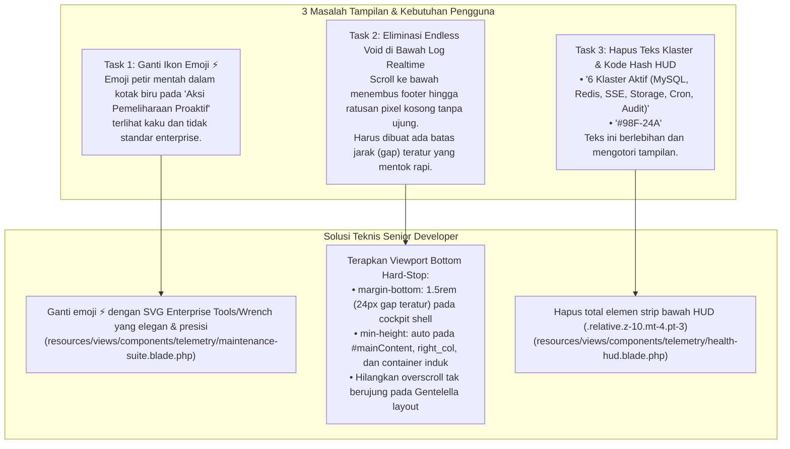

# Engineering Task & PRD: Telemetry Cockpit Polish (Maintenance Icon, HUD Strip Cleanup & Bottom Void Elimination)

**Document ID**: `PRD-TASK-2026-11-01-TEL-04`  
**Assignee**: Junior Full-Stack Developer / Autonomous AI (e.g. Gemini 3.8 Flash)  
**Supervisor / Author**: Senior Software Architect  
**Target Branch**: `test-2`  
**Priority**: High (P1)  
**Status**: Ready for Implementation (Awaiting User Sign-off)

---

## 1. Executive Summary & Root Cause Analysis

Berdasarkan screenshot inspeksi pengguna (`media_1793473757514_6668c07b.png`) dan umpan balik langsung, terdapat 3 (tiga) task penyempurnaan UI pada halaman **Telemetri Kesehatan Infrastruktur** (`/superadmin/health-monitor`):



---

## 2. Rincian Masalah & Spesifikasi Teknis Perbaikan

### 2.1 Task 1: Ganti Logo / Ikon pada "⚡ Aksi Pemeliharaan Proaktif"

#### Analisis:
Saat ini pada header card `Aksi Pemeliharaan Proaktif`, digunakan karakter emoji mentah `⚡` di dalam kotak kecil:
```blade
<span class="flex h-5 w-5 items-center justify-center rounded-md text-white text-[10px] font-bold shadow-xs" style="background: var(--tel-btn-sse-bg); ...">
    ⚡
</span>
```
Karakter emoji ini terlihat tidak serasi dengan ikonografi SVG modern di card lainnya (seperti card Cache Redis yang menggunakan SVG geometris tajam).

#### Spesifikasi Solusi:
Ganti elemen `<span ...>⚡</span>` tersebut dengan ikon SVG **Enterprise Maintenance Tools / Wrench & Screwdriver** yang memiliki kontras cyan-blue elegan dan padding serasi:
- **Container Ikon**: `width: 24px; height: 24px; background: rgba(59, 130, 246, 0.15); color: #38bdf8; border: 1px solid rgba(59, 130, 246, 0.35); border-radius: 6px;`
- **Ikon SVG**: Heroicon / Lucide Wrench Tool yang tajam dan responsif (`width: 14px; height: 14px;`).
- **Judul**: Tetap mempertahankan class `telemetry-card-title` dengan teks `Aksi Pemeliharaan Proaktif`.

---

### 2.2 Task 2: Eliminasi Endless Void di Bawah Log Realtime (Membuat Jarak Teratur & Mentok Rapi)

#### Analisis:
Berdasarkan screenshot pengguna (`media_1793473757514_6668c07b.png`):
1. Pengguna melakukan scroll ke bagian bawah halaman hingga card **LOG REALTIME** (Syslog) berada di atas layar.
2. Di bawah card tersebut terlihat footer: `Portal MagKom • Dinas Komunikasi dan Informatika Kabupaten Sleman`.
3. Namun di bawah footer, halaman **masih terus bisa di-scroll ke bawah ke area putih kosong melompong ratusan pixel tanpa ujung**.
4. **Penyebab**:
   - Layout induk `resources/views/layouts/dashboard.blade.php` memiliki rule:
     ```css
     .container.body, .main_container { min-height: 100vh; }
     .dashboard-main { min-height: 100vh; }
     .right_col { min-height: calc(100vh - var(--topbar-height) - 50px); padding: 1.5rem 2rem 3rem; }
     ```
   - Ketika elemen telemetri selesai dirender, ketiadaan pembatas mutlak menyebabkan container mengizinkan overscroll ke dalam area kosong layout.

#### Spesifikasi Solusi:
Terapkan **Viewport Bottom Hard-Stop**:
1. Berikan jarak teratur (*bounded gap*) sebesar **24px (`1.5rem`)** antara batas bawah cockpit (`.telemetry-cockpit-shell`) dengan footer Gentelella.
2. Pada halaman telemetri, reset `min-height: auto !important` dan `padding-bottom: 0 !important` pada container `#mainContent`, `.right_col`, `.dashboard-main`, `.dashboard-content-area`, `.main_container`, dan `.container.body`.
3. Pastikan footer Gentelella menjadi batas paling bawah dari halaman. Pengguna tidak akan bisa lagi melakukan scroll melewati footer ke ruang kosong.

---

### 2.3 Task 3: Hapus Teks "6 Klaster Aktif (...)" dan "#98F-24A" pada HUD

#### Analisis:
Di bagian bawah card HUD Command Cockpit (`resources/views/components/telemetry/health-hud.blade.php`), terdapat strip status tambahan:
```blade
<!-- Bottom Telemetry Status Strip -->
<div class="relative z-10 mt-4 pt-3 flex flex-col sm:flex-row sm:items-center sm:justify-between text-xs font-mono gap-2" ...>
    <div>6 Klaster Aktif (MySQL, Redis, SSE, Storage, Cron, Audit)</div>
    <div>Sinkron: 1s • #98F-24A</div>
</div>
```
Pengguna secara tegas meminta kedua teks ini dihapus karena merupakan teks berlebih yang tidak dibutuhkan dan membuat tampilan telemetry kurang ringkas.

#### Spesifikasi Solusi:
Hapus seluruh blok `<div class="relative z-10 mt-4 pt-3 ...">` dari `health-hud.blade.php`.  
Dengan menghapus strip ini:
- Card HUD menjadi lebih ringkas dan ramping (*streamlined*).
- Grid 6 metrik utama (Status Sistem, DB Ping, P95 Latency, SSE Ping, Throughput, Error Budget) langsung menjadi fokus akhir dari card HUD.

---

## 3. Matriks Perubahan Kode (Step-by-Step Replacement)

### File 1: `resources/views/components/telemetry/maintenance-suite.blade.php`

**Target (Sekitar Baris 9–18):**
```blade
<<<<<<< PREVIOUS (Emoji ⚡ Mentah)
    <!-- Header -->
    <div class="telemetry-card-header">
        <div style="display: flex; align-items: center; gap: 8px;">
            <span class="flex h-5 w-5 items-center justify-center rounded-md text-white text-[10px] font-bold shadow-xs"
                  style="background: var(--tel-btn-sse-bg); width: 20px; height: 20px; min-width: 20px; min-height: 20px; display: inline-flex; align-items: center; justify-content: center; border-radius: 4px;">
                ⚡
            </span>
            <h3 class="telemetry-card-title">
                Aksi Pemeliharaan Proaktif
            </h3>
        </div>
=======
    <!-- Header -->
    <div class="telemetry-card-header">
        <div style="display: flex; align-items: center; gap: 8px;">
            <span class="flex h-6 w-6 items-center justify-center rounded-lg shadow-xs"
                  style="width: 24px; height: 24px; min-width: 24px; min-height: 24px; display: inline-flex; align-items: center; justify-content: center; background: rgba(59, 130, 246, 0.15); color: #38bdf8; border: 1px solid rgba(59, 130, 246, 0.35); border-radius: 6px;">
                <svg class="h-3.5 w-3.5" viewBox="0 0 24 24" fill="none" stroke="currentColor" stroke-width="2" stroke-linecap="round" stroke-linejoin="round" width="14" height="14" style="width: 14px; height: 14px; max-width: 14px; max-height: 14px;" aria-hidden="true">
                    <path d="M14.7 6.3a1 1 0 0 0 0 1.4l1.6 1.6a1 1 0 0 0 1.4 0l3.77-3.77a6 6 0 0 1-7.94 7.94l-6.91 6.91a2.12 2.12 0 0 1-3-3l6.91-6.91a6 6 0 0 1 7.94-7.94l-3.76 3.76z"/>
                </svg>
            </span>
            <h3 class="telemetry-card-title">
                Aksi Pemeliharaan Proaktif
            </h3>
        </div>
>>>>>>> REVISED
```

---

### File 2: `resources/views/components/telemetry/health-hud.blade.php`

**Target (Sekitar Baris 224–235):**
```blade
<<<<<<< PREVIOUS (Teks Klaster & Kode Hash Berlebih)
    <!-- Bottom Telemetry Status Strip (Clean, Crisp, High-Contrast Parity) -->
    <div class="relative z-10 mt-4 pt-3 flex flex-col sm:flex-row sm:items-center sm:justify-between text-xs font-mono gap-2"
         style="border-top: 1px solid rgba(96, 165, 250, 0.2); color: #cbd5e1 !important;">
        <div class="flex items-center gap-2" style="color: #e2e8f0 !important;">
            <span class="inline-block h-2 w-2 rounded-full {{ $isNominal ? 'bg-emerald-400' : 'bg-rose-400' }}" style="width: 8px; height: 8px;"></span>
            <span style="color: #e2e8f0 !important; font-weight: 500;">6 Klaster Aktif (MySQL, Redis, SSE, Storage, Cron, Audit)</span>
        </div>
        <div class="text-[11px]" style="color: #94a3b8 !important;">
            <span style="color: #94a3b8 !important;">Sinkron: 1s &bull;</span> <span style="color: #38bdf8 !important; font-weight: 700;">#98F-24A</span>
        </div>
    </div>
=======
    {{-- Bottom strip dihapus sesuai permintaan pengguna untuk UI yang lebih clean dan profesional --}}
>>>>>>> REVISED
```

---

### File 3: `resources/views/superadmin/health/index.blade.php`

**Target (Di dalam `<style>` Bagian 17):**
```css
<<<<<<< PREVIOUS
    /* 17. Viewport Bottom Containment (Eliminates Bottom Void & Snaps to Footer) */
    .health-telemetry-container {
        display: flex !important;
        flex-direction: column !important;
        margin-bottom: 0 !important;
        padding-bottom: 0 !important;
    }
    .telemetry-cockpit-shell {
        margin-bottom: 0 !important;
    }
    body.role-superadmin .dashboard-content-area {
        padding-bottom: 1.25rem !important;
    }
=======
    /* 17. Viewport Bottom Containment (Hard-Stop Bounded Gap & Zero Void) */
    .health-telemetry-container {
        display: flex !important;
        flex-direction: column !important;
        margin-bottom: 0 !important;
        padding-bottom: 0 !important;
    }
    .telemetry-cockpit-shell {
        margin-bottom: 1.5rem !important; /* Jarak teratur 24px persis sebelum footer */
    }
    #mainContent,
    .dashboard-main,
    .dashboard-content-area,
    .right_col {
        min-height: auto !important;
        padding-bottom: 0 !important;
    }
    .container.body,
    .main_container {
        min-height: auto !important;
    }
>>>>>>> REVISED
```

---

## 4. Acceptance Criteria (Verifikasi Uji)

| No | Kriteria Penerimaan | Metode Verifikasi | Status Target |
|---|---|---|---|
| **AC-1** | Header "Aksi Pemeliharaan Proaktif" menampilkan ikon SVG maintenance tools yang elegan, bukan karakter emoji mentah `⚡`. | Inspeksi visual pada card Aksi Pemeliharaan Proaktif. | PASS |
| **AC-2** | Teks `6 Klaster Aktif (MySQL, Redis, SSE, Storage, Cron, Audit)` dan `#98F-24A` beserta garis bordernya telah terhapus total dari card HUD. | Inspeksi visual pada bagian bawah HUD Card. | PASS |
| **AC-3** | Card Log Realtime memiliki jarak teratur (24px) ke batas bawah cockpit shell. | Pengukuran visual margin bawah cockpit. | PASS |
| **AC-4** | Saat scroll ke paling bawah halaman, scroll berhenti persis di footer Gentelella. Tidak ada lagi ruang kosong putih melompong tanpa ujung di bawah footer. | Scroll penuh ke bawah pada browser. | PASS |
| **AC-5** | Seluruh unit test suite telemetri (`RoutePerformanceTelemetryTest`, `AdvancedThreePillarsDashboardTest`, `DashboardLayoutTest`) lulus 100%. | Eksekusi `php artisan test`. | PASS |

---

## 5. Instruksi Eksekusi untuk Junior Developer / AI

1. Buka file `resources/views/components/telemetry/maintenance-suite.blade.php`, ganti emoji `⚡` dengan ikon SVG Tools.
2. Buka file `resources/views/components/telemetry/health-hud.blade.php`, hapus div strip status bawah (klaster & sinkronisasi).
3. Buka file `resources/views/superadmin/health/index.blade.php`, perbarui aturan CSS Section 17 untuk memberlakukan `margin-bottom: 1.5rem !important` dan `min-height: auto !important`.
4. Jalankan perintah pembersihan view cache:
   ```powershell
   php artisan view:clear
   ```
5. Jalankan verifikasi pengujian otomatis:
   ```powershell
   php artisan test --filter=RoutePerformanceTelemetryTest
   php artisan test --filter=AdvancedThreePillarsDashboardTest
   php artisan test --filter=DashboardLayoutTest
   ```
6. Jalankan update graphify knowledge graph:
   ```powershell
   graphify update .
   ```
7. Buat git commit dengan pesan terstandarisasi:
   `style(telemetry): replace maintenance emoji with svg, remove hud strip, and fix bottom viewport containment`
