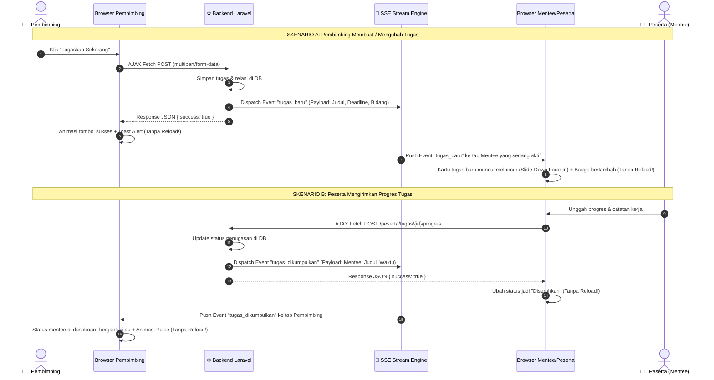

# ARSITEKTUR & PLAN TEKNIS: Animasi Google Classroom & Sistem Realtime Tanpa Reload

**Dari:** Senior Lead Architect MAGKOM  
**Untuk:** Product Owner & Tim Pengembang  
**Topik:** Evaluasi Kebutuhan Inertia.js/Vue/React vs Vanilla Modern, Rancangan Animasi Google Classroom, dan Mekanisme Realtime Tanpa Reload.  
**Status:** Architecture Approved / Ready for Review  

---

## 1. Jawaban Langsung: Apakah Butuh Laravel + Inertia.js (Vue 3 atau React)?

> [!IMPORTANT]
> **Jawabannya: TIDAK PERLU sama sekali.**  
> Semua kebutuhan Anda — animasi mengetik halus ala Google Classroom dan interaksi realtime tanpa reload (antara Pembimbing dan Peserta) — **100% dapat dicapai secara lebih elegan, lebih ringan, dan instan menggunakan stack MAGKOM saat ini (Laravel Blade + Vanilla ES Modules + CSS Modern + Server-Sent Events/SSE).**

### Mengapa TIDAK Perlu Migrasi ke Inertia.js / React / Vue?
1. **Repository MAGKOM Sudah Memiliki Engine Realtime**: MAGKOM sudah memiliki infrastruktur SSE (*Server-Sent Events*) bawaan di `resources/js/services/realtime.js` yang sudah meng-handle event `tugas_baru` dan `tugas_dikumpulkan`.
2. **Kepatuhan Aturan Permanen Proyek (`AGENTS.md`)**:
   - Aturan Bagian 2 menyatakan baseline teknologi adalah **Blade + Vanilla CSS + Vanilla JS (ES Modules)**.
   - Mengubah stack ke React/Vue akan membongkar seluruh master layout, merusak pipeline Vite, dan membatalkan validasi **532 test PHPUnit** yang saat ini sudah 100% lulus hijau.
3. **Performa & Bundle Size**:
   - Vue/React + Inertia menambah overhead runtime sebesar 150KB - 300KB JS, kompilasi runtime yang lebih lambat, dan risiko *hydration mismatch*.
   - Vanilla JS + CSS modern berjalan langsung di engine browser secara native (**0 milidetik overhead**, animasi 60 FPS mentok tanpa *jank*).

---

## 2. Rancangan Fitur 1: Animasi Mengetik & Fokus Ala Google Classroom

Google Classroom menggunakan filosofi desain **Google Material 3**, di mana setiap interaksi input terasa "hidup" dan responsif:

```
[ Inactive State ] ──(Click/Focus)──> [ Active State ] ──(Typing)──> [ Elastic Expanding ]
 Border abu-abu tipis              Ink-line biru mekar                Tinggi box bertambah elastis
 Placeholder statis                dari tengah ke samping             Karakter & formatting aktif
```

### Detail Animasi yang Akan Diimplementasikan:
1. **Ink-Ripple Active Line (Animasi Garis Bawah Mekar)**:
   - Pada input judul dan instruksi, garis border bawah memiliki pseudoelemen `::after` berwarna biru Google (`#1a73e8`).
   - Saat input disentuh atau difokuskan (`:focus-within`), garis mekar secara elastis dari titik tengah ke sisi kiri-kanan menggunakan `transform: scaleX(0) -> scaleX(1)` dengan timing function `cubic-bezier(0.4, 0, 0.2, 1)` durasi `250ms`.
2. **Smooth Elastic Auto-Expand Textarea**:
   - Kotak instruksi memiliki tinggi default yang kompak.
   - Saat pengguna mulai mengetik teks panjang atau menyisipkan baris baru (Enter), tinggi container bertambah secara dinamis mengikuti konten tanpa memunculkan scrollbar kaku (`transition: height 0.15s ease-out`).
3. **Active Glow Elevation & Subtle Elevation**:
   - Card yang sedang diketik mendapatkan *subtle box-shadow elevation* (`0 2px 6px rgba(60,64,67,0.15)`) yang membuat fokus pengguna terkunci nyaman pada area pengerjaan.
4. **Formatting Toolbar Entrance Transition**:
   - Toolbar tombol format (B, I, U, ≡, Tx) muncul dengan transisi *fade-in & slide-up* yang halus saat input instruksi difokuskan, dan tetap nyaman digunakan tanpa mengganggu pandangan.

---

## 3. Rancangan Fitur 2: Alur Realtime Tanpa Reload (Bi-directional)

MAGKOM tidak memerlukan WebSocket berbayar pihak ketiga (seperti Pusher berbayar) karena sudah memiliki arsitektur **HTTP Server-Sent Events (SSE)** yang hemat resource, zero-cost, dan didukung penuh oleh browser modern.

### Diagram Alur Realtime Tanpa Reload:



---

## 4. Rencana Kerja Implementasi (Actionable Tasks)

### Phase 1: CSS & UI Micro-Interactions (Google Classroom Feel)
- [ ] Buat class `.tugas-ink-bar` dengan transisi `transform: scaleX(...)` pada border bawah form input.
- [ ] Implementasikan auto-expanding logic pada `.tugas-visual-editor` saat mengetik baris baru.
- [ ] Tambahkan animasi hover dan active elevation pada kartu form penugasan.
- [ ] Buat keyframes CSS `@keyframes slideDownFade` untuk penyisipan item baru secara halus.

### Phase 2: AJAX Submissions (Eliminasi Full Page Reload)
- [ ] Ubah form submission di `resources/js/pages/pembimbing/tugas-create.js` menjadi `fetch()` asynchronous dengan `FormData`.
- [ ] Tampilkan animasi loading spinner pada tombol `Tugaskan Sekarang` saat request berjalan.
- [ ] Tangani respons sukses dengan menampilkan Toast Notifikasi dan redirect dinamis atau reset form mulus.
- [ ] Ubah modal penyerahan tugas peserta di portal mentee menjadi AJAX fetch yang sama.

### Phase 3: SSE Realtime Hooking (Live Sync Tanpa Reload)
- [ ] Hubungkan listener `tugas_baru` di `realtime.js` ke container feed tugas di dashboard peserta.
- [ ] Saat event diterima, render komponen kartu tugas secara langsung ke dalam DOM peserta dengan animasi `slideDownFade`.
- [ ] Hubungkan listener `tugas_dikumpulkan` di dashboard pembimbing untuk memperbarui badge progres dan counter evaluasi secara instan tanpa reload.

---

## 5. Kesimpulan & Rekomendasi Senior

1. **Tetap Gunakan Baseline Teknologi MAGKOM**: Anda **tidak perlu dan tidak disarankan beralih ke Inertia.js / Vue / React**. Menggunakan stack yang ada menjaga stabilitas, kecepatan loading, dan 532 test yang sudah lulus.
2. **Kualitas Hasil Sama Persis (Bahkan Lebih Cepat)**: Dengan Vanilla CSS keyframes dan Vanilla JS EventSource/Fetch, efek animasi Google Classroom dan realtime tanpa reload akan terasa sangat instan, mulus di 60 FPS, dan hemat resource server.

