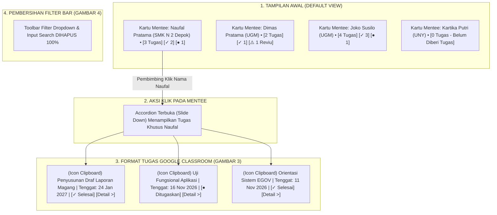

# [PRD & SENIOR DEV TASK] Rekonstruksi Stream Tugas Pembimbing: Paradigma Mentee-First Ala Google Classroom

- **Author**: Lead Fullstack Architect & Systems Designer
- **Target Assignee**: Junior Developer / AI Assistant (Gemini 3.8 Flash Parity)
- **Status**: Ready for Implementation (Comprehensive, Strict Guardrails & Step-by-Step)
- **Target Files**:
  1. `app/Http/Controllers/Pembimbing/TugasController.php` (Eager Loading Penempatan & Nested Tugas)
  2. `resources/views/pembimbing/tugas/index.blade.php` (Pembersihan Filter Bar & Restrukturisasi Mentee Accordion)
  3. `resources/css/pages/pembimbing/tugas-index.css` (Styling Kartu Mentee & Task Row Google Classroom)
  4. `resources/js/pages/pembimbing/tugas-index.js` (Interaksi Accordion Mentee Stream Tanpa Inline Script)
- **Lampiran Gambar Referensi Pengguna**:
  - **Gambar 1 (`media_1793764230937_bdee7122.png`)**: Daftar mentee bimbingan aktif (nama & institusi) yang sebelumnya tersembunyi di dalam dropdown select.
  - **Gambar 2 (`media_1793764269851_20076274.png`)**: Kondisi eksisting di mana seluruh tugas bercampur aduk jadi satu stream panjang, dan nama mentee hanya menjadi teks kecil di dalam kartu tugas.
  - **Gambar 3 (`media_1793764298360_ce0cc562.png`)**: Format acuan Google Classroom — baris tugas yang ramping (*compact horizontal row*), ikon clipboard di kiri, judul tugas di tengah, status/tanggal di kanan, dan menu aksi di ujung kanan.
  - **Gambar 4 (`media_1793764564156_97b9febd.png`)**: Toolbar pencarian dan dropdown filter mentee eksisting yang **wajib dihilangkan 100%**.

---

## 1. Executive Summary & Masalah yang Diselesaikan

### 1.1 Masalah pada Paradigma Lama (*Task-Centric Flat Stream*):
Pada sistem saat ini (Gambar 2):
1. **Tugas Bercampur Aduk**: Semua tugas dari 13 mentee ditampilkan sekaligus dalam satu daftar panjang. Pembimbing kesulitan melacak *"tugas apa saja yang sudah dikerjakan oleh Naufal?"* tanpa harus menyaring satu per satu.
2. **Ketergantungan pada Filter Bar yang Kaku (Gambar 4)**: Untuk melihat tugas mentee tertentu, pembimbing harus mengklik dropdown filter yang panjang (Gambar 1), memilih nama, dan mengklik tombol "Filter" yang memicu HTTP reload. Ini memperlambat alur kerja pembimbing.
3. **Ukuran Kartu Tugas Terlalu Tinggi**: Setiap kartu tugas memakan ruang vertikal yang besar, sehingga memuat sedikit item di layar (*low information density*).

### 1.2 Solusi Baru yang Diinginkan Pengguna (*Mentee-First / Google Classroom People & Task Stream*):


---

## 2. Spesifikasi Fungsional & Kriteria Penerimaan (Acceptance Criteria)

### AC-01: Penghapusan Toolbar Filter & Search Bar
- **Dihapus Sepenuhnya**: Elemen `<div class="task-filter-toolbar">` yang berisi dropdown mentee, kolom input pencarian, tombol "Filter", dan tombol "Reset" (Gambar 4) harus dihapus dari tampilan.
- **Rasional**: Pengguna tidak lagi membutuhkan toolbar tersebut karena seluruh mentee sudah tersaji rapi secara visual di halaman utama.

### AC-02: Tampilan Awal Kartu Mentee (Mentee Header Card)
- Halaman awal menampilkan deretan **Kartu Peserta Magang (Mentee Cards)** dari seluruh peserta bimbingan aktif pembimbing yang bersangkutan.
- Setiap Kartu Mentee memuat informasi:
  1. **Avatar / Inisial**: Lingkaran inisial mentee berlatar Sleman Blue `#EFF6FF` dengan teks `#01347C` (atau foto profil jika tersedia).
  2. **Nama Lengkap Peserta**: Tipografi tebal `font-weight: 700`, ukuran `1.05rem`, warna `#0F172A`.
  3. **Identitas Institusi & Jurusan**: `SMK Negeri 2 Depok Sleman` atau `Universitas Gadjah Mada • Teknologi Informasi`.
  4. **Ringkasan Penugasan (Badge Pills)**:
     - Total tugas (misal: `3 Tugas`).
     - Badge sukses hijau jika ada tugas selesai (misal: `✓ 2 Selesai`).
     - Badge peringatan oranye jika ada laporan butuh reviu (misal: `⚠️ 1 Perlu Evaluasi`).
     - Badge netral jika ada tugas aktif (misal: `● 1 Ditugaskan`).
     - Label khusus jika belum ada tugas: `Belum Ada Tugas`.
  5. **Indikator Chevron Interaktif**: Ikon panah (`<svg>`) di ujung kanan yang otomatis berotasi 180° saat kartu dibuka/ditutup.

### AC-03: Interaksi Buka-Tutup Tugas (*Accordion / Drawer Stream*)
- Ketika kartu nama mentee diklik:
  - Bagian penugasan mentee tersebut terbuka (*slide down*) secara instan dan mulus tanpa reload halaman (*0ms latency*).
  - Klik kembali akan menutup daftar tugas (*toggle accordion*).
  - Pembimbing dapat membuka satu mentee secara fokus, atau membuka beberapa mentee sekaligus untuk membandingkan kemajuan bimbingan.
  - Seluruh interaksi ditangani melalui JavaScript modular di `resources/js/pages/pembimbing/tugas-index.js` dengan atribut aksesibilitas `aria-expanded="false|true"`.

### AC-04: Format Kartu Tugas Ala Google Classroom (Paritas Gambar 3)
- Di dalam kartu mentee yang terbuka, daftar tugas dirender dengan ukuran ramping (*compact horizontal row*) ala Google Classroom:
  - **Tinggi Baris Kompak**: Padding vertikal `12px 18px` (jauh lebih ramping dibanding kartu lama yang memakan 120px+).
  - **Ikon Kiri**: Lingkaran 36px abu-abu/oranye muda dengan ikon clipboard Google Classroom (Gambar 3).
  - **Judul Tugas**: Teks `0.9375rem`, `font-weight: 600`, warna `#1E293B`, link hover ke halaman detail.
  - **Tanggal & Status di Sisi Kanan**:
    - Label tenggat: `Tenggat: 11 Nov 2026` atau peringatan merah jika terlambat.
    - Badge status Gentelella: `[✓ Selesai]`, `[● Ditugaskan]`, `[⚠️ Perlu Evaluasi]`.
    - Tombol Aksi: Tautan minimalis `.btn-tugas-action` bertuliskan `"Detail & Reviu >"`.
  - **Empty State Per Mentee**: Jika mentee belum memiliki tugas, tampilkan pesan ringkas:
    `"Belum ada tugas yang diberikan kepada peserta ini."` disertai tombol cepat `"+ Buat Tugas untuk Peserta Ini"` yang langsung mengarah ke form `pembimbing.tugas.create?penempatan_id=X`.

---

## 3. Langkah Implementasi Teknis (Step-by-Step Guide untuk Junior Dev / AI)

### Langkah 1: Optimalisasi Query Controller (Backend)
**File**: `app/Http/Controllers/Pembimbing/TugasController.php`

Pada method `index()`, ubah query agar memuat relasi tugas langsung di dalam `$penempatanList`:
```php
// Ambil daftar penempatan mentee aktif lengkap dengan tugas dan progresLogs (Eager Loading bebas N+1)
$penempatanList = Penempatan::with([
    'peserta.profil.jurusan',
    'bidang',
    'tugas' => function ($q) {
        $q->with('progresLogs')->latest();
    }
])
->where(function ($q) use ($user) {
    if (! $user->isAdmin() && ! $user->isSuperAdmin()) {
        $q->where('pembimbing_id', $user->id);
    }
})
->where('status', StatusPenempatanEnum::Aktif)
->get();
```
*Catatan Keamanan*: Tetap pertahankan filter `where('pembimbing_id', $user->id)` untuk mencegah IDOR (Broken Object-Level Authorization).

---

### Langkah 2: Rekstrukturisasi Template Blade (Frontend View)
**File**: `resources/views/pembimbing/tugas/index.blade.php`

1. **Hapus Toolbar Pencarian & Filter Dropdown**:
   Hapus seluruh blok:
   ```blade
   {{-- HAPUS BLOK INI SEPENUHNYA --}}
   <div class="task-filter-toolbar">
       <form method="GET" ...>
           ...
       </form>
   </div>
   ```

2. **Gantikan Stream Tugas Lama dengan Mentee Accordion Container**:
   Ganti `#classroomCardContainer` lama menjadi struktur kelompok per peserta:
   ```blade
   <div class="mentee-stream-container" id="menteeStreamContainer">
       @forelse($penempatanList as $penempatan)
           @php
               $peserta = $penempatan->peserta;
               $namaPeserta = $peserta?->nama ?? 'Peserta Magang';
               $institusi = $peserta?->profil?->institusi ?? 'Institusi Belum Diisi';
               $initials = collect(explode(' ', $namaPeserta))->map(fn($w) => mb_substr($w, 0, 1))->take(2)->implode('');
               
               $daftarTugas = $penempatan->tugas;
               $totalTugasMentee = $daftarTugas->count();
               $selesaiCount = $daftarTugas->where('status.value', 'selesai')->count() ?: $daftarTugas->where('status', 'selesai')->count();
               $pendingReviewCount = $daftarTugas->filter(fn($t) => $t->progresLogs->contains(fn($l) => $l->status_review?->value === 'menunggu' || $l->status_review === 'menunggu'))->count();
               $belumCount = $totalTugasMentee - $selesaiCount;
           @endphp

           <div class="mentee-classroom-card" data-mentee-id="{{ $penempatan->id }}">
               <!-- Header Kartu Mentee (Klik untuk Buka/Tutup Tugas) -->
               <button type="button" class="mentee-card-header" aria-expanded="false" aria-controls="tasks-mentee-{{ $penempatan->id }}">
                   <div class="mentee-info-left">
                       <div class="mentee-avatar-circle">
                           {{ $initials }}
                       </div>
                       <div class="mentee-text-meta">
                           <h3 class="mentee-primary-name">{{ $namaPeserta }}</h3>
                           <p class="mentee-sub-inst">{{ $institusi }}</p>
                       </div>
                   </div>

                   <div class="mentee-meta-right">
                       <div class="mentee-stats-badges">
                           <span class="mentee-count-chip total">
                               {{ $totalTugasMentee }} Tugas
                           </span>
                           @if($selesaiCount > 0)
                               <span class="mentee-count-chip selesai">
                                   ✓ {{ $selesaiCount }} Selesai
                               </span>
                           @endif
                           @if($pendingReviewCount > 0)
                               <span class="mentee-count-chip review">
                                   ⚠️ {{ $pendingReviewCount }} Perlu Reviu
                               </span>
                           @endif
                       </div>
                       <div class="mentee-chevron-icon">
                           <svg width="20" height="20" viewBox="0 0 24 24" fill="none" stroke="currentColor" stroke-width="2.5" stroke-linecap="round" stroke-linejoin="round">
                               <polyline points="6 9 12 15 18 9"></polyline>
                           </svg>
                       </div>
                   </div>
               </button>

               <!-- Container Tugas Mentee (Format Compact Ala Google Classroom Gambar 3) -->
               <div class="mentee-tasks-drawer" id="tasks-mentee-{{ $penempatan->id }}" hidden>
                   @if($daftarTugas->isEmpty())
                       <div class="empty-mentee-tasks">
                           <p>Belum ada tugas yang diberikan kepada mentee ini.</p>
                           <a href="{{ route('pembimbing.tugas.create', ['penempatan_id' => $penempatan->id]) }}" class="btn-create-task-inline">
                               + Buat Tugas untuk {{ $namaPeserta }}
                           </a>
                       </div>
                   @else
                       <div class="classroom-tasks-list">
                           @foreach($daftarTugas as $tugas)
                               @php
                                   $isSelesai = ($tugas->status->value ?? $tugas->status) === 'selesai';
                                   $hasPending = $tugas->progresLogs->contains(fn($l) => ($l->status_review?->value ?? $l->status_review) === 'menunggu');
                                   $deadline = $tugas->deadline;
                                   $isOverdue = $deadline && $deadline->isPast() && !$isSelesai;
                               @endphp
                               <div class="classroom-task-row">
                                   <div class="task-row-left">
                                       <div class="task-row-icon {{ $isSelesai ? 'icon-selesai' : ($hasPending ? 'icon-pending' : 'icon-default') }}">
                                           <svg width="18" height="18" viewBox="0 0 24 24" fill="none" stroke="currentColor" stroke-width="2" stroke-linecap="round" stroke-linejoin="round">
                                               <path d="M16 4h2a2 2 0 0 1 2 2v14a2 2 0 0 1-2 2H6a2 2 0 0 1-2-2V6a2 2 0 0 1 2-2h2"></path>
                                               <rect x="8" y="2" width="8" height="4" rx="1" ry="1"></rect>
                                               <path d="M9 12h6m-6 4h6"></path>
                                           </svg>
                                       </div>
                                       <div class="task-row-title-wrap">
                                           <a href="{{ route('pembimbing.tugas.show', $tugas->id) }}" class="task-row-title">
                                               {{ $tugas->judul }}
                                           </a>
                                           <span class="task-row-category">{{ $tugas->kategori ?? 'Tugas Lapangan' }}</span>
                                       </div>
                                   </div>

                                   <div class="task-row-right">
                                       <div class="task-row-due {{ $isOverdue ? 'overdue' : '' }}">
                                           {{ $deadline ? 'Tenggat: ' . $deadline->translatedFormat('d M Y') : 'Tanpa Tenggat' }}
                                       </div>

                                       @if($isSelesai)
                                           <x-gentelella.badge variant="success">Selesai</x-gentelella.badge>
                                       @elseif($hasPending)
                                           <x-gentelella.badge variant="warning">Perlu Reviu</x-gentelella.badge>
                                       @else
                                           <x-gentelella.badge variant="info">Ditugaskan</x-gentelella.badge>
                                       @endif

                                       <a href="{{ route('pembimbing.tugas.show', $tugas->id) }}" class="btn-tugas-action">
                                           <span>Detail & Reviu</span>
                                           <svg width="12" height="12" viewBox="0 0 24 24" fill="none" stroke="currentColor" stroke-width="2.5"><polyline points="9 18 15 12 9 6"></polyline></svg>
                                       </a>
                                   </div>
                               </div>
                           @endforeach
                       </div>
                   @endif
               </div>
           </div>
       @empty
           <div class="empty-state-card">
               <p>Belum ada mentee bimbingan aktif yang ditugaskan kepada Anda.</p>
           </div>
       @endforelse
   </div>
   ```

---

### Langkah 3: Penulisan CSS Modular (Vite Asset)
**File**: `resources/css/pages/pembimbing/tugas-index.css`

Tambahkan styling kelas baru untuk kartu mentee dan row tugas Google Classroom:
```css
/* Container Stream Mentee */
.mentee-stream-container {
    display: flex;
    flex-direction: column;
    gap: 14px;
    width: 100%;
}

/* Kartu Mentee (Accordion Item) */
.mentee-classroom-card {
    background: #ffffff;
    border: 1px solid #CBD5E1;
    border-radius: 12px;
    overflow: hidden;
    transition: all 0.2s cubic-bezier(0.16, 1, 0.3, 1);
    box-shadow: 0 1px 3px rgba(15, 23, 42, 0.04);
}

.mentee-classroom-card:hover {
    border-color: #01347C;
    box-shadow: 0 4px 14px rgba(1, 52, 124, 0.08);
}

/* Header Kartu Mentee (Tombol Pemicu Accordion) */
.mentee-card-header {
    width: 100%;
    padding: 16px 20px;
    background: transparent;
    border: none;
    display: flex;
    align-items: center;
    justify-content: space-between;
    gap: 16px;
    cursor: pointer;
    text-align: left;
    font-family: inherit;
    transition: background 0.15s ease;
}

.mentee-card-header:hover {
    background: #F8FAFC;
}

.mentee-classroom-card.is-expanded .mentee-card-header {
    background: #F8FAFC;
    border-bottom: 1px solid #E2E8F0;
}

.mentee-info-left {
    display: flex;
    align-items: center;
    gap: 14px;
    min-width: 0;
}

.mentee-avatar-circle {
    width: 42px;
    height: 42px;
    border-radius: 50%;
    background: #EFF6FF;
    color: #01347C;
    font-size: 0.875rem;
    font-weight: 700;
    display: flex;
    align-items: center;
    justify-content: center;
    border: 1.5px solid #BFDBFE;
    flex-shrink: 0;
}

.mentee-primary-name {
    font-size: 1.05rem;
    font-weight: 700;
    color: #0F172A;
    margin: 0 0 2px 0;
}

.mentee-sub-inst {
    font-size: 0.8125rem;
    color: #64748B;
    margin: 0;
}

.mentee-meta-right {
    display: flex;
    align-items: center;
    gap: 14px;
    flex-shrink: 0;
}

.mentee-stats-badges {
    display: flex;
    align-items: center;
    gap: 8px;
    flex-wrap: wrap;
}

.mentee-count-chip {
    font-size: 0.75rem;
    font-weight: 700;
    padding: 3px 10px;
    border-radius: 9999px;
    background: #F1F5F9;
    color: #334155;
}

.mentee-count-chip.selesai {
    background: #DCFCE7;
    color: #15803D;
}

.mentee-count-chip.review {
    background: #FEF3C7;
    color: #B45309;
}

.mentee-chevron-icon {
    color: #64748B;
    transition: transform 0.25s cubic-bezier(0.16, 1, 0.3, 1);
}

.mentee-classroom-card.is-expanded .mentee-chevron-icon {
    transform: rotate(180deg);
    color: #01347C;
}

/* Drawer Tugas di dalam Mentee (Format Ramping Ala Google Classroom Gambar 3) */
.mentee-tasks-drawer {
    padding: 8px 16px 14px 16px;
    background: #ffffff;
}

.classroom-tasks-list {
    display: flex;
    flex-direction: column;
    gap: 8px;
}

.classroom-task-row {
    display: flex;
    align-items: center;
    justify-content: space-between;
    gap: 16px;
    padding: 10px 14px;
    border-radius: 8px;
    border: 1px solid #E2E8F0;
    background: #FFFFFF;
    transition: all 0.15s ease;
}

.classroom-task-row:hover {
    background: #F8FAFC;
    border-color: #01347C;
}

.task-row-left {
    display: flex;
    align-items: center;
    gap: 12px;
    min-width: 0;
}

.task-row-icon {
    width: 32px;
    height: 32px;
    border-radius: 50%;
    display: flex;
    align-items: center;
    justify-content: center;
    flex-shrink: 0;
}

.task-row-icon.icon-default {
    background: #F1F5F9;
    color: #475569;
}

.task-row-icon.icon-selesai {
    background: #DCFCE7;
    color: #15803D;
}

.task-row-icon.icon-pending {
    background: #FEF3C7;
    color: #B45309;
}

.task-row-title {
    font-size: 0.925rem;
    font-weight: 600;
    color: #0F172A;
    text-decoration: none;
    margin-right: 8px;
}

.task-row-title:hover {
    color: #01347C;
    text-decoration: underline;
}

.task-row-category {
    font-size: 0.725rem;
    font-weight: 600;
    color: #64748B;
    background: #F1F5F9;
    padding: 2px 6px;
    border-radius: 4px;
}

.task-row-right {
    display: flex;
    align-items: center;
    gap: 12px;
    flex-shrink: 0;
}

.task-row-due {
    font-size: 0.775rem;
    font-weight: 600;
    color: #64748B;
}

.task-row-due.overdue {
    color: #DC2626;
    font-weight: 700;
}

/* Empty State Dalam Kartu Mentee */
.empty-mentee-tasks {
    padding: 20px;
    text-align: center;
    font-size: 0.875rem;
    color: #64748B;
}

.btn-create-task-inline {
    display: inline-flex;
    margin-top: 8px;
    padding: 5px 12px;
    background: #01347C;
    color: #ffffff;
    font-size: 0.775rem;
    font-weight: 700;
    border-radius: 6px;
    text-decoration: none;
}
```

---

### Langkah 4: Interaksi JavaScript Accordion (Modular ES6)
**File**: `resources/js/pages/pembimbing/tugas-index.js`

Gantikan skrip lama dengan event delegation untuk accordion mentee:
```javascript
export function initPembimbingTugasIndex() {
    const streamContainer = document.getElementById('menteeStreamContainer');
    if (!streamContainer || streamContainer.dataset.initialized) return;
    streamContainer.dataset.initialized = 'true';

    streamContainer.addEventListener('click', function (e) {
        const headerBtn = e.target.closest('.mentee-card-header');
        if (!headerBtn) return;

        const card = headerBtn.closest('.mentee-classroom-card');
        const drawerId = headerBtn.getAttribute('aria-controls');
        const drawer = document.getElementById(drawerId);

        if (!card || !drawer) return;

        const isExpanded = headerBtn.getAttribute('aria-expanded') === 'true';

        if (isExpanded) {
            headerBtn.setAttribute('aria-expanded', 'false');
            card.classList.remove('is-expanded');
            drawer.hidden = true;
        } else {
            headerBtn.setAttribute('aria-expanded', 'true');
            card.classList.add('is-expanded');
            drawer.hidden = false;
        }
    });
}

// Inisialisasi DOM
if (document.readyState === 'loading') {
    document.addEventListener('DOMContentLoaded', initPembimbingTugasIndex);
} else {
    initPembimbingTugasIndex();
}
```

---

## 4. Quality Gate & Checklist Verifikasi

Sebelum tugas dinyatakan selesai, periksa checklist berikut:
- [ ] **Zero Inline Style/Script**: Tidak ada tag `<style>` atau `<script>` baru di dalam Blade.
- [ ] **Search & Filter Bar Bersih**: Toolbar dropdown (Gambar 4) tidak lagi terlihat di browser.
- [ ] **Tampilan Awal Kartu Mentee**: Halaman menampilkan daftar nama peserta (Naufal Pratama, Dimas Pratama, dll.) dengan institusi dan badge jumlah tugas masing-masing.
- [ ] **Aksi Klik Mengembang (Accordion)**: Mengklik kartu mentee membuka daftar tugas peserta tersebut; mengklik lagi menutupnya.
- [ ] **Ukuran Kartu Tugas Ramping**: Baris tugas di dalam kartu mentee kompak horizontal sesuai Gambar 3 acuan Google Classroom.
- [ ] **Vite Build**: Jalankan `npm run build` dan pastikan tidak ada sintaks CSS/JS yang gagal terkompilasi.
- [ ] **Automated Tests**: Jalankan `php artisan test tests/Feature/PembimbingMultiMenteeTugasSchedulingTest.php` dan pastikan hijau 100%.

