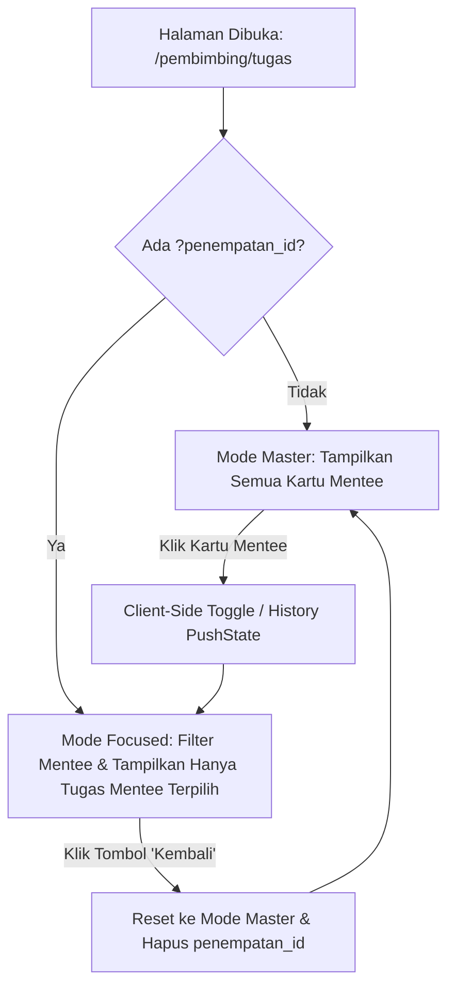

# Senior Developer Task Specification & PRD
## Transformasi ke Focused Mentee Task View (Master-Detail Scope)

**Project**: MAGKOM Portal Pembimbing — Modul Penugasan & Progres Magang  
**Target Audience**: Junior Developer / AI Engine (Gemini 3.8 Flash)  
**Tipe Dokumen**: Product Requirement Document (PRD) & Step-by-Step Technical Blueprint  
**Status**: Ready for Implementation (Awaiting User Review)

---

## 1. Executive Summary & Problem Statement

### 1.1 Masalah Saat Ini
Pada implementasi sebelumnya, penugasan ditampilkan dalam bentuk **accordion dropdown** di mana semua kartu peserta (Naufal Pratama, Dimas Pratama, Joko Susilo, Kartika Putri) tampil berderet ke bawah. Ketika satu kartu peserta diklik:
- Kartu tersebut membuka laci tugasnya ke bawah (dropdown).
- Namun, kartu peserta lain **tetap terlihat** bertumpuk di atas atau di bawahnya.
- Judul panel tetap statis: *"Daftar Penugasan & Progres Mentee"*.
- Hal ini menimbulkan *visual clutter*, membuat pembimbing terdistraksi oleh nama-nama peserta lain saat sedang ingin fokus mengevaluasi tugas dari satu mentee tertentu.

### 1.2 Solusi yang Diinginkan (Focused Mentee View)
Mengubah pola interaksi dari *in-place accordion dropdown* menjadi **Master-Detail Scoped View**:
1. **Mode Master (Semua Peserta)**: Menampilkan seluruh kartu peserta magang bimbingan secara rapi dan bersih.
2. **Mode Focused (Satu Peserta)**:
   - Ketika nama/kartu peserta diklik (misal: **Naufal Pratama**), seluruh kartu peserta lain **otomatis hilang / disembunyikan**.
   - Judul x-panel yang semula *"Daftar Penugasan & Progres Mentee"* **beralih** menjadi nama peserta tersebut, misalnya:
     `Tugas & Progres: Naufal Pratama` dengan sub-label institusi.
   - Disediakan tombol navigasi **"← Kembali ke Daftar Peserta"** untuk memudahkan pembimbing kembali melihat semua mentee.
   - Di dalam focused view, daftar tugas peserta tersebut langsung terbentang rapi dalam format horizontal ramping Google Classroom.
   - URL browser terintegrasi dengan parameter `?penempatan_id=ID` (mendukung reload & deep-link tanpa kehilangan fokus).

---

## 2. Visual Architecture & Wireframe Comparison

### 2.1 Mode Master (Awal — Semua Peserta)
```
+---------------------------------------------------------------------------------------------+
| Header: Daftar Penugasan & Progres Mentee                                      [Kartu][Tabel] |
| [Semua Tugas (22)] [Ditugaskan (7)] [Selesai (7)] [⚠️ Perlu Evaluasi (3)]                  |
+---------------------------------------------------------------------------------------------+
| [NP]  Naufal Pratama                      SMK Negeri 2 Depok Sleman   [6 Tugas] [2 Selesai] > |
| [DP]  Dimas Pratama (Ketua Tim)           Universitas Gadjah Mada     [2 Tugas]             > |
| [JS]  Joko Susilo                         Universitas Gadjah Mada     [2 Tugas]             > |
| [KP]  Kartika Putri                       Universitas Negeri Ygykta   [1 Tugas] [1 Selesai] > |
+---------------------------------------------------------------------------------------------+
```

### 2.2 Mode Focused (Ketika Naufal Pratama Diklik)
```
+---------------------------------------------------------------------------------------------+
| [← Kembali ke Semua Mentee]                                                                 |
| Judul: Tugas & Progres: Naufal Pratama (SMK Negeri 2 Depok Sleman)             [Kartu][Tabel] |
| [Semua Tugas (6)] [Ditugaskan (4)] [Selesai (2)] [⚠️ Perlu Evaluasi (1)]                    |
+---------------------------------------------------------------------------------------------+
| [📋] Penyusunan Draf Laporan Akhir Magang & Portofolio   Tenggat: 24 Jan 2027  [Ditugaskan] [Detail >] |
| [✓]  Orientasi & Pemahaman Arsitektur Sistem EGOV         Tenggat: 11 Nov 2026  [Selesai]    [Detail >] |
| [⚠️] Pengerjaan Modul Teknis: Aplikasi Informatika        Tenggat: 08 Nov 2026  [Reviu]      [Detail >] |
| [📋] Slicing & Integrasi Frontend Dashboard Peserta      Tenggat: 06 Nov 2026  [Ditugaskan] [Detail >] |
| [📋] Uji Fungsional & Penyusunan Dokumen Laporan         Tenggat: 16 Nov 2026  [Ditugaskan] [Detail >] |
| [✓]  Analisis Kebutuhan Sistem & Pemetaan API MagKom     Tenggat: 30 Okt 2026  [Selesai]    [Detail >] |
+---------------------------------------------------------------------------------------------+
```
*(Nama Dimas Pratama, Joko Susilo, Kartika Putri, dll. hilang sepenuhnya dari layar)*.

---

## 3. User Stories & Acceptance Criteria

### User Story 1: Navigasi Fokus Mentee
> **Sebagai** Pembimbing Magang,  
> **Saya ingin** mengklik salah satu nama mentee agar tampilan langsung berfokus pada tugas mentee tersebut saja dan menyembunyikan mentee lainnya,  
> **Agar** saya dapat mengevaluasi dan meninjau portofolio tugas mentee tersebut tanpa terganggu oleh daftar nama mentee lain.

- **AC-01 (Master View)**: Saat pertama kali membuka halaman `/pembimbing/tugas`, pembimbing melihat daftar seluruh mentee aktif bimbingannya.
- **AC-02 (Trigger Focus)**: Mengklik kartu atau nama peserta (misal: Naufal Pratama) memicu transisi ke mode fokus.
- **AC-03 (Isolation)**: Seluruh kartu mentee lain selain mentee yang dipilih disembunyikan (`hidden / display: none`).
- **AC-04 (Title Shift)**: Judul panel beralih dari *"Daftar Penugasan & Progres Mentee"* menjadi *"Tugas & Progres: [Nama Mentee]"*.
- **AC-05 (Back Action)**: Tombol *"← Kembali ke Semua Mentee"* muncul dengan jelas di bagian atas panel. Mengklik tombol ini mengembalikan tampilan ke daftar semua kartu mentee dan mereset judul panel.
- **AC-06 (Deep-Link & URL Sync)**: URL browser diperbarui menjadi `?penempatan_id=[ID]`. Jika halaman di-refresh, halaman tetap berada dalam mode fokus mentee tersebut.
- **AC-07 (Scoped Tab Filter)**: Tab filter (Semua, Ditugaskan, Selesai, Perlu Evaluasi) tetap berfungsi menyaring tugas di dalam mentee yang sedang difokuskan.

---

## 4. Technical Work Breakdown (Panduan untuk Junior Dev / AI)



---

### Task 1: Controller Data Passing & Scoped Metrics
**Lokasi**: `app/Http/Controllers/Pembimbing/TugasController.php`

**Petunjuk Eksekusi**:
1. Periksa parameter `penempatan_id` dari request: `$selectedPenempatanId = $request->integer('penempatan_id') ?: null;`.
2. Validasi bahwa penempatan tersebut memang milik pembimbing yang sedang login (Anti-IDOR).
3. Jika `$selectedPenempatanId` ada, ambil objek `$selectedPenempatan = $penempatanList->firstWhere('id', $selectedPenempatanId);`.
4. Kirim variabel `$selectedPenempatan` dan `$selectedPenempatanId` ke view:
   ```php
   return view('pembimbing.tugas.index', compact(
       'tugasList',
       'penempatanList',
       'counts',
       'selectedPenempatan',
       'selectedPenempatanId'
   ));
   ```

---

### Task 2: Blade Template Refactoring
**Lokasi**: `resources/views/pembimbing/tugas/index.blade.php`

**Petunjuk Eksekusi**:
1. **Header Panel Dinamis**:
   Ganti header panel statis agar mendukung dua mode:
   - Mode Default: Judul *"Daftar Penugasan & Progres Mentee"*.
   - Mode Fokus: Tombol navigasi kembali dan judul dinamis.
   ```blade
   <div class="panel-header-toolbar">
       <div id="menteeFocusHeader" class="mentee-focus-header {{ $selectedPenempatan ? '' : 'd-none' }}">
           <a href="{{ route('pembimbing.tugas.index', request()->except('penempatan_id')) }}" 
              id="btnBackToMentees" 
              class="btn-back-mentee">
               <svg width="18" height="18" viewBox="0 0 24 24" fill="none" stroke="currentColor" stroke-width="2.5">
                   <line x1="19" y1="12" x2="5" y2="12"></line>
                   <polyline points="12 19 5 12 12 5"></polyline>
               </svg>
               <span>Kembali ke Semua Mentee</span>
           </a>
           <div class="focused-mentee-info">
               <h2 id="focusedMenteeTitle" class="focused-title">
                   Tugas & Progres: {{ $selectedPenempatan?->peserta?->nama ?? '' }}
               </h2>
               <p id="focusedMenteeSub" class="focused-subtitle">
                   {{ $selectedPenempatan?->peserta?->profil?->institusi ?? '' }}
               </p>
           </div>
       </div>

       <div id="defaultPanelHeader" class="default-panel-header {{ $selectedPenempatan ? 'd-none' : '' }}">
           <h2 class="panel-title-text">Daftar Penugasan & Progres Mentee</h2>
       </div>
   </div>
   ```

2. **Daftar Kartu Mentee (`#menteeStreamContainer`)**:
   - Berikan atribut `data-mentee-id="{{ $penempatan->id }}"` dan `data-mentee-name="{{ $menteeNama }}"` pada setiap `.mentee-classroom-card`.
   - Ubah tombol header kartu mentee dari accordion toggle menjadi **pemicu focused view**:
     Tambahkan atribut `data-action="focus-mentee"`.
   - Jika `$selectedPenempatanId` aktif:
     - Kartu yang bukan dipilih diberi class `hidden-mentee` (`display: none`).
     - Kartu yang dipilih diberi class `is-focused-card`, drawer tugasnya otomatis terbuka (`hidden` dihilangkan).
     - Tombol chevron pada kartu yang sedang fokus dapat disembunyikan atau diubah menjadi penanda aktif.

3. **Fallback Saat Mode Fokus Aktif**:
   Jika dalam mode fokus, drawer tugas mentee langsung terbuka dan memenuhi lebar x-panel tanpa menampilkan kartu mentee lainnya.

---

### Task 3: CSS Scoped Rules di resources/css/
**Lokasi**: `resources/css/pages/pembimbing/tugas-index.css`

**Aturan Penting**: Dilarang menulis CSS di Blade! Semua CSS wajib ditambahkan di file ini.

**Kelas-kelas yang Ditambahkan**:
```css
/* Toolbar Header Focused Mentee */
.panel-header-toolbar {
    margin-bottom: 18px;
    padding-bottom: 14px;
    border-bottom: 1px solid #E2E8F0;
}

.mentee-focus-header {
    display: flex;
    flex-direction: column;
    gap: 8px;
}

.btn-back-mentee {
    display: inline-flex;
    align-items: center;
    gap: 8px;
    font-size: 0.875rem;
    font-weight: 700;
    color: #01347C;
    text-decoration: none;
    padding: 6px 12px;
    border-radius: 8px;
    background: #EFF6FF;
    border: 1px solid #BFDBFE;
    width: fit-content;
    transition: all 0.2s ease;
}

.btn-back-mentee:hover {
    background: #DBEAFE;
    color: #002244;
    transform: translateX(-2px);
}

.focused-title {
    font-size: 1.25rem;
    font-weight: 800;
    color: #0F172A;
    margin: 4px 0 2px 0;
}

.focused-subtitle {
    font-size: 0.85rem;
    color: #64748B;
    margin: 0;
}

/* Sembunyikan mentee lain saat mode fokus */
.mentee-stream-container.is-focused .mentee-classroom-card:not(.is-active-focus) {
    display: none !important;
}

/* Tampilan kartu mentee yang sedang aktif fokus */
.mentee-classroom-card.is-active-focus {
    border-color: #01347C;
    box-shadow: 0 4px 20px rgba(1, 52, 124, 0.08);
}

.mentee-classroom-card.is-active-focus .mentee-card-header {
    background: #F8FAFC;
    border-bottom: 1px solid #E2E8F0;
    cursor: default;
}

.mentee-classroom-card.is-active-focus .mentee-chevron-icon {
    display: none;
}

/* Utility class untuk toggle */
.d-none {
    display: none !important;
}
```

---

### Task 4: JavaScript Interactivity & History API
**Lokasi**: `resources/js/pages/pembimbing/tugas-index.js`

**Petunjuk Eksekusi**:
1. Tangani klik pada elemen dengan `data-action="focus-mentee"`:
   - Ambil `menteeId`, `menteeName`, dan `menteeInst` dari atribut dataset kartu.
   - Tambahkan class `.is-focused` pada `#menteeStreamContainer`.
   - Sembunyikan semua kartu lain, dan tambahkan class `.is-active-focus` pada kartu yang diklik.
   - Buka drawer tugas kartu tersebut (`drawer.hidden = false`).
   - Ubah header panel: sembunyikan `#defaultPanelHeader`, tampilkan `#menteeFocusHeader`, isi teks nama & institusi mentee.
   - Perbarui URL browser secara halus tanpa reload menggunakan `window.history.pushState({}, '', '?penempatan_id=' + menteeId)`.
2. Tangani klik pada `#btnBackToMentees`:
   - Cegah reload default (`e.preventDefault()`).
   - Hapus class `.is-focused` dari container dan `.is-active-focus` dari kartu.
   - Tampilkan kembali semua kartu mentee.
   - Tutup drawer tugas (`drawer.hidden = true`).
   - Kembalikan header panel ke `#defaultPanelHeader`.
   - Perbarui URL browser ke URL asal tanpa parameter `penempatan_id` via `window.history.pushState({}, '', window.location.pathname)`.
3. Dengarkan event `window.addEventListener('popstate', ...)` agar tombol Back/Forward browser berfungsi sinkron secara mulus.

---

### Task 5: Automated Testing (PHPUnit)
**Lokasi**: `tests/Feature/PembimbingFocusedMenteeTugasViewTest.php`

**Skenario Pengujian Wajib**:
1. `test_halaman_awal_menampilkan_seluruh_kartu_mentee()`:
   - Akses `/pembimbing/tugas`.
   - Memastikan nama Peserta 1 dan Peserta 2 terlihat di layar.
   - Memastikan header *"Daftar Penugasan & Progres Mentee"* terlihat.
2. `test_akses_dengan_penempatan_id_hanya_menampilkan_mentee_tersebut()`:
   - Akses `/pembimbing/tugas?penempatan_id={idPeserta1}`.
   - Memastikan nama Peserta 1 terlihat.
   - Memastikan tugas milik Peserta 1 terlihat.
   - Memastikan nama Peserta 2 **TIDAK TERLIHAT** (hilang dari respons kartu aktif).
   - Memastikan tombol *"Kembali ke Semua Mentee"* muncul.
   - Memastikan judul panel memuat *"Tugas & Progres: [Nama Peserta 1]"*.
3. `test_anti_idor_penempatan_milik_pembimbing_lain_ditolak_atau_fallback_ke_daftar()`:
   - Pembimbing A mengakses `?penempatan_id={milikPembimbingB}`.
   - Sistem tidak menampilkan data mentee pembimbing lain.

---

## 5. Quality Gates & Safeguards

Sebelum menyatakan pekerjaan selesai, jalankan urutan quality gate berikut:
```bash
# 1. Jalankan unit & feature tests
php artisan test --filter=PembimbingFocusedMenteeTugasViewTest
php artisan test --filter=Tugas

# 2. Periksa static analysis PHPStan
vendor/bin/phpstan analyse app/Http/Controllers/Pembimbing/TugasController.php --memory-limit=1G

# 3. Periksa format styling PHP
vendor/bin/pint --test

# 4. Kompilasi asset frontend Vite
npm run build

# 5. Sinkronkan knowledge graph
python -m graphify update .
```

