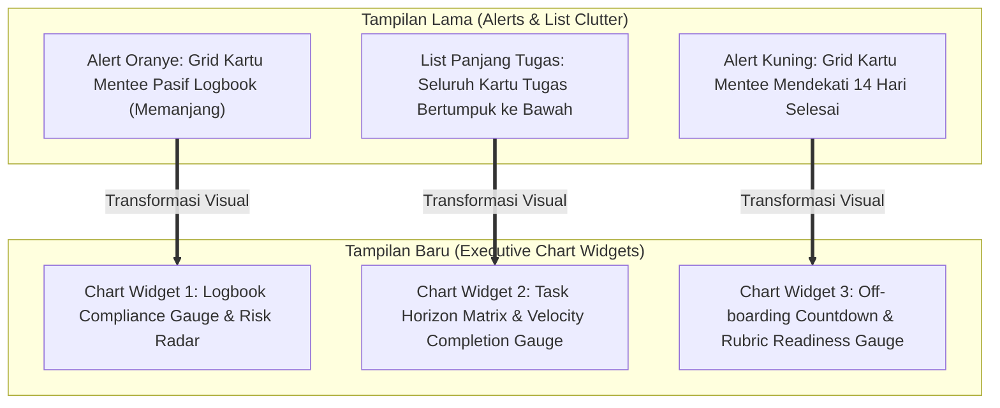

# PRD & Senior Developer Task: Transformasi 3 Komponen Alert & List Dashboard Pembimbing Menjadi Visual Chart

**Target Pelaksana**: Junior Developer / Gemini 3.8 Flash (AI Model)  
**Kode Dokumen**: `PRD-TASK-2026-11-05-PEMBIMBING-DASHBOARD-ALL-CHARTS`  
**Status**: Ready for Implementation (Awaiting Approval)  
**Tingkat Kerumitan**: Sedang - Terarah (UI/UX Transformation, SVG/CSS Chart Design, Strict Test Assertion Preservation)  
**Tumpukan Teknologi**: Laravel 10 (Blade), Vanilla CSS (Vite), Vanilla JavaScript, PHP 8.3  
**File Terdampak Utama**:
- [resources/views/pembimbing/dashboard/partials/_tab_ringkasan.blade.php](file:///g:/MAGKOM/resources/views/pembimbing/dashboard/partials/_tab_ringkasan.blade.php)
- [resources/css/pages/pembimbing/dashboard.css](file:///g:/MAGKOM/resources/css/pages/pembimbing/dashboard.css)

---

## 1. Latar Belakang & Tujuan Tugas

Dashboard Pembimbing pada Tab 1 (*Ringkasan Utama*) saat ini telah memiliki visual chart untuk aktivitas mentoring dan rasio antrean. Namun, masih terdapat 3 bagian yang berwujud **daftar kotak/tabel/peringatan panjang (alert walls)** yang memakan banyak ruang vertikal dan membuat tampilan terasa padat:

1. **Komponen A**: `Peringatan: X Mentee Belum Mengisi Logbook ≥ 2 Hari Kerja` (Alert box oranye besar dengan grid kartu mentee berulang).
2. **Komponen B**: `Tenggat Waktu Tugas Mendekati Batas Akhir & Penugasan Mentee` (Daftar vertikal panjang tugas-tugas mentee).
3. **Komponen C**: `Perhatian: X Mentee Mendekati Batas Selesai Magang (≤ 14 Hari)` (Kotak peringatan kuning dengan grid kartu mentee).

### Sasaran Utama (Objective)
Ubah ketiga komponen tersebut menjadi **Widget Chart Visual Interaktif** yang ringkas, modern, dan informatif terinspirasi dari layout Zenius, dengan tetap mempertahankan **100% kontrak fungsional dan seluruh assertion string PHPUnit test**.

> [!IMPORTANT]
> **Aturan Wajib (Non-Negotiable)**:
> 1. **Zero Test Regressions**: Seluruh test di [PembimbingDashboardEnhancementTest.php](file:///g:/MAGKOM/tests/Feature/PembimbingDashboardEnhancementTest.php) dan [GentelellaDashboardRevampTest.php](file:///g:/MAGKOM/tests/Feature/GentelellaDashboardRevampTest.php) **WAJIB HIJAU 100%**.
> 2. **Aturan AGENTS.md**: **DILARANG** menulis `<style>` atau inline CSS pada Blade. Seluruh styling baru wajib berada di [resources/css/pages/pembimbing/dashboard.css](file:///g:/MAGKOM/resources/css/pages/pembimbing/dashboard.css).
> 3. **Palet Warna**: Pertahankan identitas Sleman Navy (`#002855`, `#003566`, `#0641CC`) dipadukan aksen fungsional Amber (`#D97706`), Rose/Red (`#DC2626`), dan Emerald (`#059669`).

---

## 2. Peta Transformasi UI/UX & Arsitektur Visual



---

## 3. Spesifikasi Detail 3 Komponen Chart

### Komponen 1: Logbook Compliance Gauge & Risk Radar
*Menggantikan blok peringatan oranye memanjang [baris 4-44]*

#### A. Konsep Visual
Alih-alih menampilkan daftar kotak peringatan oranye yang memenuhi halaman atas, jadikan widget ini berbentuk **Kartu Status Kepatuhan Logbook Eksekutif** dengan 2 kolom terpadu:
1. **Kolom Kiri (Visual Compliance Gauge)**:
   - Menampilkan persentase tingkat kedisiplinan logbook mentee bimbingan.
   - Circular Gauge SVG / Progress Bar: `% Mentee Aktif Mengisi Logbook` vs `% Mentee Terlambat (≥ 2 Hari Kerja)`.
   - Ringkasan indikator: `Disiplin` (Hijau), `Pasif 2 Hari` (Kuning/Oranye), `Kritis ≥ 3 Hari / Risiko Hangus BR-09` (Merah).
2. **Kolom Kanan (Radar Mentee Butuh Perhatian Segera)**:
   - Daftar ringkas (compact chips/rows) berisi mentee yang belum mengisi logbook.
   - Menampilkan nama mentee, instansi, durasi pasif, dan tombol aksi `Cek Profil`.

#### B. Kebutuhan Assertion PHPUnit (Wajib Ada di HTML)
Junior developer / AI **harus memastikan** string berikut tetap ada dan dapat dibaca oleh crawler PHPUnit:
- `Peringatan: {{ $inactiveLogbookMentees->count() }} Mentee Belum Mengisi Logbook` (diuji pada `PembimbingDashboardEnhancementTest::test_dashboard_menampilkan_upcoming_deadlines_logbook_alert_dan_quick_action`)
- Nama mentee pasif, contoh: `Ahmad Dahlan`
- Tautan `Cek Profil` dengan `route('pembimbing.peserta.show', $m->id)`
- Penjelasan BR-09: `Maksimal pengisian mundur adalah 3 hari (BR-09). Segera ingatkan mentee sebelum entri logbook hangus.`

---

### Komponen 2: Task Horizon Matrix & Velocity Completion Gauge
*Menggantikan x-panel daftar tugas panjang [baris 46-188]*

#### A. Konsep Visual
Tetap menggunakan wrapper `<x-gentelella.x-panel>` agar struktur Gentelella tetap utuh. Namun isi panel dirombak menjadi **Pusat Pemantauan Tugas Berbasis Horison Waktu & Kecepatan Tuntas**:
1. **Header KPI & Horizon Timeline Chart**:
   - **Horizontal Multi-Segment Horizon Bar**:
     - Segmen Merah: `Lewat Tenggat (Overdue)`
     - Segmen Oranye: `Mendesak (≤ 3 Hari / Hari Ini)`
     - Segmen Biru: `Terjadwal Aman (> 3 Hari)`
   - **Cumulative Progress KPI**:
     - Widget visual progres penyelesaian tugas mentee dengan elemen `micro-progress-bar`.
     - Teks persentase tuntas: `{{ $persenTugasKumulatif }}% tuntas` (contoh: `50% tuntas`).
2. **Quick Filter Tabs**:
   - Tetap sediakan tombol filter: `Semua`, `Mendesak`, `Perlu Review`.
3. **Streamlined Compact Task Cards**:
   - Mengubah kartu tugas menjadi baris linier yang ringkas ala Zenius / Asana timeline:
     - Avatar chip inisial mentee: `{{ $initials }}` (contoh: `CK` untuk Citra Kirana).
     - Judul tugas terlink: `{{ $tugas->judul }}` (contoh: `Pembuatan Endpoint API Mobile Sleman`).
     - Info mentee: `Mentee: Citra Kirana • Universitas Gadjah Mada`.
     - Pill deadline (`Lewat Tenggat`, `Tenggat Hari Ini!`, `Sisa X Hari`).
     - Badge notifikasi: `{{ $tugas->pending_progres_count }} Laporan Progres Menunggu Evaluasi`.
     - Tombol aksi kontekstual: `Evaluasi Progres` atau `Review & Detail`.

#### B. Kebutuhan Assertion PHPUnit (Wajib Ada di HTML)
Junior developer / AI **harus memastikan** token berikut tetap ada:
- Judul Panel: `Tenggat Waktu Tugas Mendekati Batas Akhir & Penugasan Mentee` (diuji di `GentelellaDashboardRevampTest`)
- Subtitle atau label: `Penugasan Mentee`
- Judul tugas pengujian: `Instalasi Server Jaringan Sleman` dan `Pembuatan Endpoint API Mobile Sleman`
- Nama mentee & kampus: `Citra Kirana`, `Universitas Gadjah Mada`
- Avatar chip: `CK`
- Status review: `Laporan Progres Menunggu Evaluasi`
- Tombol aksi: `Evaluasi Progres`
- Kelas CSS & teks progres: `micro-progress-bar` dan `50% tuntas` (atau `$persenTugasKumulatif% tuntas`)

---

### Komponen 3: Off-boarding Countdown & Rubric Readiness Gauge
*Menggantikan blok peringatan selesai magang [baris 253-299]*

#### A. Konsep Visual
Mentransformasikan panel kuning off-boarding menjadi **Widget Analisis Kesiapan Kelulusan & Penilaian Rubrik**:
1. **Header & Regulasi**:
   - Ikon kalender kelulusan/topi toga dinas.
   - Judul: `Perhatian: {{ $offboardingMentees->count() }} Mentee Mendekati Batas Selesai Magang (≤ 14 Hari)`.
   - Subtitle: `Sesuai regulasi, segera susun penilaian rubrik final sebelum periode berakhir (BR-10, BR-11).`
2. **Visual Urgency Gauge & Status Lembar Nilai**:
   - Baris distribusi hitung mundur kelulusan:
     - `≤ 3 Hari (Kritis)` (Merah)
     - `4 - 7 Hari (Mendesak)` (Oranye)
     - `8 - 14 Hari (Normal)` (Biru Muda)
   - Status Kesiapan Nilai: Donut / Bar mini (`Belum Dinilai`, `Draf`, `Final`).
3. **Compact Off-boarding Mentee Cards**:
   - Kartu mini yang rapi berisi:
     - Nama mentee & instansi.
     - Hitung mundur sisa hari (`Tersisa X hari`, `Berakhir Hari Ini`).
     - Status nilai rubrik (`Nilai: Belum/Draft/Final`).
     - Tombol langsung: `Lembar Nilai` menuju `route('pembimbing.penilaian.show', $mentee->id)`.

#### B. Kebutuhan Assertion PHPUnit (Wajib Ada di HTML)
- Menjaga teks header: `Perhatian: {{ $offboardingMentees->count() }} Mentee Mendekati Batas Selesai Magang (≤ 14 Hari)`.
- Menjaga teks regulasi: `(BR-10, BR-11)`.
- Menjaga tautan `Lembar Nilai` ke rute penilaian.

---

## 4. Desain Struktur CSS Terpusat di `dashboard.css`

Seluruh styling ditempatkan di [resources/css/pages/pembimbing/dashboard.css](file:///g:/MAGKOM/resources/css/pages/pembimbing/dashboard.css). Tidak boleh ada `<style>` di Blade.

```css
/* ==========================================================================
   Zenius Modern Visual Chart Components for Pembimbing Dashboard
   ========================================================================== */

/* 1. Logbook Compliance Gauge Card */
.zenius-compliance-card {
    background: #FFFFFF;
    border: 1px solid #FED7AA;
    border-left: 4px solid #EA580C;
    border-radius: 14px;
    padding: 1.25rem 1.5rem;
    margin-bottom: 1.5rem;
    box-shadow: 0 2px 8px rgba(234, 88, 12, 0.06);
}

.zenius-compliance-gauge-wrapper {
    display: flex;
    align-items: center;
    gap: 1.25rem;
}

.zenius-compliance-ring {
    position: relative;
    width: 80px;
    height: 80px;
    flex-shrink: 0;
}

/* 2. Task Velocity & Deadline Horizon */
.task-horizon-summary-bar {
    display: flex;
    height: 10px;
    width: 100%;
    border-radius: 999px;
    overflow: hidden;
    background: #E2E8F0;
    margin: 0.75rem 0;
}

.task-horizon-segment {
    height: 100%;
    transition: width 0.3s ease;
}

.task-velocity-badge {
    display: inline-flex;
    align-items: center;
    gap: 6px;
    font-size: 0.8rem;
    font-weight: 700;
    color: #003566;
}

/* 3. Off-boarding Countdown Chart */
.zenius-offboarding-card {
    background: #FFFFFF;
    border: 1px solid #FEF3C7;
    border-left: 4px solid #D97706;
    border-radius: 14px;
    padding: 1.25rem 1.5rem;
    margin-bottom: 1.5rem;
    box-shadow: 0 2px 8px rgba(217, 119, 6, 0.06);
}
```

---

## 5. Rencana Eksekusi Bertahap (Action Plan)

| Tahap | Tindakan Teknis | File Terkait | Verifikasi |
|---|---|---|---|
| **Step 1** | Implementasikan visual chart kepatuhan logbook pada Komponen 1 di Blade | `_tab_ringkasan.blade.php` | Cek render nama `Ahmad Dahlan` & teks `Peringatan: 1 Mentee Belum Mengisi Logbook` |
| **Step 2** | Restrukturisasi panel tugas Komponen 2 dengan horizon timeline chart & progress bar | `_tab_ringkasan.blade.php` | Pastikan `CK`, `Citra Kirana`, `50% tuntas`, dan `micro-progress-bar` hadir |
| **Step 3** | Implementasikan widget countdown graduation pada Komponen 3 di Blade | `_tab_ringkasan.blade.php` | Cek render tombol `Lembar Nilai` & teks batas 14 hari |
| **Step 4** | Tambahkan rule CSS terpadu pada stylesheet pembimbing | `resources/css/pages/pembimbing/dashboard.css` | Jalankan `npm run build` |
| **Step 5** | Eksekusi seluruh suite pengujian otomatis & static analysis | Terminal PHPUnit & PHPStan | Pastikan **100% PASS** tanpa kegagalan |

---

## 6. Verifikasi & Quality Gates

Sebelum menyatakan tugas selesai, jalankan urutan pengujian berikut:

1. **Asset Build**:
   ```powershell
   npm run build
   ```
   *Ekspektasi: Build berhasil tanpa warning CSS/JS.*

2. **Feature Tests**:
   ```powershell
   php artisan test --filter=PembimbingDashboardEnhancementTest
   php artisan test --filter=GentelellaDashboardRevampTest
   ```
   *Ekspektasi: 7 tests passed (Enhancement) + 15 tests passed (Gentelella).*

3. **Code Formatting & Static Analysis**:
   ```powershell
   ./vendor/bin/pint --test
   ./vendor/bin/phpstan analyse --memory-limit=1G
   ```
   *Ekspektasi: Tidak ada styling violation & [OK] No errors.*

4. **Knowledge Graph Sync**:
   ```powershell
   python -m graphify update .
   ```
   *Ekspektasi: Knowledge graph terupdate secara otomatis.*

---

## 7. Checklist Konfirmasi untuk User

- [ ] Konsep chart 1: Compliance Gauge & Radar Mentee Pasif Logbook disetujui.
- [ ] Konsep chart 2: Deadline Horizon Bar & Task Velocity Progress disetujui.
- [ ] Konsep chart 3: Graduation Countdown & Rubric Readiness Gauge disetujui.
- [ ] Siap dilanjutkan ke tahap eksekusi kode.

