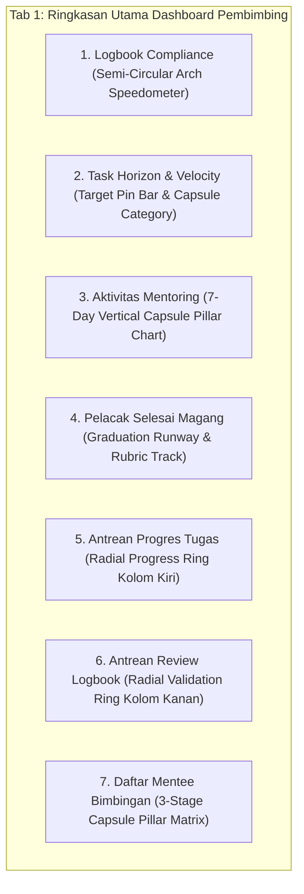

# PRD & Senior Developer Task: Transformasi 7 Visual Chart Dashboard Pembimbing (Next-Level Analytics)

**Target Pelaksana**: Junior Developer / Gemini 3.8 Flash (AI Model)  
**Kode Dokumen**: `PRD-TASK-2026-11-05-PEMBIMBING-NEXT-LEVEL-CHARTS`  
**Status**: Ready for User Review & Approval  
**Tingkat Kerumitan**: Sedang - Lanjutan (Modern SVG/CSS Data Visualization, Capsule Pillars, Semi-Circular Arch Gauges, Radial Rings, Zero Regression Testing)  
**Tumpukan Teknologi**: Laravel 10 (Blade), Vanilla CSS (Vite), Vanilla JavaScript, PHP 8.3  
**Palet Warna Wajib**: Sleman Civic Navy (`#002855`, `#003566`, `#0641CC`), Amber (`#D97706`, `#F59E0B`), Emerald (`#059669`, `#10B981`), Rose (`#DC2626`), Neutral Surface Slate (`#F8FAFC`, `#FFFFFF`, `#E2E8F0`, `#0F172A`).

---

## 1. Dokumen Referensi Visual dari Pengguna

Desain visual chart baru mengadopsi elemen grafis terbaik dari 3 tangkapan layar referensi:

````carousel

<!-- slide -->

<!-- slide -->

````

### Elemen Grafis yang Diadopsi:
1. **Dari Referensi 1 (Zenius)**:
   - **Activity Vertical Pill Bars**: Grafik batang vertikal berbentuk kapsul bulat memanjang (`border-radius: 999px`) untuk volume aktivitas mingguan.
   - **Circular Donut Ring**: Donut chart lingkaran SVG ramping untuk capaian progres.
   - **Minimalist Stat Tags**: Status badge kecil yang bersih dengan dot warna.
2. **Dari Referensi 2 (EduCare)**:
   - **Semi-Circular Radial Arch Gauge (Speedometer)**: Gauge setengah lingkaran (180°) elegan dengan angka persentase besar di tengah untuk tingkat kepatuhan dan ketuntasan.
   - **Capsule Pillar Tracks**: Batang kapsul vertikal bertingkat untuk perbandingan tahap magang.
   - **Micro Milestone Track**: Slider titik bertahap untuk sisa hari kelulusan.
3. **Dari Referensi 3 (Emedley)**:
   - **Target Pin Progress Bars**: Batang progres horizontal modern dengan indikator pin mengambang.
   - **Filter Pill Group**: Tombol filter ringkas dengan status aktif halus.

---

## 2. Pemetaan & Spesifikasi 7 Komponen Chart Baru



---

### Komponen 1: Peringatan Logbook Pasif (Semi-Circular Speedometer Arch)
*Acuan: EduCare Radial Arch Gauge (`Daily Study Progress` 50%)*

#### Spesifikasi Visual:
- **Tipe Chart**: **Semi-Circular Arch Gauge SVG** (180° busur derajat).
  - Background track busur berwarna abu-abu halus `#E2E8F0`.
  - Active stroke menggunakan gradien Amber ke Sleman Navy (`stroke-dasharray` SVG).
  - Di tengah busur terdapat teks besar: `{{ $pctDisiplin }}%` dengan subtitle *"Kedisiplinan Logbook"*.
- **Sebaran Status Kepatuhan**:
  - 3 kartu ringkas di sisi kanan/bawah busur:
    - *Disiplin*: `{{ $disiplinCount }} Peserta` (Emerald Badge).
    - *Pasif 2 Hari*: `{{ $warningLogbook }} Peserta` (Amber Badge).
    - *Kritis $\ge$ 3 Hari*: `{{ $kritisLogbook }} Peserta (BR-09)` (Rose Badge).
- **Action CTA**: Tombol elegan Sleman Navy:
  `<button type="button" data-tab="tab-mentee" class="btn-sleman-primary">Buka Tab Monitoring & Ingatkan Peserta &rarr;</button>`

---

### Komponen 2: Tenggat Waktu Tugas & Penugasan Mentee (Horizon Target Pin)
*Acuan: Emedley Horizon Target Pin Bar + Zenius Category Tags*

#### Spesifikasi Visual:
- **Header**: Tetap menggunakan `<x-gentelella.x-panel>` berpenanda `Tenggat Waktu Tugas Mendekati Batas Akhir & Penugasan Mentee`.
- **Target Pin Horizon Bar**:
  - Batang horizontal bertingkat 3 segmen warna (*Lewat Tenggat* [Merah], *Mendesak $\le$ 3 Hari* [Amber], *Terjadwal Aman* [Biru]).
  - Indikator pin target mengambang di atas bar: `{{ $persenTugasKumulatif }}% tuntas` (menggunakan elemen `micro-progress-bar`).
- **Capsule Kategori Penugasan**:
  - Deretan badge kapsul mini yang menunjukkan sebaran tipe tugas aktif (*Pengembangan Sistem*, *Infrastruktur*, *Basis Data*).
- **Action Buttons**:
  - `Buka Antrean Evaluasi Progres ({{ $pendingProgresLogs->count() }}) →`
  - `Kelola Seluruh Penugasan →`

---

### Komponen 3: Aktivitas Mentoring Minggu Ini (7-Day Vertical Capsule Pillars)
*Acuan: Zenius Activity Chart (Mon - Sun Capsule Pillars)*

#### Spesifikasi Visual:
- **Tipe Chart**: **7-Day Vertical Capsule Pillar Chart** (Senin s/d Minggu atau 7 hari aktif bimbingan).
  - 7 tiang kapsul vertikal (`border-radius: 999px`) dengan ketinggian proporsional terhadap volume interaksi bimbingan.
  - Hover tooltip interaktif pada tiap tiang menampilkan rincian entri harian.
- **Top KPI Row (Zenius-Style)**:
  - 4 indikator ringkas dengan dot warna:
    - `{{ $allPendingLogbooks->count() }}` Logbook Menunggu Validasi (Amber).
    - `{{ $allPendingProgresLogs->count() }}` Progres Perlu Evaluasi (Biru).
    - `{{ $upcomingAgendaBimbingan->count() }}` Sesi Mentoring Terjadwal (Emerald).
    - `{{ $recentNilaiRevisions->count() }}` Riwayat Rubrik Final (Ungu).

---

### Komponen 4: Pelacak Selesai Magang (Graduation Runway & Rubric Track)
*Acuan: EduCare Micro Milestone Track + Zenius Status Badges*

#### Spesifikasi Visual:
- **Runway Track 3 Tahap**:
  - Jalur linier horizontal dengan 3 pos pemeriksaan sisa hari:
    - Pos Kritis ($\le$ 3 Hari): Aksen Rose `#DC2626`.
    - Pos Mendesak (4–7 Hari): Aksen Amber `#D97706`.
    - Pos Persiapan (8–14 Hari): Aksen Blue `#2563EB`.
- **Status Kesiapan Nilai Rubrik**:
  - Trio kartu mini: `Final Resmi`, `Draf Evaluasi`, `Belum Dinilai`.
- **Action CTA**: Tombol langsung:
  `<button type="button" data-tab="tab-rubrik" class="btn-sleman-primary">Buka Lembar Penilaian di Tab Evaluasi Rubrik &rarr;</button>`

---

### Komponen 5 & 6 (Row 2 Kolom): Antrean Progres & Antrean Logbook (Dual Radial Rings)
*Acuan: Zenius Donut Progress (`73%`) + EduCare Lesson Rings*

#### Spesifikasi Visual (2 Kolom Sejajar):
- **Kolom Kiri (Antrean Progres Tugas)**:
  - **Radial Progress Ring SVG Biru**: Lingkaran SVG 80px dengan angka antrean `{{ $pendingProgresLogs->count() }}` di pusat lingkaran.
  - Teks rasio terhadap seluruh tugas aktif (`{{ $pctP }}%`).
  - Badge status: `Perlu Evaluasi` / `✓ Tuntas Dievaluasi`.
  - Tombol: `Evaluasi di Tab Antrean →`.
- **Kolom Kanan (Antrean Review Logbook)**:
  - **Radial Progress Ring SVG Amber**: Lingkaran SVG 80px dengan angka antrean `{{ $pendingLogbooks->count() }}` di pusat lingkaran.
  - Teks rasio terhadap total mentee aktif (`{{ $pctLbRatio }}%`).
  - Badge status: `Perlu Validasi` / `✓ Seluruh Logbook Valid`.
  - Tombol: `Validasi di Tab Antrean →`.

---

### Komponen 7: Daftar Mentee Bimbingan Aktif (3-Stage Capsule Pillar Matrix)
*Acuan: EduCare Performance Capsule Pillars + Emedley Subject Breakdown*

#### Spesifikasi Visual:
- **Distribusi Tahap Durasi Magang (Kolom Kiri)**:
  - Tiga bar horizontal berkapsul bulat modern:
    - *Tahap Awal (0–30% Durasi)*: `{{ $tahapAwal }} Peserta` (Biru Muda).
    - *Tahap Pertengahan (31–70% Durasi)*: `{{ $tahapTengah }} Peserta` (Sleman Navy).
    - *Tahap Akhir (71–100% Durasi)*: `{{ $tahapAkhir }} Peserta` (Amber).
  - Tiap bar menggunakan elemen `micro-progress-bar`.
- **Status Kesiapan Rubrik & Roster Ringkas (Kolom Kanan)**:
  - Trio counter kesiapan rubrik (*Final*, *Draf*, *Belum*).
  - Chip inisial mentee aktif yang ringkas.
  - Tombol: `Buka Tab Monitoring Mentee 360° →`.

---

## 3. Strategi Kepatuhan Aturan & Pengujian (Zero Regressions)

> [!IMPORTANT]
> **Pedoman Wajib `AGENTS.md`**:
> 1. **Dilarang Menulis CSS di Blade**: Seluruh style visual chart baru (SVG dimensions, animations, gradients, capsule pillars, arch gauges) ditempatkan di [resources/css/pages/pembimbing/dashboard.css](file:///g:/MAGKOM/resources/css/pages/pembimbing/dashboard.css).
> 2. **Dilarang Inline Event Handler**: Interaksi antar-tab menggunakan `data-tab="..."` yang telah ditangani oleh script modul ES [resources/js/pages/pembimbing/dashboard.js](file:///g:/MAGKOM/resources/js/pages/pembimbing/dashboard.js).
> 3. **Pertahankan Seluruh Token Uji PHPUnit**:
>    - `Peringatan: {{ $inactiveLogbookMentees->count() }} Mentee Belum Mengisi Logbook`, `Ahmad Dahlan`, `Cek Profil`.
>    - `Tenggat Waktu Tugas Mendekati Batas Akhir & Penugasan Mentee`, `Penugasan Mentee`.
>    - `Citra Kirana`, `Universitas Gadjah Mada`, `CK`, `Pembuatan Endpoint API Mobile Sleman`, `Instalasi Server Jaringan Sleman`.
>    - `Laporan Progres Menunggu Evaluasi`, `Evaluasi Progres`, `micro-progress-bar`, `50% tuntas`.
>    - `Aktivitas Mentoring Minggu Ini`, `Perhatian: {{ $offboardingMentees->count() }} Mentee Mendekati Batas Selesai Magang`, `Lembar Nilai`.
>    - `Antrean Progres Tugas`, `Antrean Review Logbook`, `Daftar Mentee Bimbingan Aktif (Ringkasan)`.
>    - Seluruh token yang tidak ditampilkan secara visual tetap diletakkan di headless accessibility layer (`.sr-only`).

---

## 4. Rencana Kerja Eksekusi (Action Steps)

| Langkah | Rincian Pekerjaan | File Terkait |
|---|---|---|
| **Langkah 1** | Tulis class CSS modular untuk Capsule Pillars, Semi-Circular Arch Gauges, dan Radial Rings di `dashboard.css`. | `resources/css/pages/pembimbing/dashboard.css` |
| **Langkah 2** | Restrukturisasi Komponen 1 (Logbook Speedometer Arch) & Komponen 4 (Graduation Runway). | `_tab_ringkasan.blade.php` |
| **Langkah 3** | Restrukturisasi Komponen 2 (Task Horizon Pin) & Komponen 3 (7-Day Vertical Capsule Pillars). | `_tab_ringkasan.blade.php` |
| **Langkah 4** | Restrukturisasi Komponen 5 & 6 (Dual Radial Rings) serta Komponen 7 (Mentee Stage Matrix). | `_tab_ringkasan.blade.php` |
| **Langkah 5** | Eksekusi build asset (`npm run build`) dan jalankan quality gates (PHPUnit, Pint, PHPStan, Graphify). | Terminal |

---

## 5. Quality Gates & Kriteria Keberhasilan

1. `npm run build` berhasil tanpa error.
2. `php artisan test --filter=Pembimbing` lulus **109 passed (591 assertions)** tanpa regresi.
3. `./vendor/bin/pint --test` lolos standard formatting.
4. `./vendor/bin/phpstan analyse --memory-limit=1G` menghasilkan **[OK] No errors**.
5. Tampilan visual Tab 1 di browser modern, bersih, terinspirasi Zenius/EduCare/Emedley dengan palet Sleman Navy.

---

## 6. Konfirmasi untuk Pengguna

Apakah rancangan visual chart baru untuk **7 komponen** di atas sudah sesuai dengan ekspektasi Anda?

Jika sudah sesuai, silakan setujui dengan menekan tombol **Proceed** atau sampaikan **"Lanjutkan"** agar saya dapat langsung mengeksekusinya ke kode!

