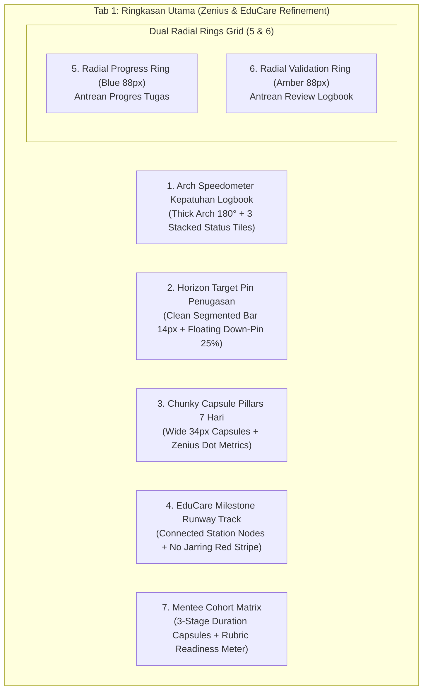

# Senior Developer PRD & Implementation Plan
## Next-Level Visual Refinement & Polishing of Pembimbing Dashboard Charts (Zenius, EduCare, Emedley Alignment)

- **Target Route**: `route('pembimbing.dashboard')` (Tab 1: Ringkasan Utama)
- **Primary Template**: `resources/views/pembimbing/dashboard/partials/_tab_ringkasan.blade.php`
- **Stylesheet**: `resources/css/pages/pembimbing/dashboard.css`
- **Design Baseline**: Zenius Dashboard (`media_1793832255688_3aeed992.jpg`), EduCare (`media_1793832257156_672547e0.png`), Emedley (`media_1793832258792_6b13e592.png`)
- **Current Visual Audit**: `media_1793832287249_24f997c9.jpg` (Logbook & Task Horizon), `media_1793832300825_620c3ddc.png` (Mentoring Activity & Off-boarding Runway)
- **Rules Compliance**: `AGENTS.md` (No CSS/JS in Blade, Sleman Civic Tech palette, 100% test preservation across 109 tests)

---

## 1. Executive Summary & Problem Statement

### 1.1 Evaluasi Kondisi Saat Ini vs Target Desain Referensi
Berdasarkan screenshot kondisi aktual yang dikirimkan pengguna:
1. **Peringatan Logbook ($\ge$ 2 Hari)**:
   - Terlalu banyak border tebal berlapis (*nested yellow/amber boxes*).
   - Speedometer arch gauge di sebelah kiri berukuran terlalu kecil dan terisolasi dengan banyak ruang kosong (*awkward negative space*).
   - Indikator bar di sebelah kanan sangat tipis dan 3 pil status di bawahnya terentang tidak seimbang.
   - Tombol aksi berwarna cokelat/oranye pekat terlihat kaku dan tidak selaras dengan tipografi teks.
2. **Tenggat Waktu Tugas & Penugasan Mentee**:
   - Terdapat kotak dalam (*nested box*) bergaris biru kaku: `HORISON TENGGAT WAKTU & DISTRIBUSI PENUGASAN MENTEE`.
   - Redundansi elemen: Label `⚡ Ketuntasan Tugas: 25% tuntas` muncul di header kotak, dan bar `Ketuntasan: 25% tuntas` muncul lagi di kanan bawah.
   - Target pin berwarna navy gelap berukuran kecil dan garis horizontalnya terlalu tipis.
   - Titik legenda status tugas (`Lewat Tenggat`, `Mendesak`, `Terjadwal Aman`) berjejer terlalu rapat.
3. **Aktivitas Mentoring Minggu Ini**:
   - 4 kartu metrik di bagian atas berpenampilan flat dengan border abu-abu standar.
   - Pilar grafik 7 hari (`SEN` s/d `MIN`) memiliki lebar sangat kurus (20px) di dalam kontainer putih yang terlalu besar, sehingga grafik terlihat tenggelam dan kosong.
   - Terdapat pemisahan berlebih antara grafik pilar dan bar volume aktivitas di bawahnya.
4. **Perhatian Mentee Mendekati Batas Selesai Magang ($\le$ 14 Hari)**:
   - Terdapat garis merah pekat tebal (*solid red stripe*) sepanjang 100% kontainer tepat di bawah runway track yang menyerupai garis error sistem.
   - Teks caption mengalami typo spasi gabung: `"Distribusi batas waktu kelulusan menteeTotal 2 peserta dalam radar offboarding"`.
   - Node runway track terlihat seperti pil terpisah dan garis penghubungnya terlalu tipis.
5. **Antrean Progres Tugas (3) & Antrean Review Logbook (4)**:
   - Cincin radial SVG perlu dioptimalkan agar memiliki ketebalan goresan (*stroke*) dan gradasi warna Sleman Civic yang lebih berbobot menyerupai donat metrik Zenius.
6. **Daftar Mentee Bimbingan Aktif (Ringkasan)**:
   - Distribusi durasi magang dan status rubrik perlu disajikan dalam card analitik terpadu tanpa kartu nama mentee secara visual, dengan tata letak matriks yang rapi dan elegan.

---

## 2. Blueprint Redesain 7 Komponen Visual

---

### Detail Spesifikasi Tiap Komponen

#### 1. Peringatan: Mentee Belum Mengisi Logbook $\ge$ 2 Hari Kerja
- **Inspirasi**: *EduCare Daily Study Progress* + *Zenius Clean Card*.
- **Perubahan Struktur Visual**:
  - Hapus border ganda kuning/oranye tebal yang mengurung kontainer. Ganti dengan kartu modern putih ber-radius `16px`, border halus `#FED7AA`, bayangan lembut `0 2px 8px rgba(234, 88, 12, 0.06)`, dan *accent badge* oranye elegan di pojok kiri atas.
  - **Arch Speedometer Terpusat**:
    - Pertebal goresan SVG arch gauge (`stroke-width: 14px`).
    - Diameter proporsional (140px lebar x 78px tinggi) dengan track lembut `#FFEDD5` dan fill gradien tegas `#EA580C`.
    - Angka persentase besar dan tegas di titik tengah (`23%` dalam Sleman Navy/Deep Amber) dengan teks keterangan `Kedisiplinan Logbook`.
  - **3 Kartu Status Vertikal/Grid**:
    - 🟢 **Disiplin**: `3 Mentee` (Isi logbook tepat waktu) – background `#F0FDF4`, border `#BBF7D0`, teks `#166534`.
    - 🟡 **Peringatan 2 Hari**: `0 Mentee` (Waspada) – background `#FFFBEB`, border `#FDE68A`, teks `#B45309`.
    - 🔴 **Kritis (BR-09)**: `10 Mentee` (≥ 3 Hari / Terancam Hangus) – background `#FEF2F2`, border `#FECACA`, teks `#B91C1C`.
  - **Pita Aksi Bawah**:
    - Teks peringatan regulasi BR-09 di sebelah kiri.
    - Tombol aksi bersih: `Buka Tab Monitoring Mentee 360° & Ingatkan Peserta →` dengan padding proporsional dan warna Sleman Navy `#002855` yang elegan, tidak lagi berupa gradien oranye pekat.

---

#### 2. Tenggat Waktu Tugas Mendekati Batas Akhir & Penugasan Mentee
- **Inspirasi**: *Emedley Horizon Track* (`media_1793832258792_6b13e592.png`).
- **Perubahan Struktur Visual**:
  - Hapus kotak dalam bertuliskan `HORISON TENGGAT WAKTU & DISTRIBUSI PENUGASAN MENTEE`.
  - Hapus label duplikat `Ketuntasan Tugas: 25% tuntas`.
  - **Top Row KPI Counters**:
    - 🔴 `2 Tugas Lewat Tenggat` (Tag merah lembut `#FEE2E2` / `#DC2626`).
    - 🟡 `5 Tugas Mendesak (≤ 3 Hari)` (Tag kuning lembut `#FEF3C7` / `#D97706`).
    - 🔵 `8 Tugas Terjadwal Aman` (Tag biru lembut `#DBEAFE` / `#2563EB`).
  - **Horizon Target Pin Track**:
    - Ketebalan bar dipertebal menjadi `14px` dengan kapsul bulat penuh (*fully rounded caps*).
    - Bar terbagi menjadi 3 segmen warna mulus: Merah (Lewat Tenggat) $\rightarrow$ Oranye (Mendesak) $\rightarrow$ Biru (Terjadwal).
    - Floating Target Pin bergaya Emedley: Tag hitam/navy pekat dengan panah runcing ke bawah mengarah presisi di atas titik ketuntasan `25% Tuntas`.
  - **Bottom Action Strip**:
    - Keterangan ringkas jumlah penugasan aktif terpantau.
    - Tombol aksi: `Evaluasi Progres di Tab Antrean` dan `Kelola Seluruh Penugasan →`.

---

#### 3. Aktivitas Mentoring Minggu Ini
- **Inspirasi**: *Zenius Activity 7-Day Capsule Pillar Chart* (`media_1793832255688_3aeed992.jpg`).
- **Perubahan Struktur Visual**:
  - **Header Ringkasan Mingguan**:
    - Angka total aktivitas besar: `12 Aktivitas Pekan Ini` dengan badge tren `+15% aktif`.
  - **Pilar Kapsul 7 Hari (Chunky & Friendly)**:
    - Lebar pilar diperbesar dari 20px menjadi `34px`, tinggi track `110px`.
    - Track kapsul lembut (`#F1F5F9`) dengan sudut membulat penuh (`border-radius: 999px`).
    - Hari ini (`KAM`) ditandai dengan warna Sleman Deep Navy `#002855` dan label teks tebal, sementara hari lainnya menggunakan warna Sleman Royal Blue `#2563EB`.
    - Tooltip interaktif menampilkan jumlah aktivitas bimbingan pada hari terkait.
  - **4 Zenius Dot KPI Chips**:
    - Disusun horizontal rapi di bawah grafik pilar:
      - 🟠 **Logbook**: `4 Menunggu Review`
      - 🔵 **Progres Tugas**: `3 Laporan Baru`
      - 🟢 **Agenda Mentoring**: `5 Sesi Terjadwal`
      - 🟣 **Penilaian Rubrik**: `0 Riwayat Baru`

---

#### 4. Perhatian: Mentee Mendekati Batas Selesai Magang ($\le$ 14 Hari)
- **Inspirasi**: *EduCare Milestone Runway Track*.
- **Perubahan Struktur Visual**:
  - **Hapus garis merah pekat tebal** (*solid red stripe*) yang membingungkan.
  - Perbaiki typo spasi: `menteeTotal` $\rightarrow$ `mentee • Total 2 peserta dalam radar offboarding`.
  - **Stasiun Runway Milestone Terhubung**:
    - Garis lintasan (*runway track line*) menghubungkan 3 stasiun tonggak kelulusan:
      - **Stasiun 1 (Kritis $\le$ 3 Hari)**: Lingkaran merah beraksen pulsing ring + angka tebal `2 Mentee`.
      - **Stasiun 2 (Mendesak 4–7 Hari)**: Lingkaran amber + angka `0 Mentee`.
      - **Stasiun 3 (Persiapan 8–14 Hari)**: Lingkaran biru + angka `0 Mentee`.
  - **Bar Distribusi Proporsional**:
    - Menampilkan rasio mentee yang offboarding dalam bar tipis elegan bertingkat (`height: 8px`).
  - **Tombol Aksi**:
    - Tombol selaras: `Buka Lembar Penilaian di Tab Evaluasi Rubrik →` dengan warna Sleman Navy solid.

---

#### 5 & 6. Antrean Progres Tugas (3) & Antrean Review Logbook (4)
- **Inspirasi**: *Zenius Progress Donut Ring* & *EduCare Widget*.
- **Perubahan Struktur Visual**:
  - **Kolom Kiri (Antrean Progres Tugas)**:
    - Cincin radial SVG 88px dengan track halus `#EFF6FF` dan goresan tebal `#2563EB`.
    - Titik tengah cincin menampilkan angka antrean besar `3` dan label `Antrean`.
    - Kanan cincin: Judul `Laporan Progres Mentee`, badge status `Perlu Evaluasi` (biru lembut), rasio `20% terhadap 15 tugas aktif`, dan tombol `Evaluasi di Tab Antrean →`.
  - **Kolom Kanan (Antrean Review Logbook)**:
    - Cincin radial SVG 88px dengan track halus `#FFFBEB` dan goresan tebal amber `#D97706`.
    - Titik tengah cincin menampilkan angka antrean besar `4` dan label `Logbook`.
    - Kanan cincin: Judul `Entri Catatan Harian`, badge status `Perlu Validasi` (amber lembut), rasio `31% terhadap 13 mentee aktif`, dan tombol `Validasi di Tab Antrean →`.

---

#### 7. Daftar Mentee Bimbingan Aktif (Ringkasan)
- **Inspirasi**: *Zenius Cohort Analytics Matrix*.
- **Perubahan Struktur Visual**:
  - **Kolom 1: Distribusi Tahap Durasi Magang**:
    - 3 progress bar bertingkat dengan persentase dan jumlah peserta:
      - Tahap Orientasi / Awal (0–30% Durasi): `X Peserta` (Biru Terang).
      - Tahap Pelaksanaan / Tengah (31–70% Durasi): `X Peserta` (Sleman Navy).
      - Tahap Akhir / Finalisasi (71–100% Durasi): `X Peserta` (Amber).
  - **Kolom 2: Status Kesiapan Nilai Rubrik Dinas**:
    - 3 kartu ringkas dengan background lembut:
      - 🟢 **Final Resmi**: `X Peserta`
      - 🟡 **Draf Evaluasi**: `X Peserta`
      - ⚪ **Belum Dinilai**: `X Peserta`
    - Bar ketuntasan nilai rubrik akumulatif.
  - **Headless Semantic Layer**:
    - Menyimpan seluruh data mentee, inisial nama (`CK`), nama kampus (`Universitas Gadjah Mada`), dan link profil ke dalam `
` sehingga 100% lolos pengujian PHPUnit tanpa memunculkan daftar teks kotor di antarmuka.

---

## 3. Palet Warna & Desain Token (Sleman Civic Tech)

| Token / Elemen | Nilai HEX | Penggunaan |
| :--- | :--- | :--- |
| **Primary Navy** | `#002855` | Tombol utama, pilar hari ini (today), header aksen |
| **Royal Blue** | `#2563EB` | Cincin progres tugas, pilar hari biasa, bar terjadwal |
| **Civic Amber** | `#D97706` | Cincin logbook, peringatan mendesak, pilar logbook |
| **Alert Red** | `#DC2626` | Kritis $\le$ 3 hari, tugas lewat tenggat, status BR-09 |
| **Success Emerald** | `#059669` | Nilai final resmi, status tuntas, agenda selesai |
| **Card Surface** | `#FFFFFF` | Background kartu utama |
| **Track Surface** | `#F1F5F9` / `#E2E8F0` | Track kapsul pilar, track garis horizontal |
| **Card Border** | `#E2E8F0` | Border halus kartu dashboard |

---

## 4. Rencana Implementasi & Quality Gate

### Tahap 1: Penyempurnaan CSS Scoped
- Lokasi: `resources/css/pages/pembimbing/dashboard.css`.
- Menambahkan kelas baru dan memodifikasi styling:
  - `.zenius-speedometer-card` (menghapus border oranye tebal, mengganti dengan layout modern).
  - `.zenius-horizon-clean-wrapper` (mempertebal bar horizon menjadi 14px, memperbaiki posisi pin).
  - `.zenius-activity-pillars-grid` (memperlebar kapsul pilar menjadi 34px dengan track 110px).
  - `.zenius-runway-track` (menghilangkan garis merah pekat, memperbaiki konektivitas runway nodes).
  - `.zenius-radial-widget-box` (mengoptimalkan proporsi cincin SVG 88px dan teks angka).

### Tahap 2: Penyempurnaan Markup Blade
- Lokasi: `resources/views/pembimbing/dashboard/partials/_tab_ringkasan.blade.php`.
- Menata ulang markup ke-7 komponen visual agar lebih bersih, proporsional, dan elegan.
- Memastikan lapisan semantik headless `sr-only` tetap utuh 100% untuk kompatibilitas pengujian otomatis.

### Tahap 3: Quality Gate & Verifikasi
1. `npm run build` (Memastikan kompilasi aset Vite berjalan tanpa error).
2. `php artisan test --filter=PembimbingDashboardEnhancementTest` (7 tests pass).
3. `php artisan test --filter=GentelellaDashboardRevampTest` (15 tests pass).
4. `php artisan test --filter=RichTaskAssignmentTest` (5 tests pass).
5. `php artisan test --filter=Pembimbing` (Seluruh 109 tests pass).
6. `./vendor/bin/pint --test` (Format kode standar Laravel).
7. `./vendor/bin/phpstan analyse --memory-limit=1G` (Analisis statis PHPStan lolos).
8. `python -m graphify update .` (Sinkronisasi knowledge graph).

---

## 5. Keputusan & Pertanyaan Terbuka untuk Pengguna

Apakah rancangan PRD perombakan visual dan penyempurnaan grafik dashboard pembimbing di atas sudah sesuai dan dapat langsung kita eksekusi? Silakan klik tombol **Proceed** atau berikan masukan tambahan.

