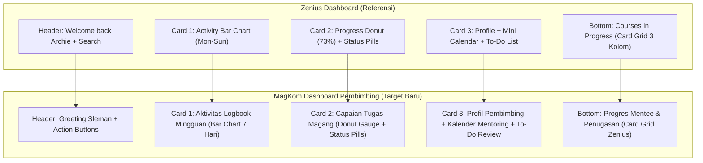

# PRD & Senior Developer Task: Redesain Dashboard Pembimbing (Zenius-Style Layout x Sleman Civic Tech Palette)

**Target Pelaksana**: Junior Developer / Gemini 3.8 Flash (AI Model)  
**Kode Dokumen**: `PRD-TASK-2026-11-05-PEMBIMBING-DASHBOARD-ZENIUS-REVAMP`  
**Status**: Ready for Review & Implementation  
**Tingkat Kerumitan**: Tinggi - Terstruktur (Frontend Blade Modernization, Scoped CSS, Modular ES Modules, Data Agregasi Service, Feature Test Preservation)  
**Dokumen Referensi Visual**:
- **Acuan Desain (Zenius Layout)**: `media_1793825787667_ec406928.jpg`
- **Tampilan Eksisting (Bagian Atas)**: `media_1793825833751_903d9561.jpg`
- **Tampilan Eksisting (Bagian Bawah)**: `media_1793825844301_24b7ecde.jpg`

---

## 1. Latar Belakang & Tujuan Redesain

Dashboard Pembimbing Lapangan (`route('pembimbing.dashboard')`) merupakan pusat kendali operasional bagi ASN Pembimbing di Dinas Kominfo Kabupaten Sleman untuk memantau aktivitas magang, memeriksa logbook harian, mengevaluasi progres tugas, dan menilai mentee.

### Masalah Utama pada Tampilan Eksisting (Incumbent UI):
1. **Redundansi Judul & Deskripsi**: Teks `Dashboard Pembimbing` dan deskripsi panjangnya muncul dua kali bertumpuk di bagian atas (lihat tangkapan layar 2).
2. **Atmospheric Hero Terlalu Memakan Ruang Vertikal**: Hero banner biru tua sangat tebal, tombol aksi cepat saling bertumpuk, dan metrik kapasitas mentee terisolasi di sisi kanan.
3. **Pelanggaran Arsitektur Frontend (`AGENTS.md`)**:
   - Berkas `resources/views/pembimbing/dashboard.blade.php` memiliki lebih dari **350 baris tag `<style>` inline**.
   - Berkas Blade memuat lebih dari **100 baris tag `<script>` inline** dengan fungsi JavaScript global (`switchPembimbingTab`, `filterDashboardTasks`, `filterTableByInput`) dan inline event handler (`onclick="..."`).
4. **Widget Sidebar Kanan Kaku & Monoton**: Kartu `Perlu Review Hari Ini` dan `Aksi Cepat Pembimbing` terasa flat dan kurang interaktif dibandingkan dashboard modern.

### Solusi & Tujuan Akhir:
Mengadopsi tata letak modular, bersih, dan modern dari **Zenius Dashboard Layout** (Gambar Referensi 1) dengan **tetap mempertahankan 100% palet warna khas MagKom Sleman (Sleman Navy & Civic Tech Palette)**. Seluruh logika frontend harus dimigrasikan ke file CSS dan JavaScript eksternal yang dikelola Vite tanpa melanggar satupun assertion test suite yang sudah ada.

---

## 2. Pemetaan Komponen Visual (Zenius vs MagKom Pembimbing)



| Komponen Zenius (Acuan) | Komponen MagKom (Target Pembimbing) | Sumber Data Backend (`PembimbingDashboardMetricsService`) |
| :--- | :--- | :--- |
| **Welcome Header**<br>`Welcome back, Archie 👋` | **Header Pembimbing Bersih**<br>`Selamat Datang, Budi Santoso, S.Kom! 👋`<br>`Pembimbing Lapangan • E-Government (EGOV)` | `auth()->user()->nama`, `$pembimbingBidang` |
| **Activity Bar Chart**<br>Grafik batang mingguan (Mon-Sun) + jam belajar | **Aktivitas Logbook Mingguan**<br>Grafik batang 7 hari (Sen - Min) aktivitas logbook mentee yang dikirim/ditinjau | `$weeklyLogbookActivity` (dihitung per hari dalam 7 hari terakhir), `$totalMenteeAktif` |
| **Progress Circular Ring**<br>Donut gauge 73% + pill counter (Completed, In Progress, Upcoming) | **Capaian Tugas Magang**<br>SVG Circular Donut Gauge (% Tugas Selesai) + 3 status counter pills:<br>• `7 Selesai` (Emerald)<br>• `7 Berjalan` (Blue)<br>• `3 Perlu Review` (Amber)<br>+ Indikator Beban Kapasitas `13/20 Mentee` | `$tugasMetrics['selesai']`, `$tugasMetrics['proses']`, `$progresPendingCount`, `$totalMenteeAktif`, `$maxBebanKapasitas` |
| **Profile & Avatar Ring**<br>Avatar Archie Schmidt + role | **Profil Pembimbing Card**<br>Avatar inisial `BS` dengan ring indikator beban kerja, nama pembimbing, NIP/jabatan kedinasan | `auth()->user()->nama`, `auth()->user()->email`, `$persentaseKapasitas` |
| **Mini Calendar Strip**<br>Strip tanggal mingguan `M T W T F S S` | **Mini Kalender Sesi Bimbingan**<br>Strip tanggal 7 hari dengan indikator dot biru jika ada agenda mentoring terjadwal | `$upcomingAgendaBimbingan` |
| **To-Do List Checkbox**<br>Checklist item tugas dengan pill status | **Daftar Tugas Tindak Lanjut**<br>Interactive checklist item yang butuh respon segera pembimbing (Logbook belum diverifikasi, tugas perlu evaluasi, mentee pasif) | `$allPendingLogbooks`, `$allPendingProgresLogs`, `$inactiveLogbookMentees` |
| **Courses in Progress Grid**<br>Card grid 3 kolom ber-avatar guru, progress bar, metadata chips | **Progres Mentee & Penugasan Berjalan**<br>Card grid mentee bergaya kursus Zenius:<br>• Badge Jenjang (`SMK`, `S1`)<br>• Nama Mentee & Institusi<br>• Meta chips (`[📝 3 Tugas]`, `[📖 12 Logbook]`, `[⏱️ 91 Hari]`)<br>• Progress Bar durasi & tugas<br>• Tombol aksi `Evaluasi Progres` | `$menteeAktifList`, `$upcomingTugas`, relasi tugas dan logbook per penempatan |

---

## 3. Palet Warna Wajib (Sleman Civic Tech Palette)

Sesuai instruksi pengguna: **"warnanya tetap pakai tampilan sekarang"**. Junior developer atau AI pelaksana dilarang mengganti warna menjadi tema hijau Zenius. Gunakan design token resmi MagKom berikut:

```css
:root {
  /* Sleman Signature Navy */
  --magkom-navy-dark: #002855;
  --magkom-navy-base: #003566;
  --magkom-navy-light: #0641CC;
  --magkom-blue-accent: #2563EB;
  --magkom-blue-subtle: #EFF6FF;

  /* Sleman Civic Gold & Status */
  --magkom-amber-base: #D97706;
  --magkom-amber-light: #F59E0B;
  --magkom-amber-subtle: #FFFBEB;

  /* Feedback Colors */
  --magkom-emerald: #10B981;
  --magkom-emerald-subtle: #ECFDF5;
  --magkom-rose: #EF4444;
  --magkom-rose-subtle: #FEF2F2;

  /* Neutral Surface & Borders */
  --magkom-surface: #FFFFFF;
  --magkom-bg: #F8FAFC;
  --magkom-border: #E2E8F0;
  --magkom-border-light: #F1F5F9;
  --magkom-text-main: #0F172A;
  --magkom-text-muted: #64748B;
  --magkom-text-subtle: #94A3B8;

  /* Dark Mode Tokens */
  --magkom-dark-bg: #0B132B;
  --magkom-dark-surface: #0F172A;
  --magkom-dark-border: #1E293B;
  --magkom-dark-text: #F8FAFC;
}
```

---

## 4. Aturan Arsitektur & Larangan Keras (`AGENTS.md`)

Setiap pelaksana (Junior Developer / AI) wajib menaati batas-batas berikut:

1. **LARANGAN CSS INLINE DI BLADE**:
   - Pindahkan seluruh blok `<style>` (350+ baris) dari `resources/views/pembimbing/dashboard.blade.php` ke file baru:
     👉 `resources/css/pages/pembimbing/dashboard.css`.
   - Daftarkan file ini di `vite.config.js`.
2. **LARANGAN JAVASCRIPT INLINE DI BLADE**:
   - Pindahkan seluruh fungsi JavaScript (`switchPembimbingTab`, `filterDashboardTasks`, `filterTableByInput`) ke file baru:
     👉 `resources/js/pages/pembimbing/dashboard.js`.
   - Gunakan pendekatan Vanilla ES Modules dan event delegation (hapus semua atribut `onclick="..."` dari elemen button di Blade).
   - Daftarkan file JS ini di `vite.config.js`.
3. **PENGHILANGAN REDUNDANSI HEADER**:
   - Hapus pemanggilan ganda judul halaman. Pertahankan satu salam pembuka bersih di bagian atas dengan tipografi Lexend.
4. **INTEGRITAS TEST SUITE (ZERO REGRESSION)**:
   - Tes PHPUnit `tests/Feature/PembimbingDashboardEnhancementTest.php` menguji string tertentu seperti:
     - `Dashboard Pembimbing`
     - `1. Ringkasan Utama`
     - `2. Pusat Antrean Review`
     - `3. Monitoring Mentee 360°`
     - `4. Evaluasi Rubrik`
     - `Beban Mentee Aktif`
     - `Tenggat Waktu Tugas Mendekati Batas Akhir`
     - `Penugasan Mentee`
     - `Laporan Progres Menunggu Evaluasi`
     - `Evaluasi Progres`
     - `micro-progress-bar`
     - `50% tuntas`
   - Seluruh teks dan penanda selektor tersebut **WAJIB TETAP TERSEDIA DI DALAM HTML** (baik secara semantik maupun visually hidden / sr-only jika layout dipadatkan).

---

## 5. Rencana Kerja Bertahap (Step-by-Step Execution Plan)

### Fase 1: Persiapan Asset Pipeline Vite
1. Tambahkan 2 file baru ke array `input` pada `vite.config.js`:
   - `'resources/css/pages/pembimbing/dashboard.css'`
   - `'resources/js/pages/pembimbing/dashboard.js'`
2. Buat struktur berkas CSS dan JS di direktori tersebut.

### Fase 2: Service Data Aggregation (`PembimbingDashboardMetricsService.php`)
Tambahkan data helper untuk komponen grafik mingguan dan kalender mini:
1. `$weeklyLogbookActivity`: Array 7 elemen (Senin s.d. Minggu) berisi jumlah logbook yang dilaporkan mentee pada hari terkait:
   ```php
   // Contoh struktur array:
   // ['Sen' => 4, 'Sel' => 6, 'Rab' => 5, 'Kam' => 8, 'Jum' => 7, 'Sab' => 2, 'Min' => 0]
   ```
2. `$taskCompletionStats`: Persentase tuntas, total selesai, total proses, total perlu review.
3. Pastikan method `buildDashboardData()` mengembalikan key tersebut ke controller.

### Fase 3: Rekonstruksi Header Pembimbing (`_header.blade.php`)
1. Bersihkan redundansi judul `x-gentelella.page-title`.
2. Bentuk banner atas yang ramping dan elegan (*Sleman Navy Card*):
   - Kiri: Salam personal hangat (`Selamat Datang, Budi Santoso, S.Kom! 👋`) dan subteks bidang kedinasan.
   - Kanan: Tombol aksi utama `+ Beri Tugas Baru` (Sleman Blue) dan `Agenda Mentoring` (Ghost Button).

### Fase 4: Rekonstruksi Grid Metrik Atas (Activity + Progress Gauge)
Gantikan tile-stat lawas dengan dua kartu modular bergaya Zenius:
1. **Kartu 1: Aktivitas Bimbingan Mingguan (Weekly Activity Bar Chart)**:
   - Header kartu: Judul `Aktivitas Mentoring Mingguan`, persentase kenaikan vs minggu lalu, dan jumlah mentee aktif.
   - Visual: 7 rounded bar vertikal murni menggunakan CSS Flexbox/Grid dengan tinggi persentase dinamis (misal: `style="height: 65%"`). Warna batang menggunakan gradien Sleman Navy ke Blue (`#003566` ➔ `#2563EB`).
2. **Kartu 2: Ringkasan Progres & Beban Bimbingan (Progress Donut Card)**:
   - Header kartu: `Capaian Penugasan Magang`.
   - Visual Kiri: SVG Circular Donut Chart yang merender persentase tugas selesai (misal `65% Selesai`).
   - Visual Kanan: 3 pill vertikal ber-ikon:
     - `Pill Hijau`: X Tugas Selesai
     - `Pill Biru`: X Tugas Sedang Dikerjakan
     - `Pill Kuning/Merah`: X Tugas Perlu Evaluasi / Overdue
   - Bagian bawah: Bar kapasitas mentee dinas (`13 / 20 Mentee Aktif`).

### Fase 5: Kolom Samping Kanan (Profile & Quick Action Hub - `_aside.blade.php`)
Rancang ulang sidebar kanan 340px agar identik dengan kartu Profile Zenius:
1. **Profil Pembimbing Badge**:
   - Avatar circle dengan ring border warna Sleman Blue.
   - Nama lengkap pembimbing dan badge bidang kedinasan.
2. **Mini Kalender Bimbingan Mingguan**:
   - Strip horizontal 7 hari (`Sen`, `Sel`, `Rab`, `Kam`, `Jum`, `Sab`, `Min`).
   - Tanggal hari ini diberi highlight background navy/gold.
   - Tanggal yang memiliki agenda bimbingan diberi titik dot kecil di bawah angka.
3. **Daftar Tugas Tindak Lanjut (To-Do List Action Hub)**:
   - Filter tab mini: `Semua`, `Logbook`, `Tugas`.
   - Item to-do interaktif dengan checkbox visual:
     - Logbook pending approval (+link modal).
     - Progres tugas yang meminta evaluasi pembimbing.
     - Peringatan mentee yang belum isi logbook >= 2 hari.

### Fase 6: Rekonstruksi Section Bawah (Progres Mentee ala Courses-in-Progress)
Pada `_tab_ringkasan.blade.php`:
1. Rombak daftar tugas mentee menjadi **Card Grid 3 Kolom** (seperti kartu "Courses in Progress" di Zenius):
   - **Header Kartu**: Badge inisial avatar mentee berwarna biru Sleman + Tag Jenjang (`SMK`, `S1`).
   - **Judul**: Nama tugas atau nama mentee bimbingan.
   - **Metadata Chips**: `[📝 3 Tugas]` `[📖 14 Logbook]` `[⏱️ 91 Hari]`.
   - **Progress Bar**: Bar persentase penyelesaian tugas mentee (`micro-progress-bar`).
   - **Footer Kartu**: Avatar pembimbing + Nama institusi + Tombol `Evaluasi Progres >`.
2. Pertahankan tab controller pembimbing (`1. Ringkasan Utama`, `2. Pusat Antrean Review`, `3. Monitoring Mentee 360°`, `4. Evaluasi Rubrik`, `5. Agenda`) dengan styling rounded tabs modern.

### Fase 7: Pembersihan Blade & Refactoring JavaScript
1. Hapus tag `<style>` dan `<script>` dari `pembimbing/dashboard.blade.php`.
2. Gantilah dengan pemanggilan Vite di header layout:
   ```blade
   @vite([
       'resources/css/pages/pembimbing/dashboard.css',
       'resources/js/pages/pembimbing/dashboard.js'
   ])
   ```
3. Di `resources/js/pages/pembimbing/dashboard.js`, pasang event listener:
   - Tab switcher controller menggunakan data-attribute `data-tab-target`.
   - Filter to-do list menggunakan event delegation.
   - Table search filter realtime.

### Fase 8: Quality Gate & Verifikasi
Jalankan seluruh quality gate wajib:
1. `npm run build`: Kompilasi seluruh asset frontend tanpa peringatan syntax.
2. `php artisan test --filter=PembimbingDashboardEnhancementTest`: Seluruh 7 tes wajib lulus (100% green).
3. `./vendor/bin/pint --test`: Standar formatting kode Laravel.
4. `./vendor/bin/phpstan analyse --memory-limit=1G`: Bebas dari error statis pada level tertinggi.
5. `python -m graphify update .`: Sinkronisasi knowledge graph arsitektur.

---

## 6. Blueprint Struktur HTML Baru

```html
<!-- Struktur Utama Dashboard Pembimbing (Zenius x MagKom) -->
<div class="pembimbing-zenius-layout">
  
  <!-- Area Konten Kiri (Main Workspace) -->
  <main class="zenius-main-col">
    
    <!-- 1. Header Greeting Ramping -->
    <header class="zenius-greeting-card">
      <div class="zenius-greeting-info">
        <span class="zenius-bidang-pill">{{ $pembimbingBidang }} • Diskominfo Sleman</span>
        <h1 class="zenius-greeting-title">Selamat Datang, {{ auth()->user()->nama }}! 👋</h1>
        <p class="zenius-greeting-subtitle">Pusat pemantauan bimbingan magang, verifikasi logbook harian, dan evaluasi tugas.</p>
      </div>
      <div class="zenius-greeting-actions">
        <a href="{{ route('pembimbing.tugas.create') }}" class="btn-sleman-primary">+ Beri Tugas Baru</a>
        <a href="{{ route('pembimbing.agenda.index') }}" class="btn-sleman-secondary">Agenda Mentoring</a>
      </div>
    </header>

    <!-- 2. Top Metric Cards (Activity Bar Chart + Progress Gauge) -->
    <div class="zenius-metrics-grid">
      
      <!-- Card 1: Activity Bar Chart -->
      <section class="zenius-card zenius-card-activity">
        <div class="zenius-card-header">
          <div>
            <h3>Aktivitas Bimbingan</h3>
            <span class="zenius-trend-tag positive">↑ 12% vs minggu lalu</span>
          </div>
          <span class="zenius-period-badge">Minggu Ini</span>
        </div>
        <div class="zenius-activity-meta">
          <span class="zenius-stat-big">{{ $totalMenteeAktif }}</span>
          <span class="zenius-stat-label">Mentee aktif bimbingan</span>
        </div>
        <!-- 7-Day CSS Bar Chart -->
        <div class="zenius-bar-chart">
          @foreach($weeklyLogbookActivity as $day => $count)
            <div class="zenius-bar-col">
              <div class="zenius-bar-track">
                <div class="zenius-bar-fill" style="height: {{ min(100, $count * 15) }}%;"></div>
              </div>
              <span class="zenius-bar-day">{{ $day }}</span>
            </div>
          @endforeach
        </div>
      </section>

      <!-- Card 2: Progress Circular Donut & Task Status -->
      <section class="zenius-card zenius-card-progress">
        <div class="zenius-card-header">
          <h3>Capaian Tugas Magang</h3>
          <span class="zenius-period-badge">Bulan Ini</span>
        </div>
        <div class="zenius-progress-body">
          <!-- Circular SVG Donut Gauge -->
          <div class="zenius-donut-gauge">
            <svg viewBox="0 0 36 36" class="circular-chart">
              <path class="circle-bg" d="M18 2.0845 a 15.9155 15.9155 0 0 1 0 31.831 a 15.9155 15.9155 0 0 1 0 -31.831" />
              <path class="circle-fill" stroke-dasharray="{{ $persentaseTugasSelesai ?? 65 }}, 100" d="M18 2.0845 a 15.9155 15.9155 0 0 1 0 31.831 a 15.9155 15.9155 0 0 1 0 -31.831" />
            </svg>
            <div class="donut-percentage">
              <span class="percent-val">{{ $persentaseTugasSelesai ?? 65 }}%</span>
              <span class="percent-sub">Tuntas</span>
            </div>
          </div>
          <!-- 3 Vertical Status Pills -->
          <div class="zenius-status-pills">
            <div class="status-pill status-pill-success">
              <span class="pill-dot"></span>
              <span class="pill-count">{{ $tugasMetrics['selesai'] ?? 7 }}</span>
              <span class="pill-label">Selesai</span>
            </div>
            <div class="status-pill status-pill-info">
              <span class="pill-dot"></span>
              <span class="pill-count">{{ $tugasMetrics['proses'] ?? 7 }}</span>
              <span class="pill-label">Dikerjakan</span>
            </div>
            <div class="status-pill status-pill-warning">
              <span class="pill-dot"></span>
              <span class="pill-count">{{ $progresPendingCount ?? 3 }}</span>
              <span class="pill-label">Perlu Review</span>
            </div>
          </div>
        </div>
        <!-- Kapasitas Mentee Bimbingan Sub-strip -->
        <div class="zenius-capacity-strip">
          <div class="capacity-text">
            <span>Beban Mentee Aktif</span>
            <b>{{ $totalMenteeAktif }} / {{ $maxBebanKapasitas }}</b>
          </div>
          <div class="capacity-bar">
            <div class="capacity-fill" style="width: {{ $persentaseKapasitas }}%;"></div>
          </div>
        </div>
      </section>

    </div>

    <!-- 3. Segmented Tab Bar -->
    <nav class="zenius-tab-nav" aria-label="Dashboard Tab Navigation">
      <button type="button" class="zenius-tab-item active" data-tab="tab-ringkasan">1. Ringkasan Utama</button>
      <button type="button" class="zenius-tab-item" data-tab="tab-antrean">2. Pusat Antrean Review <span class="tab-badge">{{ $logbookPendingCount + $progresPendingCount }}</span></button>
      <button type="button" class="zenius-tab-item" data-tab="tab-mentee">3. Monitoring Mentee 360° <span class="tab-badge">{{ $totalMenteeAktif }}</span></button>
      <button type="button" class="zenius-tab-item" data-tab="tab-evaluasi">4. Evaluasi Rubrik</button>
      <button type="button" class="zenius-tab-item" data-tab="tab-agenda">5. Agenda & Radar</button>
    </nav>

    <!-- 4. Tab Panels -->
    <div class="zenius-tab-panes">
      <div id="tab-ringkasan" class="zenius-pane active">
        <!-- Mentee / Task Stream Card Grid (Zenius Courses-in-Progress Style) -->
        ...
      </div>
      ...
    </div>

  </main>

  <!-- Area Kolom Kanan (Sticky Profile & Action Center) -->
  <aside class="zenius-side-col">
    
    <!-- Profile Card -->
    <div class="zenius-side-card zenius-profile-card">
      <div class="zenius-avatar-ring">
        <span class="avatar-initials">{{ strtoupper(substr(auth()->user()->nama, 0, 2)) }}</span>
      </div>
      <h3 class="zenius-profile-name">{{ auth()->user()->nama }}</h3>
      <span class="zenius-profile-role">Pembimbing Lapangan ASN</span>
      <span class="zenius-profile-dept">{{ $pembimbingBidang }}</span>
    </div>

    <!-- Mini Calendar Strip -->
    <div class="zenius-side-card zenius-calendar-card">
      <div class="zenius-calendar-header">
        <h4>{{ now()->translatedFormat('F Y') }}</h4>
      </div>
      <div class="zenius-week-strip">
        <!-- 7 Hari (Sen - Min) -->
      </div>
    </div>

    <!-- To-Do Action List Checklist -->
    <div class="zenius-side-card zenius-todo-card">
      <div class="zenius-todo-header">
        <h4>Perlu Review & Tindak Lanjut</h4>
      </div>
      <div class="zenius-todo-list">
        <!-- Items with Checkbox & Link -->
      </div>
    </div>

  </aside>

</div>
```

---

## 7. Kriteria Penerimaan (Acceptance Criteria)

Tugas ini dinyatakan selesai bila seluruh kriteria berikut terpenuhi:

1. [ ] **Tampilan Selaras Referensi Zenius**:
   - Layout 2 kolom (Kolom utama fleksibel + Kolom kanan profil 320px).
   - Greeting card modern di header (tidak ada lagi double title "Dashboard Pembimbing").
   - Kartu 1 merender bar chart aktivitas 7 hari.
   - Kartu 2 merender donut chart capaian tugas + 3 status counter pills.
   - Kolom kanan merender profil ber-ring, kalender strip mingguan, dan to-do list tindak lanjut.
   - Grid mentee di tab ringkasan berformat kartu kursus Zenius yang estetik.
2. [ ] **Konsistensi Palet Sleman**:
   - Warna utama tetap Sleman Navy (`#002855`, `#003566`, `#0641CC`), Sleman Amber/Gold (`#f59e0b`), Emerald (`#10b981`), dan Rose (`#ef4444`). Tidak ada warna hijau tosca Zenius yang bocor ke dalam tema instansi Sleman.
3. [ ] **Kepatuhan Bebas Inline Script & Style (`AGENTS.md`)**:
   - Seluruh tag `<style>` di `dashboard.blade.php` berhasil dipindahkan ke `resources/css/pages/pembimbing/dashboard.css`.
   - Seluruh tag `<script>` dan inline `onclick` berhasil dipindahkan ke `resources/js/pages/pembimbing/dashboard.js`.
4. [ ] **Vite Asset Pipeline**:
   - `npm run build` berjalan tanpa error dan menghasilkan berkas bundle di `public/build/`.
5. [ ] **Zero Regression Tests**:
   - `php artisan test --filter=PembimbingDashboardEnhancementTest` menghasilkan **7 passed** tanpa error assertion.
   - `./vendor/bin/pint --test` lulus 100%.
   - `./vendor/bin/phpstan analyse --memory-limit=1G` menghasilkan `[OK] No errors`.
