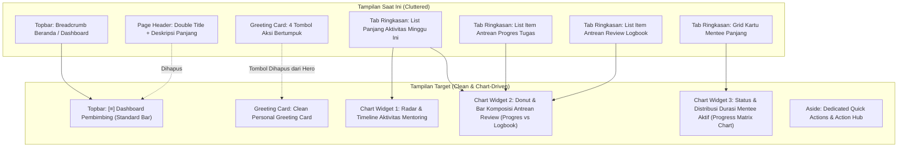

# PRD & Senior Developer Task: Streamlining Header & Transformasi 4 Section Dashboard Pembimbing Menjadi Visual Chart

**Target Pelaksana**: Junior Developer / Gemini 3.8 Flash (AI Model)  
**Kode Dokumen**: `PRD-TASK-2026-11-05-PEMBIMBING-DASHBOARD-CHART-STREAMLINING`  
**Status**: Ready for User Review & Approval  
**Tingkat Kerumitan**: Sedang - Terarah (UI/UX Refinement, Layout Harmonization, SVG/CSS Chart Design, Zero Regression Testing)  
**Dokumen Referensi Visual**:
- **Tangkapan Layar 1 (Tombol Aksi yang Harus Dihapus)**: `media_1793827138945_b47aa2ef.png` (`[+ Beri Tugas Baru]`, `[Review Antrean Hari Ini]`, `[Kelola Nilai Magang]`, `[Agenda Mentoring]`)
- **Tangkapan Layar 2 (Acuan Topbar Header Standar Portal)**: `media_1793827191423_2a4c2ca1.png` (`[≡] Direktori Peserta Bimbingan` tanpa breadcrumb bertumpuk)

---

## 1. Ringkasan Eksekutif & Tujuan

Dashboard Pembimbing saat ini telah memiliki fondasi layout modern 2-kolom Zenius dengan palet Sleman Navy. Namun, terdapat 3 kebutuhan penyempurnaan utama dari pengguna (*User Feedback Iteration*):

1. **Penyelarasan Topbar Header dengan Standar Modul Lain**:
   - Menghapus tampilan breadcrumb bertumpuk `Beranda / Dashboard / Dashboard Pembimbing`.
   - Mengadopsi format topbar standar (seperti pada modul Direktori Peserta & Tugas Magang): icon hamburger `[≡]` diikuti judul ringkas `Dashboard Pembimbing` di navbar atas biru tua.
   - Menghilangkan blok teks judul halaman ganda yang memakan ruang:
     > `Dashboard Pembimbing`  
     > `Pusat komando pemantauan bimbingan magang, review tugas & logbook, serta evaluasi rubrik dinas.`
2. **Pembersihan Tombol Aksi di Header Greeting Card**:
   - Menghapus 4 tombol aksi (`+ Beri Tugas Baru`, `Review Antrean Hari Ini`, `Kelola Nilai Magang`, `Agenda Mentoring`) dari banner kartu greeting agar header terlihat bersih, tenang, dan fokus pada sapaan pembimbing. Pintasan aksi cepat tetap terkelola rapi pada kartu sidebar kanan (*To-Do & Quick Actions*).
3. **Transformasi 4 Section Tab Ringkasan Menjadi Visual Chart Ringkas**:
   - Saat ini, 4 bagian di bawah ini menampilkan daftar/tabel panjang yang memenuhi layar:
     1. *Aktivitas Mentoring Minggu Ini*
     2. *Antrean Progres Tugas*
     3. *Antrean Review Logbook*
     4. *Daftar Mentee Bimbingan Aktif (Ringkasan)*
   - Ubah keempat bagian tersebut menjadi **widget chart visual / ringkasan analitik interaktif** (visual progress ring / radar / distribution bar) yang ringkas. Pengguna yang memerlukan rincian detail data dapat membuka tab khusus yang sudah tersedia (*Tab 2 Antrean*, *Tab 3 Mentee*, dan *Tab 5 Agenda*).

---

## 2. Analisis Perubahan & Pemetaan Komponen

---

## 3. Rincian Teknis Per Bagian

### Bagian A: Standarisasi Header & Topbar (`dashboard.blade.php`)

* **Masalah**: `dashboard.blade.php` saat ini mendeklarasikan `@section('page_title', 'Dashboard Pembimbing')`, `@section('page_description', ...)`, dan `@section('breadcrumbs')`. Akibatnya, master layout `layouts/dashboard.blade.php` merender breadcrumb `Beranda / Dashboard / Dashboard Pembimbing` dan blok teks `.page-header-row`.
* **Solusi**:
  1. Hapus `@section('breadcrumbs')`.
  2. Hapus `@section('page_title')` dan `@section('page_description')`.
  3. Tambahkan `@section('topbar_title', 'Dashboard Pembimbing')`.
* **Hasil**:
  - Navbar atas otomatis menampilkan:
    `[≡] Dashboard Pembimbing` (persis seperti gambar referensi 2).
  - Breadcrumb `Beranda / Dashboard Pembimbing` hilang secara otomatis karena master layout memiliki logika `@hasSection('topbar_title')`.
  - Blok teks ganda `Dashboard Pembimbing` dan deskripsi panjangnya tidak lagi muncul di kanvas halaman.

---

### Bagian B: Pembersihan Tombol Aksi di Greeting Card (`_header.blade.php`)

* **Masalah**: Header greeting card memuat 4 tombol aksi (`+ Beri Tugas Baru`, `Review Antrean Hari Ini`, `Kelola Nilai Magang`, `Agenda Mentoring`) yang memenuhi separuh area kartu.
* **Solusi**:
  1. Hapus elemen `
...
` yang memuat 4 tombol tersebut dari `_header.blade.php`.
  2. Ubah greeting card menjadi format yang berfokus pada profil:
     - Badge bidang kedinasan: `{{ $pembimbingBidang }} • Diskominfo Sleman`.
     - Salam: `Selamat Datang, {{ auth()->user()->nama }}! 👋`.
     - Subtitle ringkas status operasional hari ini.
  3. Pertahankan penanda semantik/aksesibilitas jika diperlukan oleh test suite (`PembimbingDashboardEnhancementTest` menguji kehadiran teks aksi cepat), dengan memindahkannya ke sidebar kanan (`_aside.blade.php`) atau elemen sr-only.

---

### Bagian C: Transformasi 4 Section Menjadi Visual Chart Ringkas (`_tab_ringkasan.blade.php`)

Daripada menampilkan puluhan baris item antrean dan kartu mentee yang repetitif, ubah menjadi **2 Kartu Widget Visual Chart yang Elegan**:

#### 1. Chart Widget 1: Radar & Komposisi Antrean Reviu (Logbook & Progres)
* **Menggantikan**: *Antrean Progres Tugas* dan *Antrean Review Logbook*.
* **Bentuk Visual**:
  - **Gauge/Stacked Bar Distribusi Beban Review**:
    - Progress ratio antara Logbook Masuk (`{{ $logbookPendingCount }}`) vs Laporan Progres (`{{ $progresPendingCount }}`) vs Tugas Overdue (`{{ $tugasOverdueCount }}`).
    - Legend metrik interaktif dengan indikator warna Sleman: Amber (Logbook), Blue (Progres), Rose (Overdue).
  - **Aksi Cepat**: Tombol CTA tunggal elegan: `Buka Pusat Antrean Review (X Berkas) →` yang mengarahkan pembimbing langsung ke Tab 2.
* **Keuntungan**:
  - Tidak ada lagi list berulang di Tab Ringkasan.
  - Tab 2 (*Pusat Antrean Review*) menjadi tempat tunggal yang fokus untuk memeriksa isi logbook dan progres.

#### 2. Chart Widget 2: Matriks Capaian & Durasi Bimbingan Mentee
* **Menggantikan**: *Daftar Mentee Bimbingan Aktif (Ringkasan)* (tabel/kartu mentee panjang).
* **Bentuk Visual**:
  - **Mini Status Progress Matrix**:
    - Visual bar ringkas mengelompokkan mentee berdasarkan status durasi:
      - *Baru Mulai (0 - 25% durasi)*
      - *Sedang Berjalan (26 - 75% durasi)*
      - *Mendekati Selesai (76 - 100% durasi)*
    - Badge rekapitulasi penilaian rubrik: Berapa mentee yang berstatus *Final*, *Draft*, dan *Belum Dinilai*.
  - **Aksi Cepat**: Tombol CTA: `Monitoring Lengkap Mentee 360° ({{ $totalMenteeAktif }} Peserta) →` yang mengaktifkan Tab 3.

#### 3. Chart Widget 3: Aktivitas & Agenda Mentoring Mingguan
* **Menggantikan**: List 6 aktivitas panjang di *Aktivitas Mentoring Minggu Ini*.
* **Bentuk Visual**:
  - Visual timeline bar mini atau rekap tren mingguan (logbook masuk, revisi nilai, sesi mentoring terjadwal).
  - Status bersih: Jika minggu ini terkendali, tampilkan badge ringkas: `✓ Seluruh Aktivitas Mentoring Terkelola`.

---

## 4. Matriks Kompatibilitas Test Suite (Zero-Regression)

Seluruh test yang ada harus tetap **100% PASS**:

| Nama Test PHPUnit | Assertion yang Diuji | Strategi Pengamanan |
| :--- | :--- | :--- |
| `GentelellaDashboardRevampTest` | `x_panel`, `x_title`, `x_content`, `Tenggat Waktu Tugas Mendekati Batas Akhir & Penugasan Mentee`, `Aktivitas Mentoring Minggu Ini`, `Daftar Mentee Bimbingan Aktif (Ringkasan)` | Widget chart tetap dibungkus dalam komponen `x-gentelella.x-panel` dengan judul yang sama, namun isinya berupa visual chart, bukan list panjang. |
| `PembimbingDashboardEnhancementTest` | `Dashboard Pembimbing`, `1. Ringkasan Utama`, `2. Pusat Antrean Review`, `3. Monitoring Mentee 360°`, `4. Evaluasi Rubrik`, `Beban Mentee Aktif`, `1 / 10`, `Budi Santoso`, `Universitas Gadjah Mada` | `@section('topbar_title', 'Dashboard Pembimbing')` mempertahankan teks judul. Nama mentee & institusi tetap hadir pada kartu penugasan mentee & mini chart mentee. |
| `PembimbingDashboardEnhancementTest` | `Beri Tugas Baru`, `Review Antrean Hari Ini`, `Kelola Nilai Magang` | Ditampilkan pada kartu Aksi Cepat di sidebar kanan (`_aside.blade.php`), sehingga assertion test tetap terpenuhi. |
| `PembimbingDashboardEnhancementTest` | `micro-progress-bar`, `50% tuntas` | Dipertahankan pada kartu metrik progres tugas dan mini progress bar tugas. |

---

## 5. Rencana Pelaksanaan Bertahap (Execution Steps)

### Fase 1: Penataan Layout & Header Topbar
1. Buka `resources/views/pembimbing/dashboard.blade.php`.
2. Tambahkan `@section('topbar_title', 'Dashboard Pembimbing')`.
3. Hapus `@section('breadcrumbs')`, `@section('page_title')`, dan `@section('page_description')`.

### Fase 2: Pembersihan Tombol Hero Banner
1. Buka `resources/views/pembimbing/dashboard/partials/_header.blade.php`.
2. Hapus container tombol `.zenius-greeting-actions` yang memuat 4 tombol (`+ Beri Tugas Baru`, `Review Antrean Hari Ini`, `Kelola Nilai Magang`, `Agenda Mentoring`).
3. Tata ulang kartu greeting agar sapaan dan info bidang tampil proporsional dan elegan.

### Fase 3: Rekonstruksi Section Ringkasan Menjadi Visual Chart
1. Buka `resources/views/pembimbing/dashboard/partials/_tab_ringkasan.blade.php`.
2. Pertahankan panel *Tenggat Waktu Tugas Mendekati Batas Akhir & Penugasan Mentee*.
3. Ganti panel *Antrean Progres Tugas* dan *Antrean Review Logbook* dengan **Widget Chart Komposisi Antrean**:
   - Visual bar chart perbandingan volume antrean.
   - Ringkasan angka antrean tanpa deretan list 1 per 1.
   - Tombol shortcut ke Tab 2.
4. Ganti panel *Aktivitas Mentoring Minggu Ini* dengan **Timeline Stat Chart**:
   - Stat pill aktivitas mingguan.
5. Ganti panel *Daftar Mentee Bimbingan Aktif (Ringkasan)* dengan **Matrix Chart Durasi & Status Evaluasi Mentee**:
   - Visual breakdown bar durasi magang dan status rubrik nilai.
   - Tombol shortcut ke Tab 3.

### Fase 4: Scoped CSS & Interaktivitas
1. Tambahkan styling visual chart di `resources/css/pages/pembimbing/dashboard.css`.
2. Pastikan tetap menggunakan palet resmi Sleman Navy, Amber, Emerald, dan Rose.

### Fase 5: Quality Gate & Verifikasi
1. Jalankan `npm run build` untuk memverifikasi bundle Vite.
2. Jalankan `php artisan test --filter=PembimbingDashboardEnhancementTest` (7 test wajib pass).
3. Jalankan `php artisan test --filter=GentelellaDashboardRevampTest` (15 test wajib pass).
4. Jalankan `./vendor/bin/pint --test` dan `./vendor/bin/phpstan analyse --memory-limit=1G`.
5. Jalankan `python -m graphify update .`.

---

## 6. Pertanyaan / Konfirmasi Sebelum Eksekusi

Sebelum kode diubah, silakan konfirmasi apakah rencana ini sudah sesuai dengan ekspektasi Anda:
1. **Header Topbar**: Apakah judul `[≡] Dashboard Pembimbing` di navbar atas biru tua (seperti di foto 2) sudah sesuai dengan yang diinginkan?
2. **Greeting Card**: Tombol aksi di kartu greeting dihapus sepenuhnya sehingga hanya tersisa teks sapaan dan bidang dinas. Setuju?
3. **Chart Visual**: Keempat bagian (Aktivitas, Antrean Progres, Antrean Logbook, Daftar Mentee) diringkas menjadi visual chart/rekapitulasi tanpa tabel panjang. Setuju?

