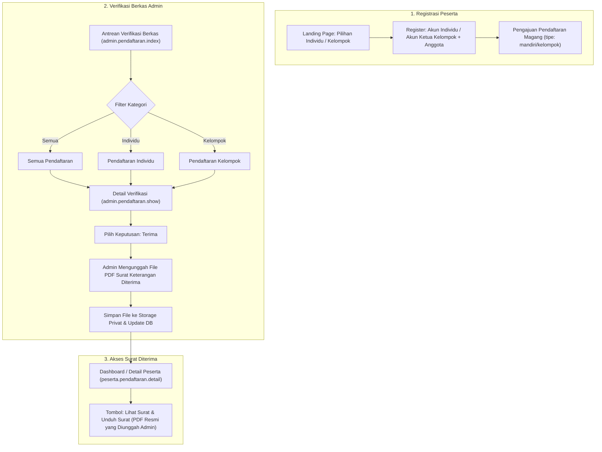

# Rencana Kerja: Kategori Verifikasi Berkas (Individu & Kelompok), Upload Manual Surat Keterangan Diterima, dan Penyelarasan Sistem

**Tanggal Dokumen:** 6 November 2026  
**Status:** Menunggu Persetujuan Pengguna (Awaiting Feedback)  
**Terkait Standar:** `.agents/rules/AGENTS.md`, `docs/01-PRD-MagKom.md` (F-01, F-03, F-04, F-16), `docs/02-TDD-MagKom.md`

---

## 1. Latar Belakang & Tujuan

Berdasarkan kebutuhan pengguna:
1. **Pemilihan Kategori pada Verifikasi Berkas Admin:**
   Di halaman verifikasi berkas (`admin.pendaftaran.index`), admin dapat memilih dan menyaring mana pendaftaran yang diverifikasi antara **Individu** dan **Kelompok** (2 kategori utama + Semua).
2. **Penggantian Generator Otomatis Surat Diterima dengan Upload Surat oleh Admin:**
   Surat Keterangan Diterima resmi kini tidak lagi di-generate otomatis via HTML-to-PDF template, melainkan **diunggah langsung oleh admin (file PDF resmi ber-kop dan bertanda tangan dinas)** ke peserta saat verifikasi diterima atau pada menu penempatan. Peserta dapat melihat pratinjau dan mengunduh berkas resmi tersebut.
3. **Penyelarasan & Konsistensi Alur:**
   Karena di *landing page* dan halaman registrasi sudah ada pilihan pendaftaran **Individu (Sendiri)** dan **Kelompok (Tim)**, seluruh antarmuka, terminologi label, badge tabel, serta alur data harus selaras dan konsisten dari awal hingga akhir.

---

## 2. Analisis Kondisi Eksisting Codebase

1. **Database & Model Pendaftaran:**
   - Tabel `pendaftaran` sudah memiliki kolom `tipe` (string default `'mandiri'`) dan `kelompok_magang_id`.
   - Tabel `kelompok_magang` dan `kelompok_anggota` sudah tersedia lengkap dengan relasinya.
   - Saat ini tabel `pendaftaran` dan `penempatan` belum memiliki kolom khusus untuk menyimpan path file dokumen surat diterima yang diunggah oleh admin (`file_surat_diterima`).
2. **Filter Verifikasi Berkas (`admin.pendaftaran.index`):**
   - Filter yang aktif saat ini baru mencakup: Status (`Semua`, `Diajukan`, `Diterima`, `Ditolak`), `Bulan Magang`, `Jurusan`, `Urutan Data` (`Terbaru`, `Terlama`), dan `Pencarian` (`Cari nama...`).
   - Belum ada kontrol segmented/tab atau filter dropdown untuk memilah pendaftaran **Individu** vs **Kelompok**.
   - Tabel belum menampilkan badge visual pembeda yang tegas antara pendaftaran perorangan dan tim kelompok.
3. **Surat Keterangan Diterima:**
   - Masih menggunakan `SuratDiterimaPdfService` yang menyusun HTML view `pdf.surat-keterangan-diterima` secara dinamis.
   - Perlu mekanisme agar admin dapat mengunggah file PDF resmi instansi pada panel verifikasi (`admin.pendaftaran.show`), yang kemudian di-stream atau diunduh oleh peserta (`peserta.penempatan.surat-diterima`).
4. **Terminologi Landing Page & Register:**
   - Di Landing page saat ini terdapat label: `Sendiri (1 Org)` vs `Kelompok (Tim)`.
   - Di Register: `Mandiri (1 Orang)` vs `Kelompok (2–4 Orang)`.
   - Perlu diselaraskan secara konsisten menggunakan terminologi: **Individu** dan **Kelompok**.

---

## 3. Desain Arsitektur & Rencana Perubahan

### 3.1. Database Migration (Non-Destruktif)
- Buat file migrasi baru: `database/migrations/2026_11_06_230000_add_file_surat_diterima_to_pendaftaran_and_penempatan_tables.php`:
  - Menambahkan kolom `file_surat_diterima` (`string(255)->nullable()`) dan `surat_diterima_uploaded_at` (`timestamp()->nullable()`) pada tabel `pendaftaran`.
  - Menambahkan kolom `file_surat_diterima` (`string(255)->nullable()`) pada tabel `penempatan`.
  - *Rollback support* lengkap melalui `$table->dropColumn(...)`.

### 3.2. Backend Logic & Services
1. **`app/Http/Requests/KeputusanPendaftaranRequest.php`:**
   - Menambahkan aturan validasi file surat ketika keputusan `'terima'`:
     `'file_surat_diterima' => ['nullable', 'file', 'mimes:pdf', 'max:2048']`.
   - Pesan kesalahan validasi dalam Bahasa Indonesia jika format bukan PDF atau ukuran > 2MB.
2. **`app/Services/PlacementService.php`:**
   - Memperbarui `terimaBerkas(Pendaftaran $pendaftaran, User $admin, ?string $catatan = null, ?UploadedFile $fileSurat = null)`:
     - Jika `$fileSurat` diunggah, simpan file ke direktori privat `surat_diterima/` via Laravel Storage.
     - Simpan path file di `$pendaftaran->file_surat_diterima`.
     - Jika penempatan langsung dibuat atau penempatan diperbarui, sinkronkan path ke `$penempatan->file_surat_diterima`.
3. **`app/Http/Controllers/Admin/PendaftaranController.php`:**
   - Pada method `index()`:
     - Menangkap parameter request `tipe` (nilai yang didukung: `individu`, `kelompok`, atau kosong untuk semua).
     - Menjalankan filter Eloquent:
       - `individu`: `where(fn($q) => $q->where('tipe', 'mandiri')->orWhere('tipe', 'individu')->orWhereNull('tipe'))`
       - `kelompok`: `where('tipe', 'kelompok')`
     - Menghitung statistik antrean kategori: `queueStats['total_individu']` dan `queueStats['total_kelompok']`.
   - Pada method `putuskan()`:
     - Meneruskan file upload `$request->file('file_surat_diterima')` ke service placement.
4. **`app/Http/Controllers/Peserta/PendaftaranController.php` & `Admin\PenempatanController.php`:**
   - Pada method `unduhSuratDiterima()` dan `pratinjauSuratDiterima()`:
     - Cek apakah `$penempatan->file_surat_diterima` atau `$penempatan->pendaftaran?->file_surat_diterima` tersedia di storage disk.
     - Jika ada, stream / download file asli yang diunggah admin tersebut.
     - Jika belum ada file diunggah (misal data lama), sediakan graceful fallback ke `SuratDiterimaPdfService` agar tidak terjadi error 404 pada data penempatan terdahulu.

---

## 4. Rincian Permohonan Persetujuan Markup Blade (Sesuai AGENTS.md 3.3)

Sesuai aturan ketat Bagian 3.3 dokumen `AGENTS.md`, perubahan markup Blade memerlukan penjelasan detail dan persetujuan eksplisit pengguna:

| No | File Blade | Bagian yang Diubah | Alasan Markup Baru Diperlukan |
|---|---|---|---|
| 1 | `resources/views/admin/pendaftaran/index.blade.php` | Toolbar filter & kolom tabel | Menambahkan tab/pilihan filter kategori (Semua, Individu, Kelompok) beserta counter, input select `tipe` di form filter, dan visual badge `Individu`/`Kelompok` di tabel antrean. |
| 2 | `resources/views/admin/pendaftaran/show.blade.php` | Panel Keputusan Terima & Header info | Menambahkan input file upload `file_surat_diterima` (PDF) dengan atribut `enctype="multipart/form-data"` pada form keputusan terima, serta pratinjau surat jika sudah ada yang terunggah. |
| 3 | `resources/views/public/landing.blade.php` | Pertanyaan 3 (Pill pemilihan mode magang) | Menyelaraskan teks pill `Sendiri (1 Org)` menjadi `Individu (1 Orang)` agar konsisten dengan terminologi sistem. |
| 4 | `resources/views/auth/register.blade.php` | Radio button pemilihan tipe | Menyelaraskan label `Mandiri (1 Orang)` menjadi `Individu (1 Orang)` agar seragam dengan landing page dan verifikasi berkas. |

> **Catatan Styling & Interaksi:** Seluruh styling tampilan akan menggunakan utility class CSS yang sudah ada atau scoped styling CSS, tanpa inline event handler JavaScript yang dilarang.

---

## 5. Rencana Pengujian (Test Suite & Quality Gate)

1. **Feature Testing (PHPUnit):**
   - `tests/Feature/AdminVerifikasiKategoriDanUploadSuratTest.php`:
     - Test filter kategori: admin memfilter `tipe=individu` hanya menampilkan pendaftaran mandiri/individu.
     - Test filter kategori: admin memfilter `tipe=kelompok` hanya menampilkan pendaftaran bertipe kelompok.
     - Test verifikasi terima dengan upload file PDF surat diterima berhasil tersimpan di storage dan path tercatat di database.
     - Test validasi upload menolak file non-PDF (misal .exe/.txt) dan ukuran > 2MB.
     - Test peserta dapat mengunduh dan melihat pratinjau file PDF asli yang diunggah oleh admin.
2. **Regression Testing:**
   - Menjalankan `php artisan test --filter Pendaftaran` untuk memastikan alur registrasi, validasi berkas, dan pembatalan tetap 100% lulus.
   - Menjalankan test suite penempatan `AdminPenempatanTest` dan `PesertaPendaftaranFlowTest`.
3. **Static Analysis & Formatting:**
   - Menjalankan `./vendor/bin/pint --test` untuk memastikan kerapian kode standar PSR-12.
   - Menjalankan PHPStan bila relevan.

---

## 6. Tahapan Pelaksanaan

- **Langkah 1:** Pembuatan migrasi database penambahan kolom `file_surat_diterima`.
- **Langkah 2:** Update Model `Pendaftaran` & `Penempatan` (`$fillable`).
- **Langkah 3:** Update `KeputusanPendaftaranRequest` & `PlacementService` untuk proses upload file surat.
- **Langkah 4:** Update Controller Admin & Peserta untuk filter kategori dan download surat yang diunggah.
- **Langkah 5:** Penerapan perubahan markup Blade pada `admin.pendaftaran.index`, `admin.pendaftaran.show`, `landing`, dan `register`.
- **Langkah 6:** Pembuatan feature test suite komprehensif dan eksekusi quality gate.
- **Langkah 7:** Pelaporan hasil lengkap kepada pengguna.

