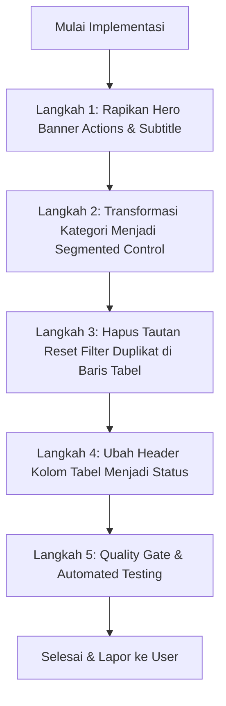

# Rencana Kerja: Penyelarasan Header, Pembersihan Navigasi, Kolom Status, dan Modernisasi Kategori Verifikasi

**Tanggal:** 7 November 2026  
**Target:** `resources/views/admin/pendaftaran/index.blade.php`  
**Tujuan:** Menyelaraskan dan menuntaskan 5 permintaan perbaikan antarmuka pada Meja Verifikasi Berkas Pendaftaran Peserta Magang Dinas Kominfo Sleman sesuai standar tata kelola UI kedinasan.

---

## 1. Analisis 5 Poin Permintaan Pengguna

### Poin 1 (Gambar 1): Hapus Tombol Navigasi Hero Banner
- **Kondisi Saat Ini**:
  Di sisi kanan Hero Banner terdapat 2 tombol di dalam `.adm-hero-actions`:
  1. `< Dashboard` (`.adm-hero-btn-secondary` - tombol navigasi kembali).
  2. `Unduh Bundel ZIP` (`.adm-hero-btn-primary` - tombol aksi ekspor berkas pendaftar).
- **Masalah**:
  Tombol `< Dashboard` merupakan duplikasi navigasi yang tidak diperlukan karena menu navigasi `Dashboard` sudah tersedia permanen di sidebar kiri admin.
- **Rencana Tindakan**:
  - **Hapus tombol navigasi `< Dashboard`**.
  - **Pertahankan tombol aksi `Unduh Bundel ZIP`** sebagai tombol aksi tunggal (*single primary action*) di hero banner (serupa dengan pola Direktori Pembimbing yang hanya memiliki tombol tunggal `+ Beri Tugas Baru`).
  *(Catatan: Jika pengguna menghendaki kedua tombol di Gambar 1 dihapus total tanpa sisa, dapat dikonfirmasi pada Opsi B).*

---

### Poin 2 (Gambar 2): Koreksi Teks Subtitle Hero Banner
- **Kondisi Saat Ini**:
  `Meja Verifikasi Berkas Pendaftaran Peserta • Dinas Komunikasi dan Informatika Kabupaten Sleman • 4 Total Berkas`
- **Permintaan Pengguna**:
  Ubah menjadi `Verifikasi Berkas Pendaftaran Peserta` (hilangkan kata "Meja"), dan hapus `• 4 Total Berkas`.
- **Rencana Tindakan**:
  Ubah markup subtitle menjadi:
  ```blade
  <div class="adm-hero-subtitle">
      <span>Verifikasi Berkas Pendaftaran Peserta</span>
      <span class="sep">&bull;</span>
      <span>Dinas Komunikasi dan Informatika Kabupaten Sleman</span>
  </div>
  ```
  *(Alasan tepat: Informasi jumlah berkas sudah disajikan secara detail pada KPI Card "Total Permohonan" dan badge status, sehingga penghapusan ini menghindari redundansi angka).*

---

### Poin 3 (Gambar 3): Hapus Tautan `✕ Reset Filter` di Baris Tabel
- **Kondisi Saat Ini**:
  Di sisi kanan baris status alur kerja (di atas tabel) terdapat:
  ```blade
  @if($hasActiveFilters)
      <a href="{{ route('admin.pendaftaran.index') }}" class="adm-filter-reset-link">
          ...
          <span>Reset Filter</span>
      </a>
  @endif
  ```
- **Masalah**:
  Di form pencarian dan filter di atasnya sudah tersedia tombol resmi `Reset` (`.adm-btn-filter-reset`). Adanya tautan `✕ Reset Filter` kedua di baris tabel menciptakan elemen duplikat yang membuat antarmuka terasa ramai dan memecah fokus verifikator.
- **Rencana Tindakan**:
  - Hapus blok kondisi `@if($hasActiveFilters) ... @endif` tersebut secara menyeluruh.

---

### Poin 4 (Gambar 4): Ubah Header Kolom Tabel `STATUS PERMOHONAN` $\rightarrow$ `STATUS`
- **Kondisi Saat Ini**:
  `<th>Status Permohonan</th>`
- **Permintaan Pengguna**:
  Ubah menjadi `<th>Status</th>`.
- **Rencana Tindakan**:
  - Ganti teks pada baris 1046 menjadi `<th>Status</th>`.
  - Memberikan keseragaman (*consistency*) dengan tabel admin lainnya di portal MagKom (seperti tabel penempatan, kuota, dan waiting list).

---

### Poin 5 (Gambar 5): Saran Senior Developer untuk Switcher Kategori (`Semua Kategori`, `Individu`, `Kelompok`)
- **Kondisi Saat Ini**:
  Menggunakan model *Underline Tab* teks tipis (`.adm-category-nav-bar`) yang terletak di atas form filter pencarian.
- **Kebingungan Pengguna**:
  Apakah untuk aplikasi kedinasan lebih baik dijadikan tombol atau dibiarkan seperti itu saja?

#### Analisis Arsitektur UI/UX Kedinasan (GovTech Indonesia / SPBE Sleman):
1. **Mengapa Underline Tab Terasa Kurang Pas?**
   - Garis bawah tipis (*underline*) biasanya diasosiasikan dengan perpindahan halaman penuh (*page routing*), bukan filter penyaringan data.
   - Di bawah form pencarian, ada baris status (`Semua Status`, `Diajukan`, `Diterima`, `Ditolak`) yang berbentuk *pill*. Keberadaan dua baris navigasi berkarakter berbeda membuat hierarki visual membingungkan.
2. **Saran & Rekomendasi Senior Developer: "Segmented Control Container (Tombol Kapsul Terpadu)"**
   - **Solusi Terbaik Kedinasan**: Mengubah switcher kategori menjadi **Segmented Control Pill Container** (seperti panel sakelar mode resmi):
     - **Wadah (Container)**: Latar abu-abu terang halus (`#F1F5F9`), sudut membulat 12px, border tipis (`#E2E8F0`), padding 4px.
     - **Item Aktif**: Tombol berlatar belakang putih solid (`#FFFFFF`) dengan efek timbul lembut (*soft card shadow* `0 1px 3px rgba(0,0,0,0.08)`), warna teks biru Sleman tegas (`#01347C`), font weight 700.
     - **Item Inaktif**: Teks abu-abu netral (`#64748B`), saat disentuh (hover) berubah lebih gelap (`#1E293B`) dengan transisi halus.
     - **Badge Counter**: Kapsul mungil di sebelah teks (`#EFF6FF` teks biru saat aktif; `#E2E8F0` teks abu-abu saat inaktif).
   - **Keuntungan Utama**:
     1. **Keterbacaan & Afordansi (Affordance)**: Verifikator dinas langsung memahami bahwa ini adalah tombol pengalih (*switcher*) yang aktif dan bisa diklik.
     2. **Kerapian & Kestabilan**: Tidak berserakan, hemat ruang, dan memberikan identitas visual profesional khas instansi pemerintah modern.
     3. **Hierarki Jelas**: Kategori Peserta (Individu vs Kelompok) diwadahi dalam Segmented Pill terpadu di atas form, sementara Status Alur Kerja (Diajukan/Diterima/Ditolak) tetap di baris tabel.

---

## 2. Rencana Implementasi Bertahap



### Langkah 1: Modifikasi Hero Banner (Poin 1 & 2)
1. Hapus tag tautan `<a href="{{ route('admin.dashboard') }}" class="adm-hero-btn-secondary">...</a>`.
2. Pertahankan `<a href="{{ route('admin.pendaftaran.download-zip') }}" class="adm-hero-btn-primary">...</a>`.
3. Ganti isi subtitle hero banner menjadi:
   ```blade
   <div class="adm-hero-subtitle">
       <span>Verifikasi Berkas Pendaftaran Peserta</span>
       <span class="sep">&bull;</span>
       <span>Dinas Komunikasi dan Informatika Kabupaten Sleman</span>
   </div>
   ```

### Langkah 2: Modernisasi Kategori Menjadi Segmented Control (Poin 5)
1. Tambahkan CSS scoped baru:
   - `.adm-category-segmented-container`: Display inline-flex, background `#F1F5F9`, border 1px solid `#E2E8F0`, border-radius 12px, padding 4px, gap 4px.
   - `.adm-category-segmented-btn`: Padding 8px 16px, border-radius 8px, font-size 0.875rem, font-weight 600, color `#64748B`.
   - `.adm-category-segmented-btn.active`: Background `#FFFFFF`, color `#01347C`, font-weight 700, shadow `0 1px 3px rgba(0,0,0,0.08)`.
   - `.adm-category-seg-badge`: Padding 2px 7px, border-radius 9999px, font-size 0.75rem.
2. Update markup kategori di baris 889 agar menggunakan class baru ini.

### Langkah 3: Hapus Reset Filter Duplikat (Poin 3)
1. Hapus baris 1011 s/d 1019 pada `resources/views/admin/pendaftaran/index.blade.php`:
   ```blade
   @if($hasActiveFilters)
       <div>
           <a href="{{ route('admin.pendaftaran.index') }}" class="adm-filter-reset-link" ...>
               ...
           </a>
       </div>
   @endif
   ```

### Langkah 4: Ubah Header Kolom Status (Poin 4)
1. Ubah baris 1046:
   ```blade
   <th>Status</th>
   ```

---

## 3. Rencana Pengujian & Quality Gates

1. **Pint Code Styling**:
   ```bash
   vendor\bin\pint.bat --test
   ```
2. **PHPUnit Feature Tests**:
   - `AdminVerifikasiKategoriDanUploadSuratTest` (memastikan switcher kategori dan filter tetap berfungsi 100%).
   - `AdminChildPagesVisualTest` (memastikan halaman pendaftaran lolos assertion visual).
   - `AdminChildPagesExtendedVisualTest`.
3. **Frontend Build Verification**:
   ```bash
   npm run build
   ```
4. **Dev Server Verification**:
   Memastikan response HTTP 200 via `curl.exe -I http://127.0.0.1:8000/admin/pendaftaran`.

