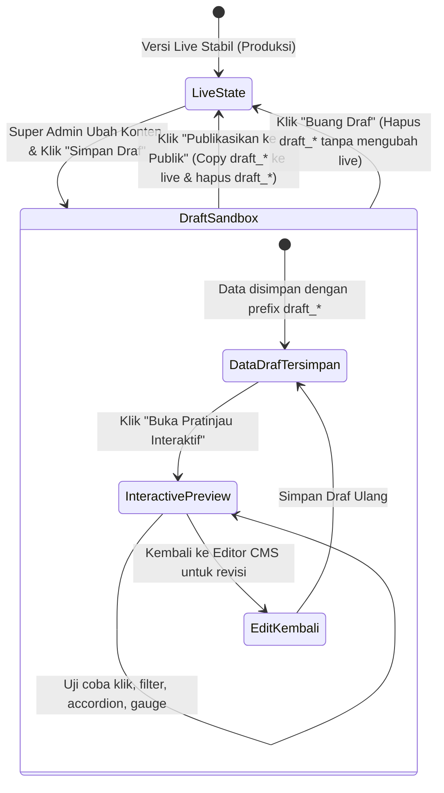

# DOKUMEN TUGAS SENIOR DEVELOPER
## Fitur: Staging Sandbox, Draft Storage & Full Interactive Live Preview CMS Landing Page
### Modul Super Admin — MAGKOM

---

**Kepada:** Junior Developer / AI Coding Agent (Gemini 3.8 Flash, Cursor, Copilot)  
**Dari:** Senior Lead Software Engineer  
**Tanggal:** 7 November 2026  
**Status:** Ready for Step-by-Step Implementation  
**Prioritas:** P1 — High Reliability Content Staging & Safe Publishing  
**Target:** 100% Perubahan Landing Page Masuk ke Kontainer Draf (Sandbox) Terlebih Dahulu, Dapat Di-preview Secara Utuh & Interaktif, Sebelum Dipublikasikan ke Publik

---

## 1. LATAR BELAKANG & TUJUAN BISNIS

### 1.1 Masalah Saat Ini
Saat ini, setiap kali Super Admin mengklik tombol "Simpan Perubahan" pada modul CMS Landing Page (`/superadmin/landing`), data baru langsung tersimpan ke tabel `pengaturan` dan langsung tayang secara *live* detik itu juga kepada seluruh pengunjung publik.

Kelemahan alur langsung (direct-to-production) ini:
1. **Risiko Salah Ketik (Typo) / Kesalahan Format**: Jika Super Admin salah memasukkan teks, format tanggal, atau URL, calon peserta magang di luar sana langsung melihat kesalahan tersebut.
2. **Tidak Ada Tempat Uji Coba / Kontainer Aman**: Super Admin tidak dapat melihat bagaimana tampilan baru tersebut berinteraksi dengan layout aslinya sebelum benar-benar dirilis.
3. **Perubahan Parsial Terlihat**: Jika Super Admin ingin merombak 3 bagian sekaligus (misal Hero + Kuota + Tahapan), publik akan melihat kondisi nanggung di mana Hero sudah berubah tapi Kuota belum sempat disimpan.

### 1.2 Analogi "Kontainer Staging / Sandbox"
Senior Developer menginginkan konsep **"Kontainer Sandbox"**:
> *Bayangkan Super Admin bekerja di dalam sebuah ruang kaca / kontainer uji coba (Sandbox/Staging). Di dalam kontainer ini, Super Admin bebas mengubah teks, mengganti foto banner, menyesuaikan alur, atau mengedit FAQ. Perubahan ini HANYA tampak di dalam kontainer tersebut dan TIDAK bocor ke publik. Super Admin dapat menjelajahi halaman Landing Page versi kontainer ini secara penuh—bisa diklik, tombolnya aktif, tab kuotanya responsif, accordion FAQ-nya bergerak—sampai merasa 100% yakin. Setelah yakin, barulah Super Admin menekan satu tombol: **"Publikasikan ke Publik"** untuk melepas isi kontainer ke dunia luar. Jika tidak puas, ada tombol **"Buang Draf"** untuk mengembalikan semuanya seperti sedia kala tanpa bekas.*

---

## 2. ALUR KERJA SISTEM (LIFECYCLE & STATE MACHINE)



### Penjelasan Status (States):
1. **Live State (Publik Bersih)**:
   - Pengunjung publik, tamu, siswa, mahasiswa, pembimbing, dan admin biasa HANYA membaca kunci asli (`landing_*`) dari tabel `pengaturan`.
   - Tidak pernah terpengaruh oleh draf yang sedang dikerjakan Super Admin.
2. **Draft / Sandbox State (Kontainer Draf)**:
   - Saat Super Admin mengedit di CMS dan mengklik **"Simpan Draf"**, data disimpan dengan namespace draf (`draft_landing_*`).
   - Sistem mencatat timestamp `draft_landing_updated_at` dan status draf aktif.
3. **Interactive Live Preview State (Pratinjau Interaktif Penuh)**:
   - Super Admin membuka route khusus `/superadmin/landing/preview` atau URL berparameter `/?preview=1` yang dilindungi otorisasi Super Admin.
   - Halaman me-render view Landing Page publik asli dengan seluruh aset Vite, CSS, Vanilla JS, Google Fonts, dan interaktivitasnya (gauge ring, filter bulan, filter jenjang, accordion FAQ, modal).
   - Di bagian atas layar (Sticky Top Bar), muncul **"Floating Preview Control Bar"**:
     - Indikator: `🟡 Mode Pratinjau CMS Aktif — Anda sedang melihat draf yang belum terpublikasi`.
     - Tombol: `[ ✏️ Kembali ke Editor ]`, `[ 🗑️ Buang Draf ]`, `[ 🚀 Publikasikan ke Publik ]`.
4. **Publish Action (Publikasi)**:
   - Super Admin menekan **"Publikasikan ke Publik"**.
   - Sistem mentransfer semua nilai `draft_landing_*` menimpa nilai `landing_*` versi live.
   - Semua kunci `draft_landing_*` dibersihkan.
   - File sementara (jika ada upload banner/PDF baru di draf) dipindahkan ke direktori publik permanen.
   - Cache dibersihkan (`Pengaturan::clearCache()`) dan audit trail dicatat.
5. **Discard Action (Buang Draf)**:
   - Super Admin menekan **"Buang Draf"**.
   - Sistem menghapus seluruh kunci `draft_landing_*` dan file sementara draf.
   - Editor CMS kembali membaca nilai live saat ini.

---

## 3. ARSITEKTUR DATA (ZERO DATABASE MIGRATION)

Kita **TIDAK PERLU** menambah tabel baru atau mengubah skema database master yang sudah stabil. Kita memanfaatkan tabel `pengaturan` yang fleksibel (`kunci` VARCHAR(100), `nilai` TEXT).

### 3.1 Skema Penamaan Kunci Draf (Draft Keys)

Setiap kunci pengaturan live memiliki pasangan kunci draf dengan prefix `draft_`:

| Kunci Live (Produksi) | Kunci Draf (Sandbox) | Keterangan |
|---|---|---|
| `landing_meta_title` | `draft_landing_meta_title` | Draf judul SEO |
| `landing_meta_desc` | `draft_landing_meta_desc` | Draf deskripsi SEO |
| `landing_hero_title` | `draft_landing_hero_title` | Draf judul Hero |
| `landing_hero_year` | `draft_landing_hero_year` | Draf badge tahun |
| `landing_hero_image` | `draft_landing_hero_image` | Draf path foto banner |
| `landing_panduan_pdf` | `draft_landing_panduan_pdf` | Draf path file panduan PDF |
| `landing_kuota_heading` | `draft_landing_kuota_heading` | Draf heading kuota |
| `landing_tahapan_steps` | `draft_landing_tahapan_steps` | Draf JSON alur pendaftaran |
| `landing_faq_data` | `draft_landing_faq_data` | Draf JSON FAQ accordion |
| `landing_footer_alamat` | `draft_landing_footer_alamat` | Draf alamat dinas |
| `kebijakan_privasi_sections` | `draft_kebijakan_privasi_sections`| Draf pasal kebijakan privasi |

### 3.2 Metadata Status Kontainer Draf
Dua kunci khusus digunakan untuk melacak status kontainer:
- `landing_draft_active`: bernilai `'1'` jika ada draf aktif yang belum dipublikasikan, atau `'0'` jika tidak ada draf.
- `landing_draft_updated_at`: string timestamp ISO 8601 (contoh: `2026-11-07 18:00:00`) kapan draf terakhir disimpan.
- `landing_draft_author_name`: nama Super Admin yang terakhir mengubah draf.

---

## 4. RANCANGAN IMPLEMENTASI TEKNIS

Sebagai Senior Developer, berikut panduan arsitektur yang harus diikuti oleh Junior Developer / AI agent:

### 4.1 Modifikasi Helper `App\Support\Pengaturan`
Helper `Pengaturan` saat ini sudah memiliki method `get()`, `set()`, `json()`, `setJson()`. Kita tambahkan fungsionalitas **Preview Context Awareness**:

```php
// app/Support/Pengaturan.php
namespace App\Support;

use App\Models\Pengaturan as PengaturanModel;

final class Pengaturan
{
    private static bool $previewMode = false;

    /**
     * Aktifkan mode pratinjau draf untuk request saat ini.
     */
    public static function setPreviewMode(bool $enabled): void
    {
        self::$previewMode = $enabled;
    }

    /**
     * Cek apakah mode pratinjau sedang aktif.
     */
    public static function isPreviewMode(): bool
    {
        return self::$previewMode;
    }

    /**
     * Ambil nilai konfigurasi.
     * Jika dalam mode pratinjau dan ada draf, kembalikan nilai draf.
     * Jika tidak ada draf atau tidak dalam mode pratinjau, kembalikan nilai live.
     */
    public static function get(string $kunci, ?string $default = null): ?string
    {
        if (self::$previewMode) {
            $draftKey = 'draft_' . $kunci;
            $draftVal = PengaturanModel::getNilai($draftKey);
            if ($draftVal !== null && $draftVal !== '') {
                return $draftVal;
            }
        }

        return PengaturanModel::getNilai($kunci, $default);
    }

    /**
     * Ambil nilai JSON dengan dukungan draf pratinjau.
     */
    public static function json(string $kunci, array $default = []): array
    {
        if (self::$previewMode) {
            $draftKey = 'draft_' . $kunci;
            $draftVal = PengaturanModel::getNilai($draftKey);
            if ($draftVal !== null && $draftVal !== '') {
                $decoded = json_decode($draftVal, true);
                if (is_array($decoded)) {
                    return $decoded;
                }
            }
        }

        return PengaturanModel::getJson($kunci, $default);
    }
}
```

> **Mengapa ini cerdas?**
> Karena dengan modifikasi 20 baris ini di `Pengaturan.php`, **seluruh file `landing.blade.php`, `peta-alur-interaktif.blade.php`, dan `kebijakan-privasi.blade.php` TIDAK PERLU DIUBAH SAMA SEKALI!** Saat preview aktif, semua panggilan `Pengaturan::get(...)` otomatis membaca draf. Ketika diakses publik, otomatis membaca live.

---

### 4.2 Pembuatan Service Baru: `App\Services\LandingCmsStagingService`
Buat service terisolasi untuk menangani logika kontainer draf agar Controller tetap ramping (*Skinny Controller*):

Tanggung jawab service:
1. `hasActiveDraft(): bool`: Memeriksa apakah ada draf tertunda.
2. `getDraftMetadata(): array`: Mengambil info siapa yang mengubah dan kapan.
3. `saveDraft(string $section, array $data, ?UploadedFile $foto, ?UploadedFile $pdf): void`: Menyimpan data ke kunci `draft_*`.
4. `publishDraft(int $superAdminId): void`:
   - Mengambil semua record dari tabel `pengaturan` yang memiliki `kunci LIKE 'draft_%'`.
   - Menimpa nilai kunci target (menghilangkan prefix `draft_`).
   - Memindahkan file dari storage sementara ke permanen.
   - Menghapus semua kunci `draft_*`.
   - Mengubah `landing_draft_active` menjadi `'0'`.
   - Membersihkan cache `Pengaturan::clearCache()`.
   - Mencatat Audit Log resmi.
5. `discardDraft(int $superAdminId): void`:
   - Menghapus semua file fisik upload sementara draf.
   - Menghapus semua record dengan `kunci LIKE 'draft_%'`.
   - Mengubah `landing_draft_active` menjadi `'0'`.
   - Membersihkan cache.

---

### 4.3 Route & Controller Pratinjau Interaktif

Tambahkan rute pada `routes/web.php` di dalam grup middleware Super Admin:

```php
Route::prefix('superadmin')->name('superadmin.')->middleware(['auth', 'role:superadmin'])->group(function () {
    // CMS Landing
    Route::get('/cms-landing', [LandingCmsController::class, 'index'])->name('landing.index');
    Route::put('/cms-landing/draft', [LandingCmsController::class, 'saveDraft'])->name('landing.draft.save');
    Route::post('/cms-landing/publish', [LandingCmsController::class, 'publishDraft'])->name('landing.draft.publish');
    Route::delete('/cms-landing/discard', [LandingCmsController::class, 'discardDraft'])->name('landing.draft.discard');
    
    // Interactive Full Preview Route
    Route::get('/cms-landing/preview', [LandingCmsController::class, 'preview'])->name('landing.preview');
});
```

#### Method `preview()` di `LandingCmsController`:
1. Memanggil `Pengaturan::setPreviewMode(true);`.
2. Menyiapkan query data kuota, bidang, dan jurusan persis seperti `LandingController::__invoke()`.
3. Mengirimkan parameter tambahan `$isPreview = true` ke view.
4. Me-render view `public.landing`.

---

### 4.4 Komponen UI: Floating Preview Action Bar

Saat `$isPreview === true`, di bagian paling atas atau bawah layar disisipkan bar navigasi kontainer:

```html
<!-- resources/views/public/partials/_preview_control_bar.blade.php -->
@if(isset($isPreview) && $isPreview)
<div id="cms-preview-floating-bar" class="magkom-preview-bar">
    <div class="magkom-preview-bar__container">
        <div class="magkom-preview-bar__info">
            <span class="magkom-preview-badge">MODAL KONTEN: PRATINJAU INTERAKTIF</span>
            <span class="magkom-preview-desc">
                Perubahan pada draf ini <strong>belum dipublikasikan</strong> ke publik. Uji interaksi tombol & filter di bawah ini.
            </span>
        </div>
        <div class="magkom-preview-bar__actions">
            <a href="{{ route('superadmin.landing.index') }}" class="btn-preview-back">
                ← Kembali ke Editor CMS
            </a>
            
            <form action="{{ route('superadmin.landing.draft.discard') }}" method="POST" onsubmit="return confirm('Apakah Anda yakin ingin membuang semua draf perubahan? Konten akan kembali ke versi live.')">
                @csrf
                @method('DELETE')
                <button type="submit" class="btn-preview-discard">
                    🗑️ Buang Draf
                </button>
            </form>

            <form action="{{ route('superadmin.landing.draft.publish') }}" method="POST" onsubmit="return confirm('Apakah Anda yakin ingin MEMPUBLIKASIKAN perubahan ini ke publik? Seluruh pengunjung akan langsung melihat versi baru ini.')">
                @csrf
                <button type="submit" class="btn-preview-publish">
                    🚀 Publikasikan ke Publik
                </button>
            </form>
        </div>
    </div>
</div>
@endif
```

#### Styling Scoped CSS (di `resources/css/components/preview-bar.css`):
- Posisi: `fixed; top: 0; left: 0; right: 0; z-index: 99999;`.
- Background: Gelap elegan bernuansa modern (`background: #0f172a; border-bottom: 2px solid #f59e0b; color: #f8fafc;`).
- Responsif: Stack tombol pada tampilan mobile / tablet.
- Tidak menutupi navbar utama Landing Page (beri padding-top pada body saat preview aktif).

---

### 4.5 Perubahan pada Halaman Editor CMS (`superadmin/landing/index.blade.php`)

Pada bagian atas halaman index CMS Super Admin:
1. **Banner Status Draf (Hero Summary Bar)**:
   - Jika **Tidak Ada Draf**:
     - Tampilkan badge hijau: `🟢 Versi Live Terpublikasi & Tersinkronisasi`.
     - Keterangan: "Semua teks dan media saat ini sesuai dengan yang dilihat pengunjung publik."
   - Jika **Ada Draf Aktif**:
     - Tampilkan kotak peringatan oranye: `🟡 Ada Perubahan Draf Belum Terpublikasi`.
     - Keterangan: *"Draf terakhir disimpan pada [Tanggal/Jam] oleh [Nama Super Admin]. Pengunjung publik masih melihat versi sebelumnya."*
     - Tombol Cepat di Banner:
       - `[ 👁️ Buka Pratinjau Interaktif ]` (Buka tab baru atau jendela yang sama)
       - `[ 🚀 Publikasikan Sekarang ]`
       - `[ 🗑️ Buang Draf ]`
2. **Tombol di Setiap Form Section**:
   - Ganti tombol submit tunggal menjadi:
     - Tombol Primer: `[ 💾 Simpan sebagai Draf ]` (Menyimpan section tersebut ke kontainer draf).
     - Tombol Sekunder / Pintasan: `[ 👁️ Simpan & Pratinjau ]` (Menyimpan draf dan langsung redirect ke halaman preview).

---

## 5. RENCANA KERJA TAHAP DEMI TAHAP (STEP-BY-STEP RUNBOOK)

Sebagai Senior Developer, instruksikan Junior Developer / AI untuk mengerjakan urutan ini secara disiplin:

### Langkah 1: Kembangkan Model & Helper Runtime
- **File**: `app/Support/Pengaturan.php` & `app/Models/Pengaturan.php`.
- **Tugas**: Tambahkan state `$previewMode` dan adaptasi method `get()` serta `json()` untuk mengecek `draft_*` jika `$previewMode === true`.
- **Verifikasi**: Jalankan unit test sederhana untuk memastikan pemanggilan biasa tetap membaca live dan tidak rusak.

### Langkah 2: Kembangkan `LandingCmsStagingService`
- **File**: `app/Services/LandingCmsStagingService.php`.
- **Tugas**: Buat method `hasActiveDraft()`, `saveDraft()`, `publishDraft()`, `discardDraft()`, dan `getDraftValues()`.
- **Validasi**:
  - Tangani upload file sementara ke folder `landing/draft/`.
  - Pastikan operasi `publishDraft` dan `discardDraft` membungkus transaksi atau atomic write secara aman serta membersihkan cache.

### Langkah 3: Perbarui Controller CMS Super Admin
- **File**: `app/Http/Controllers/SuperAdmin/LandingCmsController.php`.
- **Tugas**:
  - Tambahkan method `saveDraft(Request $request)`.
  - Tambahkan method `publish(Request $request)`.
  - Tambahkan method `discard(Request $request)`.
  - Tambahkan method `preview(Request $request)`.
  - Update `index()` agar memuat nilai draf ke dalam form editor jika draf aktif, sehingga Super Admin bisa melanjutkan editan drafnya.

### Langkah 4: Buat Partial & Styling Preview Control Bar
- **File**:
  - `resources/views/public/partials/_preview_control_bar.blade.php`.
  - `resources/css/components/preview-bar.css` (di-import ke `landing.css`).
  - `resources/views/public/landing.blade.php` (include partial jika `$isPreview`).

### Langkah 5: Perbarui Antarmuka Editor CMS Super Admin
- **File**: `resources/views/superadmin/landing/index.blade.php`.
- **Tugas**:
  - Tambahkan Draft Status Alert Banner di bagian atas.
  - Perbarui tombol aksi form pada setiap tab: [Simpan Draf], [Simpan & Pratinjau], [Publikasikan].

### Langkah 6: Pembuatan Automated Feature Tests & Regression
- **File**: `tests/Feature/LandingCmsStagingTest.php`.
- **Tugas**:
  - Test 1: Super Admin simpan draf -> publik belum melihat perubahan draf.
  - Test 2: Super Admin buka `/superadmin/landing/preview` -> melihat perubahan draf secara utuh.
  - Test 3: Pengunjung biasa mencoba akses `/superadmin/landing/preview` -> terlempar / 403 Forbidden.
  - Test 4: Super Admin klik publikasikan -> publik sekarang melihat perubahan.
  - Test 5: Super Admin klik buang draf -> perubahan terhapus dan kembali ke versi live.
- Jalankan seluruh test suite (`php artisan test`) untuk memastikan 618 existing tests tetap hijau (100% lulus).

---

## 6. KASUS UJI & VERIFIKASI (TEST SUITE SPECIFICATION)

Junior Developer / AI wajib membuat minimal 5 skenario pengujian dengan pola AAA (*Arrange-Act-Assert*):

```php
// Skenario 1: Simpan draf tidak mengubah tampilan publik
$superAdmin = User::factory()->create(['role' => RoleEnum::SuperAdmin]);
$this->actingAs($superAdmin)
    ->put(route('superadmin.landing.draft.save'), [
        'section' => 'hero',
        'hero_title' => 'Judul Baru di Dalam Kontainer',
    ])
    ->assertRedirect();

// Verifikasi publik tetap melihat judul lama
$this->get(route('landing'))
    ->assertDontSee('Judul Baru di Dalam Kontainer');

// Skenario 2: Pratinjau menampilkan draf
$this->actingAs($superAdmin)
    ->get(route('superadmin.landing.preview'))
    ->assertOk()
    ->assertSee('Judul Baru di Dalam Kontainer')
    ->assertSee('MODAL KONTEN: PRATINJAU INTERAKTIF');

// Skenario 3: Publikasi menerapkan draf ke publik
$this->actingAs($superAdmin)
    ->post(route('superadmin.landing.draft.publish'))
    ->assertRedirect();

$this->get(route('landing'))
    ->assertSee('Judul Baru di Dalam Kontainer');

// Skenario 4: Buang draf membersihkan kontainer
$this->actingAs($superAdmin)
    ->put(route('superadmin.landing.draft.save'), [
        'section' => 'hero',
        'hero_title' => 'Draf Dibuang',
    ]);

$this->actingAs($superAdmin)
    ->delete(route('superadmin.landing.draft.discard'))
    ->assertRedirect();

$this->actingAs($superAdmin)
    ->get(route('superadmin.landing.preview'))
    ->assertDontSee('Draf Dibuang');
```

---

## 7. DEFINITION OF DONE (DoD)

Pekerjaan dianggap selesai jika dan hanya jika:
- [ ] Tersedia kontainer draf untuk seluruh 7 section CMS Landing Page.
- [ ] Pengunjung umum sama sekali tidak melihat konten draf sebelum dipublikasikan.
- [ ] Tersedia halaman Pratinjau Interaktif Penuh (`/superadmin/landing/preview`) yang dilindungi otorisasi Super Admin.
- [ ] Pada mode pratinjau, seluruh komponen JS (gauge ring kuota, filter bulan, filter jenjang, modal, accordion FAQ) berfungsi normal dan interaktif.
- [ ] Terdapat Floating Preview Control Bar di halaman pratinjau dengan tombol: Kembali ke Editor, Buang Draf, dan Publikasikan ke Publik.
- [ ] Di halaman editor CMS, terdapat banner indikator status draf yang jelas.
- [ ] Fitur upload foto banner dan file PDF di mode draf tersimpan secara terisolasi dan baru dipindahkan saat dipublikasikan.
- [ ] Seluruh unit dan feature test baru lulus 100%.
- [ ] Tidak ada regresi pada 618 existing tests (`php artisan test`).
- [ ] Kode bersih sesuai Laravel Pint (`./vendor/bin/pint --test`).
- [ ] Aset frontend berhasil di-build tanpa error (`npm run build`).

---

**Instruksi Terakhir Senior Developer:**
> *"Jangan terburu-buru mengubah semuanya sekaligus. Ikuti runbook langkah demi langkah, buat `LandingCmsStagingService` terlebih dahulu, uji runtime `Pengaturan::$previewMode`, baru pasang antarmuka preview bar dan form-nya. Pastikan tidak ada satupun teks hardcode yang tersisa!"*

