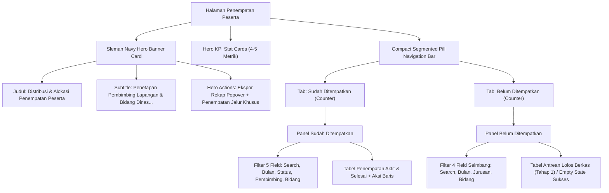

# Rencana Desain & Arsitektur: Sleman Navy Hero Banner & Filter Antrean Penempatan

> **Dokumen Rencana**: `docs/plans/2026-11-08-hero-banner-dan-filter-antrean-penempatan.md`  
> **Status**: *Draft Proposal Menunggu Persetujuan Pengguna*  
> **Target Rilis**: Branch `test-2`  
> **Terkait Modul**: Admin Penempatan Peserta Magang (`admin.penempatan.index`)

---

## 1. Analisis Kebutuhan & Latar Belakang

Pengguna mengajukan empat kebutuhan inti yang saling terintegrasi:
1. **Analisis Filter "Belum Ditempatkan" (Tinjauan Senior Developer)**:
   - Apakah filter antrean peserta yang belum ditempatkan harus disamakan persis dengan filter peserta yang sudah ditempatkan?
2. **Kerapian, Keselarasan, & Integrasi Layout**:
   - Layout filter di kedua tab harus simetris, berimbang secara visual, dan konsisten dengan sistem desain MagKom.
3. **Penerapan Card Banner (Hero Banner Khas MagKom)**:
   - Mengganti header teks polos (SS 3) dengan **Sleman Navy Hero Banner Card** (seperti pada modul pendaftaran/verifikasi berkas di SS 4).
4. **Penamaan Judul Banner yang Tepat & Kontekstual**:
   - Menghindari penamaan redundan `"Penempatan Peserta"` karena di topbar navbar sudah tertulis `"Penempatan Peserta Magang"`. Menemukan nama yang tepat dan merefleksikan inti proses bisnis alokasi & penugasan magang.

---

## 2. Tinjauan Arsitektur & Logika Domain (Senior Developer View)

### A. Pertanyaan 1: Apakah isi filter "Belum Ditempatkan" harus disamakan 100% dengan "Sudah Ditempatkan"?

**Jawaban & Rekomendasi Profesional**:
> **TIDAK BISA dan TIDAK BOLEH 100% SAMA secara mentah.**

**Alasan Logika Bisnis & Domain Model**:
Pada tab **"Sudah Ditempatkan"** (`$penempatanList`), record berasal dari tabel `penempatan`, di mana peserta sudah memiliki:
1. **Pembimbing Lapangan** (`pembimbing_id`)
2. **Status Penempatan** (`status`: Aktif, Selesai, Mengundurkan Diri)
3. **Bidang Dinas** (`bidang_id`)
4. **Bulan Magang** (`bulan_magang_id`)
5. **Pencarian Peserta** (`q`)

Sedangkan pada tab **"Belum Ditempatkan"** (`$antreanBelumDitempatkan`), record berasal dari pendaftar yang **baru saja lulus administrasi/berkas (Tahap 1)** dan sedang menunggu **penetapan pembimbing lapangan (Tahap 2)**:
- ❌ **Filter "Pembimbing Lapangan"**: **TIDAK VALID & TIDAK MASUK AKAL**, karena seluruh peserta di antrean ini memang **belum memiliki pembimbing**! Jika dropdown ini dipasang, nilainya akan selalu kosong atau tidak berfungsi.
- ❌ **Filter "Status Penempatan"**: **TIDAK VALID**, karena calon peserta belum memiliki record penempatan (belum aktif/selesai). Status mereka di pendaftaran seragam: `diterima` (lolos berkas).

### B. Solusi Keselarasan Visual (Visual Balance & Symmetry)
Agar form filter tab "Belum Ditempatkan" **tidak bolong/asimetris** (seperti terlihat pada SS 2 yang hanya memiliki 2 field vs 5 field):
Kita sediakan **4 kontrol filter yang 100% fungsional, relevan, dan sangat dibutuhkan admin**:

| No | Kontrol Filter Tab "Sudah Ditempatkan" | Kontrol Filter Tab "Belum Ditempatkan" (Rekomendasi) | Manfaat Bisnis bagi Admin |
|:---|:---|:---|:---|
| 1 | **Pencarian Peserta** (`q`) | **Pencarian Antrean** (`q`) | Mencari nama pelamar, kampus/sekolah, atau email |
| 2 | **Bulan Magang** (`bulan_magang_id`) | **Bulan Magang** (`bulan_magang_id`) | Memfilter gelombang magang yang sedang diproses |
| 3 | **Pembimbing Lapangan** (`pembimbing_id`) | **Jurusan / Program Studi** (`jurusan_id`) | *Sangat krusial!* Admin dapat memprioritaskan penempatan per bidang ilmu (contoh: memfilter anak Informatika) |
| 4 | **Bidang Dinas** (`bidang_id`) | **Bidang Dinas Rekomendasi** (`bidang_id`) | Memfilter rekomendasi bidang dinas berdasarkan jurusan yang dituju |
| 5 | **Status Penempatan** (`status`) | *(Opsional: Kuota Magang / Lembaga Pendidikan)* | Opsional: dapat dibiarkan 4 kontrol seimbang dengan proporsi flex yang rapi |

Dengan 4 kontrol input ini, visual bar filter "Belum Ditempatkan" menjadi **sangat padat, rapi, simetris, dan sejajar**, tanpa memasukkan opsi fiktif yang merusak logika sistem.

---

## 3. Redesign Header: Sleman Navy Hero Banner Card (SS 3 → SS 4)

### A. Masalah Header Saat Ini (SS 3)
Saat ini view menggunakan Blade section bawaan:
- `@section('page_title', 'Penempatan Peserta')`
- `@section('page_actions') ... @endsection`
Layout induk merendernya sebagai teks biasa yang tipis dan terpisah dari konten halaman (SS 3).

### B. Solusi Sleman Navy Hero Banner (SS 4)
Menghapus `@section('page_title')` dan `@section('page_actions')`, lalu memasang container **`adm-hero-banner`** di puncak `@section('content')` sebagaimana modul Pendaftaran (`adm-verifikasi-wrapper`).

### C. Opsi Penamaan Judul Banner (Menjawab Poin 4 User)
Karena Topbar navigasi aplikasi sudah bertuliskan **"Penempatan Peserta Magang"**, maka judul di dalam Banner Card tidak boleh monoton mengulang kata yang sama.

Berikut 3 opsi nama yang kontekstual, berbobot kedinasan, dan mencerminkan proses bisnis penempatan:

| Opsi | Judul Utama (H1) | Subtitle / Keterangan | Nilai Rasa & Keselarasan |
|:---:|:---|:---|:---|
| **A (Rekomendasi Utama)** | **Distribusi & Alokasi Penempatan Peserta** | *Penetapan Pembimbing Lapangan, Distribusi Bidang Dinas, dan Penerbitan Surat Keputusan • Dinas Komunikasi dan Informatika Kabupaten Sleman* | **Paling tepat!** Merefleksikan aksi nyata admin: mendistribusikan pendaftar yang lolos ke pembimbing & bidang. |
| **B** | **Manajemen Penugasan & Pembimbing Magang** | *Alokasi Peserta Lolos Berkas, Pemantauan Mentee Aktif, dan Distribusi Kuota • Dinas Komunikasi dan Informatika Kabupaten Sleman* | Menekankan pada aspek manajerial pembimbing & mentee aktif. |
| **C** | **Portal Alokasi & Penempatan Kerja Praktik** | *Ploting Pembimbing Lapangan dan Pemantauan Status Magang Aktif • Dinas Komunikasi dan Informatika Kabupaten Sleman* | Menggunakan istilah resmi kerja praktik / magang kedinasan. |

### D. Penataan Action Button di Sisi Kanan Banner
Di dalam `.adm-hero-actions`, kita tempatkan:
1. **Unified Export Popover Trigger** (`Ekspor Rekap ▾`): Diberi styling tombol sekunder hero putih-transparan (`.adm-hero-btn-secondary`).
2. **Tombol Penempatan Jalur Khusus** (`+ Penempatan Jalur Khusus`): Diberi styling tombol primer hero putih bersih (`.adm-hero-btn-primary` dengan teks biru navy Sleman `#01347C`).
3. **Badge SuperAdmin (Mode Lihat Saja)**: Tetap muncul anggun jika pengguna berstatus SuperAdmin.

---

## 4. Rincian Teknis Implementasi



### A. Perubahan Backend (`PenempatanController.php`)
1. Menambahkan filter `jurusan_id` pada query `$antreanQuery`:
   ```php
   if ($request->filled('jurusan_id')) {
       $jurusanId = $request->integer('jurusan_id');
       $antreanQuery->whereHas('kuota', function ($qk) use ($jurusanId) {
           $qk->where('jurusan_id', $jurusanId);
       });
   }
   ```
2. Menambahkan filter `bidang_id` pada query `$antreanQuery`:
   ```php
   if ($request->filled('bidang_id')) {
       $bidangId = $request->integer('bidang_id');
       $antreanQuery->whereHas('kuota.jurusan.bidang', function ($qb) use ($bidangId) {
           $qb->where('bidangs.id', $bidangId);
       });
   }
   ```

### B. Perubahan Frontend Blade (`resources/views/admin/penempatan/index.blade.php`)
1. Hapus `@section('page_title')` dan `@section('page_actions')`.
2. Sisipkan CSS khas `.adm-hero-banner` (Sleman Navy gradient, box-shadow, responsive media query, dark mode support).
3. Buat markup `.adm-hero-banner` di paling atas `@section('content')`.
4. Pindahkan tombol Ekspor Rekap Popover dan Jalur Khusus ke dalam `.adm-hero-actions`.
5. Perbarui filter bar tab "Belum Ditempatkan":
   - Input Pencarian Antrean (`q`)
   - Select Bulan Magang (`bulan_magang_id`)
   - Select Jurusan / Program Studi (`jurusan_id`)
   - Select Bidang Dinas Rekomendasi (`bidang_id`)
   - Button `Terapkan Filter` (warna amber/navy serasi) & Button `Reset`.

---

## 5. Rencana Pengujian & Quality Gates

1. **Uji Fungsional Filter Antrean**:
   - Filter `jurusan_id` menyaring peserta lolos sesuai jurusan pendaftar.
   - Filter `bidang_id` menyaring peserta sesuai bidang dinas rekomendasi jurusan.
   - Tombol `Reset` mengembalikan filter antrean ke kondisi semula.
2. **Uji Visual & Responsif**:
   - Tampilan Desktop (>1024px): Banner lebar penuh, tombol di kanan, filter berjejer rapi.
   - Tampilan Mobile (<768px): Banner menyesuaikan padding, tombol aksi stack ke bawah secara elegan.
   - Tampilan Dark Mode: Latar gradasi `#0A192F` ke `#0F172A`.
3. **Pengecekan Standar MagKom**:
   - PHPStan (Larastan): 0 errors.
   - Laravel Pint: 100% PSR-12 clean.
   - Automated Feature Tests: `AdminChildPagesVisualTest` & `AdminPenempatan` seluruhnya lulus.
   - Vite Asset Build: Bebas error.

