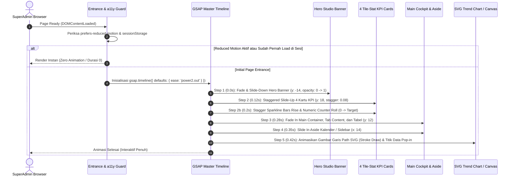

# Rencana Kerja: Implementasi Orkestrasi Animasi GSAP Timeline pada Seluruh Tampilan SuperAdmin & Interaksi Hover Chart

**Dokumen:** Implementation Plan (Web Planning)  
**Tanggal:** 2026-11-09  
**Target:** Seluruh Tampilan Modul SuperAdmin (Dashboard, Audit Log, Master Data, Telemetri Kesehatan, Konfigurasi) & Komponen Grafik/Chart  
**Teknologi:** GSAP 3.15.1 (`gsap.timeline()`), Vanilla JS (ES Modules), Vite, CSS Variables, WCAG 2.1 AA  
**Status:** 🟢 **SELESAI TERVERIFIKASI (Completed & Verified)**  

---

## 1. Tujuan

Membangun dan mengintegrasikan orkestrasi animasi profesional yang elegan dan berperforma tinggi pada antarmuka pengguna modul **SuperAdmin MagKom** menggunakan pustaka resmi **GSAP Timeline (`gsap.timeline()`)** dengan aturan interaktivitas khusus:
1. **Initial Page Load Only:** Animasi entrance orkestrasi berjenjang (*staggered entrance*) hanya berjalan **satu kali** saat halaman pertama kali dimuat (*initial load/entrance*), dan tidak berulang secara mengganggu saat berpindah tab in-page atau interaksi lokal.
2. **Interactive Chart Hover Effect:** Komponen berbentuk grafik/chart (seperti *SVG Trend Bézier Curve* pada Dashboard dan *HTML5 2D Canvas Latency & Telemetry* pada Status Sistem) memiliki animasi interaktif dinamis saat kursor mouse diarahkan ke area chart (*hover/mouseenter*) dan data point terkait.
3. **Strict Compliance & Zero Regression:** Tetap mematuhi aturan ketat repositori (`.agents/rules/AGENTS.md`):
   - Tanpa menyisipkan CSS/JS inline di dalam file Blade (Blade read-only).
   - Seluruh logika animasi dimodularisasi dalam ES Modules di `resources/js/services/superadmin-motion.js`.
   - Mendukung penuh preferensi aksesibilitas `prefers-reduced-motion` (WCAG 2.1 AA).
   - Menggunakan properti non-layout (`transform`, `opacity`) guna menjamin Core Web Vitals (CWV: 0 CLS, optimal INP & LCP).

---

## 2. Asumsi & Analisis Kebutuhan

### 2.1 Asumsi Kerja Logis
1. **Ketersediaan Dependency:** Pustaka `gsap` telah terpasang di `package.json` (`"gsap": "^3.15.1"`), sehingga tidak memerlukan instalasi dependensi pihak ketiga baru.
2. **Cakupan Halaman SuperAdmin:** Seluruh halaman SuperAdmin berada di bawah layout induk `layouts/dashboard.blade.php` yang secara otomatis membubuhkan class `role-superadmin` pada elemen `<body>` (misalnya: `/superadmin/dashboard`, `/superadmin/audit-log`, `/superadmin/health`, `/superadmin/bidang`, `/superadmin/akun`, dll.).
3. **Identifikasi Komponen Chart:** Komponen grafik di SuperAdmin terbagi menjadi:
   - *SVG Trend Chart Pendaftaran* (`.gt-chart-wrapper`, `.gt-chart-svg`, path kurva `.gt-curve-primary`, `.gt-curve-secondary`, dan titik data `.gt-chart-point`).
   - *HTML5 Canvas Telemetry & Latency* (`#canvasContainer`, `#routeLatencyCanvas`).
   - *Mini Sparklines* pada kartu tile statistik (`.sa-spark i`, `.stat-spark i`).
4. **Mekanisme Guard Initial Load:** Guardrail menggunakan kombinasi `sessionStorage` berbasis path/sesi navigasi dan pengecekan runtime inisialisasi agar animasi entrance tidak dipicu ulang saat aksi in-page (seperti navigasi tab Cockpit Dashboard, pemilihan tanggal kalender, filter paginasi tabel AJAX, atau pembukaan modal/drawer).

---

## 3. Evaluasi Pendekatan Teknis

### Perbandingan Pendekatan

| Kriteria Evaluasi | Opsi A: Reusable Motion Service Terpusat (`superadmin-motion.js`) (Direkomendasikan) | Opsi B: Skrip Animasi Terisolasi Per-Halaman di Tiap Modul JS |
| :--- | :--- | :--- |
| **Arsitektur & Reusabilitas** | **Tinggi:** Modul mandiri `resources/js/services/superadmin-motion.js` yang diekspor dan diintegrasikan melalui bundle Vite (`app.js` / `superadmin/dashboard.js`). | **Rendah:** Duplikasi logika timeline GSAP di 10+ file JS halaman individual. |
| **Kepatuhan Aturan Blade** | **100% Patuh:** Tidak menyentuh atau menambahkan `<script>` di Blade; otomatis mendeteksi selektor umum `role-superadmin`. | **Rentan:** Sering tergoda memanggil script inline di `@push('scripts')` Blade. |
| **Konsistensi Timing & Easing** | **Seragam:** Konfigurasi durasi, delay, easing (`power2.out`, `back.out(2)`), dan sequence terorkestrasi satu pintu. | **Inkonsisten:** Potensi beda durasi dan style antar-halaman. |
| **Pemeliharaan & Ekstensibilitas** | **Mudah:** Menambah atau mengubah kurva hover cukup dari satu konfigurasi service. | **Sulit:** Membutuhkan refaktor berulang di banyak file jika ada pembaruan selector. |
| **Penanganan Aksesibilitas (a11y)** | **Terpusat:** Single guardrail untuk `prefers-reduced-motion` dan initial-load storage guard. | Berisiko terlewat di beberapa halaman. |

> **Rekomendasi:** **Opsi A (Reusable Motion Service Terpusat)** dipilih karena konsisten dengan pola yang sudah terbukti sukses pada modul Pembimbing (`resources/js/services/pembimbing-motion.js`), aman terhadap aturan Blade, dan mudah dikelola jangka panjang.

---

## 4. Desain Detail Orkestrasi Animasi GSAP

### 4.1 Entrance Timeline (`gsap.timeline()` pada Initial Load)



### 4.2 Spesifikasi Sequence GSAP Timeline

```javascript
const tl = gsap.timeline({
    defaults: { ease: 'power2.out' }
});

// 1. Hero Banner Entrance
tl.fromTo('.sa-hero-banner, .sa-hero', 
    { opacity: 0, y: -14 }, 
    { opacity: 1, y: 0, duration: 0.45 }, 
    0
);

// 2. Staggered Entrance Kartu KPI / Tile Stats
tl.fromTo('.sa-metrics-row > *, .tiles-grid > *, .sa-stat-grid > *, .audit-kpi-card', 
    { opacity: 0, y: 18, scale: 0.98 }, 
    { opacity: 1, y: 0, scale: 1, duration: 0.42, stagger: 0.08 }, 
    0.12
);

// 3. Mini Sparkline Bars Rise (Jika Ada)
tl.fromTo('.sa-spark i, .stat-spark i', 
    { scaleY: 0, opacity: 0.2 }, 
    { scaleY: 1, opacity: 0.85, duration: 0.38, stagger: 0.015, transformOrigin: 'bottom center' }, 
    0.22
);

// 4. Smooth Numeric Counter Rolling (0 ke Nilai Nyata)
// Menggunakan proxy object { val: 0 } yang meng-update textContent secara mulus

// 5. Cockpit Main Layout & Content Surfaces
tl.fromTo('.sa-cockpit-main, .audit-main-layout, .sa-card, .table-responsive, .superadmin-akun-wrapper', 
    { opacity: 0, y: 12 }, 
    { opacity: 1, y: 0, duration: 0.45 }, 
    0.28
);

// 6. Aside Widget (Kalender / Channel Sidebar)
tl.fromTo('.sa-cockpit-aside, .channels-sidebar, .sa-calendar-widget', 
    { opacity: 0, x: 14 }, 
    { opacity: 1, x: 0, duration: 0.45 }, 
    0.35
);

// 7. Initial Entrance Chart (Bézier Path Stroke Draw & Data Point Scale-In)
if (hasTrendChart) {
    tl.fromTo('.gt-curve-primary', 
        { strokeDasharray: 1000, strokeDashoffset: 1000 }, 
        { strokeDashoffset: 0, duration: 0.85, ease: 'power2.inOut' }, 
        0.38
    );
    tl.fromTo('path[fill*="gtTealGradient"]', 
        { opacity: 0 }, 
        { opacity: 1, duration: 0.5 }, 
        0.55
    );
    tl.fromTo('.gt-chart-point', 
        { scale: 0, opacity: 0 }, 
        { scale: 1, opacity: 1, stagger: 0.035, transformOrigin: 'center center', duration: 0.35, ease: 'back.out(2)' }, 
        0.58
    );
}
```

---

### 4.3 Spesifikasi Interaktivitas Hover pada Grafik/Chart

Ketika kursor diarahkan ke komponen chart (`mouseenter` / `mousemove` / `mouseleave`), animasi interaktif dipicu secara mulus:

1. **Hover pada Wrapper Grafik (`.gt-chart-wrapper`, `.telemetry-canvas-wrapper`):**
   - **`mouseenter`:**
     - Border & bayangan kontainer chart dipertegas secara halus:
       ```javascript
       gsap.to(wrapper, {
           boxShadow: '0 10px 28px -6px rgba(1, 52, 124, 0.12)',
           borderColor: 'rgba(63, 81, 181, 0.35)',
           duration: 0.3,
           ease: 'power2.out'
       });
       ```
     - Garis kurva utama (`.gt-curve-primary`):
       ```javascript
       gsap.to('.gt-curve-primary', {
           strokeWidth: 4,
           filter: 'drop-shadow(0 2px 8px rgba(13, 148, 136, 0.45))',
           duration: 0.25,
           ease: 'power2.out'
       });
       ```
   - **`mouseleave`:**
     - Kembali ke keadaan resting semula secara halus (`duration: 0.25`, `strokeWidth: 3`, `filter: 'none'`).

2. **Hover pada Titik Data Individual (`.gt-chart-point`):**
   - **`mouseenter`:**
     - Titik data membesar dengan pantulan dinamis (*elastic pop*):
       ```javascript
       gsap.to(point, {
           scale: 1.85,
           transformOrigin: 'center center',
           stroke: '#003566',
           strokeWidth: 3,
           duration: 0.25,
           ease: 'back.out(2.2)'
       });
       ```
   - **`mouseleave`:**
     - Kembali ke ukuran semula (`scale: 1`, `duration: 0.2`).

3. **Hover pada Canvas Telemetri/Latensi (`#canvasContainer`, `.telemetry-canvas-wrapper`):**
   - **`mouseenter`:**
     - Efek scanning laser (`.telemetry-scanner-laser`) meningkatkan intensitas opasitas dan laju kilatan.
     - Canvas scale micro-breathing (`scale: 1.004`, `duration: 0.3`).
   - **`mouseleave`:**
     - Reset ke normal (`scale: 1`, opasitas resting).

---

## 5. Rencana Perubahan Berkas (File Changes)

| Berkas | Aksi | Ringkasan Perubahan |
| :--- | :--- | :--- |
| `resources/js/services/superadmin-motion.js` | **Create** | Modul layanan GSAP terpusat: guard initial-load & a11y, entrance timeline orchestrator, counter rolling, dan event listeners hover chart. |
| `resources/js/pages/superadmin/dashboard.js` | **Modify** | Integrasikan panggilan `initSuperAdminMotion('dashboard')` dan bind interaksi hover chart saat update dataset periode filter (12m / 6m / 30d). |
| `resources/js/app.js` | **Modify** | Daftarkan inisialisasi umum `initSuperAdminMotion('global')` ketika `document.body.classList.contains('role-superadmin')`. |
| `resources/css/pages/superadmin/dashboard.css` | **Modify** | Tambahkan aturan CSS ringan pendukung GPU hardware acceleration (`will-change: transform, opacity`) dan transisi hover chart non-intrusif. |
| `resources/css/pages/superadmin/superadmin-common.css` | **Modify** | Tambahkan utility class pendukung transform origin untuk sparkline dan chart points. |

> ⚠️ **Catatan Penting Kepatuhan Blade:** Sesuai aturan repositori `.agents/rules/AGENTS.md`, **TIDAK ADA file Blade yang dimodifikasi** untuk menambahkan tag `<script>` atau `<style>`. Seluruh aset dikelola melalui Vite pipeline.

---

## 6. Langkah Implementasi Terstruktur

### Tahap 1: Pembuatan Reusable Motion Service (`superadmin-motion.js`)
- [x] Buat berkas `resources/js/services/superadmin-motion.js` berbasis ES Module yang mengimpor `gsap` dari `gsap`.
- [x] Implementasikan fungsi guard `shouldAnimatePage(storageKey)`:
  - Cek `window.matchMedia('(prefers-reduced-motion: reduce)')`.
  - Cek `sessionStorage` dengan key khusus per-path untuk membatasi animasi hanya pada **initial load**.
- [x] Implementasikan `animateSuperAdminEntrance()`:
  - Timeline berjenjang: Hero -> 4 Kartu KPI/Tile Stats -> Numeric Counter Roll -> Cockpit Main Content -> Aside Widgets.
- [x] Implementasikan `animateSvgTrendChartEntrance()` dan `bindChartHoverAnimations()`:
  - Animasi draw stroke dan data points SVG.
  - Pasang event delegation / listener `mouseenter` dan `mouseleave` pada `.gt-chart-wrapper`, `.gt-chart-point`, dan `.telemetry-canvas-wrapper`.

### Tahap 2: Integrasi ke Dashboard & Entry Point Vite
- [x] Sambungkan `superadmin-motion.js` ke `resources/js/pages/superadmin/dashboard.js`:
  - Jalankan orkestrasi pada `DOMContentLoaded`.
  - Pastikan saat user mengubah filter periode (12m/6m/30d), titik-titik data dinamis baru (`.gt-dyn-point`) otomatis terikat (*re-bind*) dengan animasi hover GSAP.
- [x] Sambungkan handler global di `resources/js/app.js`:
  - Periksa `document.body.classList.contains('role-superadmin')` untuk memicu entrance motion pada halaman-halaman superadmin non-dashboard.

### Tahap 3: Optimasi CSS & GPU Acceleration
- [x] Tambahkan utility styling di `resources/css/pages/superadmin/dashboard.css` dan `superadmin-common.css`:
  - Pastikan titik data SVG memiliki `transform-box: fill-box` dan `transform-origin: center center` agar scaling SVG akurat di semua browser.
  - Pasang `@media (prefers-reduced-motion: reduce)` override untuk menonaktifkan transisi CSS jika ada.

### Tahap 4: Build & Kompilasi Aset
- [x] Jalankan `npm run build` untuk memverifikasi tidak ada error bundling di Vite.
- [x] Verifikasi manifest dan integritas bundle asset.

---

## 7. Strategi Pengujian & Verifikasi Kualitas (Quality Gate)

### 7.1 Verifikasi Fungsional & Visual
1. **Initial Page Load Check:**
   - Akses `/superadmin/dashboard`.
   - Pastikan animasi berjalan mulus dalam sequence: Hero -> Stat Cards -> Main/Aside -> Chart draw.
   - Durasi total entrance tidak boleh melebihi **0.95 detik** agar pengguna tidak merasa terhambat.
2. **Initial Load Only Guardrail Check:**
   - Klik tab in-page (`Ringkasan` -> `Seleksi` -> `Bimbingan` -> `Sistem`). Animasi entrance TIDAK BOLEH dipicu ulang.
   - Buka popover kalender atau klik drawer audit. Animasi entrance TIDAK BOLEH dipicu ulang.
   - Buka halaman di tab baru atau refresh halaman: Animasi entrance berjalan satu kali.
3. **Chart Hover Interaction Check:**
   - Arahkan kursor ke area `.gt-chart-wrapper`: amati peningkatan halus pada stroke garis kurva dan bayangan.
   - Arahkan kursor ke titik lingkaran data (`.gt-chart-point`): amati pembesaran titik dengan efek bounce/elastic (`scale: 1.85`).
   - Ubah filter periode (12m -> 6m -> 30d): amati titik-titik data baru tetap merespons hover dengan sempurna.
4. **WCAG 2.1 AA Prefers-Reduced-Motion:**
   - Aktifkan emulasi *"prefers-reduced-motion: reduce"* di browser devtools.
   - Muat ulang halaman: Semua elemen harus langsung tampil 100% statis tanpa transisi/animasi, tanpa kedipan (*zero flicker*).

### 7.2 Quality Gate Commands
- [x] `./vendor/bin/pint --test` (Format kode PHP tetap bersih)
- [x] `npm run build` (Build Vite sukses 0 warning/error)
- [x] `php artisan test --filter=SuperAdmin` (Memastikan tidak ada regresi backend pada seluruh fitur SuperAdmin: 231 tests passed)

---

## 8. Analisis Risiko & Mitigasi

| Potensi Risiko | Tingkat Risiko | Mitigasi yang Diterapkan |
| :--- | :---: | :--- |
| **Flash of Unstyled/Invisible Content (FOUC)** | Rendah | Menggunakan `fromTo` alih-alih menyembunyikan elemen via CSS `opacity: 0` awal di Blade. Jika JS gagal dimuat, seluruh konten tetap terlihat normal. |
| **Beban Kinerja / Reflow (Jank)** | Rendah | Hanya menggunakan `transform` dan `opacity` yang diakselerasi oleh GPU (Compositor Thread). Menghindari animasi properti box-model (`width`, `height`, `margin`). |
| **SVG Point Scaling Error di Firefox/Safari** | Sedang | Menambahkan deklarasi CSS `transform-box: fill-box; transform-origin: center center;` khusus untuk elemen `<circle>` SVG. |
| **Event Listener Memory Leak** | Rendah | Menggunakan event delegation pada chart wrapper sehingga pembaruan titik data melalui filter periode tidak menumpuk listener di memori. |

---

## 9. Kriteria Selesai (Definition of Done)

- [x] Dokumen rencana disetujui secara eksplisit oleh pengguna.
- [x] Berkas `resources/js/services/superadmin-motion.js` terbuat dan teruji dengan GSAP 3.15.1.
- [x] Animasi entrance orkestrasi berjalan berurutan secara elegan pada initial page load seluruh modul SuperAdmin.
- [x] Animasi entrance terbukti HANYA berjalan 1x saat initial load dan tidak berulang saat interaksi in-page.
- [x] Interaksi hover pada grafik SVG trend dan canvas berjalan halus dan responsif.
- [x] Fitur aksesibilitas `prefers-reduced-motion` berfungsi 100% mematikan animasi.
- [x] Tidak ada perubahan atau penambahan script/style di dalam file Blade (`.blade.php`).
- [x] Perintah `npm run build` berhasil tanpa error.
- [x] Seluruh test suite `php artisan test` hijau / passing (231 passed, 1487 assertions).

