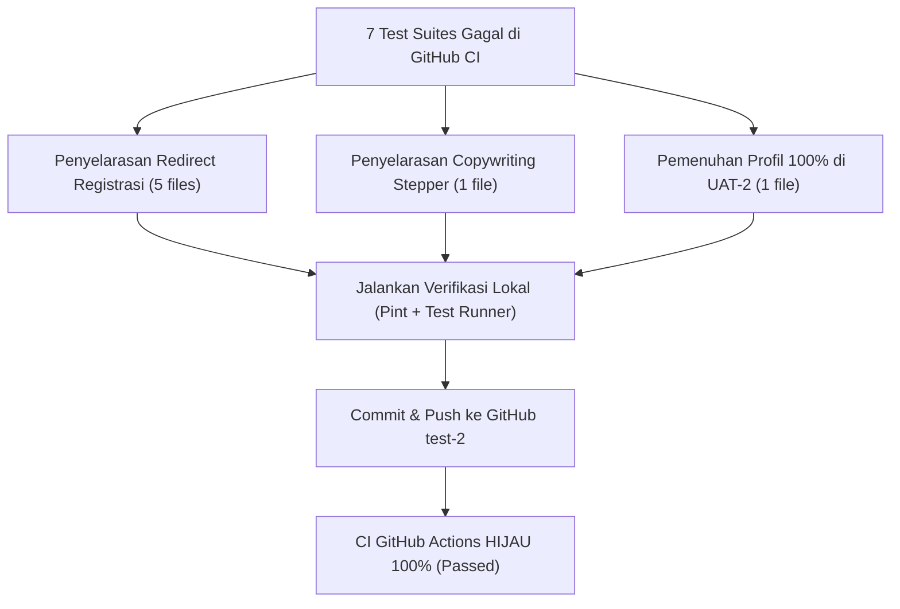

# Rencana Harmonisasi & Perbaikan 7 Test Suite CI GitHub Actions

Dokumen ini berisi analisis akar masalah (*root cause analysis*) dan rencana implementasi terarah untuk menyelesaikan seluruh kegagalan (silang merah) pada GitHub Actions CI di branch `test-2`.

---

## 🔍 Root Cause Analysis (Akar Masalah)

Berdasarkan investigasi menyeluruh terhadap 100 file Feature Test di repositori MAGKOM, seluruh kegagalan CI berasal dari **3 perubahan arsitektural** yang baru saja di-merge ke branch `test-2` (commit `0b15bac`), namun beberapa test suite lama belum diselaraskan:

### 1. Perubahan Kontrak Redirect Pasca-Registrasi (`AuthController@register`)
- **Perubahan di `app/Http/Controllers/Auth/AuthController.php`**:
  Alur registrasi peserta baru kini diarahkan langsung ke `route('peserta.dashboard')` (agar peserta langsung masuk ke halaman panduan onboarding), bukan lagi ke `route('peserta.profil.show')`.
- **File Test Terdampak (5 file)**:
  1. `tests/Feature/PendaftaranKelompokTest.php` (baris 29, 69, 214)
  2. `tests/Feature/ReleaseThreeSocialLoginTest.php`
  3. `tests/Feature/ReleaseTwoFeaturesTest.php`
  4. `tests/Feature/SecurityDynamicCaptchaTest.php`
  5. `tests/Feature/PesertaUuPdpPersetujuanWaliTest.php`
  *Gejala*: `Failed asserting that two strings are equal: 'http://localhost:8000/peserta/profil' vs 'http://localhost:8000/peserta/dashboard'`.

### 2. Penyesuaian Copywriting Stepper Onboarding Peserta (`_phase_onboarding.blade.php`)
- **Perubahan di `resources/views/peserta/dashboard/partials/_phase_onboarding.blade.php`**:
  - Langkah 2: dari `Pilih Periode & Kuota` menjadi `2. Pilih Bulan & Kuota Magang`
  - Langkah 3: dari `Unggah Berkas & Ajukan` menjadi `3. Unggah Dokumen & Ajukan Pendaftaran`
- **File Test Terdampak (1 file)**:
  1. `tests/Feature/GentelellaDashboardRevampTest.php` (baris 380–382)
  *Gejala*: Assertion `$response->assertSee('Pilih Periode & Kuota')` gagal karena teks baru menggunakan terminologi `Bulan & Kuota Magang`.

### 3. Validasi Prasyarat Profil 100% Lengkap (`PendaftaranRequest`)
- **Perubahan di `app/Http/Requests/PendaftaranRequest.php`**:
  Ditambahkan validasi ketat bahwa peserta tidak dapat memilih kuota / membuat draf pendaftaran sebelum biodata profil mencapai **100% lengkap** (pasfoto, kontak darurat wali, dan data akademik).
- **File Test Terdampak (1 file)**:
  1. `tests/Feature/EndToEndUatTest.php` (UAT 2, baris 188–205)
  *Gejala*: UAT 2 membuat profil peserta tanpa pasfoto dan kontak darurat, sehingga `PendaftaranRequest` melempar validation error dan draf pendaftaran gagal terbuat (`ModelNotFoundException`).

---

## 🛠️ Rencana Aksi (Action Items)



### Langkah 1: Harmonisasi Redirect Registrasi pada 5 Test File
Perbarui assertion redirect form registrasi dari `route('peserta.profil.show')` ke `route('peserta.dashboard')` pada:
1. `tests/Feature/PendaftaranKelompokTest.php`
2. `tests/Feature/ReleaseThreeSocialLoginTest.php`
3. `tests/Feature/ReleaseTwoFeaturesTest.php`
4. `tests/Feature/SecurityDynamicCaptchaTest.php`
5. `tests/Feature/PesertaUuPdpPersetujuanWaliTest.php`

### Langkah 2: Penyelarasan Stepper Copywriting pada `GentelellaDashboardRevampTest.php`
Perbarui assertion teks langkah onboarding di baris 380–382 agar mencocokkan teks aktual:
```php
$response->assertSee('Lengkapi Biodata & Profil', false);
$response->assertSee('Pilih Bulan & Kuota Magang', false);
$response->assertSee('Unggah Dokumen & Ajukan Pendaftaran', false);
```

### Langkah 3: Pemenuhan Profil 100% pada `EndToEndUatTest.php`
Pada UAT 2 (baris 188–197), lengkapi payload pengisian profil peserta baru dengan data wajib agar profil mencapai 100%:
- `foto` (dummy file image)
- `alamat`
- `nama_kontak_darurat`
- `no_kontak_darurat`
- `hubungan_kontak_darurat`

### Langkah 4: Quality Gate & Verifikasi Lokal
1. Jalankan ke-7 file test yang diperbaiki untuk memastikan statusnya menjadi **PASS**.
2. Jalankan `vendor/laravel/pint/builds/pint --test` untuk memastikan kebersihan format kode.
3. Jalankan seluruh 100 Feature test suite untuk memastikan 0 error regresi.

---

## 📋 Verifikasi Pasca Eksekusi
- [ ] `tests/Feature/PendaftaranKelompokTest.php` lulus 100%
- [ ] `tests/Feature/ReleaseThreeSocialLoginTest.php` lulus 100%
- [ ] `tests/Feature/ReleaseTwoFeaturesTest.php` lulus 100%
- [ ] `tests/Feature/SecurityDynamicCaptchaTest.php` lulus 100%
- [ ] `tests/Feature/PesertaUuPdpPersetujuanWaliTest.php` lulus 100%
- [ ] `tests/Feature/GentelellaDashboardRevampTest.php` lulus 100%
- [ ] `tests/Feature/EndToEndUatTest.php` lulus 100%
- [ ] GitHub Actions CI workflow berstatus centang hijau (Success).

