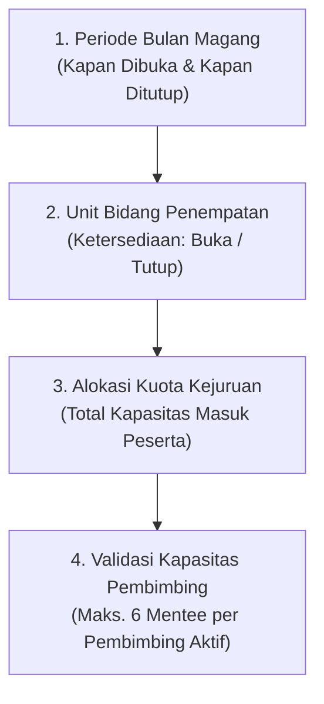

# Rencana Kerja: Redesign Pop-Up Modern & Penyelarasan Sistem Manajemen Kuota Magang

Dokumen ini merinci rencana perapihan, penataan terstruktur, dan harmonisasi visual serta fungsional untuk tiga modal dialog utama pada halaman Manajemen Kuota Magang (`/admin/kuota`):
1. **Pop-up "Ubah bulan"** (`#modalUbahBulan`)
2. **Pop-up "Buat bulan baru"** (`#modalBuatBulan`)
3. **Pop-up "Tambah kuota"** (`#modalTambahKuota`)

---

## 1. Latar Belakang & Filosofi Penyelarasan (Menjawab Poin 3 & 4)

Sistem Manajemen Kuota Magang memiliki hierarki data dan logika bisnis yang saling bertingkat dan harus selaras:

1. **Tingkat Periode Bulan Magang (Modal Ubah Bulan & Buat Bulan)**:
   - Bertanggung jawab menentukan **kapan pendaftaran dibuka** (`tgl_buka`), **kapan pendaftaran ditutup** (`tgl_tutup`), dan **kapan pelaksanaan magang dimulai** (`bulan_mulai`).
   - Mengatur status pendaftaran publik: **`Dibuka`** (portal aktif menerima registrasi) atau **`Draft / Ditutup`** (disimpan sebagai draf atau ditutup sebelum jadwal).
2. **Tingkat Unit Bidang Penempatan**:
   - Menentukan ketersediaan unit kerja: apakah bidang tersebut **`Dibuka`** (menerima peserta) atau **`Ditutup`** (tanpa kuota/0 peserta) pada bulan tersebut.
3. **Tingkat Total Kapasitas & Kejuruan (Modal Tambah Kuota & Ubah Kuota Bidang)**:
   - Menentukan total kapasitas yang dapat masuk ke setiap bidang penempatan dengan membaginya ke jurusan-jurusan yang dibutuhkan.
   - Dibatasi secara logis oleh kapasitas bimbingan pembimbing dinas (`pembimbing_aktif * 6`).

---

## 2. Identifikasi Masalah Visual pada Pop-Up Eksisting (Berdasarkan Gambar SS)

| Komponen | Masalah Eksisting | Solusi Desain Baru |
|---|---|---|
| **Input Tanggal (Datepicker)** | Ada 2 icon kalender bertumpuk di sebelah kanan (icon native browser + icon SVG). | Normalisasi datepicker via CSS: sembunyikan icon native browser dan gunakan 1 icon kalender SVG elegan dengan trigger klik penuh pada input. |
| **Status Pills (Draft / Dibuka)** | Pill saat ini kaku, border tipis, centang biru terlihat seperti tombol terpisah yang tidak seimbang. | Buat **Segmented Control** modern: background `#F1F5F9`, border radius 10px, tombol aktif memiliki background putih dengan soft shadow `0 2px 4px rgba(0,0,0,0.06)`, text bold, dan icon check rapi. |
| **Chips Jurusan (Tambah Kuota)** | Chips biru tipis melengkung berjejer ramai dan tidak teratur. | Gunakan desain chip modern ber-padding nyaman, indikator visual check elegan, tata letak grid/flex wrap teratur, dan tombol `+ Jurusan` minimalis. |
| **Dropdown Bidang** | Teks nama bidang terpotong di dropdown (`Aplikasi Informatika (E...`). | Lebarkan container select, hilangkan constraint text-overflow kaku, dan tampilkan nama bidang secara utuh. |
| **Box Peringatan Kapasitas** | Kotak merah besar kaku dengan border tajam yang mendominasi pop-up. | Gunakan **Soft Alert Callout** (`#FEF2F2`, border `#FECACA`, text `#991B1B`), icon shield/warning halus, dan layout teks yang terstruktur rapi. |
| **Header & Tombol Close** | Tombol close berbentuk kotak kaku, typography header kaku. | Header clean dengan typography Slate-900, subtitle Slate-500, dan tombol close berbentuk lingkaran/persegi halus dengan hover effect lembut. |

---

## 3. Rincian Perubahan Tiap Pop-Up

### A. Pop-up 1: "Ubah bulan" (`#modalUbahBulan`)
1. **Header**:
   - Judul: `Ubah Jadwal Periode Magang`
   - Subtitle: `Tentukan jadwal buka-tutup pendaftaran dan tanggal mulai kegiatan magang.`
2. **Form Layout**:
   - **Nama Periode**: Input text ber-radius 8px dengan border `#CBD5E1` yang lembut.
   - **Jadwal Pendaftaran**: Grid 2 kolom yang presisi:
     - Kolom Kiri: `Tanggal Buka Pendaftaran`
     - Kolom Kanan: `Tanggal Tutup Pendaftaran`
     - Dilengkapi auto-validasi dinamis (`tgl_tutup >= tgl_buka`).
   - **Pelaksanaan Magang**:
     - `Tanggal Mulai Kegiatan Magang` (wajib setelah tanggal tutup pendaftaran).
   - **Status Ketersediaan**:
     - Segmented Control modern: `[ Draft ]` vs `[ ✓ Dibuka untuk Publik ]`.
   - **Callout Info**:
     - Box biru pastel lembut: *"Perubahan jadwal pendaftaran dan mulai magang akan langsung disinkronkan ke portal publik."*
   - **Footer**:
     - Tombol `Batal` (outline netral) & `Simpan Perubahan` (biru Sleman solid `#0641CC` dengan soft shadow).

---

### B. Pop-up 2: "Buat bulan baru" (`#modalBuatBulan`)
1. **Desain Selaras 100% dengan Modal Ubah Bulan**:
   - Judul: `Buat Periode Magang Baru`
   - Subtitle: `Rancang gelombang magang baru beserta jadwal pendaftaran dan mulai magang.`
   - Form fields, input datepicker single-icon, segmented control status awal, dan alert callout info seragam secara proporsional.

---

### C. Pop-up 3: "Tambah kuota" (`#modalTambahKuota`)
1. **Header**:
   - Judul: `Tambah Kuota Penempatan`
   - Subtitle: `Alokasikan kuota penerimaan magang per bidang dinas sesuai kapasitas pembimbing.`
2. **Baris 1 — Konteks Periode & Bidang Dinas**:
   - Menampilkan badge periode bulan yang dipilih (`November 2026`).
   - Dropdown pilihan **Bidang Dinas** yang lebar dan jelas (menampilkan nama lengkap bidang tanpa teks terpotong).
   - Menampilkan **Card Mini Kapasitas Bidang**:
     - Total Pembimbing aktif di bidang tersebut.
     - Kapasitas bimbingan maksimal (`pembimbing * 6`).
     - Sisa kapasitas kursi yang masih aman dialokasikan.
3. **Baris 2 — Kejuruan yang Dibutuhkan**:
   - Chips jurusan yang bersih, rounded-8px, dengan highlight aktif `#EFF6FF` dan border `#2563EB`.
   - Tombol `+ Jurusan` untuk menambah kejuruan lintas bidang bila diperlukan.
4. **Baris 3 — Jenjang Pendidikan**:
   - Segmented buttons: `[ SMK ]`, `[ D3 ]`, `[ S1 ]` yang interaktif dan dapat dipilih kombinasi multi-jenjang.
5. **Baris 4 — Alokasi Kursi & Durasi**:
   - Grid 3 kolom: `Jumlah Kuota Masuk`, `Durasi Minimum`, `Durasi Maksimum`.
6. **Baris 5 — Warning Kapasitas Interaktif**:
   - Soft callout warning yang hanya muncul jika input kuota melampaui sisa kapasitas bimbingan pembimbing di bidang tersebut.
7. **Footer**:
   - Tombol `Batal` & `Simpan Kuota`.

---

## 4. Matriks Pengujian & Quality Gates

| Aspek Pengujian | File Uji | Target |
|---|---|---|
| **Struktur DOM & Tombol** | `tests/Feature/AdminKuotaRevampTest.php` | Seluruh ID modal, form, dan tombol tetap ada dan berfungsi. |
| **Validasi Tanggal Dinamis** | Feature Test & Visual Browser | Tanggal buka, tutup, dan mulai magang tervalidasi logis. |
| **Kapasitas Pembimbing** | `AdminKuotaRevampTest.php` | Sistem mendeteksi kapasitas pembimbing dan mencegah alokasi berlebih. |
| **Code Style** | `vendor/bin/pint --test` | 100% PSR-12 compliant. |
| **Asset Pipeline** | `npm run build` | Kompilasi Vite sukses 0 error. |
| **Full Regression** | `vendor/bin/phpunit` | Seluruh 722 tests 100% HIJAU. |

