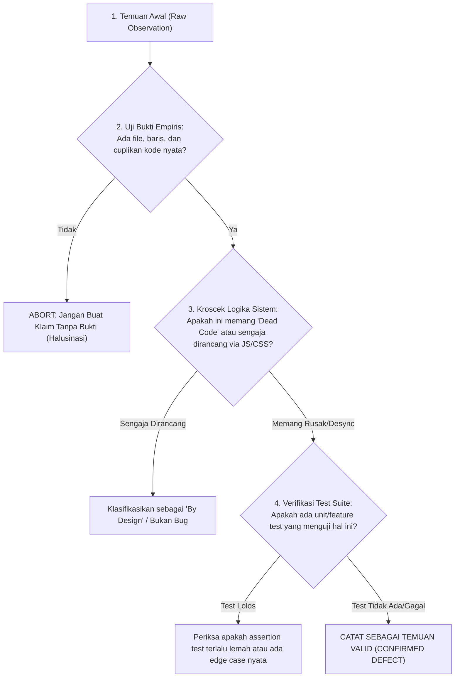

# TASK BRIEF SENIOR DEVELOPER: PANDUAN AUDIT KOMPREHENSIF SELURUH FITUR & KONEKTIVITAS SUPERADMIN (STRICTLY READ-ONLY)

> **Dari:** Senior Software Architect / Lead Developer  
> **Kepada:** Junior Developer / AI Agent (Gemini 3.8 Flash / Pelaksana Audit Teknis)  
> **Target Subjek:** Seluruh Fitur, Antarmuka, dan Backend Modul SuperAdmin MAGKOM  
> **Status Dokumen:** 🟡 **PANDUAN AUDIT TEKNIS RESMI (PRD & AUDIT IMPLEMENTATION PLAN)**  
> **Sifat Penugasan:** 🔴 **STRICTLY READ-ONLY — DILARANG KERAS MENGUBAH, MENAMBAH, ATAU MENGHAPUS KODE APAPUN SELAMA TUGAS INI BERJALAN**  
> **Baseline Stack:** Laravel 10.x | PHP 8.3 | Blade Views | Vanilla JS (ES Modules) | Vite | MySQL  
> **Dokumentasi Terkait:** `AGENTS.md`, `docs/01-PRD-MagKom.md`, `docs/02-TDD-MagKom.md`, `docs/04-SKEMA-DATABASE-DAN-DATA-DICTIONARY.md`, `docs/05-KEAMANAN-RBAC-DAN-AUDIT-TRAIL.md`

---

## 1. 🎯 LATAR BELAKANG & TUJUAN AUDIT

Modul **SuperAdmin** adalah pusat komando tertinggi (*cockpit & governance center*) pada sistem Portal Manajemen Magang Kominfo (MAGKOM). Modul ini mencakup 91 rute aktif, 17 controller, dan puluhan view antarmuka yang mengelola data master, audit trail 15 kanal, disaster recovery backup, telemetri server, manajemen staf, hingga visual site editor.

Tujuan utama dari penugasan audit ini adalah melakukan **investigasi menyeluruh secara objektif, sistematis, dan berbasis bukti empiris (evidence-based)** terhadap seluruh fitur SuperAdmin untuk menjawab 6 pertanyaan inti dari arsitek sistem:
1. **Kelengkapan Fungsi Antarmuka:** Apakah ada tombol, dropdown, link, tab, filter, modal, atau form di tampilan yang mati (*dead links/buttons*), belum dihubungkan ke event handler, atau tidak menghasilkan aksi apa pun?
2. **Keselarasan Frontend & Backend:** Apakah ada formulir atau AJAX payload di frontend yang tidak selaras dengan validasi, parameter, atau respons yang diharapkan oleh backend controller?
3. **Stabilitas & Kualitas Penulisan Kode:** Apakah ada kode yang berpotensi rapuh (*unstable*), penanganan error/exception yang buruk (misal: *empty catch blocks*, *unhandled nulls*, *silent fails*), atau risiko *memory leak* pada JavaScript?
4. **Kepatuhan Praktik Terbaik Industri (Backend Best Practices):** Apakah arsitektur backend Laravel 10 / PHP 8.3 sudah memenuhi standar industri (*Skinny Controllers*, pemisahan Service Layer, Form Requests, atomisitas transaksi database, optimasi query/pencegahan N+1, dan standar keamanan OWASP Top 10)? Jika belum, di bagian mana celahnya?
5. **Integritas Navigasi:** Apakah seluruh navigasi (sidebar, topbar, breadcrumbs, tombol kembali, pagination, drawer, popover) dapat berfungsi 100% tanpa tautan rusak (*broken routes* / 404 / 500)?
6. **Konektivitas Front-End ke Back-End:** Apakah seluruh pengiriman data (HTTP Form POST/PUT/PATCH/DELETE dan panggilan AJAX/Fetch) sudah terhubung sempurna dan terproteksi oleh token CSRF?

> ⚠️ **PERINGATAN KERAS DARI SENIOR DEVELOPER:**  
> Tugas ini **HANYA BERSIFAT AUDIT & PELAPORAN**. Anda **TIDAK DIIZINKAN** melakukan perbaikan kode, mengedit file, menjalankan perintah git commit/push, atau menjalankan operasi database destruktif. Setiap temuan masalah wajib melalui protokol **"Kritik Diri & Cek-Kroscek Ulang"** sebelum dimasukkan ke dalam laporan final.

---

## 2. 🔍 6 PILAR AUDIT UTAMA & METODOLOGI PENELUSURAN

Junior Developer / AI Pelaksana wajib menggunakan 6 pilar audit berikut sebagai panduan standar:

```
┌──────────────────────────────────────────────────────────────────────────────────────────────────────┐
│                               6 PILAR AUDIT KOMPREHENSIF SUPERADMIN                                  │
├───────────────────────────────────┬──────────────────────────────────┬───────────────────────────────┤
│ [PILAR 1: KELENGKAPAN UI/UX]      │ [PILAR 2: KESELARASAN DATA]      │ [PILAR 3: KUALITAS KODE]      │
│ • Dead links (href="#", empty)    │ • Form input name vs Controller  │ • Empty catch / silent errors │
│ • Unbound button clicks           │ • AJAX payload vs Request rules  │ • Unhandled nulls & typing    │
│ • Inactive filters & search bars  │ • JSON response contract desync  │ • JS memory leaks & listeners │
├───────────────────────────────────┼──────────────────────────────────┼───────────────────────────────┤
│ [PILAR 4: BACKEND BEST PRACTICES] │ [PILAR 5: INTEGRITAS NAVIGASI]   │ [PILAR 6: KONEKTIVITAS E2E]   │
│ • Skinny Controllers & Services   │ • 91 Rute SuperAdmin verification│ • CSRF token attachment       │
│ • N+1 query prevention (with)     │ • Sidebar, Topbar, Breadcrumbs   │ • Form method spoofing        │
│ • OWASP & SuperAdmin Read-Only    │ • Pagination & Drawer triggers   │ • HTTP status response (2xx)  │
└───────────────────────────────────┴──────────────────────────────────┴───────────────────────────────┘
```

---

### PILAR 1: Audit Kelengkapan Fungsi Antarmuka (Dead Buttons & Orphan Links)
- **Fokus Pemeriksaan:**
  - Telusuri seluruh file Blade di `resources/views/superadmin/**/*.blade.php` dan bagian navigasi SuperAdmin di `resources/views/layouts/dashboard.blade.php`.
  - Cari elemen `<a>` yang memiliki `href="#"`, `href="javascript:void(0)"`, atau `href=""` tanpa JavaScript event handler yang sah.
  - Cari elemen `<button>` yang bertipe `button` namun tidak memiliki atribut `onclick`, event listener di file JS, atau `data-action` yang terdaftar.
  - Cari elemen `<select>` atau input search yang tidak memiliki form pembungkus atau AJAX query listener.
- **Teknik Audit:**
  - Jalankan pencarian regex: `grep -rn 'href="#"' resources/views/superadmin/`
  - Periksa file JS di `resources/js/pages/superadmin/` untuk memastikan setiap `id` atau `class` pemicu event memang ada di markup Blade.

---

### PILAR 2: Audit Keselarasan Frontend-Backend (Data Contract & Payload Alignment)
- **Fokus Pemeriksaan:**
  - Bandingkan setiap `<form>` di Blade dengan method Controller dan Form Request terkait:
    - Apakah atribut `name="..."` pada input HTML sama persis dengan field yang divalidasi di controller? (Contoh: input `nama_lengkap` di view vs validasi `$request->validate(['nama' => ...])` di controller = **DESYNC**).
    - Apakah tipe data input (teks, angka, date, file) sesuai dengan aturan validasi backend?
  - Periksa setiap pemanggilan AJAX (`fetch` / `axios` / `XMLHttpRequest`):
    - Apakah endpoint URL yang dituju valid dan terdaftar di `routes/web.php`?
    - Apakah parameter URL (query string atau route params) cocok dengan controller?
    - Apakah struktur JSON response (misal: `{ success: true, data: { ... } }`) diakses dengan key yang tepat oleh JavaScript frontend (misal: mengakses `res.data.items` padahal backend mengirimkan `res.data.list`)?

---

### PILAR 3: Audit Stabilitas & Kualitas Penulisan Kode (Code Stability & Error Handling)
- **Fokus Pemeriksaan:**
  - **Error Handling:** Cari blok `try { ... } catch (\Exception $e) { }` yang kosong atau hanya mengabaikan error tanpa logging audit trail.
  - **Null Safety:** Periksa pemanggilan objek berantai (misal: `$user->pembimbing->bidang->nama`) yang tidak menggunakan null-safe operator (`?->`) atau pengecekan null, yang berpotensi memicu `Error: Call to a member function on null`.
  - **JavaScript Stability:** Periksa apakah ada listener event yang dipasang berulang kali di dalam loop atau fungsi render dinamis yang tidak pernah dibersihkan (*event listener leak*).
  - **XSS & Output Escaping:** Periksa penggunaan `{!! $variabel !!}` di file Blade. Apakah variabel tersebut berasal dari input pengguna tanpa sanitasi `e()` atau strip tags?

---

### PILAR 4: Kepatuhan Standar Praktik Terbaik Industri Backend (Laravel 10 / PHP 8.3)
- **Fokus Pemeriksaan:**
  - **Skinny Controller vs Fat Controller:** Apakah Controller melebihi 300 baris kode dan memuat query database mentah, kalkulasi rumit, atau manipulasi file langsung? Logika domain wajib didelegasikan ke *Service Layer* (`app/Services/`).
  - **Pencegahan N+1 Query:** Periksa query Eloquent di controller SuperAdmin. Apakah relasi di-load menggunakan eager loading (`Model::with([...])`) atau dibiarkan terjadi lazy loading di dalam loop Blade (`@foreach($items as $item) {{ $item->relasi->nama }} @endforeach`)?
  - **Atomisitas Transaksi (Database Transactions):** Apakah operasi multi-tabel (seperti penempatan peserta, reset data, atau backup) dibungkus dalam `DB::transaction()` dengan proteksi race condition (`lockForUpdate()`)?
  - **Keamanan RBAC & SuperAdmin Read-Only Isolation:**
    - Berdasarkan PRD `05-KEAMANAN-RBAC-DAN-AUDIT-TRAIL.md`, peran SuperAdmin bersifat **Tata Kelola & Audit Sistem**, dan dilarang memutasikan operasional pembimbing harian secara sepihak tanpa jalur administrasi. Periksa apakah ada controller SuperAdmin yang membocorkan IDOR atau melanggar isolasi peran ini.
  - **Type Hinting & Return Types:** Apakah method controller dan service menerapkan deklarasi tipe PHP 8.3 (`string`, `int`, `array`, `?Model`, `: JsonResponse`, `: View`)?

---

### PILAR 5: Integritas Navigasi & Routing (Navigation Matrix Verification)
- **Fokus Pemeriksaan:**
  - Telusuri seluruh menu pada Sidebar SuperAdmin (`resources/views/layouts/dashboard.blade.php`), Topbar Header, dan Breadcrumbs.
  - Pastikan setiap helper route `route('superadmin....')` benar-benar ada di daftar 91 rute hasil `php artisan route:list`.
  - Verifikasi menu accordion/dropdown navigasi SuperAdmin:
    - Grup Modul Operasional (Administrasi, Pembimbing, Peserta/Arsip).
    - Grup Sistem (Data Staf, Hak Akses, Audit Log, Status Sistem, Backup Database).
    - Grup Konfigurasi (Pengaturan, Canvas Editor, Periode Magang, Jalur Khusus, Data Jurusan, Unit Kerja).
  - Verifikasi apakah state `active` pada class menu sidebar menyala dengan benar sesuai route prefix (`request()->routeIs(...)`).

---

### PILAR 6: Integritas Konektivitas Front-End ke Back-End
- **Fokus Pemeriksaan:**
  - **CSRF Token:** Pastikan setiap tag `<form method="POST">` menyertakan direktif `@csrf`.
  - **HTTP Method Spoofing:** Pastikan formulir yang melakukan mutasi non-POST menggunakan `@method('PUT')`, `@method('PATCH')`, atau `@method('DELETE')`.
  - **AJAX Header Authorization & CSRF:** Pastikan script JS menyertakan header `X-CSRF-TOKEN` atau `X-Requested-With: XMLHttpRequest`.
  - **Flash Messages & Notifikasi:** Apakah feedback setelah submit (misal: `with('success', '...')` atau `with('error', '...')`) ditampilkan secara konsisten pada antarmuka via alert box atau toast notification?

---

## 3. 📋 MATRIKS AUDIT SPESIFIK: 17 SUBMODUL SUPERADMIN

Junior Developer / AI wajib mengaudit setiap submodul berikut secara bertahap dan mencatat temuannya:

| No | Submodul SuperAdmin | Controller Terkait | View Utama Terkait | Poin Kritis yang Wajib Diuji |
| :---: | :--- | :--- | :--- | :--- |
| **1** | **Dashboard Eksekutif** | `DashboardController.php` | `superadmin/dashboard.blade.php` (+ partials) | 4 Tab Cockpit (`Ringkasan`, `Seleksi`, `Bimbingan`, `Sistem`), SVG trend curve 12m/6m/30d filter, Mini Calendar widget popover, Drawer Audit detail trigger, Quick Attention alert links. |
| **2** | **Audit Log (15 Kanal)** | `AuditLogController.php` | `superadmin/audit-log/index.blade.php` | Navigasi 15 kanal di sidebar kiri, filter toolbar (q, level severity, staf dropdown), pagination per lembar, modal diff inspector sebelum-sesudah, ekspor CSV dengan proteksi formula injection (SEC-05). |
| **3** | **Arsip Peserta & Alumni** | `ArsipPesertaController.php` | `superadmin/arsip/index.blade.php` & `show.blade.php` | Filter status (Selesai, Ditolak, Mundur), pagination lembar 1-10, detail berkas peserta, tombol pratinjau sertifikat/nilai. |
| **4** | **Backup & Disaster Recovery** | `BackupController.php` | `superadmin/backup/index.blade.php` | Tombol buat snapshot instan, rate-limiting trigger (anti-spam), unduh file zip/sql dengan validasi path traversal, hapus backup, telemetry disk storage. |
| **5** | **Telemetri Status Sistem (Health)** | `HealthMonitorController.php` | `superadmin/health/index.blade.php` | Live heartbeat ping, 4 tombol diagnostik (*Optimize DB*, *Clear Cache*, *Test Storage*, *Security Sweep*), Canvas grafik latensi HTTP & SSE, status database pool. |
| **6** | **Manajemen Akun Pribadi** | `AkunController.php` | `superadmin/akun/index.blade.php` | Form update profil, update password (verifikasi password lama, konfirmasi password baru), form preferensi tema (Terang, Gelap, Sistem). |
| **7** | **Manajemen Data Staf** | `StafController.php` | `superadmin/staf/index.blade.php` | Form tambah staf baru, modal edit staf, tombol toggle status aktif/non-aktif, fitur generate password baru & reset password dengan audit trail. |
| **8** | **Master Unit Kerja (Bidang)** | `BidangController.php` | `superadmin/bidang/index.blade.php` | Modal tambah bidang, modal edit bidang, toggle aktif bidang (validasi BR-12: larangan nonaktifkan bidang jika masih ada peserta aktif), sinkronisasi kuota. |
| **9** | **Master Data Jurusan** | `JurusanController.php` | `superadmin/jurusan/index.blade.php` | CRUD jurusan pendidikan, toggle aktif status jurusan, proteksi hapus/nonaktifkan jika terikat pendaftar aktif. |
| **10** | **Master Periode (Bulan Magang)** | `BulanController.php` | `superadmin/bulan/index.blade.php` | Form buka bulan magang, validasi tanggal buka/tutup (aturan BAB 8.2), toggle status penerimaan, indikator kuota terisi. |
| **11** | **Jalur & Slot Khusus** | `SlotKhususController.php` | `superadmin/slot-khusus/index.blade.php` | Form alokasi slot instansi khusus, modal edit kuota khusus, toggle aktif slot, filter instansi/kampus. |
| **12** | **Pendaftaran Peserta Khusus** | `PesertaJalurKhususController.php` | `superadmin/peserta-khusus/create.blade.php` | Formulir pendaftaran jalur khusus mandiri, upload berkas persyaratan khusus, validasi kuota slot khusus terkait. |
| **13** | **Hak Akses & Role Matrix** | `RoleController.php` | `superadmin/role/index.blade.php` | Matriks perizinan 4 role, tambah custom permission, update matriks hak akses massal, proteksi larangan hapus permission inti sistem. |
| **14** | **Parameter Konfigurasi Sistem** | `PengaturanController.php` | `superadmin/pengaturan/index.blade.php` | Form pengaturan SLA, batas maksimal pendaftar/mentee, toggle aktivasi fitur, tombol pembersihan audit log data akses (*data access purge*). |
| **15** | **Canvas Site Editor** | `LandingCmsSiteEditorController.php` | `superadmin/site-editor/index.blade.php` | Blok layout editor visual, media library modal, upload foto/banner, live preview responsif (desktop, tablet, mobile), riwayat revisi (*revision restore & rollback*), publish draft. |
| **16** | **Landing CMS (Legacy Form)** | `LandingCmsController.php` | `superadmin/landing/index.blade.php` | Form konten landing page (hero title/subtitle, FAQ, kontak dinas, kebijakan privasi), simpan draft & publish banner status. |
| **17** | **Profil Eksekutif SuperAdmin** | `ProfilController.php` | `superadmin/profil/show.blade.php` | Ringkasan identitas SuperAdmin, ringkasan aktivitas login, integrasi preferensi dashboard. |

---

## 4. 🔬 PROTOKOL KRITIK DIRI & CEK-KROSCEK BERULANG (SELF-CRITIQUE & FACT-CHECKING)

Sebelum mencatat sebuah poin sebagai "Masalah" atau "Bug", Junior Developer / AI wajib menerapkan protokol pengujian ketat 4 tahap:



### Langkah Uji Kritis yang Wajib Dilakukan:
1. **Pengecekan Dead Button/Link:**
   - Jika menemukan button tanpa atribut `href` atau `type="submit"`, **JANGAN LANGSUNG MENUDUH MATI**.
   - Periksa apakah button tersebut memiliki `data-action`, `id`, atau `class` yang ditangani oleh event listener terpusat di `resources/js/` (misalnya: drawer opener, modal toggler, theme switcher).
   - Hanya tandai sebagai **Dead Button** jika setelah dicari di seluruh file JS proyek, tidak ada satu pun event listener yang menangani elemen tersebut.
2. **Pengecekan Desync Form Input:**
   - Jika ada input di Blade yang tidak divalidasi di controller, periksa apakah input tersebut diproses via JavaScript/FormData secara dinamis sebelum dikirim.
3. **Pengecekan Celah Keamanan & Best Practices:**
   - Jangan menyebutkan celah SQL Injection jika Eloquent ORM atau PDO parameterized bindings digunakan.
   - Jangan menyebutkan celah CSRF jika formulir menggunakan `@csrf` atau request AJAX menggunakan header `X-CSRF-TOKEN`.

---

## 5. 📑 FORMAT LAPORAN TEMUAN HASIL AUDIT (DELIVERABLE TEMPLATE)

Hasil audit wajib disajikan menggunakan format tabel terstandarisasi berikut:

### Tabel 1: Temuan Masalah & Defek Valid (Confirmed Issues)
| ID Temuan | Submodul SuperAdmin | Berkas & Baris Kode | Kategori (Pilar 1-6) | Bukti Kode (Snippet) | Dampak Teknis / Bisnis | Rekomendasi Solusi Senior Dev |
| :---: | :--- | :--- | :---: | :--- | :--- | :--- |
| `AUD-01` | *Nama Submodul* | `path/to/file.php:L123` | *Pilar X* | `<code>...</code>` | *Apa yang terjadi jika diklik/dijalankan* | *Langkah teknis perbaikan yang ideal* |

### Tabel 2: Fitur Sehat & Terverifikasi Baik (Verified Healthy Features)
| No | Submodul SuperAdmin | Cakupan Fitur yang Diuji | Status Verifikasi | Catatan Implementasi & Best Practice |
| :---: | :--- | :--- | :---: | :--- |
| `1` | *Nama Submodul* | *Daftar tombol, navigasi, dan aksi backend* | 🟢 **100% HEALTHY** | *Penjelasan bukti bahwa frontend dan backend telah selaras* |

---

## 6. 🛠️ DAFTAR PERINTAH READ-ONLY YANG DIIZINKAN

Junior Developer / AI dilarang menjalankan perintah mutasi. Hanya perintah inspeksi berikut yang diizinkan untuk mengumpulkan data:

```powershell
# 1. Melihat seluruh 91 rute SuperAdmin
& "F:\laragon\bin\php\php-8.3.28-Win32-vs16-x64\php.exe" artisan route:list --name=superadmin

# 2. Menjalankan test suite SuperAdmin untuk memetakan cakupan pengujian
& "F:\laragon\bin\php\php-8.3.28-Win32-vs16-x64\php.exe" artisan test --filter=SuperAdmin

# 3. Mencari potensi dead links href="#" di folder views SuperAdmin
Select-String -Path "resources\views\superadmin\**\*.blade.php" -Pattern 'href="#"'

# 4. Mencari pemanggilan unescaped Blade {!! !!}
Select-String -Path "resources\views\superadmin\**\*.blade.php" -Pattern '\{!!'

# 5. Mencari potensi empty catch blocks di controller SuperAdmin
Select-String -Path "app\Http\Controllers\SuperAdmin\*.php" -Pattern 'catch\s*\(.*?\)\s*\{\s*\}'
```

---

## 7. 🏁 CHECKLIST KRITERIA SELESAI (DEFINITION OF DONE AUDIT)

Laporan audit dinyatakan tuntas apabila memenuhi seluruh kriteria berikut:
- [ ] Seluruh **17 submodul SuperAdmin** telah diinspeksi secara menyeluruh dari lapisan Blade View, JavaScript, Route, hingga Controller/Service.
- [ ] Keenam pilar audit (Kelengkapan UI, Keselarasan Data, Kualitas Kode, Best Practices Backend, Navigasi, Konektivitas) terjawab secara mendalam dan berbasis bukti kode nyata.
- [ ] Seluruh temuan telah melalui protokol **Kritik Diri & Cek-Kroscek Berulang** (bebas dari klaim palsu / *false positives*).
- [ ] Tidak ada satu pun baris kode proyek yang diubah (*Zero Code Mutation Guaranteed*).
- [ ] Laporan akhir menyajikan pemisahan tegas antara komponen yang bermasalah (*issues*) dan komponen yang sudah berjalan sehat (*healthy*).

