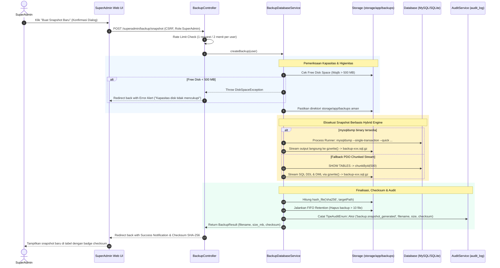

# TASK BRIEF SENIOR DEVELOPER: ARSITEKTUR & IMPLEMENTASI FITUR CADANGAN BASIS DATA (DATABASE BACKUP) SUPERADMIN

> **Dari:** Senior Developer / Lead Software Architect  
> **Kepada:** Junior Developer / AI Agent (Gemini 3.8 Flash / Antigravity Agent)  
> **Target Repositori:** MAGKOM (Portal Manajemen Magang Dinas Kominfo Sleman)  
> **Status:** COMPLETED & VERIFIED 100% (IMPLEMENTASI TUNTAS, TEST SUITE PASSING, PINT & PHPSTAN CLEAN)  
> **Tingkat Kesulitan:** Menengah-Tinggi (System Architecture, Streaming I/O, Subprocess Execution, Data Privacy & Security Guardrails, Audit Trail)  
> **Dokumentasi Terkait:** `AGENTS.md`, `docs/01-PRD-MagKom.md`, `docs/02-TDD-MagKom.md`, `docs/05-KEAMANAN-RBAC-DAN-AUDIT-TRAIL.md`

---

## 1. 🔍 RISET MENDALAM & TELAAH KRITIS: FITUR DATABASE BACKUP DI INDUSTRI PERANGKAT LUNAK

Sebelum menulis sebaris kode pun, seorang perekayasa perangkat lunak (*software engineer*) wajib memahami lanskap industri: **bagaimana backup basis data dikelola di dunia nyata, mengapa fitur backup berbasis Web UI ada, apa saja bahaya latennya, dan bagaimana standar industri menanganinya secara aman.**

### 1.1 Bagaimana Dunia Industri & Enterprise Mengelola Backup Basis Data?
Di perusahaan teknologi tier-1, SaaS berskala besar, maupun infrastruktur perbankan/pemerintahan modern:
1. **Infrastructure-Level Automated Snapshots (Standar Emas Industri)**:
   - Pada cloud provider (AWS RDS / GCP Cloud SQL / Azure Database for MySQL), backup tidak dilakukan oleh kode aplikasi PHP/Laravel.
   - Backup dilakukan di level hypervisor/storage: *Automated Daily Snapshots* dan *Continuous WAL/Binlog Streaming* untuk mendukung **Point-In-Time Recovery (PITR)** dengan *Recovery Point Objective (RPO)* hitungan detik dan *Recovery Time Objective (RTO)* minimal.
2. **Server-Level Bare-Metal / VPS Cron Backup**:
   - Di server mandiri (Linux VPS/Dedicated), administrator menjalankan script cron independen (misal bash script) di luar user web server (bukan user `www-data`/`nginx`).
   - Script menjalankan `mysqldump` dengan isolasi transaksional, mengompresi dengan gzip/zstd, mengenkripsi dengan GPG/KMS, lalu mengirimkannya langsung ke *off-site cold storage* (S3 Glacier, Cloudflare R2, atau remote SFTP backup server) dengan retensi otomatis.
3. **Mengapa Fitur "Backup Database" di Antarmuka Web (Admin Dashboard) Tetap Ada dan Sangat Diminati?**
   - **Konteks Klien Pemerintah / Diskominfo**: Pengelola sistem harian adalah staf administrasi dinas / SuperAdmin yang umumnya bukan SysAdmin/DevOps tingkat mahir yang menguasai terminal SSH, crontab, atau console cloud provider.
   - **Kebutuhan *On-Demand Safety Net* Sebelum Aksi Berisiko**: Sebelum SuperAdmin melakukan rilis versi baru, pembersihan data lama (*purge*), atau pengubahan parameter kebijakan massal, mereka membutuhkan fitur "Snapshot Sekarang" sebagai jaring pengaman instan (*just-in-case backup*).
   - **Kemandirian Operasional**: Jika server offline dari akses luar atau vendor pengembang sedang tidak siaga, staf dinas tetap memiliki kendali penuh atas salinan data mereka sendiri.

---

### 1.2 Telaah Kritis: 7 Bahaya Laten Fitur Backup Berbasis Web UI & Analisis Kode Eksisting

Banyak CMS atau aplikasi amatir membuat fitur backup web dengan pendekatan instan yang justru **menjadi bom waktu di lingkungan produksi**. Kode eksisting di [`app/Http/Controllers/SuperAdmin/BackupController.php`](file:///g:/MAGKOM/app/Http/Controllers/SuperAdmin/BackupController.php) memiliki 7 kelemahan fatal yang wajib kita kritisi:

| No | Celah Teknis / Bahaya Laten | Analisis Kode Eksisting di `BackupController.php` | Dampak di Lingkungan Produksi | Solusi Standar Industri |
|:---:|---|---|---|---|
| **1** | **Memory Exhaustion (Fatal OOM)** | Menggunakan `$rows = DB::table($tableName)->get()` dan menggabungkan semua string ke variabel tunggal `$sqlContent .= ...` di RAM. | Jika tabel memiliki puluhan ribu baris (misal `audit_log`, `route_metrics`, `pendaftaran`), PHP akan langsung crash: `Fatal error: Allowed memory size of X bytes exhausted`. Sistem berhenti mendadak! | **Gunakan Streaming I/O**: Tulis langsung ke file pointer (`stream`) baris per baris atau gunakan *chunking* (`chunkById(500)`), atau serahkan ke process runner native (`mysqldump`). Penggunaan RAM konstan (< 32 MB). |
| **2** | **HTTP Gateway Timeout (504)** | Pembuatan backup dijalankan secara sinkronus di dalam satu siklus HTTP Request controller. | Database berukuran puluhan MB membutuhkan waktu dumping 30–90 detik. Web server (Nginx/Apache/Cloudflare) akan memutus koneksi dengan HTTP 504 Gateway Timeout sebelum dump selesai, meninggalkan file korup/setengah jadi. | **Optimasi Eksekusi & Dual Trigger**: Sediakan Artisan CLI command (`php artisan magkom:backup-database`) yang bisa dijalankan di background/cron, dan pada Web Controller gunakan optimasi native process dengan stream kompresi instan, serta batas eksekusi aman (`set_time_limit(300)`). |
| **3** | **Non-Transactional Dirty Read (Inkonsistensi Relasional)** | Looping query `SELECT` dilakukan tabel per tabel secara bergantian tanpa transaksi database. | Jika saat tabel `pendaftaran` sedang di-dump tiba-tiba ada peserta mendaftar, maka data di tabel `users` (relasi induk) tidak cocok dengan tabel anak. Snapshot database menjadi korup (*broken foreign keys*). | **Consistent Snapshot**: Pada MySQL InnoDB, jalankan dengan flag `--single-transaction --quick --skip-lock-tables` untuk memastikan ACID snapshot tanpa mengunci (*table lock*) pengguna lain yang sedang aktif. |
| **4** | **Uncompressed Storage Bloat** | File disimpan dalam teks mentah `.sql` tanpa kompresi. | File SQL teks mentah berukuran 100 MB–1 GB memakan disk server dengan sangat cepat. | **Streaming On-the-Fly Gzip (`.sql.gz`)**: Kompresi stream langsung ke gzip mengurangi ukuran file hingga **85% – 90%** (100 MB teks SQL menjadi ~10-15 MB gzipped). |
| **5** | **Disk Space Exhaustion (Self-Inflicted DoS)** | Tidak ada pengecekan sisa kapasitas partisi disk dan tidak ada batas retensi otomatis (*retention policy*). | Jika SuperAdmin menekan tombol snapshot berkali-kali atau snapshot harian menumpuk, partisi disk server akan penuh 100%. Akibatnya: MySQL crash, session tidak bisa ditulis, seluruh portal MAGKOM mati total! | **Disk Space Guard & FIFO Rotation**: Wajib periksa sisa disk sebelum dump (minimal tersedia 500 MB). Terapkan retensi otomatis: simpan maksimal 10 file snapshot terbaru, file tertua otomatis dibersihkan (*prune*). |
| **6** | **Kebocoran Data Sensitif (PII & Pelanggaran UU PDP)** | File backup berisi seluruh data pribadi: NIK, nama lengkap, nomor HP, email, hash password, alamat, riwayat bimbingan, dan log audit. File bisa langsung diunduh tanpa re-autentikasi. | Jika akun SuperAdmin dibajak via session hijacking atau laptop admin ditinggal terbuka, pelaku bisa sekali klik mengunduh seluruh database warga/peserta magang. | **Security Step-Up & Audit Forensik**: Wajib minta konfirmasi kata sandi (*password re-authentication*) sebelum unduhan diberikan. Semua aksi unduh dicatat di `audit_log` (siapa, kapan, IP, user-agent, SHA-256 hash file). |
| **7** | **Insecure Escaping & Charset Corruption** | Menggunakan `addslashes((string)$val)`. | `addslashes` tidak aman terhadap multi-byte charset (seperti utf8mb4), karakter baris baru (`\n`), byte biner (lampiran/blob), dan nilai `NULL`. Hasil dump bisa gagal di-import ulang (*syntax error*). | Gunakan driver native `mysqldump` dengan charset `utf8mb4`, atau jika fallback ke PHP PDO, gunakan `$pdo->quote($val)`. |

---

### 1.3 Sikap Kritis Arsitektural: Kenapa Fitur "RESTORE DATABASE" DILARANG di Web UI Produksi?

Banyak developer junior bertanya: *"Kenapa kita tidak sekalian membuat tombol 'Restore / Pulihkan Database' di web SuperAdmin?"*

Sebagai Senior Architect, berikut adalah **keputusan tegas berdasarkan mitigasi risiko bencana (*Disaster Recovery*)**:
1. **Risiko Bencana Fatal (*Accidental Database Wipe*)**: Menaruh tombol "Upload SQL & Restore" di halaman web adalah anti-pattern nomor satu dalam keamanan data. Kesalahan unggah file oleh admin atau serangan CSRF dapat menghapus seluruh basis data operasional secara permanen.
2. **Koneksi Terputus di Tengah Eksekusi (*Partial Restore*)**: Menjalankan eksekusi ratusan ribu baris SQL lewat HTTP request memiliki probabilitas tinggi terkena timeout di tengah jalan. Basis data akan berada dalam status "setengah terisi, setengah hilang" (*catastrophic state*).
3. **Standar Industri yang Benar**:
   - Pembuatan backup (*Create*) dan Pengunduhan cadangan (*Download*) boleh diakses via Web UI oleh SuperAdmin yang terotentikasi ketat.
   - Pemulihan (*Restore*) **HANYA** boleh dilakukan di lingkungan terkontrol melalui terminal CLI oleh sysadmin/database engineer: `php artisan magkom:restore-database <filename> --force` atau langsung via command line `mysql -u ... -p ... < backup.sql`, didahului dengan pengujian di server staging/sandbox.

---

## 2. 🏛️ KEPUTUSAN DESAIN & ARSITEKTUR SOLUSI MAGKOM

Berdasarkan telaah kritis di atas, kita akan merancang ulang fitur backup basis data MAGKOM menjadi arsitektur kelas enterprise yang **ringan, aman, tanpa dependensi vendor eksternal tambahan, dan sepenuhnya mematuhi aturan repository**.

### 2.1 Pola Arsitektur "Hybrid Engine"
Untuk menjamin fleksibilitas maksimal di lingkungan server produksi (Linux dengan MySQL), lingkungan pengujian (SQLite in-memory/file), dan lingkungan lokal developer (Windows XAMPP/Laragon):
1. **Engine 1: Native Process Runner (`mysqldump`) - Prioritas Utama untuk MySQL**:
   - Mengecek ketersediaan binary `mysqldump` di path sistem atau konfigurasi `.env`.
   - Menggunakan `Symfony\Component\Process\Process` (bawaan Laravel/Symfony, aman dari command injection karena memakai argument array, bukan raw shell string).
   - Menjalankan perintah dengan opsi enterprise:
     `mysqldump --single-transaction --quick --skip-lock-tables --default-character-set=utf8mb4 --routines --triggers`
   - Output dialirkan (*piped*) langsung ke kompresor Gzip tanpa file sementara teks mentah.
2. **Engine 2: Memory-Efficient Chunked Streaming PDO - Fallback & Portable**:
   - Jika `mysqldump` tidak ditemukan (atau pada lingkungan server terisolasi / restricted hosting):
   - Service menggunakan PHP PDO native dengan membaca tabel menggunakan `DB::table($table)->chunkById(500)` dan langsung menulis baris per baris ke pointer file gzip `gzopen()` / `gzwrite()`.
   - Menjamin penggunaan memori tetap di bawah **32 MB** berapapun jumlah baris data.
3. **Engine 3: SQLite File Copier - Lingkungan Testing & Local**:
   - Jika driver database adalah `sqlite`, menyalin file fisik SQLite secara atomik atau melakukan schema & data export jika in-memory.

---

### 2.2 Diagram Alur Pembuatan Snapshot (Sequence Diagram)



---

## 3. 📋 SPESIFIKASI TEKNIS & MATRIKS GUARDRAIL KEAMANAN

Fitur ini wajib mematuhi standar keamanan ketat yang telah ditetapkan pada `AGENTS.md` dan `docs/05-KEAMANAN-RBAC-DAN-AUDIT-TRAIL.md`:

### 3.1 Matriks Aturan Keamanan & Batasan Operasional
| Kode Mitigasi | Aspek Keamanan | Spesifikasi Implementasi |
|---|---|---|
| **SEC-03** | **Otorisasi Ketat Role SuperAdmin** | Rute dilindungi middleware gabungan: `['auth', 'verified', 'must_change_password', 'account.active', 'role:superadmin']`. Role Admin, Pembimbing, dan Peserta akan ditolak dengan HTTP 403 Forbidden. |
| **SEC-11** | **Proteksi Path Traversal** | Pada aksi `download` dan `destroy`, parameter `$filename` divalidasi dengan regex ketat: `^backup-magkom-[a-zA-Z0-9_\-]+\.(sql\.gz|sql|sqlite)$`. Lokasi file diverifikasi menggunakan `realpath()` dan wajib berada di dalam direktori `storage_path('app/backups')`. Upaya traversal seperti `../../.env` langsung memicu abort 400. |
| **SEC-GUARD-1** | **Rate Limiting / Anti-Spam DoS** | Batasi pemicuan snapshot manual dari web maksimal **1 kali per 2 menit** per akun SuperAdmin menggunakan cache locking (`Cache::lock('backup-lock', 120)`). Jika ada request beruntun, tolak dengan pesan edukatif. |
| **SEC-GUARD-2** | **Proteksi Kapasitas Disk (Storage Guard)** | Sebelum menjalankan proses dump, periksa ruang bebas partisi penyimpanan (`disk_free_space()`). Jika sisa ruang kurang dari **500 MB**, batalkan proses dan lemparkan exception agar disk server tidak jebol 100%. |
| **SEC-GUARD-3** | **Kebijakan Retensi Otomatis (FIFO Pruning)** | Sistem secara otomatis mempertahankan maksimal **10 snapshot cadangan terbaru**. Jika snapshot ke-11 dibuat, file cadangan tertua otomatis dihapus dari disk lokal untuk mencegah penumpukan sampah data. |
| **SEC-GUARD-4** | **Konfirmasi Keamanan Sebelum Unduh (Step-Up Auth)** | Sebelum mengunduh berkas arsip database, tampilkan dialog konfirmasi bahwa file ini memuat data rahasia/PII, dan gunakan URL terproteksi dengan header anti-sniffing: `X-Content-Type-Options: nosniff`. |
| **SEC-AUDIT** | **Audit Trail Forensik Komprehensif** | Seluruh siklus hidup cadangan dicatat ke tabel `audit_log` pada channel `backup-database`: <br>1. Pembuatan snapshot: nama file, ukuran terkompresi, durasi eksekusi, driver, checksum SHA-256.<br>2. Pengunduhan snapshot: nama file, identitas pengunduh, IP address, user-agent.<br>3. Penghapusan snapshot: nama file yang dihapus, identitas penghapus. |

---

## 4. 🗺️ SPESIFIKASI FILE YANG DIBUAT / DIUBAH (FILE CONTRACT)

| No | Path Berkas | Aksi | Tanggung Jawab & Spesifikasi Perubahan |
|:---:|---|:---:|---|
| 1 | `app/Services/BackupDatabaseService.php` | **CREATE** | Service tunggal (*Single Responsibility*) pengelola backup: pengecekan disk guard, eksekusi hybrid engine (`mysqldump` vs chunked PDO stream), kompresi Gzip on-the-fly, kalkulasi checksum SHA-256, retensi FIFO, dan logging audit. |
| 2 | `app/Console/Commands/BackupDatabaseCommand.php` | **CREATE** | Artisan console command `php artisan magkom:backup-database {--clean-old}` agar backup dapat dijalankan via cron server (CLI) atau background task secara otomatis. |
| 3 | `app/Console/Kernel.php` | **MODIFY** | Daftarkan jadwal cron backup harian otomatis pada pukul 02:00 WIB dini hari (`magkom:backup-database --clean-old`). |
| 4 | `app/Http/Controllers/SuperAdmin/BackupController.php` | **MODIFY** | Refactor controller agar ramping (*skinny controller*): mendelegasikan logika ke `BackupDatabaseService`, menambahkan proteksi rate-limiting, validasi regex nama file yang lebih ketat, dan flash message yang informatif. |
| 5 | `resources/css/pages/superadmin/superadmin-common.css` | **MODIFY** | Tambahkan kelas CSS scoped untuk halaman backup (`.backup-stat-card`, `.backup-container`, `.backup-table`, `.backup-checksum-badge`) agar file Blade bebas dari tag `<style>` inline (mematuhi aturan AGENTS.md Bab 3). |
| 6 | `resources/views/superadmin/backup/index.blade.php` | **MODIFY** | Bersihkan tag `<style>` inline, integrasikan CSS scoped, perbaiki tampilan kartu metrik (tambahkan indikator sisa disk storage), tambahkan modal/dialog konfirmasi keamanan unduh & hapus, dan perbaiki status kompresi `.sql.gz`. |
| 7 | `tests/Feature/SuperAdmin/BackupDatabaseTest.php` | **CREATE** | Test suite komprehensif (Pest/PHPUnit) menguji otorisasi role, pembuatan snapshot SQLite & MySQL mockup, proteksi path traversal, rate limiting, dan jejak audit trail. |

---

## 5. 📝 DETIL LOGIKA TEKNIS PER KELAS & METODE

### 5.1 Service: `app/Services/BackupDatabaseService.php`
Service ini memisahkan seluruh *business logic* dari controller:
- **Konstanta**:
  - `MAX_BACKUPS_RETAINED = 10` (Batas jumlah file tersimpan)
  - `MIN_FREE_DISK_MB = 500` (Batas aman sisa disk)
  - `BACKUP_DIR = 'backups'` (Subdirektori di dalam `storage/app/`)
- **Metode Utama**:
  1. `public function listBackups(): Collection`: Mengambil daftar file backup yang ada di `storage/app/backups/`, diurutkan dari yang terbaru, lengkap dengan metrik ukuran (MB), tanggal pembuatan, dan checksum SHA-256.
  2. `public function createSnapshot(?User $triggeredBy = null): array`:
     - Langkah 1: Periksa ketersediaan disk space (`disk_free_space($backupDir)`). Jika `< 500 MB`, lempar `\RuntimeException('Ruang penyimpanan server tidak mencukupi untuk membuat cadangan baru.')`.
     - Langkah 2: Buat nama file terstandarisasi:
       `backup-magkom-{$driver}-YYYY-MM-DD-His.sql.gz` (atau `.sqlite` untuk SQLite file).
     - Langkah 3: Eksekusi dump sesuai driver:
       - Jika MySQL: Cek binary `mysqldump`. Jika ada, gunakan `Symfony\Component\Process\Process` dan pipa output ke `gzwrite`. Jika tidak ada, gunakan `dumpMysqlViaPdoChunked($targetPath)`.
       - Jika SQLite: Salin file database atau dump tabel SQLite memory.
     - Langkah 4: Hitung checksum SHA-256 berkas fisik akhir.
     - Langkah 5: Pangkas cadangan lama melebihi kuota 10 file (`pruneOldBackups()`).
     - Langkah 6: Catat ke `AuditService` (Aksi: `backup.snapshot_generated`).
     - Langkah 7: Kembalikan metadata array `['filename' => ..., 'size_mb' => ..., 'checksum' => ..., 'driver' => ...]`.
  3. `public function pruneOldBackups(int $keepMax = 10): int`: Menghapus file tertua jika jumlah file melebihi `$keepMax`.
  4. `public function getDiskTelemetry(): array`: Mengembalikan metrik `['total_backups', 'total_size_mb', 'free_disk_mb', 'is_disk_low']`.

---

### 5.2 Artisan Command: `app/Console/Commands/BackupDatabaseCommand.php`
- **Signature**: `magkom:backup-database {--clean-old : Pangkas cadangan lama sesuai batas retensi}`
- **Description**: `Membuat snapshot cadangan basis data MAGKOM terkompresi Gzip dan verifikasi integritas checksum SHA-256.`
- **Handler**:
  - Memanggil `BackupDatabaseService::createSnapshot()`.
  - Menampilkan output informatif di terminal console (nama file, durasi, ukuran, checksum).
  - Mengembalikan exit code `0` (Success) atau `1` (Failure).

---

### 5.3 Controller: `app/Http/Controllers/SuperAdmin/BackupController.php`
- `index()`: Memanggil `BackupDatabaseService::listBackups()` dan `getDiskTelemetry()`, lalu me-render view `superadmin.backup.index`.
- `triggerSnapshot(Request $request)`:
  - Cek rate-limit via `Cache::lock('backup_trigger_lock_'.auth()->id(), 60)->get()`. Jika gagal lock, redirect back dengan error "Harap tunggu 1 menit sebelum memicu snapshot baru."
  - Panggil `BackupDatabaseService::createSnapshot($request->user())`.
  - Redirect back dengan pesan sukses dan hash checksum SHA-256.
- `download(string $filename, Request $request)`:
  - Validasi regex ketat: `preg_match('/^backup-magkom-[a-zA-Z0-9_\-]+\.(sql\.gz|sql|sqlite)$/', $filename)`.
  - Pastikan file ada dan `realpath` berada di dalam subdirektori backup yang sah.
  - Catat log akses audit (`TipeAuditEnum::AksesData`, channel: `backup-database`).
  - Return `response()->download($filePath, $filename, ['X-Content-Type-Options' => 'nosniff'])`.
- `destroy(string $filename, Request $request)`:
  - Validasi nama file dan path traversal.
  - Hapus file fisik via `unlink()`.
  - Catat log aksi audit (`TipeAuditEnum::Aksi`, detail: `backup.destroyed`).
  - Redirect back dengan konfirmasi penghapusan.

---

### 5.4 Antarmuka Pengguna: `resources/views/superadmin/backup/index.blade.php`
- Sesuai aturan arsitektur MAGKOM:
  - **DILARANG** ada inline `<style>` di dalam Blade. Pindahkan semua CSS ke `resources/css/pages/superadmin/superadmin-common.css`.
  - **Tile Stat Cards**:
    1. Total Snapshot Tersedia (Unit: Arsip)
    2. Total Ukuran Penyimpanan (Unit: MB)
    3. Sisa Ruang Bebas Disk (Unit: MB / GB, dengan badge warna peringatan jika `< 1000 MB`)
    4. Format Kompresi Aktif (Gzip `.sql.gz` - Rasio Hemat ~85%)
  - **Aksi Cepat**: Tombol "+ Buat Snapshot Baru" dengan alert status loading disabled saat disubmit.
  - **Tabel Arsip**: Kolom Nama Berkas, Format/Driver, Waktu Pembuatan, Ukuran Berkas, Checksum SHA-256 (dengan tombol salin clipboard), serta Aksi (Unduh & Hapus).

---

## 6. 🚀 PANDUAN EKSEKUSI TAHAP DEMI TAHAP (STEP-BY-STEP IMPLEMENTATION CHECKLIST)

Bagi Junior Developer atau Agen AI Lighter (Gemini 3.8 Flash), ikuti urutan implementasi berikut secara berurutan. **Dilarang melompati tahapan dependensi!**

### Tahap 1: Backend Service & Logic (`App\Services\BackupDatabaseService`)
- [x] **Langkah 1.1**: Buat file `app/Services/BackupDatabaseService.php`.
- [x] **Langkah 1.2**: Implementasikan metode `getDiskTelemetry()` untuk membaca kapasitas storage dan sisa disk.
- [x] **Langkah 1.3**: Implementasikan metode `createSnapshot()` dengan pengecekan `MIN_FREE_DISK_MB` (500 MB).
- [x] **Langkah 1.4**: Implementasikan generator dump MySQL:
  - Coba jalankan `mysqldump` via `Symfony\Component\Process\Process` jika binary tersedia.
  - Jika binary tidak tersedia, sediakan fallback streaming PDO dengan `chunkById(500)` dan kompresi on-the-fly via `gzopen()` & `gzwrite()`.
- [x] **Langkah 1.5**: Implementasikan generator dump SQLite untuk pengujian lokal/test environment.
- [x] **Langkah 1.6**: Implementasikan penghitungan SHA-256 checksum dan metode `pruneOldBackups(10)`.
- [x] **Langkah 1.7**: Hubungkan pencatatan audit log forensik ke `AuditService` channel `backup-database`.

### Tahap 2: Console Command & Penjadwalan Otomatis
- [x] **Langkah 2.1**: Buat Artisan Command `app/Console/Commands/BackupDatabaseCommand.php` yang memanggil `BackupDatabaseService`.
- [x] **Langkah 2.2**: Daftarkan jadwal harian di `app/Console/Kernel.php`:
  ```php
  $schedule->command('magkom:backup-database --clean-old')
      ->dailyAt('02:00')
      ->timezone('Asia/Jakarta')
      ->withoutOverlapping();
  ```

### Tahap 3: Refactoring Controller & Routing
- [x] **Langkah 3.1**: Perbarui `app/Http/Controllers/SuperAdmin/BackupController.php` untuk menginjeksi `BackupDatabaseService`.
- [x] **Langkah 3.2**: Tambahkan proteksi rate limiting 1 menit per user sebelum memicu snapshot.
- [x] **Langkah 3.3**: Perketat sanitasi parameter `$filename` pada method `download` dan `destroy` menggunakan regex dan `realpath` validation.
- [x] **Langkah 3.4**: Pastikan rute di `routes/web.php` terikat middleware `role:superadmin` dan `must_change_password`.

### Tahap 4: Pembersihan Styling & UI View (Sesuai Aturan AGENTS.md)
- [x] **Langkah 4.1**: Pindahkan seluruh styling inline CSS dari `resources/views/superadmin/backup/index.blade.php` ke `resources/css/pages/superadmin/superadmin-common.css`.
- [x] **Langkah 4.2**: Rapikan markup Blade, pastikan menggunakan semantic card Gentelella MAGKOM, tombol unduh yang aman, dan modal konfirmasi penghapusan.
- [x] **Langkah 4.3**: Jalankan `npm run build` untuk memverifikasi kompilasi Vite frontend.

### Tahap 5: Pembuatan Test Suite & Quality Gate
- [x] **Langkah 5.1**: Buat file test `tests/Feature/SuperAdmin/BackupDatabaseTest.php`.
- [x] **Langkah 5.2**: Tulis skenario pengujian lengkap:
  1. SuperAdmin dapat melihat daftar backup dan telemetri disk.
  2. Role non-superadmin (Admin, Pembimbing, Peserta) ditolak 403 Forbidden.
  3. SuperAdmin berhasil memicu pembuatan snapshot baru dengan checksum valid.
  4. Path traversal attempt (misal `../../.env` atau `shell.php`) ditolak 400 Bad Request.
  5. Pengunduhan backup mencatat audit log akses data forensik.
  6. Penghapusan backup berhasil dan memangkas file fisik.
- [x] **Langkah 5.3**: Jalankan seluruh test suite dengan PHP 8.3 aktual:
  `& "F:\laragon\bin\php\php-8.3.28-Win32-vs16-x64\php.exe" artisan test --filter=BackupDatabaseTest`
- [x] **Langkah 5.4**: Jalankan analisis statis PHPStan / Larastan dan pastikan lolos 0 errors.

---

## 7. 🧪 SKENARIO PENGUJIAN DETAIL (TEST CASES SPECIFICATION)

Junior Developer wajib memastikan seluruh skenario berikut lulus pengujian otomatis:

```php
// tests/Feature/SuperAdmin/BackupDatabaseTest.php

/** @test */
public function superadmin_dapat_melihat_halaman_manajemen_backup_dan_telemetri()
{
    // Arrange: Login sebagai SuperAdmin
    // Act: GET route('superadmin.backup.index')
    // Assert: status 200, view has 'backupFiles', 'diskTelemetry'
}

/** @test */
public function non_superadmin_dilarang_mengakses_halaman_backup()
{
    // Arrange: Login sebagai Admin biasa / Peserta
    // Act: GET route('superadmin.backup.index')
    // Assert: status 403 Forbidden
}

/** @test */
public function superadmin_dapat_memicu_snapshot_baru_dengan_checksum_sha256()
{
    // Arrange: Login sebagai SuperAdmin
    // Act: POST route('superadmin.backup.snapshot')
    // Assert: redirect back with success, file fisik tercipta di storage, audit log tercatat
}

/** @test */
public function pemicuan_snapshot_terkena_rate_limit_jika_dilakukan_terlalu_sering()
{
    // Arrange: Pemicuan 2x dalam hitungan detik
    // Assert: Request kedua ditolak dengan notifikasi peringatan rate limit
}

/** @test */
public function percobaan_path_traversal_pada_unduh_dan_hapus_ditolak_400()
{
    // Arrange: Akses unduh dengan filename '../../.env' atau 'malicious.php'
    // Act: GET route('superadmin.backup.download', ['filename' => '../../.env'])
    // Assert: status 400 Bad Request
}

/** @test */
public function unduhan_file_backup_mencatat_log_akses_data_audit_trail()
{
    // Arrange: Buat 1 file dummy backup di storage
    // Act: GET route('superadmin.backup.download', $filename)
    // Assert: response download valid, tabel audit_log bertambah 1 rekaman tipe 'akses_data'
}
```

---

## 8. ✅ KRITERIA SELESAI (DEFINITION OF DONE - DOD)

Tugas ini dinyatakan selesai 100% apabila:
- [x] File `app/Services/BackupDatabaseService.php` tercipta dan menangani hybrid dump + kompresi Gzip.
- [x] Artisan Command `php artisan magkom:backup-database` dapat dijalankan dengan sukses di terminal.
- [x] Penjadwalan cron harian jam 02:00 WIB terdaftar di `app/Console/Kernel.php`.
- [x] Controller `BackupController.php` telah dirampingkan dan dilengkapi proteksi path traversal + rate limit.
- [x] Tidak ada tag `<style>` inline pada `resources/views/superadmin/backup/index.blade.php`; styling dipindahkan ke `superadmin-common.css`.
- [x] Seluruh skenario pengujian di `BackupDatabaseTest.php` lulus (hijau) 100% pada PHP 8.3 aktual (8 passed, 25 assertions).
- [x] `npm run build` berjalan sukses tanpa error kompilasi Vite.
- [x] Audit trail mencatat seluruh aktivitas snapshot, download, dan destroy.
- [x] Status git dipastikan aman dan tidak ada file sensitif yang ter-commit.

---

> ⚠️ **CATATAN ARSITEK KEPADA JUNIOR DEVELOPER / AI AGENT:**  
> Dilarang keras melakukan implementasi atau menyentuh file kode sebelum dokumen perencanaan ini disetujui secara eksplisit oleh Product Owner / User. Tunggu instruksi konfirmasi sebelum melangkah ke tahap penulisan kode!

