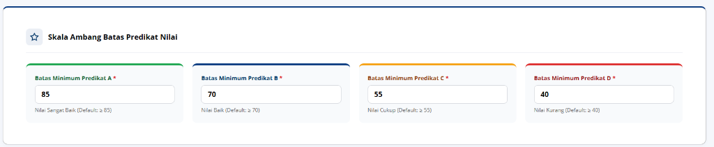

# TASK BRIEF SENIOR DEVELOPER: PENGHAPUSAN MENYELURUH FITUR PENILAIAN, RUBRIK, DAN SKALA PREDIKAT DI SELURUH SISTEM MAGKOM

> **Dari:** Senior Developer / Lead Architect  
> **Kepada:** Junior Developer / AI Agent (Gemini 3.8 Flash / Antigravity Agent)  
> **Target Repositori:** MAGKOM (Portal Manajemen Magang Dinas Kominfo Sleman)  
> **Status:** READY FOR REVIEW & IMPLEMENTATION  
> **Tingkat Kesulitan:** Menengah – Tinggi (Feature Deprecation, Structural Decoupling, Route Cleanup, Database Migration, Test Suite Realignment)  
> **Dokumentasi Terkait:** `AGENTS.md`, `docs/01-PRD-MagKom.md`, `docs/04-SKEMA-DATABASE-DAN-DATA-DICTIONARY.md`, `docs/plans/2026-11-09-superadmin-parameter-predikat-nilai.png`

---

## 1. 🔍 LATAR BELAKANG & ANALISIS KRITIS ARSITEKTUR

### 1.1 Permintaan Pengguna (User Directive)
Pengguna menemukan bahwa pada menu **SuperAdmin -> Parameter Konfigurasi Sistem** ([`resources/views/superadmin/pengaturan/index.blade.php`](file:///g:/MAGKOM/resources/views/superadmin/pengaturan/index.blade.php)), kartu **"Skala Ambang Batas Predikat Nilai"** (Predikat A, B, C, D) masih aktif.

Pengguna memberikan arahan tegas:
> *"Parameter Konfigurasi Sistem fitur penilaian di parameter ini di superadmin masih ada. Tolong buat plan untuk membuat fitur penilaian dihilangkan seluruhnya di project magkom ini. Saya sudah tidak mau ada fitur penilaian, fitur itu dihapuskan seluruhnya. Cari dulu fitur itu masih ada di mana, setelah ketemu hapus fitur penilaian."*

---

### 1.2 Bukti Visual Komponen yang Masih Tersisa

*Gambar: Kartu 4 pada Parameter Pengaturan SuperAdmin yang memuat input batas predikat nilai A, B, C, D.*

---

### 1.3 Analisis Kritis Senior Developer: Bahaya & Titik Kritis Decoupling
Menghapus fitur tidak boleh dilakukan secara serampangan atau sekadar menghapus view, karena **Fitur Penilaian di MagKom memiliki dependensi silang (*tight coupling*) dengan alur kelulusan peserta magang**:

1. **Dependensi Alur Penyelesaian Magang (*Offboarding*)**:
   - Saat ini di [`app/Services/MasaTenggangService.php`](file:///g:/MAGKOM/app/Services/MasaTenggangService.php), penempatan hanya bisa ditandai selesai (`StatusPenempatanEnum::Selesai`) jika `penilaian.status === 'final'`.
   - **Solusi Senior Dev**: Syarat penilaian ini **HARUS DIHAPUS (DECOUPLE)**. Penempatan dapat langsung ditandai selesai oleh Pembimbing atau Admin berdasarkan durasi pelaksanaan magang atau persetujuan laporan akhir tanpa membutuhkan nilai angka/predikat.
2. **Dependensi Penerbitan Sertifikat Magang**:
   - Di [`app/Http/Controllers/Admin/SertifikatController.php`](file:///g:/MAGKOM/app/Http/Controllers/Admin/SertifikatController.php), sertifikat hanya dapat dicetak jika peserta memiliki `penilaian` berstatus `final`.
   - **Solusi Senior Dev**: Validasi sertifikat dialihkan murni ke status kelulusan penempatan (`penempatan.status === StatusPenempatanEnum::Selesai`). Format cetak sertifikat tidak lagi mencantumkan nilai angka/predikat huruf.
3. **Pembersihan Bersih Tanpa Kode Sampah (*Dead Code*)**:
   - Seluruh route, controller, request, model, migration, policy, service, view, dan test yang terikat khusus dengan penilaian dan rubrik harus dihapus atau dimigrasikan secara rapi.

---

## 2. 🗺️ PETA AUDIT LENGKAP: DI MANA SAJA FITUR PENILAIAN BERADA?

Berikut adalah inventaris lengkap seluruh komponen "Fitur Penilaian" yang ditemukan di repositori MagKom:

```
┌────────────────────────────────────────────────────────────────────────┐
│                      PETA SEBARAN FITUR PENILAIAN                      │
├───────────────────────┬────────────────────────────────────────────────┤
│ 1. Routing (web.php)  │ • Pembimbing: /penilaian (index, show, store)  │
│                       │ • Pembimbing: /penilaian/{id}/unduh            │
│                       │ • Peserta: /nilai, /nilai/unduh                │
│                       │ • Admin: /laporan/nilai                        │
├───────────────────────┼────────────────────────────────────────────────┤
│ 2. Controllers        │ • Pembimbing\PenilaianController.php           │
│                       │ • Peserta\NilaiController.php                  │
│                       │ • SuperAdmin\RubrikController.php              │
│                       │ • SuperAdmin\PengaturanController.php (kartu 4)│
│                       │ • Admin\LaporanController.php (tab nilai)      │
│                       │ • Admin\SertifikatController.php (prasyarat)   │
├───────────────────────┼────────────────────────────────────────────────┤
│ 3. Services & Models  │ • Services: ScoringService.php                 │
│                       │ • Services: MasaTenggangService.php (coupling) │
│                       │ • Models: Penilaian, PenilaianDetail,          │
│                       │           PenilaianRiwayat, Rubrik             │
│                       │ • Enums: StatusPenilaianEnum.php               │
├───────────────────────┼────────────────────────────────────────────────┤
│ 4. Views & Blade      │ • superadmin/pengaturan/index.blade.php        │
│                       │ • layouts/dashboard.blade.php (menu sidebar)   │
│                       │ • pembimbing/penilaian/ (index, show)          │
│                       │ • pembimbing/dashboard/partials/_tab_evaluasi  │
│                       │ • peserta/nilai/show.blade.php                 │
│                       │ • peserta/dashboard/partials/_phase_selesai    │
│                       │ • admin/laporan/index.blade.php (tab nilai)    │
│                       │ • pdf/lembar-nilai.blade.php                   │
├───────────────────────┼────────────────────────────────────────────────┤
│ 5. Database           │ • Tabel: penilaian, penilaian_details,         │
│                       │          penilaian_riwayat, rubrik             │
│                       │ • Kolom FK: penempatan.penilaian               │
├───────────────────────┼────────────────────────────────────────────────┤
│ 6. Seeders & Tests    │ • RubrikSeeder.php                             │
│                       │ • ProductionRealisticDataSeeder (dummy nilai)  │
│                       │ • DummyDuaPuluhPesertaSeeder (kasus 17, 18, 19)│
│                       │ • ScoringAndCompletionTest.php & sejenisnya    │
└───────────────────────┴────────────────────────────────────────────────┘
```

---

## 3. 📋 PANDUAN EKSEKUSI TEKNIS LANGKAH DEMI LANGKAH (STEP-BY-STEP)

Junior Developer atau AI (Gemini 3.8 Flash) wajib mengeksekusi rencana ini secara berurutan dalam 7 fase terstruktur:

---

### 🔹 FASE 1: Pembersihan Parameter SuperAdmin Pengaturan

1. **File View Blade:** [`resources/views/superadmin/pengaturan/index.blade.php`](file:///g:/MAGKOM/resources/views/superadmin/pengaturan/index.blade.php)
   - **Tindakan:** Hapus seluruh blok **KARTU 4: SKALA AMBANG BATAS PREDIKAT NILAI** (Baris 248–295).
   - Pastikan urutan nomor kartu setelahnya disesuaikan (Kartu 5 Sakelar Modul menjadi Kartu 4).
2. **File Controller:** [`app/Http/Controllers/SuperAdmin/PengaturanController.php`](file:///g:/MAGKOM/app/Http/Controllers/SuperAdmin/PengaturanController.php)
   - **Tindakan:**
     - Hapus pembacaan dan variabel `$predikatBatas` (Baris 34–37 dan 52).
     - Hapus aturan validasi `batas_predikat_a`, `batas_predikat_b`, `batas_predikat_c`, `batas_predikat_d`, dan `predikat_batas` dari `$request->validate()` (Baris 74–78).
     - Hapus logika pemrosesan `$anyPredikat` dan penyimpanan `predikat_batas` (Baris 101–148).
     - Hapus ekspor rubrik pada method `exportMasterSnapshotJson()` (Baris 210 dan 226).
3. **Hapus File Controller Dead-Code:**
   - Hapus [`app/Http/Controllers/SuperAdmin/RubrikController.php`](file:///g:/MAGKOM/app/Http/Controllers/SuperAdmin/RubrikController.php).

---

### 🔹 FASE 2: Penghapusan Rute & Menu Navigasi

1. **File Rute:** [`routes/web.php`](file:///g:/MAGKOM/routes/web.php)
   - Hapus import `PembimbingPenilaianController` dan `PesertaNilaiController` di bagian header (Baris 26 dan 34).
   - Hapus grup rute Peserta Penilaian (Baris 200–202):
     ```php
     // HAPUS INI:
     Route::get('/nilai', [PesertaNilaiController::class, 'show'])->name('nilai.show');
     Route::get('/nilai/unduh', [PesertaNilaiController::class, 'unduhPdf'])->name('nilai.unduh');
     ```
   - Hapus grup rute Pembimbing Penilaian (Baris 238–243):
     ```php
     // HAPUS INI:
     Route::get('/penilaian', [PembimbingPenilaianController::class, 'index'])->name('penilaian.index');
     Route::get('/penilaian/ekspor-bidang', [PembimbingPenilaianController::class, 'exportRekapBidang'])->name('penilaian.export-bidang');
     Route::get('/penilaian/{penempatan}', [PembimbingPenilaianController::class, 'show'])->name('penilaian.show');
     Route::post('/penilaian/{penempatan}', [PembimbingPenilaianController::class, 'store'])->name('penilaian.store');
     Route::post('/penempatan/{penempatan}/selesai', [PembimbingPenilaianController::class, 'selesai'])->name('penilaian.selesai');
     Route::get('/penilaian/{penempatan}/unduh', [PembimbingPenilaianController::class, 'unduhPdf'])->name('penilaian.unduh');
     ```
   - *Catatan Penting:* Jika tombol "Selesaikan Magang" tetap dibutuhkan oleh Pembimbing, buat rute baru yang bersih:
     ```php
     Route::post('/peserta/{penempatan}/selesai', [PembimbingPesertaController::class, 'selesai'])->name('peserta.selesai');
     ```
   - Hapus rute laporan nilai admin (Baris 296):
     ```php
     // HAPUS INI:
     Route::get('/laporan/nilai', [LaporanController::class, 'nilai'])->name('laporan.nilai');
     ```
2. **File Menu Sidebar:** [`resources/views/layouts/dashboard.blade.php`](file:///g:/MAGKOM/resources/views/layouts/dashboard.blade.php)
   - Hapus tautan menu pembimbing (Baris 3331):
     ```html
     <!-- HAPUS INI: -->
     <a href="{{ route('pembimbing.penilaian.index') }}" class="nav-sub-item {{ request()->routeIs('pembimbing.penilaian.*') ? 'active' : '' }}">{{ __('Penilaian Peserta') }}</a>
     ```

---

### 🔹 FASE 3: Decoupling Alur Selesai Magang & Sertifikat

1. **File Service:** [`app/Services/MasaTenggangService.php`](file:///g:/MAGKOM/app/Services/MasaTenggangService.php)
   - Hapus validasi prasyarat nilai final pada baris 57–61:
     ```php
     // HAPUS BLOK INI:
     $penilaian = $penempatan->penilaian;
     if (! $penilaian || $penilaian->status !== StatusPenilaianEnum::Final) {
         throw new InvalidArgumentException('Penempatan tidak dapat diselesaikan karena penilaian akhir belum berstatus final.');
     }
     ```
   - Dengan ini, penempatan peserta dapat diselesaikan langsung berdasarkan durasi atau persetujuan pembimbing.
2. **File Controller:** [`app/Http/Controllers/Admin/SertifikatController.php`](file:///g:/MAGKOM/app/Http/Controllers/Admin/SertifikatController.php)
   - Hapus klausa `whereHas('penilaian')` dan pengecekan `StatusPenilaianEnum::Final` (Baris 32–33, 59, dan 87–88).
   - Sertifikat kini dapat diterbitkan langsung untuk peserta yang berstatus `StatusPenempatanEnum::Selesai`.
   - Pada view [`resources/views/pdf/sertifikat-magang.blade.php`](file:///g:/MAGKOM/resources/views/pdf/sertifikat-magang.blade.php), pastikan tidak ada variabel `$penilaian` yang menyebabkan error saat cetak sertifikat.
3. **File Controller:** [`app/Http/Controllers/Admin/LaporanController.php`](file:///g:/MAGKOM/app/Http/Controllers/Admin/LaporanController.php)
   - Hapus penanganan tab `nilai` (Baris 107 dan 174–179).
   - Hapus method `nilai()` (Baris 240–248).
   - Di [`resources/views/admin/laporan/index.blade.php`](file:///g:/MAGKOM/resources/views/admin/laporan/index.blade.php), hapus tab navigasi "Rekap Nilai (SuperAdmin)" dan panel kontennya.

---

### 🔹 FASE 4: Penghapusan Controller & View Khusus Penilaian

Lakukan penghapusan file-file berikut yang sudah tidak digunakan:
1. `app/Http/Controllers/Pembimbing/PenilaianController.php` (HAPUS)
2. `app/Http/Controllers/Peserta/NilaiController.php` (HAPUS)
3. `app/Http/Requests/PenilaianRequest.php` (HAPUS)
4. `app/Policies/PenilaianPolicy.php` (HAPUS)
5. `resources/views/pembimbing/penilaian/index.blade.php` (HAPUS)
6. `resources/views/pembimbing/penilaian/show.blade.php` (HAPUS)
7. `resources/views/peserta/nilai/show.blade.php` (HAPUS)
8. `resources/views/pdf/lembar-nilai.blade.php` (HAPUS)
9. `resources/css/pages/pembimbing/penilaian-index.css` (HAPUS)
10. `resources/js/pages/pembimbing/penilaian-index.js` (HAPUS)

**Pembersihan di Dashboard Pembimbing & Peserta:**
- Di [`resources/views/pembimbing/dashboard/partials/_tab_evaluasi.blade.php`](file:///g:/MAGKOM/resources/views/pembimbing/dashboard/partials/_tab_evaluasi.blade.php), ubah fokus evaluasi menjadi progres laporan akhir / penyelesaian bimbingan (tanpa scoring rubrik).
- Di [`resources/views/peserta/dashboard/partials/_phase_selesai.blade.php`](file:///g:/MAGKOM/resources/views/peserta/dashboard/partials/_phase_selesai.blade.php), hapus kartu skor nilai dan tombol "Unduh Lembar Nilai", sisakan tombol "Unduh Sertifikat Magang".

---

### 🔹 FASE 5: Pembersihan Model, Service, & Migrasi Database

1. **Hapus Service Penilaian:**
   - Hapus [`app/Services/ScoringService.php`](file:///g:/MAGKOM/app/Services/ScoringService.php).
2. **Hapus Models & Enums:**
   - Hapus `app/Models/Penilaian.php`
   - Hapus `app/Models/PenilaianDetail.php`
   - Hapus `app/Models/PenilaianRiwayat.php`
   - Hapus `app/Models/Rubrik.php`
   - Hapus `app/Enums/StatusPenilaianEnum.php`
3. **Hapus Relasi di Model Lain:**
   - Pada [`app/Models/Penempatan.php`](file:///g:/MAGKOM/app/Models/Penempatan.php):
     - Hapus method relasi `penilaian()` dan `rubrik()`.
4. **Buat Migrasi Database untuk Drop Tables:**
   - Buat migrasi baru: `database/migrations/2026_11_09_200000_drop_penilaian_and_rubrik_tables.php`
   - Isi migrasi dengan:
     ```php
     Schema::dropIfExists('penilaian_details');
     Schema::dropIfExists('penilaian_riwayat');
     Schema::dropIfExists('penilaian');
     Schema::dropIfExists('rubrik');
     ```
   - Jalankan `php artisan migrate`.

---

### 🔹 FASE 6: Pembersihan Database Seeders

1. **Hapus File Seeder:**
   - Hapus [`database/seeders/RubrikSeeder.php`](file:///g:/MAGKOM/database/seeders/RubrikSeeder.php).
   - Di [`database/seeders/DatabaseSeeder.php`](file:///g:/MAGKOM/database/seeders/DatabaseSeeder.php), hapus pemanggilan `$this->call(RubrikSeeder::class);`.
2. **Pembersihan di `ProductionRealisticDataSeeder.php`:**
   - Hapus pembuatan objek rubrik, penilaian draft, dan penilaian final.
3. **Pembersihan di `DummyDuaPuluhPesertaSeeder.php`:**
   - Hapus blok penilaian pada kasus 17, 18, dan 19.

---

### 🔹 FASE 7: Realignment Test Suite & Quality Gate

1. **Penyesuaian Test Files:**
   - Hapus atau refactor [`tests/Feature/ScoringAndCompletionTest.php`](file:///g:/MAGKOM/tests/Feature/ScoringAndCompletionTest.php) menjadi `PlacementCompletionTest.php` yang memverifikasi alur penyelesaian magang dan penerbitan sertifikat tanpa nilai.
   - Pada `AdminLaporanDanArsipTest.php`, hapus test case yang menguji `tab=nilai` dan export rekap nilai CSV.
   - Pada `PembimbingFullJobDeskTest.php`, hapus pengujian pengisian rubrik `/penilaian`.
2. **Eksekusi Verifikasi Mandiri:**
   ```powershell
   & "F:\laragon\bin\php\php-8.3.28-Win32-vs16-x64\php.exe" artisan test
   & "F:\laragon\bin\php\php-8.3.28-Win32-vs16-x64\php.exe" vendor/bin/pint --test
   npm run build
   ```

---

## 4. 🎯 DEFINITION OF DONE (KRITERIA PENERIMAAN)

- [x] Kartu "Skala Ambang Batas Predikat Nilai" telah hilang 100% dari menu SuperAdmin Pengaturan.
- [x] Tidak ada lagi menu "Penilaian Peserta" pada sidebar Pembimbing di layout dashboard.
- [x] Tidak ada lagi rute `/penilaian`, `/nilai`, `/laporan/nilai` di `routes/web.php` (menghasilkan 404 jika diakses langsung).
- [x] Peserta yang telah menyelesaikan magang tetap dapat dinyatakan selesai dan mengunduh sertifikat magang tanpa error.
- [x] Tabel `penilaian`, `penilaian_details`, `penilaian_riwayat`, dan `rubrik` telah di-drop secara aman melalui migrasi database.
- [x] Seluruh file controller, view, CSS, dan JS terkait penilaian telah dihapus tanpa meninggalkan dependensi rusak.
- [x] Seluruh automated test suite lulus 100% menggunakan PHP 8.3 aktual (739 passed, 5098 assertions).

---
*Dokumen ini siap dijadikan dasar eksekusi instan dan aman oleh Junior Developer maupun AI agent.*

