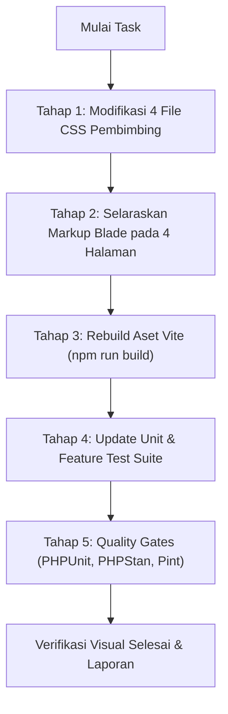

# Senior Dev Task & PRD: Standarisasi Filter Card & Aksen Biru Sleman Portal Pembimbing

> **Dokumen Penugasan Senior Developer**  
> **Target Pelaksana**: Junior Developer / AI Assistant (Gemini 3.8 Flash, Claude 3.5 Haiku, dsb.)  
> **Status**: Draf Rencana Kerja Siap Eksekusi  
> **Tanggal**: 9 November 2026  
> **Sistem**: Portal Manajemen Magang Dinas Kominfo Sleman (MagKom)  
> **Scope**: 4 Modul Portal Pembimbing (`/pembimbing/peserta`, `/pembimbing/logbook`, `/pembimbing/tugas`, `/pembimbing/laporan-kinerja`)  

---

## 1. Ringkasan Eksekutif & Tujuan Tugas

Tugas ini bertujuan untuk menyelaraskan dan menstandarisasi komponen **Filter Card** pada seluruh halaman kerja utama Pembimbing Lapangan agar memiliki identitas visual yang seragam dengan desain SuperAdmin/Admin MagKom.

### Masalah Saat Ini:
1. **Tidak Ada Garis Aksen Biru di Bagian Atas Kartu**: Kontainer filter di 4 halaman modul pembimbing saat ini menggunakan border abu-abu polos biasa (`border: 1px solid #E2E8F0`), tidak memiliki aksen garis biru khas Sleman MagKom di tepi atas kartu (`border-top: 3.5px solid #01347C`).
2. **Tombol Pencarian/Filter Belum Seragam**: Sebagian tombol menggunakan tinggi 38px, warna navy tua `#01347C`, ada yang tidak menggunakan ikon, atau memiliki padding yang berbeda-beda.
3. **Kebutuhan Standarisasi**: Menyeragamkan tampilan kartu filter agar persis seperti contoh referensi:
   - Aksen garis biru di bagian atas kartu: `border-top: 3.5px solid var(--magkom-primary-blue, #01347C) !important;` (atau `#3B82F6` di Dark Mode).
   - Tombol filter/pencarian berwarna **Royal Blue MagKom (`#0641CC`)** dengan ikon representatif (funnel/search), tinggi standar **42px**, sudut melengkung **8px**, dan teks putih tebal.
   - Kontrol input dan dropdown diselaraskan dengan tinggi **42px** serta fokus ring yang bersih.
   - **Logika dan fungsi spesifik masing-masing halaman tetap 100% dipertahankan** sesuai kebutuhan operasional bimbingan.

---

## 2. Bukti Visual & Referensi Desain

### A. Referensi Desain Target (Contoh yang Diinginkan)
Aksen biru tipis di tepi atas kartu (`border-top: 3.5px solid #01347C`), input teks dengan ikon, dropdown bersih, dan tombol filter biru royal `#0641CC` dengan ikon funnel:


### B. Kondisi Eksisting Portal Pembimbing
Kartu filter saat ini masih polos tanpa aksen garis biru di tepi atas dan tombol filter belum terstandarisasi:


---

## 3. Batasan Teknis & Aturan Pengkodean (Guardrails)

Bagi Junior Developer / AI Pelaksana, wajib mematuhi aturan berikut:
1. **Dilarang Menulis CSS di Blade**: Jangan menambahkan tag `<style>` di dalam file `.blade.php`. Semua styling harus ditulis pada file CSS masing-masing modul di bawah `resources/css/pages/pembimbing/`.
2. **Dilarang Menulis JavaScript di Blade**: Jangan menambahkan tag `<script>` baru di Blade. Gunakan form GET native submission untuk filter.
3. **Pertahankan Kontrak URL & Controller**:
   - Halaman **Direktori Peserta**: parameter `q` dan `tab` (`aktif` / `selesai`).
   - Halaman **Review Logbook**: parameter `q`, `penempatan_id`, dan `bulan`.
   - Halaman **Tugas & Progres**: parameter `q`, `penempatan_id`, `bulan`, serta mempertahankan hidden inputs `status` dan `kategori`.
   - Halaman **Laporan Kinerja**: parameter `q`, `penempatan_id`, `status`, dan `bulan`.
4. **Dukungan Dark Mode**: Seluruh elemen baru wajib mendukung selektor `[data-theme="dark"]`.
5. **Quality Gates Wajib Lolos**: `npm run build`, `artisan test`, `phpstan analyse`, dan `pint`.

---

## 4. Analisis & Matriks Pemetaan 4 Modul Pembimbing

| Modul Pembimbing | Route URL | File Blade | File CSS Terkait | Parameter Filter Khusus |
| :--- | :--- | :--- | :--- | :--- |
| **1. Direktori Peserta Bimbingan** | `/pembimbing/peserta` | `resources/views/pembimbing/peserta/index.blade.php` | `resources/css/pages/pembimbing/peserta-index.css` | `tab` (`aktif`/`selesai`), `q` (nama, kampus, NIM) |
| **2. Review Logbook Harian** | `/pembimbing/logbook` | `resources/views/pembimbing/logbook/index.blade.php` | `resources/css/pages/pembimbing/logbook-index.css` | `q`, `penempatan_id`, `bulan` |
| **3. Tugas & Progres Magang** | `/pembimbing/tugas` | `resources/views/pembimbing/tugas/index.blade.php` | `resources/css/pages/pembimbing/tugas-index.css` | `q`, `penempatan_id`, `bulan`, `status`, `kategori` |
| **4. Laporan Kinerja Peserta** | `/pembimbing/laporan-kinerja` | `resources/views/pembimbing/laporan-kinerja/index.blade.php` | `resources/css/pages/pembimbing/laporan-kinerja-index.css` | `q`, `penempatan_id`, `status`, `bulan` |

---

## 5. Rincian Perubahan Per Modul (Blueprint Implementasi)

### Modul 1: Direktori Peserta Bimbingan (`/pembimbing/peserta`)

#### Fungsi Filter:
- Tab segmen: **Peserta Aktif** (`$countAktif`) vs **Alumni Selesai** (`$countSelesai`).
- Input pencarian teks `q` untuk mencari nama mentee, kampus, atau NIM.

#### Perubahan CSS (`resources/css/pages/pembimbing/peserta-index.css`):
1. Tambahkan `border-top: 3.5px solid var(--magkom-primary-blue, #01347C) !important;` pada `.peserta-filter-card`.
2. Selaraskan tinggi `.peserta-search-input` menjadi `42px`.
3. Perbarui class `.btn-search`:
   - Tinggi: `42px`
   - Background: `#0641CC`
   - Border radius: `8px`
   - Tambahkan ikon kaca pembesar / filter `<svg>`
   - Hover state: `#003566`
4. Tambahkan override Dark Mode pada `.peserta-filter-card` dan `.btn-search`.

#### Perubahan Blade (`resources/views/pembimbing/peserta/index.blade.php`):
- Perbarui tombol submit form pada baris 107 agar memuat ikon SVG dan teks "Cari":
```blade
<button type="submit" class="btn-search">
    <svg width="15" height="15" viewBox="0 0 24 24" fill="none" stroke="currentColor" stroke-width="2.5">
        <circle cx="11" cy="11" r="8"></circle>
        <line x1="21" y1="21" x2="16.65" y2="16.65"></line>
    </svg>
    <span>Cari</span>
</button>
```

---

### Modul 2: Review Logbook Harian (`/pembimbing/logbook`)

#### Fungsi Filter:
- `q`: Pencarian nama, kampus, NIM peserta.
- `penempatan_id`: Dropdown memilih mentee bimbingan tertentu.
- `bulan`: Dropdown memilih bulan kegiatan magang.

#### Perubahan CSS (`resources/css/pages/pembimbing/logbook-index.css`):
1. Tambahkan `border-top: 3.5px solid var(--magkom-primary-blue, #01347C) !important;` pada `.logbook-filter-card`.
2. Ubah tinggi `.filter-control` dan `.peserta-search-input` dari 38px menjadi `42px`.
3. Ubah styling `.btn-filter-apply`:
   - Tinggi: `42px`
   - Background: `#0641CC`
   - Border radius: `8px`
   - Teks tombol: "Filter"
   - Hover state: `#003566`
4. Tambahkan override Dark Mode.

#### Perubahan Blade (`resources/views/pembimbing/logbook/index.blade.php`):
- Pastikan tombol submit pada `.filter-actions` menampilkan teks "Filter" dan ikon funnel:
```blade
<button type="submit" class="btn-filter-apply">
    <svg width="14" height="14" viewBox="0 0 24 24" fill="none" stroke="currentColor" stroke-width="2.5">
        <polygon points="22 3 2 3 10 12.46 10 19 14 21 14 12.46 22 3"></polygon>
    </svg>
    <span>Filter</span>
</button>
```

---

### Modul 3: Tugas & Progres Magang (`/pembimbing/tugas`)

#### Fungsi Filter:
- Mempertahankan `hidden` input `status` dan `kategori`.
- `q`: Pencarian nama peserta atau judul tugas.
- `penempatan_id`: Dropdown nama mentee.
- `bulan`: Dropdown filter bulan.

#### Perubahan CSS (`resources/css/pages/pembimbing/tugas-index.css`):
1. Tambahkan `border-top: 3.5px solid var(--magkom-primary-blue, #01347C) !important;` pada `.tugas-filter-card`.
2. Ubah tinggi `.filter-control` dan `.peserta-search-input` menjadi `42px`.
3. Ubah styling `.btn-filter-apply`:
   - Tinggi: `42px`
   - Background: `#0641CC`
   - Border radius: `8px`
   - Teks: "Filter"
   - Hover state: `#003566`
4. Tambahkan override Dark Mode.

#### Perubahan Blade (`resources/views/pembimbing/tugas/index.blade.php`):
- Perbarui tombol submit pada baris 169-172 agar menampilkan teks "Filter":
```blade
<button type="submit" class="btn-filter-apply">
    <svg width="14" height="14" viewBox="0 0 24 24" fill="none" stroke="currentColor" stroke-width="2.5">
        <polygon points="22 3 2 3 10 12.46 10 19 14 21 14 12.46 22 3"></polygon>
    </svg>
    <span>Filter</span>
</button>
```

---

### Modul 4: Laporan Kinerja Peserta (`/pembimbing/laporan-kinerja`)

#### Fungsi Filter:
- `q`: Pencarian nama, kampus, NIM peserta.
- `penempatan_id`: Dropdown mentee bimbingan.
- `status`: Dropdown status penempatan (`aktif`, `tidak_aktif`, `selesai`).
- `bulan`: Dropdown bulan periode magang.

#### Perubahan CSS (`resources/css/pages/pembimbing/laporan-kinerja-index.css`):
1. Tambahkan `border-top: 3.5px solid var(--magkom-primary-blue, #01347C) !important;` pada `.laporan-filter-card`.
2. Ubah tinggi `.filter-control` dan `.peserta-search-input` menjadi `42px`.
3. Ubah styling `.btn-filter-apply`:
   - Tinggi: `42px`
   - Background: `#0641CC`
   - Border radius: `8px`
   - Teks: "Filter"
   - Hover state: `#003566`
4. Tambahkan override Dark Mode.

#### Perubahan Blade (`resources/views/pembimbing/laporan-kinerja/index.blade.php`):
- Tombol submit sudah memiliki ikon funnel dan teks "Filter", pastikan class selaras dengan CSS baru.

---

## 6. Cuplikan CSS Terstandarisasi (Pola Rujukan)

Berikut adalah pola CSS standar yang harus diadopsi pada setiap stylesheet terkait:

```css
/* =========================================================================
   STANDARISASI FILTER CARD & TOMBOL FILTER BIRU MAGKOM (#0641CC)
   ========================================================================= */

/* 1. Kontainer Kartu Filter dengan Garis Aksen Biru Sleman di Atas */
.peserta-filter-card,
.logbook-filter-card,
.tugas-filter-card,
.laporan-filter-card {
    background: #ffffff;
    border-radius: 12px;
    border: 1px solid #CBD5E1;
    border-top: 3.5px solid var(--magkom-primary-blue, #01347C) !important;
    padding: 1.15rem 1.35rem;
    box-shadow: 0 1px 3px rgba(15, 23, 42, 0.05);
    margin-bottom: 24px;
}

/* 2. Tombol Aksi Filter / Cari Berwarna Biru Royal Sleman */
.btn-filter-apply,
.btn-search {
    height: 42px;
    padding: 0 1.25rem;
    background: #0641CC !important;
    color: #FFFFFF !important;
    font-weight: 700;
    font-size: 0.8125rem;
    border: none;
    border-radius: 8px;
    cursor: pointer;
    transition: all 0.15s ease;
    display: inline-flex;
    align-items: center;
    justify-content: center;
    gap: 0.4rem;
    box-shadow: 0 2px 6px rgba(6, 65, 204, 0.2);
    text-decoration: none;
}

.btn-filter-apply:hover,
.btn-search:hover {
    background: #003566 !important;
    color: #FFFFFF !important;
    transform: translateY(-1px);
    box-shadow: 0 4px 10px rgba(6, 65, 204, 0.3);
}

/* 3. Dukungan Dark Mode Penuh */
[data-theme="dark"] .peserta-filter-card,
[data-theme="dark"] .logbook-filter-card,
[data-theme="dark"] .tugas-filter-card,
[data-theme="dark"] .laporan-filter-card {
    background-color: #003566 !important;
    border-color: #3F51B5 !important;
    border-top: 3.5px solid var(--blue-600, #3B82F6) !important;
}

[data-theme="dark"] .btn-filter-apply,
[data-theme="dark"] .btn-search {
    background: #2563EB !important;
}

[data-theme="dark"] .btn-filter-apply:hover,
[data-theme="dark"] .btn-search:hover {
    background: #1D4ED8 !important;
}
```

---

## 7. Rencana Eksekusi Langkah-demi-Langkah (Action Plan)



### Langkah 1: Update File CSS
Modifikasi selektor kontainer filter dan tombol pada:
- `resources/css/pages/pembimbing/peserta-index.css`
- `resources/css/pages/pembimbing/logbook-index.css`
- `resources/css/pages/pembimbing/tugas-index.css`
- `resources/css/pages/pembimbing/laporan-kinerja-index.css`

### Langkah 2: Update Markup Blade
- `resources/views/pembimbing/peserta/index.blade.php`: Tambahkan ikon SVG pada tombol "Cari".
- `resources/views/pembimbing/logbook/index.blade.php`: Selaraskan teks tombol menjadi "Filter" dengan ikon funnel.
- `resources/views/pembimbing/tugas/index.blade.php`: Selaraskan teks tombol menjadi "Filter" dengan ikon funnel.
- `resources/views/pembimbing/laporan-kinerja/index.blade.php`: Pastikan tombol dan input selaras.

### Langkah 3: Eksekusi Kompilasi Vite
Jalankan kompilasi untuk memperbarui manifest bundle frontend:
```powershell
npm run build
```

### Langkah 4: Pembaruan Test Suite
Tambahkan assertions pada `tests/Feature/PembimbingPortalStandardizationTest.php` untuk memastikan class filter card dan tombol filter biru ter-render di keempat halaman.

### Langkah 5: Menjalankan Quality Gates
Jalankan perintah verifikasi ketat:
```powershell
& "F:\laragon\bin\php\php-8.3.28-Win32-vs16-x64\php.exe" artisan test tests/Feature/Pembimbing*
& "F:\laragon\bin\php\php-8.3.28-Win32-vs16-x64\php.exe" vendor/bin/phpstan analyse --memory-limit=1G
& "F:\laragon\bin\php\php-8.3.28-Win32-vs16-x64\php.exe" vendor/bin/pint --test
```

---

## 8. Kriteria Penerimaan (Acceptance Criteria)

- [ ] Seluruh kartu filter pada 4 halaman (`Direktori Peserta`, `Review Logbook`, `Tugas & Progres`, `Laporan Kinerja`) memiliki garis aksen biru Sleman di tepi atas kartu (`border-top: 3.5px solid #01347C`).
- [ ] Tombol aksi submit filter/pencarian di keempat halaman berwarna **Royal Blue MagKom (`#0641CC`)** dengan ikon dan teks tebal.
- [ ] Tinggi elemen form (input text, select dropdown, tombol filter) seragam setinggi **42px**.
- [ ] Tidak ada aturan styling yang ditulis di dalam file Blade (CSS 100% di `resources/css/`).
- [ ] Fitur fungsional, parameter query GET, dan paginasi di setiap halaman berjalan normal tanpa error atau regresi.
- [ ] Mendukung Dark Mode dengan warna garis `#3B82F6` dan tombol `#2563EB`.
- [ ] Semua pengujian otomatis (`tests/Feature/Pembimbing*`) lulus 100% hijau.

