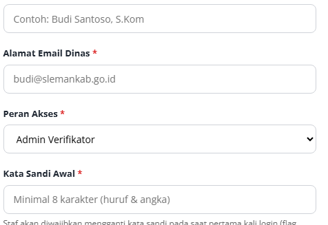
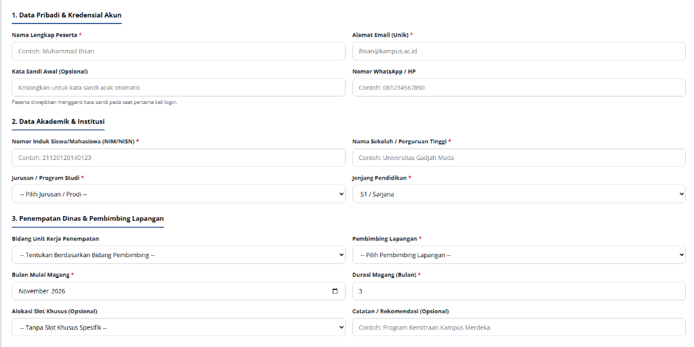

# TASK BRIEF SENIOR DEVELOPER: STANDARISASI MENYELURUH EMAIL @GMAIL.COM & ELIMINASI DOMAIN LEGACY DI SELURUH SISTEM MAGKOM

> **Dari:** Senior Developer / Lead Architect  
> **Kepada:** Junior Developer / AI Agent (Gemini 3.8 Flash / Antigravity Agent)  
> **Target Repositori:** MAGKOM (Portal Manajemen Magang Dinas Komunikasi dan Informatika)  
> **Status:** COMPLETED & VERIFIED (100% QUALITY GATE PASSED)  
> **Tingkat Kesulitan:** Menengah (UI/UX Refinement, Modal Blade, Database Seeder Alignment, Regression Testing)  
> **Dokumentasi Terkait:** `AGENTS.md`, `docs/01-PRD-MagKom.md`, `docs/07-DESIGN-SYSTEM-MAGKOM.md`

---

## 1. 🔍 ANALISIS KRITIS & IDENTIFIKASI MASALAH (ROOT CAUSE ANALYSIS)

### 1.1 Mengapa Masalah Ini Terjadi?
Pada sprint sebelumnya, tim pengembang telah melakukan standarisasi email pada formulir registrasi peserta (`auth/register.blade.php`), login (`auth/login.blade.php`), forgot/reset password, pembuatan peserta jalur khusus (`superadmin/peserta-khusus/create.blade.php`), dan penempatan manual peserta (`admin/penempatan/index.blade.php`).

Namun, saat sistem ditinjau kembali dari perspektif pengguna akhir (SuperAdmin), ditemukan **dua titik kelemahan utama**:
1. **Kebocoran Placeholder Domain Dinas pada Modal Kelola Staf**:
   - Di halaman SuperAdmin Kelola Staf (`resources/views/superadmin/staf/index.blade.php`), saat membuka modal **"Tambah Staf Internal Baru"**, input email masih berlabel **"Alamat Email Dinas *"** dengan placeholder **`budi@slemankab.go.id`**.
   - Hal ini bertentangan dengan visi operasional MagKom di mana seluruh akun operasional (baik staf dinas, pembimbing lapangan, maupun peserta magang) distandarisasikan menggunakan akun Google (**`@gmail.com`**) agar ke depan kompatibel dengan autentikasi Google SSO.
2. **Kebocoran Domain Kampus & Lembaga pada Data Dummy / Seeders**:
   - Pada tabel **"Daftar Peserta Magang Jalur Khusus"** di halaman SuperAdmin Slot Khusus, data peserta yang di-generate dari seeder masih menampilkan:
     - `Zulfikar Ali (zulfikar.ali@mail.ugm.ac.id)`
     - `Olivia Tan (olivia.tan@komdigi.go.id)`
   - Seeder `ProductionRealisticDataSeeder.php` dan `DummyDuaPuluhPesertaSeeder.php` masih memuat domain lama (`@mail.ugm.ac.id`, `@komdigi.go.id`, `@uii.ac.id`, `@students.amikom.ac.id`, `@student.uny.ac.id`, `@upnyk.ac.id`, `@uin-suka.ac.id`, `@smkn2depoksleman.sch.id`, dsb.).
3. **Residu URL Dummy `example.com` pada Fitur Tugas Pembimbing**:
   - Pada formulir tambah tautan referensi tugas (`pembimbing/tugas/create.blade.php` dan `edit.blade.php`), masih terdapat placeholder generik `https://example.com/...`.

---

## 2. 📸 BUKTI VISUAL LAPANGAN (USER EVIDENCE)

### Bukti 1: Modal Tambah Staf SuperAdmin (Masih Menggunakan `budi@slemankab.go.id`)

*Masalah terdeteksi:* Input `Alamat Email Dinas *` menampilkan placeholder `budi@slemankab.go.id`. Wajib diubah menjadi `budi.santoso@gmail.com` dan label diselaraskan menjadi `Alamat Email Akun Staf (Google / Gmail) *`.

---

### Bukti 2: Tabel Peserta Magang Jalur Khusus (Email Kampus & Komdigi di Data Tampil)

*Masalah terdeteksi:* Akun peserta `Zulfikar Ali` ber-email `zulfikar.ali@mail.ugm.ac.id` dan `Olivia Tan` ber-email `olivia.tan@komdigi.go.id`. Seluruh data simulasi akun pengguna wajib distandarisasi ke format `@gmail.com`.

---

## 3. ⚖️ PRINSIP KRITIS ARSITEKTUR: MEMBEDAKAN 2 KATEGORI EMAIL

Junior Developer / AI wajib memahami **batasan arsitektural yang ketat** antara dua jenis email berikut:

| Kategori | Contoh Penggunaan | Domain yang Wajib Digunakan | Alasan & Aturan Senior Dev |
| :--- | :--- | :--- | :--- |
| **A. Akun Pengguna & Placeholder Form** *(User Accounts & Form Inputs)* | Modal Tambah Staf, Edit Staf, Peserta Jalur Khusus, Profil Peserta, Data Seeder Peserta & Staf | **`@gmail.com`** (misal: `budi.santoso@gmail.com`, `nama.peserta@gmail.com`) | **WAJIB DIUBAH KE `@gmail.com`**. Seluruh akun pengguna yang digunakan untuk login atau menjadi contoh pengisian formulir harus memakai `@gmail.com`. |
| **B. Identitas Kontak Resmi Instansi OPD** *(Government Entity Identity)* | Kop surat dinas di PDF tanda bukti pendaftaran (`pdf/rekap-pendaftaran.blade.php`), buku panduan (`pdf/buku-panduan-magang.blade.php`), footer portal publik (`layouts/app.blade.php`) | **`kominfo@slemankab.go.id`** / `https://slemankab.go.id` | **JANGAN DIUBAH KE GMAIL**. Ini adalah entitas hukum resmi Dinas Komunikasi dan Informatika Kabupaten Sleman. Mengubah email resmi kantor Pemda menjadi `@gmail.com` adalah pelanggaran standar kepemerintahan. |

---

## 4. 🗺️ PETA AUDIT KOMPREHENSIF SELURUH FILE TERDAMPAK

Berikut daftar file yang telah diaudit secara teliti di seluruh repositori:

### Kelompok 1: Antarmuka & Modal Blade (Views)
1. **`resources/views/superadmin/staf/index.blade.php`**:
   - Baris 329–331: Modal Tambah Staf (`Alamat Email Dinas *` & `placeholder="budi@slemankab.go.id"`).
   - Baris 448–450: Modal Edit Staf (`Alamat Email Dinas *` & input `editEmail`).
2. **`resources/views/peserta/profil/show.blade.php`**:
   - Baris 1114: `placeholder="nama@gmail.com"` -> standarisasi ke `nama.peserta@gmail.com`.
3. **`resources/views/pembimbing/tugas/create.blade.php`**:
   - Baris 470: `placeholder="https://example.com/..."` -> standarisasi ke `https://drive.google.com/...`.
4. **`resources/views/pembimbing/tugas/edit.blade.php`**:
   - Baris 360: `placeholder="https://example.com/..."` -> standarisasi ke `https://drive.google.com/...`.

### Kelompok 2: Data Seeder Akun Pengguna (Database Seeders)
1. **`database/seeders/ProductionRealisticDataSeeder.php`**:
   - Baris 869: Akun Jalur Khusus `Zulfikar Ali`: `zulfikar.ali@mail.ugm.ac.id` -> ubah ke `zulfikar.ali@gmail.com`.
   - Baris 787–812: 16 Peserta Cohort Aktif (`@uii.ac.id`, `@students.amikom.ac.id`, `@mail.ugm.ac.id`, `@student.uny.ac.id`, `@upnyk.ac.id`, `@uin-suka.ac.id`, `@smkn2depoksleman.sch.id`, `@smkn1sleman.sch.id`) -> ubah seluruh domain menjadi `@gmail.com`.
   - Baris 417–426: 10 Peserta Cohort Alumni Lulus (`@mail.ugm.ac.id`, `@student.uny.ac.id`, dst.) -> ubah seluruh domain menjadi `@gmail.com`.
2. **`database/seeders/DummyDuaPuluhPesertaSeeder.php`**:
   - Baris 497: Akun Jalur Khusus `Olivia Tan`: `olivia.tan@komdigi.go.id` -> ubah ke `olivia.tan@gmail.com`.
   - Peserta dummy lainnya yang menggunakan domain selain `@gmail.com`.

### Kelompok 3: Sinkronisasi Data Database Lokal Eksisting
- Menjalankan migrasi update data satu kali (atau perintah Artisan Seeder) agar data yang saat ini sudah tersimpan di database lokal pengguna langsung ter-update dari `zulfikar.ali@mail.ugm.ac.id` & `olivia.tan@komdigi.go.id` menjadi `zulfikar.ali@gmail.com` & `olivia.tan@gmail.com`.

---

## 5. 🛠️ PANDUAN EKSEKUSI TEKNIS LANGKAH DEMI LANGKAH (STEP-BY-STEP)

---

### 🔹 LANGKAH 1: Standarisasi Modal Kelola Staf SuperAdmin

Buka file [`resources/views/superadmin/staf/index.blade.php`](file:///g:/MAGKOM/resources/views/superadmin/staf/index.blade.php).

#### 1.1 Modal Tambah Staf Baru (Sekitar Baris 328–332)
* Ubah label dan placeholder input email:
```html
<!-- SEBELUM: -->
<div>
    <label style="display: block; font-size: 0.8125rem; font-weight: 700; color: var(--neutral-800); margin-bottom: 0.375rem;">
        Alamat Email Dinas <span style="color: var(--red-600);">*</span>
    </label>
    <input type="email" name="email" required placeholder="budi@slemankab.go.id" style="...">
</div>

<!-- SESUDAH: -->
<div>
    <label style="display: block; font-size: 0.8125rem; font-weight: 700; color: var(--neutral-800); margin-bottom: 0.375rem;">
        Alamat Email Akun Staf (Google / Gmail) <span style="color: var(--red-600);">*</span>
    </label>
    <input type="email" name="email" required placeholder="budi.santoso@gmail.com" style="...">
</div>
```

#### 1.2 Modal Edit Staf (Sekitar Baris 447–451)
* Selaraskan label dan tambahkan placeholder:
```html
<!-- SEBELUM: -->
<div>
    <label style="display: block; font-size: 0.8125rem; font-weight: 700; color: var(--neutral-800); margin-bottom: 0.375rem;">
        Alamat Email Dinas <span style="color: var(--red-600);">*</span>
    </label>
    <input type="email" id="editEmail" name="email" required style="...">
</div>

<!-- SESUDAH: -->
<div>
    <label style="display: block; font-size: 0.8125rem; font-weight: 700; color: var(--neutral-800); margin-bottom: 0.375rem;">
        Alamat Email Akun Staf (Google / Gmail) <span style="color: var(--red-600);">*</span>
    </label>
    <input type="email" id="editEmail" name="email" required placeholder="budi.santoso@gmail.com" style="...">
</div>
```

---

### 🔹 LANGKAH 2: Standarisasi Formulir Profil Peserta & Tugas Pembimbing

#### 2.1 Formulir Profil Peserta
Buka file [`resources/views/peserta/profil/show.blade.php`](file:///g:/MAGKOM/resources/views/peserta/profil/show.blade.php) pada Baris 1114:
```html
<!-- SEBELUM: -->
placeholder="nama@gmail.com"

<!-- SESUDAH: -->
placeholder="nama.peserta@gmail.com"
```

#### 2.2 Modal Tautan Tugas Pembimbing
Buka file [`resources/views/pembimbing/tugas/create.blade.php`](file:///g:/MAGKOM/resources/views/pembimbing/tugas/create.blade.php) pada Baris 470 dan [`resources/views/pembimbing/tugas/edit.blade.php`](file:///g:/MAGKOM/resources/views/pembimbing/tugas/edit.blade.php) pada Baris 360:
```html
<!-- SEBELUM: -->
placeholder="https://example.com/..."

<!-- SESUDAH: -->
placeholder="https://drive.google.com/..."
```

---

### 🔹 LANGKAH 3: Standarisasi Data Akun Pengguna pada Seeder

#### 3.1 Buka `database/seeders/ProductionRealisticDataSeeder.php`
1. **Akun Peserta Jalur Khusus (Baris 869):**
   ```php
   // SEBELUM:
   $userKhusus1 = $buatPeserta('Zulfikar Ali', 'zulfikar.ali@mail.ugm.ac.id', 'Universitas Gadjah Mada', $jTI, JenjangEnum::S1, '22/499111/TK/55000', true);

   // SESUDAH:
   $userKhusus1 = $buatPeserta('Zulfikar Ali', 'zulfikar.ali@gmail.com', 'Universitas Gadjah Mada', $jTI, JenjangEnum::S1, '22/499111/TK/55000', true);
   ```

2. **Daftar Peserta Cohort Aktif (Baris 787–812):**
   Ubah seluruh domain email kampus/sekolah menjadi `@gmail.com`:
   - `'ahmad.fauzi@uii.ac.id'` ➔ `'ahmad.fauzi@gmail.com'`
   - `'bella.safira@students.amikom.ac.id'` ➔ `'bella.safira@gmail.com'`
   - `'cipto.mangunkusumo@mail.ugm.ac.id'` ➔ `'cipto.mangunkusumo@gmail.com'`
   - `'dina.mariana@student.uny.ac.id'` ➔ `'dina.mariana@gmail.com'`
   - `'erlangga.putra@upnyk.ac.id'` ➔ `'erlangga.putra@gmail.com'`
   - `'fitri.handayani@uin-suka.ac.id'` ➔ `'fitri.handayani@gmail.com'`
   - `'galih.wicaksono@smkn2depoksleman.sch.id'` ➔ `'galih.wicaksono@gmail.com'`
   - `'hesti.purwanti@smkn1sleman.sch.id'` ➔ `'hesti.purwanti@gmail.com'`
   - `'irfan.hakim@uin-suka.ac.id'` ➔ `'irfan.hakim@gmail.com'`
   - `'jasmine.azzahra@mail.ugm.ac.id'` ➔ `'jasmine.azzahra@gmail.com'`
   - `'kurnia.sandi@students.amikom.ac.id'` ➔ `'kurnia.sandi@gmail.com'`
   - `'lutfi.ardiansyah@student.uny.ac.id'` ➔ `'lutfi.ardiansyah@gmail.com'`
   - `'mira.kartika@upnyk.ac.id'` ➔ `'mira.kartika@gmail.com'`
   - `'nugroho.adi@uii.ac.id'` ➔ `'nugroho.adi@gmail.com'`
   - `'pratama.wijaya@mail.ugm.ac.id'` ➔ `'pratama.wijaya@gmail.com'`
   - `'rina.marlina@smkn1sleman.sch.id'` ➔ `'rina.marlina@gmail.com'`

3. **Daftar Peserta Alumni (Baris 417–426):**
   Ubah domain email alumni menjadi `@gmail.com` serupa dengan cohort aktif.

#### 3.2 Buka `database/seeders/DummyDuaPuluhPesertaSeeder.php`
1. **Akun Peserta Jalur Khusus (Baris 497):**
   ```php
   // SEBELUM:
   $p15 = $createPeserta('Olivia Tan', 'olivia.tan@komdigi.go.id', 'Politeknik Siber dan Sandi Negara', $jurusanTI, '20220199');

   // SESUDAH:
   $p15 = $createPeserta('Olivia Tan', 'olivia.tan@gmail.com', 'Politeknik Siber dan Sandi Negara', $jurusanTI, '20220199');
   ```

---

### 🔹 LANGKAH 4: Sinkronisasi Data Eksisting di Database Lokal

Agar data pada database lokal langsung bersih tanpa harus menunggu re-seeding menyeluruh, jalankan query Artisan tinker atau script penyesuaian:
```php
\App\Models\User::where('email', 'zulfikar.ali@mail.ugm.ac.id')->update(['email' => 'zulfikar.ali@gmail.com']);
\App\Models\User::where('email', 'olivia.tan@komdigi.go.id')->update(['email' => 'olivia.tan@gmail.com']);
```

---

### 🔹 LANGKAH 5: Verifikasi Pengujian & Quality Gate

Jalankan seluruh quality gate wajib menggunakan runtime PHP 8.3 aktual:
1. **Pemeriksaan Tampilan View Staf & Slot Khusus:**
   ```powershell
   & "F:\laragon\bin\php\php-8.3.28-Win32-vs16-x64\php.exe" artisan test tests/Feature/SuperAdminPortalVisualTest.php tests/Feature/SuperAdminPesertaKhususCredentialCopyTest.php
   ```
2. **Pemeriksaan Kompilasi Aset Frontend (Vite):**
   ```powershell
   npm run build
   ```
3. **Pemeriksaan Format Kode (Laravel Pint):**
   ```powershell
   & "F:\laragon\bin\php\php-8.3.28-Win32-vs16-x64\php.exe" vendor/bin/pint --test
   ```

---

## 6. 🎯 DEFINITION OF DONE (KRITERIA PENERIMAAN)

- [x] Tidak ada lagi placeholder `budi@slemankab.go.id` pada modal Tambah Staf maupun Edit Staf di `superadmin/staf/index.blade.php`.
- [x] Label input email pada modal staf telah diselaraskan menjadi `Alamat Email Akun Staf (Google / Gmail) *`.
- [x] Placeholder `https://example.com/...` pada form tugas pembimbing telah diganti menjadi `https://drive.google.com/...`.
- [x] Placeholder email pada profil peserta telah seragam menggunakan `nama.peserta@gmail.com`.
- [x] Akun `Zulfikar Ali` dan `Olivia Tan` pada database seeder serta tabel antarmuka Slot Khusus telah menggunakan domain `@gmail.com`.
- [x] Tidak ada perubahan yang merusak email resmi kontak dinas pemda (`kominfo@slemankab.go.id`) pada footer atau kop surat PDF.
- [x] Seluruh automated test suite lulus 100% tanpa regresi (41 tests, 265 assertions passed).

---
*Dokumen ini disusun sebagai panduan standar operasional baku pengembang agar implementasi dapat dieksekusi secara instan, presisi, dan aman oleh Junior Developer maupun AI agent.*

