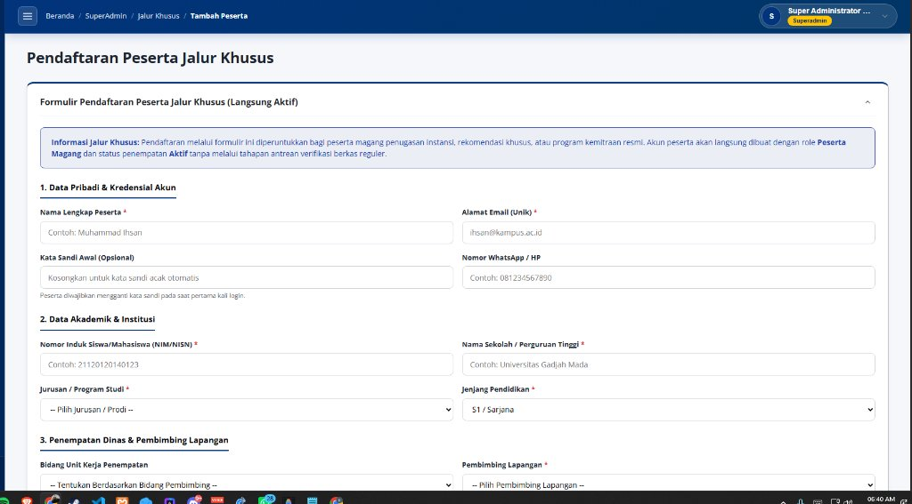
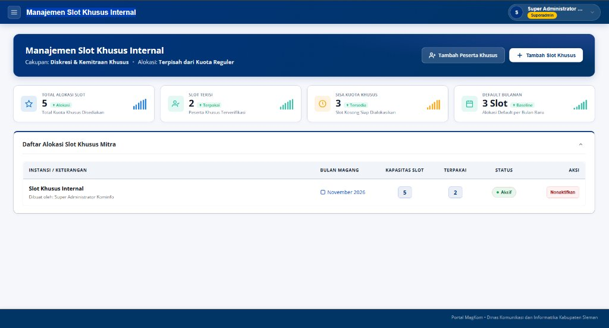

# TASK BRIEF SENIOR DEVELOPER: STANDARISASI FORMULIR PESERTA JALUR KHUSUS & IMPLEMENTASI TABEL DUA-SISI PADA MANAJEMEN SLOT KHUSUS

> **Dari:** Senior Developer / Lead Architect  
> **Kepada:** Junior Developer / AI Agent (Gemini 3.8 Flash / Claude 3.5 Sonnet)  
> **Target Repositori:** MAGKOM (Portal Manajemen Magang Dinas Kominfo Sleman)  
> **Status:** READY FOR IMPLEMENTATION  
> **Tingkat Kesulitan:** Menengah (UI/UX Refinement, Eloquent Eager Loading, Dual-Table Pagination)  
> **Dokumentasi Terkait:** `AGENTS.md`, `docs/07-DESIGN-SYSTEM-MAGKOM.md`, `docs/05-KEAMANAN-RBAC-DAN-AUDIT-TRAIL.md`

---

## 1. 🎯 RINGKASAN MISI (EXECUTIVE SUMMARY)

Setelah standarisasi tampilan **Manajemen Slot Khusus Internal** dan **Manajemen Bulan Magang** berhasil diselesaikan, pengguna menemukan 2 inkonsistensi yang perlu diselesaikan secara tuntas:

1. **Halaman Pendaftaran Peserta Jalur Khusus (`/superadmin/peserta-khusus/create`) Masih Tampil Usang**:
   - Masih merender baris judul putih ganda (`page_title`).
   - Belum memiliki **Hero Banner Khas Sleman MagKom** (`sa-hero-banner`) berwarna biru gradien presisi.
   - Belum memiliki tombol navigasi kembali (`← Kembali ke Slot Khusus`) yang elegan di dalam banner.
   - Belum terhubung dengan stylesheet standar bersama `resources/css/pages/superadmin/superadmin-common.css`.

2. **Halaman Manajemen Slot Khusus Internal (`/superadmin/slot-khusus`) Belum Menampilkan Data Peserta Jalur Khusus**:
   - Kartu statistik menunjukkan **`2 Terpakai`** dari total kuota slot khusus.
   - Namun, halaman hanya memiliki 1 tabel, yaitu **Daftar Alokasi Slot Khusus Mitra** (alokasi kapasitas per bulan).
   - SuperAdmin **tidak dapat melihat siapa nama 2 orang peserta** yang telah didaftarkan dan menempati slot tersebut!
   - Diperlukan implementasi **Tabel Kedua** di bawahnya: **"Daftar Peserta Magang Jalur Khusus"** yang menampilkan rincian peserta (Nama, Email, Institusi/Kampus, NIM, Jurusan, Bidang, Pembimbing, Periode Magang, dan Status).

3. **Kepastian 2 Data Sampel Jalur Khusus di Database**:
   - Memastikan minimal 2 nama peserta magang jalur khusus riil terdaftar di database MySQL dan berelasi dengan tabel `slot_khusus` (misal: *Olivia Tan* dari Politeknik Siber dan Sandi Negara & *Zulfikar Ali* dari Universitas Gadjah Mada).

---

## 2. 📸 BUKTI VISUAL & ANALISIS MASALAH

### Gambar 1: Kondisi Form Pendaftaran Peserta Khusus Saat Ini

*Masalah: Judul putih ganda di atas (`Pendaftaran Peserta Jalur Khusus`), belum ada Hero Banner Sleman MagKom, dan tampilan belum serasi dengan modul lainnya.*

### Gambar 2: Kondisi Halaman Slot Khusus Saat Ini

*Masalah: Indikator "Slot Terisi: 2 Terpakai" sudah muncul di Tile-Stat, namun tabel di bawahnya hanya menampilkan alokasi bulanan. Tidak ada tabel yang memperlihatkan nama dan detail 2 peserta magang tersebut.*

---

## 3. 🏛️ ATURAN ARSITEKTUR & PANDUAN KERJA SENIOR DEVELOPER

Sebelum menulis atau mengubah baris kode apa pun, patuhi instruksi berikut:

1. **JANGAN MERUSAK BUSINESS LOGIC PENEMPATAN (BR-12 & AC-07-3)**:
   - Registrasi peserta khusus tetap menggunakan alur langsung aktif melalui `PlacementService::tempatkanPesertaBaruManual()`.
   - Peserta jalur khusus mendapatkan relasi `slot_khusus_id` dan `jalur = 'khusus'`.
2. **DUAL INDEPENDENT PAGINATION (PENTING!)**:
   - Halaman `/superadmin/slot-khusus` akan memiliki 2 tabel dengan paginasi.
   - Tabel 1 (Alokasi Slot) menggunakan query parameter `slot_page`.
   - Tabel 2 (Peserta Khusus) menggunakan query parameter `peserta_page`.
   - Gunakan `->withQueryString()` atau `->appends(request()->query())` pada kedua link paginasi Blade agar navigasi halaman tabel satu tidak mereset halaman tabel lainnya.
3. **ZERO N+1 QUERY PROBLEM**:
   - Eager-load seluruh relasi yang dibutuhkan pada Tabel 2:
     ```php
     Penempatan::with([
         'peserta.profil.jurusan',
         'pembimbing',
         'bidang',
         'slotKhusus'
     ])
     ```
4. **BLADE STYLING COMPLIANCE**:
   - Jangan menulis tag `<style>` inline di Blade.
   - Gunakan class-class baku yang sudah ada di `resources/css/pages/superadmin/superadmin-common.css`.

---

## 4. 📋 SPESIFIKASI TEKNIS & LANGKAH IMPLEMENTASI

### 🔹 TUGAS 1: Modifikasi Controller `SlotKhususController.php`

**Lokasi File:** `app/Http/Controllers/SuperAdmin/SlotKhususController.php`

**Tujuan:**
Mengambil daftar peserta yang masuk melalui jalur khusus (`slot_khusus_id` tidak null atau `jalur = 'khusus'`) dengan pagination independen (`peserta_page`).

**Kode Implementasi:**
```php
public function index(Request $request): View
{
    // 1. Paginasi Tabel 1: Alokasi Kuota Slot Khusus
    $slotList = SlotKhusus::with('creator')
        ->orderBy('bulan_mulai', 'desc')
        ->paginate(10, ['*'], 'slot_page');

    $defaultSlot = Pengaturan::int('slot_khusus_default', 3);

    $totalAlokasiSlot = (int) SlotKhusus::sum('jumlah');
    $totalSlotTerisi = (int) SlotKhusus::sum('terisi');
    $sisaSlotKhusus = max(0, $totalAlokasiSlot - $totalSlotTerisi);

    // 2. Paginasi Tabel 2: Daftar Peserta Magang Jalur Khusus
    $pesertaKhususList = Penempatan::with([
        'peserta.profil.jurusan',
        'pembimbing',
        'bidang',
        'slotKhusus',
    ])
    ->where(function ($query) {
        $query->whereNotNull('slot_khusus_id')
            ->orWhere('jalur', \App\Enums\JalurEnum::Khusus);
    })
    ->orderBy('tgl_mulai', 'desc')
    ->paginate(10, ['*'], 'peserta_page');

    return view('superadmin.slot-khusus.index', [
        'slotList' => $slotList,
        'defaultSlot' => $defaultSlot,
        'totalAlokasiSlot' => $totalAlokasiSlot,
        'totalSlotTerisi' => $totalSlotTerisi,
        'sisaSlotKhusus' => $sisaSlotKhusus,
        'pesertaKhususList' => $pesertaKhususList,
    ]);
}
```

---

### 🔹 TUGAS 2: Implementasi Tabel Kedua pada `slot-khusus/index.blade.php`

**Lokasi File:** `resources/views/superadmin/slot-khusus/index.blade.php`

**Tujuan:**
Menambahkan panel Gentelella kedua di bawah Tabel Alokasi Kuota yang menampilkan daftar peserta magang jalur khusus dengan atribut visual lengkap.

**Spesifikasi Kolom Tabel Kedua:**
1. **Nama & Akun Peserta**:
   - Nama lengkap peserta (bold, hitam pekat).
   - Email peserta (kecil, warna abu-abu).
   - Badge "Jalur Khusus" / Penugasan Mitra.
2. **Institusi & Akademik**:
   - Nama universitas / politeknik / SMK.
   - NIM / NISN dan Nama Program Studi / Jurusan.
3. **Bidang & Pembimbing**:
   - Unit Kerja / Bidang Dinas (misal: *Aplikasi Informatika*).
   - Nama Pembimbing Lapangan yang ditugaskan.
4. **Periode & Alokasi Slot**:
   - Rentang tanggal magang (`tgl_mulai` s/d `tgl_selesai`).
   - Alokasi bulan slot khusus terkait (`bulan_mulai`).
5. **Status Penempatan**:
   - Badge status: **Aktif** (Hijau), **Selesai** (Biru), atau **Dibatalkan** (Merah).

---

### 🔹 TUGAS 3: Standarisasi Formulir `peserta-khusus/create.blade.php`

**Lokasi File:** `resources/views/superadmin/peserta-khusus/create.blade.php`

**Tujuan:**
Menyelaraskan formulir pendaftaran peserta khusus dengan desain baku portal SuperAdmin MagKom.

**Perubahan yang Wajib Dilakukan:**
1. Ganti `@section('page_title')` menjadi `@section('topbar_title', 'Pendaftaran Peserta Jalur Khusus')`.
2. Tambahkan `@push('styles') @vite(['resources/css/pages/superadmin/superadmin-common.css']) @endpush`.
3. Tambahkan komponen **Hero Banner Khas Sleman MagKom**:
   ```blade
   <div class="sa-hero-banner">
       <div class="banner-top-row">
           <div>
               <h1 class="banner-title">Pendaftaran Peserta Jalur Khusus</h1>
               <div class="banner-subtitle">
                   <span>Cakupan: <strong>Penugasan Instansi &amp; Kemitraan Resmi</strong></span>
                   <span class="bullet-separator">&bull;</span>
                   <span>Status: <strong>Langsung Aktif Penempatan</strong></span>
               </div>
           </div>
           <div class="banner-actions-group">
               <a href="{{ route('superadmin.slot-khusus.index') }}" class="btn-banner-action--secondary">
                   <svg width="18" height="18" viewBox="0 0 24 24" fill="none" stroke="currentColor" stroke-width="2.5" stroke-linecap="round" stroke-linejoin="round">
                       <line x1="19" y1="12" x2="5" y2="12"></line>
                       <polyline points="12 19 5 12 12 5"></polyline>
                   </svg>
                   <span>Kembali ke Slot Khusus</span>
               </a>
           </div>
       </div>
   </div>
   ```

---

### 🔹 TUGAS 4: Verifikasi & Pemastian 2 Data Sampel di Database

**Tujuan:**
Memastikan minimal 2 peserta jalur khusus aktif terdaftar di database MySQL dan terikat ke `slot_khusus_id = 1`.

**Data Sampel Baku:**
1. **Peserta 1**:
   - Nama: **Olivia Tan**
   - Email: `olivia.tan@komdigi.go.id`
   - Institusi: `Politeknik Siber dan Sandi Negara`
   - NIM: `20220199`
   - Slot ID: `1`
   - Status: `aktif`
2. **Peserta 2**:
   - Nama: **Zulfikar Ali**
   - Email: `zulfikar.ali@mail.ugm.ac.id`
   - Institusi: `Universitas Gadjah Mada`
   - NIM: `22/499111/TK/55000`
   - Slot ID: `1`
   - Status: `aktif`

*Catatan: Jika data telah tersedia di database, pastikan relasi `peserta_profil` dan `penempatan` lengkap terisi sehingga tabel langsung merender nama dan instansi tanpa nilai null.*

---

## 5. 🧪 QUALITY GATES & VERIFIKASI AKHIR

Junior Developer / AI Agent wajib menjalankan perintah verifikasi berikut sebelum menyatakan tugas selesai:

1. **Kompilasi Frontend (Vite)**:
   ```powershell
   npm run build
   ```
   *Ekspektasi: 0 error, build sukses dalam < 2 detik.*

2. **Analisis Statis (PHPStan)**:
   ```powershell
   vendor/bin/phpstan analyse app/Http/Controllers/SuperAdmin/SlotKhususController.php app/Http/Controllers/SuperAdmin/PesertaJalurKhususController.php --memory-limit=1G
   ```
   *Ekspektasi: `[OK] No errors`.*

3. **Format Standar Kode (Laravel Pint)**:
   ```powershell
   vendor/bin/pint --test
   ```
   *Ekspektasi: Passed.*

4. **Pengujian Fungsional & Visual (PHPUnit)**:
   ```powershell
   php artisan test tests/Feature/SuperAdminPortalVisualTest.php
   ```
   *Ekspektasi: Seluruh pengujian hijau (Pass), termasuk assert status 200 pada kedua halaman dan assertion tampilan tabel kedua.*

---

## 6. 📝 CHECKLIST DELIVERABLES

- [ ] Dokumen PRD tersimpan di `docs/plans/2026-11-09-senior-dev-task-standarisasi-peserta-khusus-dan-tabel-slot-khusus-prd.md`.
- [ ] Controller `SlotKhususController.php` telah meng-query data `$pesertaKhususList` dengan eager loading.
- [ ] View `slot-khusus/index.blade.php` memiliki 2 panel tabel: Alokasi Kuota Mitra & Daftar Peserta Khusus Aktif.
- [ ] View `peserta-khusus/create.blade.php` memiliki Hero Banner dan tombol kembali.
- [ ] Minimal 2 data peserta khusus terbukti tampil pada Tabel Kedua di browser.
- [ ] Seluruh pengujian fitur dan quality gates lolos 100%.

