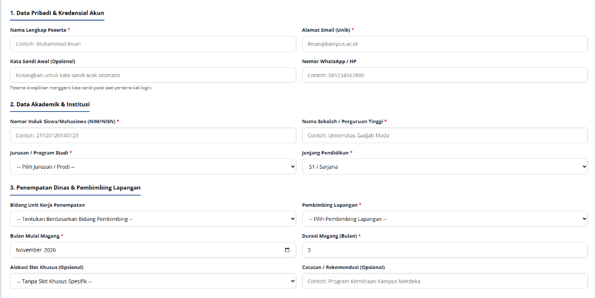
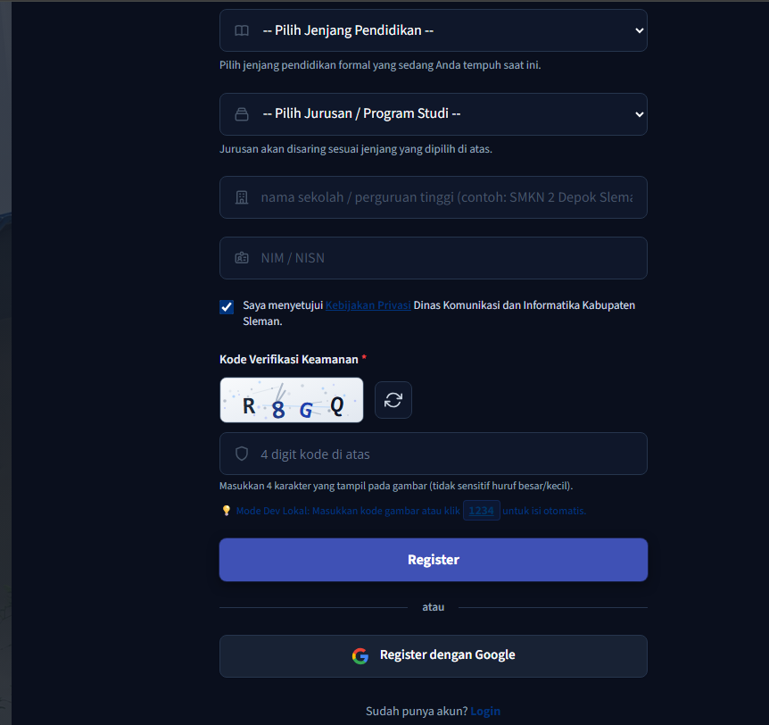

# TASK BRIEF SENIOR DEVELOPER: STANDARISASI PLACEHOLDER EMAIL PESERTA @GMAIL.COM & ELIMINASI TOMBOL GOOGLE PADA HALAMAN REGISTER

> **Dari:** Senior Developer / Lead Architect  
> **Kepada:** Junior Developer / AI Agent (Gemini 3.8 Flash / Antigravity Agent)  
> **Target Repositori:** MAGKOM (Portal Manajemen Magang Dinas Kominfo Sleman)  
> **Status:** READY FOR IMPLEMENTATION  
> **Tingkat Kesulitan:** Rendah – Menengah (UI/UX Refinement, Blade Sanitation, Test Alignment)  
> **Dokumentasi Terkait:** `AGENTS.md`, `docs/01-PRD-MagKom.md` (F-02, F-18), `docs/07-DESIGN-SYSTEM-MAGKOM.md`

---

## 1. 🎯 RINGKASAN MISI (EXECUTIVE SUMMARY)

Dalam rangka menyelaraskan alur autentikasi dan pendaftaran peserta magang di Portal MagKom, terdapat 2 arahan arsitektur utama yang wajib diterapkan:

1. **Standarisasi Contoh Email Peserta Menggunakan `@gmail.com`**:
   - Seluruh contoh (*placeholder*) email peserta di seluruh formulir sistem (mulai dari Pendaftaran Peserta Jalur Khusus di SuperAdmin, Penempatan Manual di Admin, hingga Formulir Registrasi Publik dan Lupa Password) harus distandarisasi menggunakan domain **`@gmail.com`** (misalnya `ihsan.peserta@gmail.com` atau `nama.peserta@gmail.com`).
   - Tidak diperkenankan lagi menggunakan placeholder lama seperti `@kampus.ac.id`, `@sekolah.ac.id`, `@email.com`, atau `example.com` untuk data peserta, karena calon peserta magang nantinya terintegrasi dengan ekosistem login Google.
2. **Pembersihan Halaman Registrasi (Eliminasi Tombol "Register dengan Google")**:
   - Tombol **"Register dengan Google"** pada halaman registrasi publik (`/register`) harus **dihapus**.
   - **Tombol Google OAuth HANYA boleh tersedia pada Halaman Login (`/login`)**.
   - *Alasan Arsitektur:* Pendaftaran awal peserta magang di MagKom membutuhkan kelengkapan data akademik terstruktur (NIM/NISN, nama institusi sekolah/kampus, jenjang, program studi, dan nomor WhatsApp aktif). Registrasi mandiri wajib mengisi form tersebut secara lengkap. Setelah akun terdaftar (atau dibuatkan oleh admin), peserta dapat langsung masuk menggunakan autentikasi akun Google di halaman Login.

---

## 2. 📸 BUKTI VISUAL & ANALISIS PERUBAHAN

### Gambar 1: Formulir Pendaftaran Peserta Khusus (Placeholder Lama Kampus)

*Masalah: Input email pada baris "Alamat Email (Unik) *" saat ini masih menggunakan placeholder `ihsan@kampus.ac.id`. Wajib diubah menjadi `ihsan.peserta@gmail.com`.*

---

### Gambar 2: Halaman Registrasi Peserta (Tombol Google yang Harus Dihapus)

*Masalah: Di bawah tombol "Register" terdapat divider "atau" dan tombol "Register dengan Google". Bagian ini harus dihapus dari halaman Register dan hanya dipertahankan pada halaman Login.*

---

## 3. 🏛️ ATURAN TEKNIS & KEBIJAKAN ARSITEKTUR SENIOR DEVELOPER

Sebelum menulis atau mengedit baris kode apa pun, setiap Junior Developer / AI wajib membaca dan mematuhi panduan repositori `AGENTS.md`:

1. **JANGAN MERUSAK LOGIKA AUTHENTIKASI GOOGLE DI LOGIN**:
   - Tombol Google OAuth di halaman login (`/login`) dan rute backend (`route('oauth.redirect', 'google')` serta `route('oauth.callback', 'google')`) **HARUS TETAP AKTIF DAN BERFUNGSI NORMAL**.
   - Yang dihilangkan **hanya elemen visual tombol Google pada tampilan registrasi (`resources/views/auth/register.blade.php`)**.
2. **ATURAN KETAT BLADE**:
   - Dilarang menambahkan JavaScript di tag `<script>` atau atribut inline seperti `onclick` di Blade.
   - Dilarang menambahkan CSS di tag `<style>` dalam Blade.
   - Modifikasi Blade hanya sebatas pembaruan nilai atribut `placeholder` dan penghapusan markup tombol Google di register.
3. **ZERO BROKEN TESTS**:
   - Setiap kali menghapus elemen visual dari view, periksa apakah ada pengujian otomatis (`tests/Feature/`) yang mengasumsikan keberadaan tombol tersebut.
   - Sesuaikan assertion test agar memverifikasi bahwa tombol Google **tidak muncul lagi di halaman register**, tetapi **tetap ada di halaman login**.

---

## 4. 📋 SPESIFIKASI TUGAS DETAIL (STEP-BY-STEP)

---

### 🔹 TUGAS 1: Standarisasi Placeholder Email Menjadi `@gmail.com`

Junior Developer / AI harus mengubah placeholder email pada file-file berikut:

#### 1.1 Formulir Tambah Peserta Jalur Khusus SuperAdmin
* **Lokasi File:** [`resources/views/superadmin/peserta-khusus/create.blade.php`](file:///g:/MAGKOM/resources/views/superadmin/peserta-khusus/create.blade.php) (Baris 61)
* **Koreksi:**
  ```html
  <!-- SEBELUM: -->
  <input type="email" name="email" value="{{ old('email') }}" required placeholder="ihsan@kampus.ac.id" ...>

  <!-- SESUDAH: -->
  <input type="email" name="email" value="{{ old('email') }}" required placeholder="ihsan.peserta@gmail.com" ...>
  ```

#### 1.2 Formulir Modal Tambah Peserta Penempatan Manual Admin
* **Lokasi File:** [`resources/views/admin/penempatan/index.blade.php`](file:///g:/MAGKOM/resources/views/admin/penempatan/index.blade.php) (Baris 1127)
* **Koreksi:**
  ```html
  <!-- SEBELUM: -->
  <input type="email" name="email" id="input-email-baru" value="{{ old('email') }}" placeholder="email@sekolah.ac.id" ...>

  <!-- SESUDAH: -->
  <input type="email" name="email" id="input-email-baru" value="{{ old('email') }}" placeholder="peserta.magang@gmail.com" ...>
  ```

#### 1.3 Formulir Registrasi Mandiri Publik (Ketua & Anggota Tim)
* **Lokasi File:** [`resources/views/auth/register.blade.php`](file:///g:/MAGKOM/resources/views/auth/register.blade.php)
* **Koreksi Email Utama (Baris 198):**
  ```html
  <!-- SEBELUM: -->
  <input type="email" id="email" name="email" value="{{ old('email') }}" required class="form-input" placeholder="email" ...>

  <!-- SESUDAH: -->
  <input type="email" id="email" name="email" value="{{ old('email') }}" required class="form-input" placeholder="nama.peserta@gmail.com" ...>
  ```
* **Koreksi Email Anggota Kelompok (Baris 309, 333, 357):**
  ```html
  <!-- SEBELUM: -->
  placeholder="Email Aktif *"

  <!-- SESUDAH: -->
  placeholder="anggota.tim@gmail.com *"
  ```

#### 1.4 Formulir Login Publik
* **Lokasi File:** [`resources/views/auth/login.blade.php`](file:///g:/MAGKOM/resources/views/auth/login.blade.php) (Baris 35)
* **Koreksi:**
  ```html
  <!-- SEBELUM: -->
  <input type="email" id="email" name="email" value="{{ old('email') }}" required class="form-input" placeholder="email" ...>

  <!-- SESUDAH: -->
  <input type="email" id="email" name="email" value="{{ old('email') }}" required class="form-input" placeholder="nama.peserta@gmail.com" ...>
  ```

#### 1.5 Formulir Lupa & Reset Kata Sandi
* **Lokasi File 1:** [`resources/views/auth/forgot-password.blade.php`](file:///g:/MAGKOM/resources/views/auth/forgot-password.blade.php) (Baris 43)
  ```html
  <!-- SEBELUM: placeholder="nama@email.com" -->
  <!-- SESUDAH: placeholder="nama.peserta@gmail.com" -->
  ```
* **Lokasi File 2:** [`resources/views/auth/reset-password.blade.php`](file:///g:/MAGKOM/resources/views/auth/reset-password.blade.php) (Baris 44)
  ```html
  <!-- SEBELUM: placeholder="nama@email.com" -->
  <!-- SESUDAH: placeholder="nama.peserta@gmail.com" -->
  ```

---

### 🔹 TUGAS 2: Eliminasi Tombol Google OAuth dari Halaman Register

* **Lokasi File:** [`resources/views/auth/register.blade.php`](file:///g:/MAGKOM/resources/views/auth/register.blade.php) (Baris 527–543)
* **Tindakan:** Hapus blok kode divider dan tombol "Register dengan Google":

```blade
    <!-- HAPUS BLOK KODE BERIKUT DARI resources/views/auth/register.blade.php: -->
    <div class="auth-divider" role="separator" aria-label="Metode pendaftaran alternatif">
        <span>atau</span>
    </div>

    <a href="{{ route('oauth.redirect', 'google') }}" class="btn-google" id="btn-register-google" title="Daftar dengan Google" aria-label="Daftar dengan Google">
        <svg width="20" height="20" viewBox="0 0 24 24" aria-hidden="true">
            <path fill="#4285F4" d="M22.56 12.25c0-.78-.07-1.53-.2-2.25H12v4.26h5.92c-.26 1.37-1.04 2.53-2.21 3.31v2.77h3.57c2.08-1.92 3.28-4.74 3.28-8.09z"/>
            <path fill="#34A853" d="M12 23c2.97 0 5.46-.98 7.28-2.66l-3.57-2.77c-.98.66-2.23 1.06-3.71 1.06-2.86 0-5.29-1.93-6.16-4.53H2.18v2.84C3.99 20.53 7.7 23 12 23z"/>
            <path fill="#FBBC05" d="M5.84 14.09c-.22-.66-.35-1.36-.35-2.09s.13-1.43.35-2.09V7.06H2.18C1.43 8.55 1 10.22 1 12s.43 3.45 1.18 4.94l2.85-2.22.81-.63z"/>
            <path fill="#EA4335" d="M12 5.38c1.62 0 3.06.56 4.21 1.64l3.15-3.15C17.45 2.09 14.97 1 12 1 7.7 1 3.99 3.47 2.18 7.06l3.66 2.84c.87-2.6 3.3-4.52 6.16-4.52z"/>
        </svg>
        <span>Register dengan Google</span>
    </a>
```

* **Verifikasi Halaman Login:**
  - Buka [`resources/views/auth/login.blade.php`](file:///g:/MAGKOM/resources/views/auth/login.blade.php) baris 104–119.
  - Pastikan tombol `<a href="{{ route('oauth.redirect', 'google') }}" class="btn-google" id="btn-login-google">...</a>` **TETAP ADA** dan tidak terhapus.

---

### 🔹 TUGAS 3: Penyesuaian Automated Feature Tests

* **Lokasi File:** [`tests/Feature/ReleaseThreeSocialLoginTest.php`](file:///g:/MAGKOM/tests/Feature/ReleaseThreeSocialLoginTest.php)
* **Koreksi:**
  Pada method `test_register_page_renders_google_register_button()`, perbarui ekspektasi assertion:
  ```php
  public function test_register_page_does_not_render_google_register_button(): void
  {
      $response = $this->get(route('register'));

      $response->assertStatus(200);
      $response->assertDontSee('btn-register-google');
      $response->assertDontSee('Register dengan Google');
  }
  ```
  Dan pastikan method `test_login_page_renders_google_login_button()` tetap memverifikasi bahwa tombol Google login **hadir (PASS)** di halaman `/login`.

---

## 5. 🧪 STRATEGI TESTING & QUALITY GATES

Jalankan perintah pengujian wajib menggunakan runtime PHP 8.3 aktual pada terminal:

1. **Uji Otomatis Social Login & Registrasi**:
   ```powershell
   & "F:\laragon\bin\php\php-8.3.28-Win32-vs16-x64\php.exe" artisan test tests/Feature/ReleaseThreeSocialLoginTest.php
   ```
2. **Uji Otomatis Registrasi Mandiri & Fitur Khusus**:
   ```powershell
   & "F:\laragon\bin\php\php-8.3.28-Win32-vs16-x64\php.exe" artisan test tests/Feature/SuperAdminPesertaKhususCredentialCopyTest.php tests/Feature/RegistrationTest.php
   ```
3. **Pemeriksaan Analisis Statis (PHPStan)**:
   ```powershell
   & "F:\laragon\bin\php\php-8.3.28-Win32-vs16-x64\php.exe" vendor/bin/phpstan analyse --memory-limit=1G
   ```
4. **Pemeriksaan Format Kode (Pint)**:
   ```powershell
   & "F:\laragon\bin\php\php-8.3.28-Win32-vs16-x64\php.exe" vendor/bin/pint --test
   ```
5. **Kompilasi Aset Frontend (Vite)**:
   ```powershell
   npm run build
   ```

---

## 6. 📦 CHECKLIST VERIFIKASI AKHIR (DEFINITION OF DONE)

- [x] Seluruh placeholder input email peserta di `superadmin/peserta-khusus/create.blade.php`, `admin/penempatan/index.blade.php`, `auth/register.blade.php`, `auth/login.blade.php`, `auth/forgot-password.blade.php`, dan `auth/reset-password.blade.php` telah menggunakan domain `@gmail.com`.
- [x] Tombol "Register dengan Google" dan divider pemisah "atau" pada `auth/register.blade.php` telah dihapus secara bersih.
- [x] Tombol "Login dengan Google" pada `auth/login.blade.php` tetap dipertahankan dan berfungsi 100%.
- [x] Test otomatis pada `ReleaseThreeSocialLoginTest.php` disesuaikan dan lolos pengujian (PASS).
- [x] Linter Pint dan PHPStan tidak mengeluarkan error.
- [x] Kompilasi `npm run build` sukses tanpa kendala.

