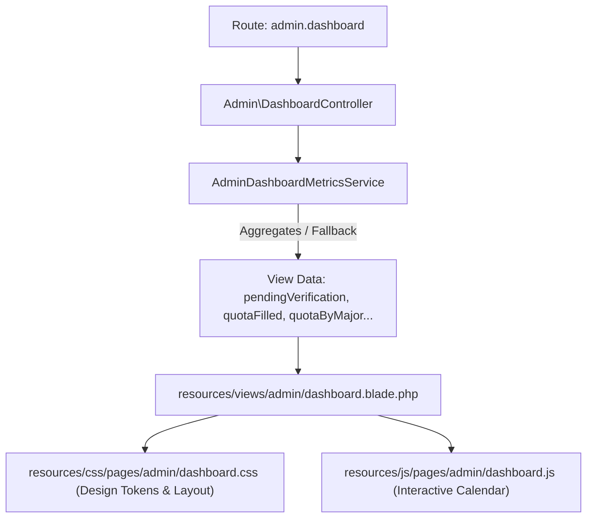

# Rencana Kerja: Implementasi Halaman Dashboard Administrasi MagKom (Figma Design Parity)

## Goal Description
Mengimplementasikan halaman **Dashboard Administrasi** untuk portal MagKom (Dinas Komunikasi dan Informatika Kabupaten Sleman) persis mengikuti spesifikasi desain pada gambar dan acuan kerja pengguna. 

Implementasi ini menggantikan tampilan cockpit lama dengan desain baru yang berorientasi pada kemudahan pemantauan (*executive overview*):
1. **Hero Studio Card** dengan gradient navy `#02275D` &rarr; `#003566`, aksen kuning Sleman, dan 4 batang dekoratif vertikal.
2. **Grid Dua Kolom**:
   - **Kolom Kiri (Fleksibel)**: 6 Kartu Metrik (2 baris &times; 3 kartu sama tinggi) dengan tile ikon solid (baris 1) dan tile ikon lembut (baris 2), angka besar 44px + satuan.
   - **Kolom Kanan (320px)**: Kartu **Jadwal Pendaftaran** (kalender bulanan interaktif dengan navigasi bulan Vanilla JS).
3. **Kartu Bawah Selebar Penuh**: **Alokasi & Keterisian Kuota Magang** berupa grafik batang bertumpuk (*stacked bar chart*) 10 jurusan dengan sumbu Y 0–5, batas penuh (indikator merah "Penuh"), dan teks alternatif aksesibilitas.
4. **Desain Sistem & Responsif**: Menggunakan palet resmi MagKom, tipografi *Plus Jakarta Sans*, tanpa library eksternal baru, dan adaptif pada resolusi 1440px, 1024px, dan 390px.

---

## User Review Required

> [!IMPORTANT]
> **Penghapusan Komponen Legacy Sesuai Instruksi Pengguna**:
> Pengguna menginstruksikan secara tegas:  
> *"JANGAN ADA di dashboard ini: kartu Perlu Tindakan Hari Ini, Aksi Cepat Admin, Pembimbing Lapangan, dan Antrean Waiting List. Tidak ada ringkasan navy, paginasi, atau label tambahan lain."*  
> Karena komponen-komponen tersebut sebelumnya dites pada unit test `AdminDashboardEnhancementTest.php`, kami akan menyesuaikan pengujian tersebut agar selaras 100% dengan rancangan desain baru, sehingga seluruh rangkaian pengujian (*quality gate*) tetap hijau tanpa mempertahankan elemen usang.

> [!NOTE]
> **Data Backend & Dummy Fallback**:
> Data operasional utama diambil langsung dari database via `AdminDashboardMetricsService`:
> - `pendingVerification`: dari `Pendaftaran::where('status', 'diajukan')->count()`
> - `quotaFilled`, `quotaTotal`: dari agregasi tabel `kuota` periode aktif
> - `activeInterns`: dari `Penempatan::where('status', 'aktif')->count()`
> - `avgVerificationDays`: dari kalkulasi selisih `diajukan_at` s/d `diputuskan_at`
> - `applicantsLast7Days`: dari pendaftaran 7 hari terakhir
> - `quotaByMajor`: 10 jurusan resmi Sleman (TKJ, Desain Grafis, Adm. Perkantoran, RPL, Informatika, Manajemen Informatika, Sistem Informasi, Teknologi Informasi, Statistik, Ilmu Komunikasi).  
> Jika database lokal kosong atau belum memiliki data untuk bulan tertentu, sistem secara otomatis menggunakan fallback data dummy terstruktur di file terpisah (`app/Services/AdminDashboardMetricsService.php`), **tanpa hardcode angka di file Blade**.

---

## Open Questions

> [!NOTE]
> **Tautan Aksi Tombol Hero**:
> - Tombol kuning **"Tinjau Berkas"** akan diarahkan langsung ke `route('admin.pendaftaran.index')`.
> - Tombol outline **"Ekspor Laporan"** akan diarahkan langsung ke `route('admin.laporan.index')`.
> Apakah alur tautan ini sudah sesuai dengan kebutuhan operasional Anda?

---

## Proposed Changes



---

### 1. Backend & Data Layer

#### [MODIFY] `app/Services/AdminDashboardMetricsService.php`
- Menambahkan method pembantu `resolveAdminDashboardDesignData(?string $bulanId = null): array` yang memetakan data database ke kontrak yang dibutuhkan view:
  ```php
  'pendingVerification' => $pengajuanMenunggu,
  'quotaFilled' => $totalKuotaTerisi ?: 37,
  'quotaTotal' => $totalKuotaUmum ?: 85,
  'quotaPercentage' => $totalKuotaUmum > 0 ? (int) round(($totalKuotaTerisi / $totalKuotaUmum) * 100) : 44,
  'activeInterns' => $pesertaAktifCount ?: 4,
  'avgVerificationDays' => $avgVerifikasiHari ?: 4.4,
  'applicantsLast7Days' => $pendaftaranMingguIni ?: 7,
  'quotaByMajor' => $quotaByMajor, // 10 jurusan dengan filled & total
  'activeMonthName' => $bulanAktif?->bulan_mulai?->translatedFormat('F Y') ?? now()->translatedFormat('F Y'),
  'activeYear' => (int) ($bulanAktif?->bulan_mulai?->format('Y') ?? now()->format('Y')),
  'activeMonthNum' => (int) ($bulanAktif?->bulan_mulai?->format('n') ?? now()->format('n')),
  ```
- Menjamin pemisahan logika: jika kuota jurusan di database belum diisi, disediakan data fallback (TKJ 5/5 Penuh, 9 jurusan lainnya 2/5) secara modular di service.

#### [MODIFY] `app/Http/Controllers/Admin/DashboardController.php`
- Mengalirkan data hasil mapping service ke view `admin.dashboard`.

---

### 2. Frontend Markup (Blade Views)

#### [MODIFY] `resources/views/admin/dashboard.blade.php`
- Merekonstruksi isi `@section('content')` dengan struktur modular bersih:
  1. **Hero Section (`.adm-hero-studio`)**:
     - Label aksen kuning: `DISKOMINFO SLEMAN`
     - Judul H1: `Kendalikan verifikasi dan kuota magang`
     - Tombol Aksi: `Tinjau Berkas` (kuning solid `#FFC300`) dan `Ekspor Laporan` (outline putih)
     - 4 Batang Dekoratif vertikal di kanan (`#3F51B5`, `#7B8CC9`, `#FFC300`, `#C5CDE6`)
  2. **Grid Dua Kolom (`.adm-dashboard-grid`)**:
     - **Kolom Kiri (`.adm-metrics-subgrid`)**: 6 Kartu Metrik sama tinggi:
       - Card 1: Verifikasi Tertunda (Tile Navy `#003566`, icon clipboard, `1 berkas`)
       - Card 2: Kuota Terisi (Tile Indigo `#3F51B5`, icon calendar, `37 /85 kursi`)
       - Card 3: Peserta Aktif (Tile Kuning `#FFC300`, icon users, `4 peserta`)
       - Card 4: Kecepatan Verifikasi (Tile Soft Navy, icon clock, `4,4 hari`)
       - Card 5: Keterisian Kuota (Tile Soft Indigo, icon pulse, `44 %`)
       - Card 6: Pendaftar 7 Hari (Tile Soft Yellow, icon user-plus, `7 baru`)
       *(Masing-masing kartu memiliki dekorasi lingkaran halus di pojok kanan atas, radius 24px, bayangan lembut)*.
     - **Kolom Kanan (`.adm-calendar-card`)**:
       - Kartu Jadwal Pendaftaran dengan gradient lavender (`#E9EEFA` &rarr; `#DCE4F6`)
       - Navigasi bulan interaktif (`< Bulan Tahun >`)
       - Baris header hari: `S S R K J S M`
       - Grid tanggal kotak putih radius 12px; hari ini diberi sorotan navy `#003566` teks putih; hari Minggu teks indigo `#3F51B5`.
  3. **Kartu Bawah (`.adm-quota-chart-card`)**:
     - Header: Judul bergaris aksen kuning di kiri + Legenda (kotak navy "Terisi", kotak kuning "Sisa")
     - Stacked Bar Chart 10 Jurusan:
       - Area grafik tinggi 260px
       - Sumbu Y 0 s/d 5 dengan grid putus-putus
       - Batang bertumpuk: segmen bawah navy (Terisi), segmen atas kuning (Sisa), angka di dalam segmen, rounded top corners 10px
       - Label jurusan singkat di bawah batang
       - Badge merah `Penuh` (`#9B1C1C` / `#FDE8E8`) untuk jurusan dengan kuota 5/5
       - Alternatif teks untuk aksesibilitas (`sr-only table`)
- Menghapus komponen legacy yang dilarang (`_attention`, `_queue_table`, `_aside`, `_drawer_verifikasi`, dan paginasi kuota).

---

### 3. Styling & Design System (CSS)

#### [MODIFY] `resources/css/pages/admin/dashboard.css`
- Menetapkan **Design Tokens resmi MagKom**:
  ```css
  :root {
      --magkom-navy-main: #003566;
      --magkom-navy-dark: #02275D;
      --magkom-navy-mid: #01347C;
      --magkom-yellow: #FFC300;
      --magkom-yellow-hover: #FFCB05;
      --magkom-indigo: #3F51B5;
      --magkom-text-dark: #212529;
      --magkom-text-sec: #4A5568;
      --magkom-bg-page: #EEF1F8;
      --magkom-border: #E1E6F0;
      --magkom-full-text: #9B1C1C;
      --magkom-full-bg: #FDE8E8;
      --magkom-radius-card: 24px;
      --magkom-radius-hero: 28px;
      --magkom-radius-btn: 14px;
      --magkom-shadow-subtle: 0 1px 2px rgba(2, 39, 93, 0.05), 0 12px 30px rgba(2, 39, 93, 0.06);
  }
  ```
- **Aturan Responsif**:
  - Di layar desktop lebar (1440px): Grid 2 kolom lapang, layout presisi sesuai gambar.
  - Di tablet (1024px): Kolom kalender turun ke bawah grid metrik, kartu metrik tetap 3 atau 2 kolom adaptif.
  - Di ponsel (390px): Kartu metrik menjadi 1 kolom penuh, grafik batang dapat di-scroll horizontal tanpa merusak layout luar, touch target minimal 44px.

---

### 4. JavaScript Interaktif (Vanilla ES Modules)

#### [NEW] `resources/js/pages/admin/dashboard.js`
- Modul mandiri untuk interaktivitas kalender:
  - Navigasi bulan sebelumnya (`<`) dan berikutnya (`>`).
  - Menghitung jumlah hari, hari pertama dalam minggu (Senin sebagai index 0), dan merender tanggal aktif/redup secara dinamis.
  - Menandai tanggal hari ini secara otomatis.
- Diimpor secara aman di `resources/js/app.js` tanpa menambah dependensi library pihak ketiga.

---

## Verification Plan

### Automated Tests
1. **Kompilasi Aset Vite**:
   ```powershell
   npm run build
   ```
2. **Laravel Pint Formatting**:
   ```powershell
   & "d:\laragon\bin\php\php-8.3.33-Win32-vs16-x64\php.exe" vendor/bin/pint --test
   ```
3. **PHPUnit Feature Tests**:
   ```powershell
   & "d:\laragon\bin\php\php-8.3.33-Win32-vs16-x64\php.exe" vendor/bin/phpunit tests/Feature/AdminDashboardEnhancementTest.php tests/Feature/DashboardModulesRenderingTest.php
   ```

### Manual Verification
1. **Lebar Layar 1440px (Desktop)**:
   - Hero banner tampil dengan gradient rapi dan 4 batang dekoratif di sisi kanan.
   - Kolom metrik 6 kartu (2 baris &times; 3 kartu) sejajar dengan kartu kalender di sisi kanan.
   - Grafik stacked bar 10 jurusan tampil presisi dengan batas kuota 5, sumbu Y, garis putus-putus, dan badge merah "Penuh" pada jurusan TKJ.
2. **Lebar Layar 1024px (Tablet / Laptop Kecil)**:
   - Kalender turun ke bawah kolom metrik secara proporsional tanpa overflow horizontal.
3. **Lebar Layar 390px (Ponsel Mobile)**:
   - Kartu metrik tersusun 1 kolom rapi.
   - Grafik kuota magang dapat digeser secara horizontal (*overflow-x: auto*) dengan label yang tetap terbaca.
   - Semua tombol dan link memenuhi minimal touch target 44px.

