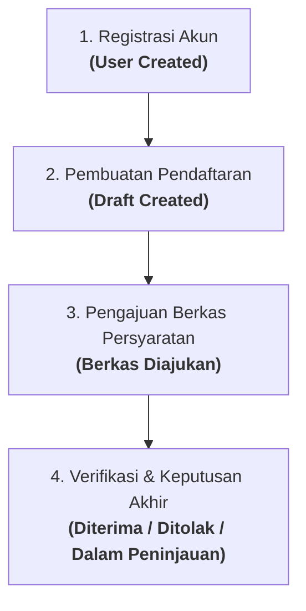

# Rencana Kerja: Pemisahan Data Cardlet Informasi Peserta & Rekonstruksi Logika Timeline

**Tanggal:** 10 November 2026  
**Status:** Menunggu Persetujuan Pengguna  
**Referensi File:**  
- Blade View: [`resources/views/admin/pendaftaran/show.blade.php`](file:///d:/laragon/www/MAGKOM/resources/views/admin/pendaftaran/show.blade.php)  
- Stylesheet: [`resources/css/pages/admin/pendaftaran-show.css`](file:///d:/laragon/www/MAGKOM/resources/css/pages/admin/pendaftaran-show.css)  

---

## 1. Analisis & Tanggapan Senior Developer

### A. Evaluasi Poin 1: Pemisahan Data yang Sebelumnya Digabung
> *"jangan di jadiin satu dong contoh, di tampilan yang saya ss ini kan 4 chart kan, nah itu kan ada yang di satuin jadi jangan di satuin jadi saran aku di pisah contoh: asal instansi sendiri, program studi sendiri,gmail sendiri wa sendiri bulan sendiri kuota sendiri, menurutmu gmn seorang senior developer"*

**Pandangan Senior Developer & UI/UX Dashboard Enterprise:**
Saran Anda **100% tepat dan sangat cerdas secara kaidah UX**.
- *Masalah Desain Lama*: Menggabungkan dua jenis data dalam satu kotak (seperti Instansi + Prodi di satu cell, atau Email + WA di satu cell) memaksa mata verifikator membaca secara bertingkat (*hierarchical scanning*) dan meningkatkan beban kognitif (*cognitive load*).
- *Solusi Modern (Atomic Data Cells)*: Setiap data pokok dipecah menjadi **1 entitas mandiri (atomic cardlet)**:
  1. **Asal Instansi**: Mandiri (contoh: *Universitas Negeri Yogyakarta*)
  2. **Program Studi / Jurusan**: Mandiri (contoh: *Manajemen Informatika*)
  3. **Nomor Induk (NIM / NISN)**: Mandiri & dinamis (SMK $\rightarrow$ NISN, Kuliah $\rightarrow$ NIM)
  4. **Periode Bulan Magang**: Mandiri (contoh: *Desember 2026*)
  5. **Email Akun Peserta**: Mandiri (contoh: *galangcs@gmail.com*)
  6. **Kontak WhatsApp**: Mandiri (contoh: *08976543221*)
  7. **Status Sisa Kuota Bidang**: Mandiri (contoh: *Tersedia 3 Kursi*)
- *Hasil Visual*: Tata letak grid 2 kolom menjadi padat, simetris, seragam, dan verifikator dapat melakukan verifikasi silang data dalam hitungan detik.

---

### B. Evaluasi Poin 2: Penamaan Judul Card
> *"dan untuk penamaan buatkan yg tepat dong masa iya 'Rangkuman Calon Peserta' aneh ga si"*

**Analisis Linguistik & Terminologi Sistem Informasi:**
- Kritik Anda sangat tepat. Kata *"Rangkuman"* diartikan sebagai ikhtisar/resume teks panjang, bukan kumpulan atribut data identitas dan akademik.
- **Opsi Penamaan Standar Enterprise & Pemerintahan:**
  - **Rekomendasi Utama**: **`Data Calon Peserta`** (Lugas, bersih, dan formal).
  - Alternatif 1: **`Informasi Calon Peserta`**
  - Alternatif 2: **`Profil & Biodata Peserta`**
- Kita akan mengganti judul card menjadi **`Data Calon Peserta`**.

---

### C. Evaluasi Poin 3: Alur Logika Rekam Jejak (Timeline)
> *"ss ke dua mungkin bisa di buat yg detail lagi, logikanya sistem gmn? kan awalnya regris dulu kan trs daftar trs pengajuan berkas yaa nggga?"*

**Analisis Alur Sistem (System Lifecycle Logic):**
Logika Anda **sangat akurat**. Siklus hidup pendaftaran di portal MagKom memang berjalan terstruktur dalam urutan berikut:



Saat ini timeline menampilkan data secara terbalik (*reverse chronological*) dan melompati tahapan "Pendaftaran Dibuat". Agar alur runtut dan mudah dipahami, kita sajikan **Alur Kronologis Progresif (Langkah 1 $\rightarrow$ 2 $\rightarrow$ 3 $\rightarrow$ 4)** dari atas ke bawah:

1. **Langkah 1: Registrasi Akun Peserta**
   - Waktu: `user->created_at`
   - Keterangan: Akun peserta berhasil didaftarkan di portal MagKom.
2. **Langkah 2: Pembuatan Formulir Pendaftaran**
   - Waktu: `pendaftaran->created_at`
   - Keterangan: Calon peserta memilih periode magang dan membuat draf pengajuan.
3. **Langkah 3: Pengajuan Berkas Persyaratan**
   - Waktu: `pendaftaran->diajukan_at` (atau *"Belum Diajukan"* jika berkas belum lengkap).
   - Keterangan: Berkas persyaratan resmi dikirimkan ke sistem untuk diverifikasi.
4. **Langkah 4: Keputusan Verifikasi Berkas**
   - Waktu: `pendaftaran->diputuskan_at` (atau waktu pembaruan terkini).
   - Keterangan: Status resmi putusan verifikator (*Diterima*, *Ditolak*, atau *Sedang Ditinjau Verifikator*).
   - Dot indikator aktif (hijau menyala) berada di tahap terakhir yang sedang berjalan!

---

## 2. Wireframe Visual Desain Baru

```text
========================================================================================================
[AVATAR]  gopal is king                                                            Waktu Pengajuan:
          #REG-00007                                                               Belum Diajukan
                                                                                   [Kembali ke Verifikasi]
========================================================================================================
KOLOM KIRI (~57% Lebar Layar)                          KOLOM KANAN (~43% Lebar Layar)
+--------------------------------------------------+  +--------------------------------------------------+
| Card 1: Kelompok: gopalo                         |  | Card 1: Keputusan Verifikasi                     |
| [Tabel: Peran | Nama Peserta | NISN | Kontak WA] |  | - Status Kuota: Tersedia (4 Kursi)               |
+--------------------------------------------------+  | - Tab Switcher: Terima / Tolak                   |
| Card 2: Verifikasi Berkas Calon Peserta          |  | - Upload Surat Keterangan Diterima (PDF)         |
| - Daftar Berkas / Status Unggah                  |  | - Catatan Penerimaan & Tombol Keputusan          |
+--------------------------------------------------+  +--------------------------------------------------+
| Card 3: Data Calon Peserta                       |  | Card 2: Rekam Jejak Pendaftaran [Ikon Jam/Riwayat|
|                                                  |  |                                                  |
| +-----------------------+----------------------+ |  |  (●) 1. Registrasi Akun                          |
| | ASAL INSTANSI         | PROGRAM STUDI        | |  |      06 Nov 2026, 21:05                          |
| | Univ. Negeri Ygykrta  | Manajemen Informatika| |  |   |                                              |
| +-----------------------+----------------------+ |  |  (●) 2. Pembuatan Pendaftaran                    |
| | NISN (atau NIM)       | PERIODE BULAN MAGANG | |  |      06 Nov 2026, 21:10                          |
| | 24.02.7689            | Desember 2026        | |  |   |                                              |
| +-----------------------+----------------------+ |  |  (●) 3. Pengajuan Berkas                         |
| | EMAIL CALON PESERTA   | KONTAK WHATSAPP      | |  |      06 Nov 2026, 21:16                          |
| | galangcs@gmail.com    | 08976543221          | |  |   |                                              |
| +-----------------------+----------------------+ |  |  (●) 4. Keputusan Verifikasi [Aktif Hijau]       |
| | SISA KUOTA BIDANG     |                      | |  |      08 Nov 2026, 17:44 (Diterima)               |
| | Tersedia sisa 3 kursi |                      | |  |                                                  |
| +-----------------------+----------------------+ |  +--------------------------------------------------+
+--------------------------------------------------+
========================================================================================================
```

---

## 3. Rincian Perubahan Teknis

### File 1: `resources/views/admin/pendaftaran/show.blade.php`
1. **Pembaruan Card Data Calon Peserta**:
   - Ganti judul panel: `title="Data Calon Peserta"`.
   - Ubah isi `<dl class="adm-biodata-grid-2col">` menjadi 6/7 cardlet mandiri yang terpisah:
     1. `ASAL INSTANSI`: `$profil?->institusi`
     2. `PROGRAM STUDI`: `$profil?->jurusan?->nama_jurusan`
     3. `{{ $labelNomorInduk }}` (NIM atau NISN): `$profil?->nim_nisn`
     4. `PERIODE BULAN MAGANG`: `$pendaftaran->bulanMagang?->bulan_mulai?->translatedFormat('F Y')`
     5. `EMAIL PESERTA`: `$user?->email`
     6. `KONTAK WHATSAPP`: `$profil?->no_hp`
     7. `SISA KUOTA BIDANG`: `$sisaKuota > 0 ? "Tersedia {$sisaKuota} kursi" : "Kuota Penuh"`
2. **Pembaruan Timeline Rekam Jejak Pendaftaran**:
   - Merekonstruksi urutan timeline menjadi alur kronologis alami (Registrasi $\rightarrow$ Draf Dibuat $\rightarrow$ Pengajuan Berkas $\rightarrow$ Keputusan Verifikasi).
   - Menambahkan status keputusan verifikasi resmi jika sudah diputuskan (`$pendaftaran->diputuskan_at`), atau status *"Menunggu Peninjauan Verifikator"* jika belum diputuskan.

### File 2: `resources/css/pages/admin/pendaftaran-show.css`
- Menyesuaikan styling `.adm-biodata-card-item` agar seragam dan rapi saat menampilkan 6–7 atomic cells.
- Memperhalus visual milestone timeline (garis konektor vertikal yang menyambungkan 4 tahap dengan status aktif/selesai).

---

## 4. Rencana Verifikasi & Quality Gates

1. **Vite Production Build**: `npm run build`
2. **Feature Tests Terkait**:
   `& "d:\laragon\bin\php\php-8.3.33-Win32-vs16-x64\php.exe" vendor/bin/phpunit tests/Feature/PendaftaranPesertaTest.php tests/Feature/AdminDuplicateNimDetectionTest.php tests/Feature/AdminSuperAdminPortalTest.php`
3. **Laravel Pint**:
   `& "d:\laragon\bin\php\php-8.3.33-Win32-vs16-x64\php.exe" vendor/bin/pint --test resources/views/admin/pendaftaran/show.blade.php`
4. **Full Test Suite (750 Tests)**:
   `& "d:\laragon\bin\php\php-8.3.33-Win32-vs16-x64\php.exe" vendor/bin/phpunit`

