# 📋 SENIOR DEVELOPER TECHNICAL DIRECTIVE & PRD
## Task: Audit & Perbaikan Anomali Spacing Layout Masif (100vh Dead Space Offset) pada Dashboard & Sub-Modul SuperAdmin

- **Author**: Senior Lead Developer (Antigravity Architecture Team)
- **Assignee**: Junior Developer / AI Model (Gemini 3.8 Flash / Autonomous Developer)
- **Target File**: [`resources/views/layouts/dashboard.blade.php`](file:///g:/MAGKOM/resources/views/layouts/dashboard.blade.php)
- **Status Dokumen**: Siap Ditinjau & Disetujui (Draft Plan)
- **Tanggal**: 10 November 2026
- **Klasifikasi Masalah**: Critical Layout Regression / DOM Tree Hierarchy Mismatch

---

## 🎯 1. Ringkasan Eksekutif (TL;DR 60 Detik)

| Parameter | Keterangan Teknis |
|---|---|
| **Gejala Masalah** | Konten halaman di bawah topbar tampak terdorong sangat jauh ke bawah (~720px / 100vh). Pada Dashboard SuperAdmin muncul blok biru pekat raksasa kosong (`#0A2A6A`), sedangkan pada halaman Profil dan Pengaturan Akun muncul ruang kosong abu-abu/putih raksasa sebelum kartu profil muncul di bagian bawah layar. |
| **Akar Masalah (RCA)** | Terdapat **1 tag penutup `</div>` ekstra (rogue closing tag)** pada baris 3827 di [`resources/views/layouts/dashboard.blade.php`](file:///g:/MAGKOM/resources/views/layouts/dashboard.blade.php). Hal ini menyebabkan `.main_container dashboard-container` tertutup secara prematur sebelum elemen `<main>` dibuka. Akibatnya, elemen `<main>` terlempar keluar dari `.main_container` dan terdorong ke `y = 720px` (persis di bawah container `.main_container` yang memiliki `min-height: 100vh`). |
| **Skala Dampak** | Karena [`resources/views/layouts/dashboard.blade.php`](file:///g:/MAGKOM/resources/views/layouts/dashboard.blade.php) adalah **Master Layout** bersama, regresi layout ini berdampak pada **seluruh peran** (SuperAdmin, Pembimbing, Admin, Peserta) di setiap halaman yang meng-`@extends('layouts.dashboard')`. |
| **Solusi yang Dibutuhkan** | Hapus **1 tag penutup `</div>` berlebih** pada baris 3827 di [`resources/views/layouts/dashboard.blade.php`](file:///g:/MAGKOM/resources/views/layouts/dashboard.blade.php). Tidak perlu mengubah file CSS dan tidak perlu menyentuh file Blade lain. |
| **Estimasi Waktu Eksekusi** | < 2 menit (Single-line surgical deletion + `view:clear` + automated test). |

---

## 🔍 2. Hasil Audit Menyeluruh Seluruh Halaman Terdampak

Berdasarkan audit komprehensif pada DOM Tree dan perhitungan Bounding Client Rect (`getBoundingClientRect()`), berikut adalah daftar seluruh modul yang mengalami anomali spacing:

### 2.1 Modul SuperAdmin
| No | Rute / Halaman | URL | Posisi Awal `<main>` (Kondisi Rusak) | Posisi Seharusnya (Kondisi Normal) | Dampak Visual pada Layar Pengguna |
|---|---|---|---|---|---|
| 1 | **Dashboard SuperAdmin** | `/superadmin/dashboard` | `top: 720px` (100vh) | `top: 64px` | Layar pertama berisi kanvas biru tua kosong pekat (`#0A2A6A`). Bento & hero banner terdorong ke bawah lipatan layar (*below the fold*). |
| 2 | **Biodata & Profil SuperAdmin** | `/superadmin/profil` | `top: 720px` (100vh) | `top: 64px` | Header topbar di atas, lalu dead space putih/abu-abu raksasa 720px, kartu profil baru muncul saat di-scroll ke bawah. |
| 3 | **Pengaturan Akun & Sandi** | `/superadmin/akun` | `top: 720px` (100vh) | `top: 64px` | Hero banner "Akun & Preferensi Saya" terdorong ke `y = 720px`, menyisakan ruang kosong besar di bawah topbar. |
| 4 | **Manajemen Staf Internal** | `/superadmin/staf` | `top: 720px` (100vh) | `top: 64px` | Hero banner dan tile statistik terdorong ke bawah 1 layar penuh. |
| 5 | **Hak Akses & Role** | `/superadmin/role` | `top: 720px` (100vh) | `top: 64px` | Tabel matrik permission terdorong ke bawah 1 layar penuh. |
| 6 | **Periode Magang** | `/superadmin/bulan` | `top: 720px` (100vh) | `top: 64px` | Kalender dan kuota bulanan terdorong ke bawah. |
| 7 | **Alokasi Slot Khusus** | `/superadmin/slot-khusus` | `top: 720px` (100vh) | `top: 64px` | Tabel alokasi terdorong ke bawah. |
| 8 | **Master Jurusan & Unit Kerja** | `/superadmin/jurusan`, `/superadmin/bidang` | `top: 720px` (100vh) | `top: 64px` | Panel CRUD terdorong ke bawah. |
| 9 | **Audit Log & Telemetri** | `/superadmin/audit-log`, `/superadmin/status` | `top: 720px` (100vh) | `top: 64px` | Feed audit log terdorong ke bawah. |

### 2.2 Modul Pembimbing, Admin, dan Peserta
| Peran | Halaman | Posisi Awal `<main>` (Kondisi Rusak) | Posisi Normal | Catatan Audit |
|---|---|---|---|---|
| **Pembimbing** | Dashboard, Profil, Pengaturan, Logbook, Nilai | `top: 720px` (100vh) | `top: 64px` | Mengalami dead space kosong abu-abu terang setinggi layar karena mewarisi master layout yang sama. |
| **Admin** | Dashboard, Verifikasi Berkas, Kuota, Penempatan | `top: 720px` (100vh) | `top: 64px` | Terpengaruh identik. |
| **Peserta** | Dashboard, Biodata Profil, Pendaftaran, Logbook | `top: 720px` (100vh) | `top: 64px` | Terpengaruh identik. |

---

## 🔬 3. Deep Root-Cause Analysis (RCA)

Mengapa anomali ini terjadi secara teknis? Mari kita bedah struktur hierarki HTML pada master layout:

### 3.1 Diagram Pohon DOM: Kondisi Rusak vs Kondisi Benar

```mermaid
graph TD
    subgraph KONDISI_RUSAK ["❌ Kondisi Rusak Saat Ini (Terdapat Extra </div> di Baris 3827)"]
        B1["div.container.body"]
        B1 --> MC1["div.main_container (min-height: 100vh)"]
        MC1 --> SB1["aside#mainSidebar (position: fixed)"]
        MC1 --> TN1["div.top_nav (height: 64px)"]
        TN1 --> HD1["header.nav_menu"]
        HD1 --> TR1["div.topbar-right"]
        TR1 --> UD1["div#userDropdown"]
        UD1 --> C1["</div> menutup #userDropdown (baris 3827)"]
        TR1 --> C2["</div> menutup .topbar-right (baris 3828)"]
        TN1 --> C3["</div> menutup .top_nav prematur! (baris 3829)"]
        MC1 --> C4["</div> menutup .main_container prematur! (baris 3831)"]
        B1 --> M1["main.right_col (TERLEM PAR KELUAR DARI .main_container!)"]
        M1 --> POS1["Posisi: y = 720px (di bawah container 100vh)"]
    end

    subgraph KONDISI_BENAR ["✅ Kondisi Benar (Setelah Menghapus 1 </div> Ekstra)"]
        B2["div.container.body"]
        B2 --> MC2["div.main_container (Flex Column)"]
        MC2 --> SB2["aside#mainSidebar (position: fixed)"]
        MC2 --> TN2["1. div.top_nav (height: 64px)"]
        TN2 --> HD2["header.nav_menu"]
        HD2 --> TR2["div.topbar-right"]
        TR2 --> UD2["div#userDropdown"]
        UD2 --> C5["</div> menutup #userDropdown"]
        TR2 --> C6["</div> menutup .topbar-right"]
        HD2 --> C7["</header> menutup header"]
        TN2 --> C8["</div> menutup .top_nav"]
        MC2 --> M2["2. main.right_col (Direct Child dari .main_container!)"]
        M2 --> POS2["Posisi: y = 64px (TEPAT di bawah topbar, 0 dead space!)"]
        MC2 --> FT2["3. footer.gentelella-footer"]
    end
```



### 3.2 Penjelasan Mekanika CSS & Browser Rendering
1. Pada file CSS master layout ([`resources/views/layouts/dashboard.blade.php#L2202`](file:///g:/MAGKOM/resources/views/layouts/dashboard.blade.php#L2202)):
   ```css
   .main_container {
       display: flex;
       flex-direction: column;
       min-height: 100vh;
       position: relative;
       width: 100%;
   }
   ```
2. Pada file CSS SuperAdmin ([`resources/css/pages/superadmin/dashboard.css#L14-L16`](file:///g:/MAGKOM/resources/css/pages/superadmin/dashboard.css#L14-L16)):
   ```css
   body.role-superadmin .main_container {
       background-color: var(--navy-800, #0A2A6A);
   }
   ```
3. Ketika `.main_container` ditutup di baris 3831, browser menganggap seluruh konten `.main_container` telah selesai (hanya berisi Sidebar fixed dan Topbar setinggi 64px). Namun karena `.main_container` memiliki `min-height: 100vh`, ia merentangkan dirinya memenuhi 100% tinggi layar monitor (`height: 720px` atau `1080px`) dan mewarnainya dengan warna `#0A2A6A` (biru pekat SuperAdmin).
4. Elemen `<main>` yang baru dimulai di baris 3834 kemudian diletakkan oleh browser di **bawah** `.main_container` (pada koordinat `top: 720px`). Inilah alasan mengapa pengguna melihat blok kosong raksasa dan mengira ada "spacing sangat jauh".

---

## 🛠️ 4. Rencana Kerja Eksekusi (Step-by-Step Action Plan)

> **PANDUAN UNTUK JUNIOR DEV / AI EXECUTOR:**  
> Ikuti instruksi ini secara harfiah. Jangan mengubah baris kode lain di luar instruksi ini!

### Task 1: Hapus 1 Tag Penutup `</div>` Ekstra di Master Layout
- **File Target**: [`resources/views/layouts/dashboard.blade.php`](file:///g:/MAGKOM/resources/views/layouts/dashboard.blade.php)
- **Baris Target**: Sekitar baris 3825–3832
- **Tindakan**: Hapus satu baris `</div>` tepat di bawah `</form>` form logout.

#### Draf Perubahan (Diff):
```diff
                         <!-- Form Logout Resmi POST -->
                         <form method="POST" action="{{ route('logout') }}" style="margin: 0;">
                             @csrf
                             <button type="submit" class="dropdown-item-btn logout-action" role="menuitem">
                                 <svg width="16" height="16" fill="none" stroke="currentColor" stroke-width="2" viewBox="0 0 24 24">
                                     <path stroke-linecap="round" stroke-linejoin="round" d="M17 16l4-4m0 0l-4-4m4 4H7m6 4v1a3 3 0 01-3 3H6a3 3 0 01-3-3V7a3 3 0 013-3h4a3 3 0 013 3v1"></path>
                                 </svg>
                                 <span>{{ __('Keluar Akun') }}</span>
                             </button>
                         </form>
-                        </div>
                     </div>
                 </div>
             </header>
         </div>

         <!-- Container Konten Dinamis (Gentelella right_col) -->
             <main class="right_col dashboard-main dashboard-content-area {{ $isSuperAdmin ? 'gentelella-fluid-canvas' : '' }} @yield('content_area_class')" role="main" id="mainContent">
```

> **Verifikasi Penutupan Tag Setelah Task 1:**
> - `</div>` baris pertama: Menutup `<div id="userDropdown">` (baris 3685).
> - `</div>` baris kedua: Menutup `<div class="topbar-right">` (baris 3664).
> - `</header>`: Menutup `<header class="nav_menu dashboard-topbar">` (baris 3632).
> - `</div>`: Menutup `<div class="top_nav dashboard-topbar-wrapper">` (baris 3631).
> - `<main>` berada di dalam `<div class="main_container dashboard-container">` sebagai saudara kandung (*sibling*) langsung dari `.top_nav`.

---

### Task 2: Pembersihan Cache View & Cache Konfigurasi Laravel
Jalankan perintah berikut di terminal:
```powershell
C:\Users\galan\php83\php.exe artisan view:clear
C:\Users\galan\php83\php.exe artisan config:clear
```

---

### Task 3: Verifikasi Visual & Validasi Bounding Rect (Quality Gates)
Jalankan pengujian Playwright atau skrip PHP inspeksi untuk memastikan:
1. `document.querySelector('main').parentElement.className` bernilai `"main_container dashboard-container"`.
2. `document.querySelector('main').getBoundingClientRect().top` bernilai persis **64px** (tidak lagi 720px atau 100vh).
3. `document.querySelector('.sa-hero-banner').getBoundingClientRect().top` bernilai **72px–88px** (posisi normal dengan padding canvas 24px).
4. Pada halaman `/superadmin/profil`, kartu profil `.profil-main-card` berada di koordinat `top: 88px` (bukan 720px).
5. Pada halaman `/superadmin/akun`, kartu hero banner berada di koordinat `top: 88px` (bukan 720px).

---

## 🚫 5. Aturan Do's & Don'ts (Batas Kerja Senior Developer)

| ✅ DO'S (Yang WAJIB Dilakukan) | ❌ DON'TS (Yang DILARANG Keras) |
|---|---|
| Hanya hapus 1 tag penutup `</div>` di file [`resources/views/layouts/dashboard.blade.php`](file:///g:/MAGKOM/resources/views/layouts/dashboard.blade.php). | **JANGAN** mengubah file CSS apa pun (`dashboard.css`, `gentelella.css`, `profil-show.css`, dll.) karena CSS sudah 100% benar. |
| Jalankan `php artisan view:clear` segera setelah pengeditan agar compiled Blade view di `storage/framework/views` diperbarui. | **JANGAN** menambahkan inline style `<style>` atau inline script `<script>` di Blade. |
| Jalankan verifikasi automated test (`DashboardLayoutTest`, `StaffProfileAndSettingsTest`). | **JANGAN** mengubah markup form atau elemen di luar area penutup dropdown yang ditargetkan. |
| Jalankan Laravel Pint (`vendor/bin/pint --dirty --test`) untuk memastikan formatting kode tetap bersih dan lolos standar PSR-12. | **JANGAN** membuat file Blade baru atau entry point Vite baru. |

---

## 🧪 6. Kriteria Penerimaan (Acceptance Criteria / DoD)

- [ ] **AC-1 (Zero Dead Space)**: Di layar desktop (resolusi 1280x720, 1920x1080), konten utama (`<main>`) dimulai tepat di `y = 64px` (di bawah garis batas topbar). Tidak ada lagi blok biru kosong setinggi layar monitor.
- [ ] **AC-2 (DOM Hierarchy Integrity)**: Elemen `<main>` menjadi *direct child* dari `<div class="main_container dashboard-container">`.
- [ ] **AC-3 (Multi-Role Consistency)**: Halaman Dashboard, Biodata & Profil, dan Pengaturan Akun di seluruh peran (SuperAdmin, Pembimbing, Admin, Peserta) tampil normal, simetris, dan proporsional tanpa spasi vertikal aneh.
- [ ] **AC-4 (PHPUnit Suite Pass)**: Semua test terkait layout dan autentikasi staff lolos 100% green:
  ```powershell
  C:\Users\galan\php83\php.exe artisan test --filter=DashboardLayoutTest
  C:\Users\galan\php83\php.exe artisan test --filter=StaffProfileAndSettingsTest
  ```
- [ ] **AC-5 (Pint Formatting)**: Pint clean tanpa pelanggaran formatting:
  ```powershell
  ./vendor/bin/pint --dirty --test
  ```

