# 📋 SENIOR DEVELOPER TECHNICAL DIRECTIVE & PRD
## Task: Standardisasi Layout Rata Kanan-Kiri (100% Fluid Edge-to-Edge) pada Halaman Biodata & Profil serta Sub-Modul SuperAdmin

- **Author**: Senior Lead Developer (Antigravity Architecture Team)
- **Assignee**: Junior Developer / AI Model (Gemini 3.8 Flash / Autonomous Developer)
- **Target Subsystem**: Master Styling Profil & Sub-Modul SuperAdmin / Pembimbing
- **Status Dokumen**: Siap Ditinjau & Disetujui (Draft Plan)
- **Tanggal**: 11 November 2026
- **Klasifikasi Masalah**: UI/UX Layout Standardization / Boxed Container to Fluid Full-Width

---

## 🎯 1. Ringkasan Eksekutif (TL;DR 60 Detik)

| Parameter | Keterangan Teknis |
|---|---|
| **Gejala Masalah** | Pada halaman **Biodata & Profil Super Administrator** (`/superadmin/profil`), kartu konten utama terlihat "terjepit" di tengah layar (*boxed container*) dengan ruang kosong putih/abu-abu yang lebar di sisi kiri dan kanan (~200px di layar 1080p). Tampilan ini tidak konsisten dengan halaman Dashboard SuperAdmin, Data Staf, dan sub-modul lain yang sudah membentang penuh rata kanan-kiri (*100% fluid edge-to-edge*). |
| **Akar Masalah (RCA)** | File stylesheet [`resources/css/pages/superadmin/profil-show.css`](file:///g:/MAGKOM/resources/css/pages/superadmin/profil-show.css) pada kelas `.profil-page-wrapper` masih mengunci ukuran menggunakan `max-width: 1200px; margin: 0 auto;`. Pada monitor beresolusi 1080p (lebar canvas 1675px), aturan ini memaksa kartu konten hanya selebar 1200px dan menempatkan sisa ruang `(1675 - 1200) / 2 = 237.5px` sebagai dead space di kiri dan kanan kartu. |
| **Sasaran Akhir (Target State)** | Halaman Profil SuperAdmin (dan Pembimbing) membentang penuh rata kanan-kiri dari batas canvas (`padding: 24px 28px` / `1.75rem 2.5rem`) dengan `max-width: 100%; width: 100%; margin: 0;`, identik dengan standar fluid layout MagKom pada modul Staf, Role, dan Admin Profil. |
| **File Target** | 1. [`resources/css/pages/superadmin/profil-show.css`](file:///g:/MAGKOM/resources/css/pages/superadmin/profil-show.css)<br>2. [`resources/css/pages/pembimbing/profil-show.css`](file:///g:/MAGKOM/resources/css/pages/pembimbing/profil-show.css)<br>3. [`resources/views/superadmin/landing/index.blade.php`](file:///g:/MAGKOM/resources/views/superadmin/landing/index.blade.php) (Pembersihan inline `max-width: 1080px;`)<br>4. [`resources/views/superadmin/peserta-khusus/create.blade.php`](file:///g:/MAGKOM/resources/views/superadmin/peserta-khusus/create.blade.php) (Pembersihan inline `max-width: 980px;`) |

---

## 🔍 2. Hasil Audit Menyeluruh: Boxed Container vs Fluid Full-Width

Berdasarkan audit komprehensif pada seluruh stylesheet dan view antarmuka MagKom:

### 2.1 Audit Halaman yang Masih Terkunci Boxed Container
| No | Modul / Halaman | File Sumber | Kode Penyebab Boxed | Status Saat Ini | Status Target |
|---|---|---|---|---|---|
| 1 | **Biodata & Profil SuperAdmin** | [`resources/css/pages/superadmin/profil-show.css`](file:///g:/MAGKOM/resources/css/pages/superadmin/profil-show.css#L8-L15) | `.profil-page-wrapper { max-width: 1200px; margin: 0 auto; }` | ❌ Boxed (Dead space 200–300px kiri & kanan) | ✅ 100% Fluid Rata Kanan-Kiri |
| 2 | **Biodata & Profil Pembimbing** | [`resources/css/pages/pembimbing/profil-show.css`](file:///g:/MAGKOM/resources/css/pages/pembimbing/profil-show.css#L8-L15) | `.profil-page-wrapper { max-width: 1200px; margin: 0 auto; }` | ❌ Boxed (Dead space 200–300px kiri & kanan) | ✅ 100% Fluid Rata Kanan-Kiri |
| 3 | **Site Canvas Editor (Landing)** | [`resources/views/superadmin/landing/index.blade.php`](file:///g:/MAGKOM/resources/views/superadmin/landing/index.blade.php#L20) | Inline style `max-width: 1080px; margin: 0 auto;` | ❌ Boxed | ✅ 100% Fluid Rata Kanan-Kiri |
| 4 | **Pendaftaran Peserta Khusus** | [`resources/views/superadmin/peserta-khusus/create.blade.php`](file:///g:/MAGKOM/resources/views/superadmin/peserta-khusus/create.blade.php#L19) | Inline style `max-width: 980px; margin: 0 auto;` | ❌ Boxed | ✅ 100% Fluid Rata Kanan-Kiri |

### 2.2 Audit Halaman Acuan yang SUDAH Sempurna Rata Kanan-Kiri (The Standard)
| Modul / Halaman | File Sumber | Spesifikasi Lebar Konten | Kondisi Visual |
|---|---|---|---|
| **Dashboard SuperAdmin** | `resources/css/pages/superadmin/dashboard.css` | `.sa-dash { width: 100%; max-width: 100%; margin: 0; }` | 100% Fluid Rata Kanan-Kiri Sempurna |
| **Profil Staf Administrasi (Admin)** | `resources/css/pages/admin/profil-show.css` | `.admin-profil-wrapper { width: 100%; } .admin-profil-main-card { width: 100%; max-width: 100%; }` | 100% Fluid Rata Kanan-Kiri Sempurna |
| **Manajemen Staf, Role, Bulan, Jurusan** | `resources/css/layouts/gentelella.css` | `.sa-fluid-container { width: 100% !important; max-width: 100% !important; margin: 0 !important; }` | 100% Fluid Rata Kanan-Kiri Sempurna |
| **Pengaturan Akun (Seluruh Peran)** | `resources/css/components/pengaturan-akun.css` | `.pengaturan-akun-page { width: 100%; }` | 100% Fluid Rata Kanan-Kiri Sempurna |

---

## 🔬 3. Deep Root-Cause Analysis (RCA)

```mermaid
graph TD
    subgraph KONDISI_BOXED ["❌ Kondisi Boxed Saat Ini (max-width: 1200px)"]
        W1["Viewport Desktop 1920x1080"]
        W1 --> M1["main.right_col (Lebar: 1675px)"]
        M1 --> PW1[".profil-page-wrapper (Terkunci: max-width 1200px, margin: 0 auto)"]
        PW1 --> DS1["Dead space kiri: 237.5px | Konten: 1200px | Dead space kanan: 237.5px"]
    end

    subgraph KONDISI_FLUID ["✅ Kondisi Fluid Rata Kanan-Kiri (max-width: 100%)"]
        W2["Viewport Desktop 1920x1080"]
        W2 --> M2["main.right_col (Lebar: 1675px)"]
        M2 --> PW2[".profil-page-wrapper (width: 100%, max-width: 100%, margin: 0)"]
        PW2 --> FL2["Konten membentang 1595px (dengan padding canvas simetris)"]
        FL2 --> OK2["Dampak: Tampilan Elegan, Rata Kanan-Kiri, Proporsional"]
    end
```



---

## 🛠️ 4. Rencana Kerja Eksekusi (Step-by-Step Action Plan)

> **PANDUAN UNTUK JUNIOR DEV / AI EXECUTOR:**  
> Ikuti instruksi ini secara bertahap dan teratur.

### Task 1: Ubah CSS Wrapper & Card Profil SuperAdmin menjadi Fluid
- **File Target**: [`resources/css/pages/superadmin/profil-show.css`](file:///g:/MAGKOM/resources/css/pages/superadmin/profil-show.css)
- **Baris Target**: Baris 8–29
- **Instruksi**:
  Ganti `max-width: 1200px; margin: 0 auto;` menjadi `max-width: 100%; margin: 0;` dan pastikan `.profil-main-card` memiliki `max-width: 100%;`.

#### Draf Perubahan (Diff):
```diff
 /* Outer Page Wrapper */
 .profil-page-wrapper {
     background-color: transparent;
     width: 100%;
-    max-width: 1200px;
-    margin: 0 auto;
+    max-width: 100%;
+    margin: 0;
     padding: 0 0 32px 0;
     box-sizing: border-box;
 }
 
 /* Main Fluid Card Container (Single-Card Modern) */
 .profil-main-card {
     width: 100%;
+    max-width: 100%;
     background: #ffffff;
     border: 1px solid #E2E8F0;
     border-radius: 16px;
     box-shadow: 0 1px 3px rgba(15, 23, 42, 0.05);
     padding: 28px 32px;
     box-sizing: border-box;
     display: flex;
     flex-direction: column;
     gap: 20px;
 }
```

---

### Task 2: Selaraskan CSS Wrapper & Card Profil Pembimbing (Paritas 1:1)
- **File Target**: [`resources/css/pages/pembimbing/profil-show.css`](file:///g:/MAGKOM/resources/css/pages/pembimbing/profil-show.css)
- **Baris Target**: Baris 8–29
- **Instruksi**:
  Terapkan penyesuaian yang identik agar modul Pembimbing tetap sejalan (*parity*).

#### Draf Perubahan (Diff):
```diff
 /* Outer Page Wrapper */
 .profil-page-wrapper {
     background-color: transparent;
     width: 100%;
-    max-width: 1200px;
-    margin: 0 auto;
+    max-width: 100%;
+    margin: 0;
     padding: 0 0 32px 0;
     box-sizing: border-box;
 }
 
 /* Main Fluid Card Container (Single-Card Modern) */
 .profil-main-card {
     width: 100%;
+    max-width: 100%;
     background: #ffffff;
     border: 1px solid #E2E8F0;
     border-radius: 16px;
```

---

### Task 3: Pembersihan Inline `max-width` pada Sub-Modul SuperAdmin
- **File 1 Target**: [`resources/views/superadmin/landing/index.blade.php`](file:///g:/MAGKOM/resources/views/superadmin/landing/index.blade.php) (Baris 20)
  ```diff
  - <div class="sa-fluid-container" style="display: flex; flex-direction: column; gap: 1.5rem; max-width: 1080px; margin: 0 auto; width: 100%;">
  + <div class="sa-fluid-container" style="display: flex; flex-direction: column; gap: 1.5rem; width: 100%;">
  ```
- **File 2 Target**: [`resources/views/superadmin/peserta-khusus/create.blade.php`](file:///g:/MAGKOM/resources/views/superadmin/peserta-khusus/create.blade.php) (Baris 19)
  ```diff
  - <div class="sa-fluid-container" style="display: flex; flex-direction: column; gap: 1.5rem; max-width: 980px; margin: 0 auto; width: 100%;">
  + <div class="sa-fluid-container" style="display: flex; flex-direction: column; gap: 1.5rem; width: 100%;">
  ```

---

### Task 4: Rebuild Aset Vite & Verifikasi Quality Gates
Jalankan perintah berikut:
```powershell
npm run build
C:\Users\galan\php83\php.exe artisan view:clear
C:\Users\galan\php83\php.exe artisan test --filter=StaffProfileAndSettingsTest
C:\Users\galan\php83\php.exe vendor/bin/pint --dirty --test
```

---

## 🚫 5. Aturan Do's & Don'ts

| ✅ DO'S (Wajib Dilakukan) | ❌ DON'TS (Dilarang Keras) |
|---|---|
| Mengubah CSS hanya di `resources/css/pages/superadmin/profil-show.css` dan `resources/css/pages/pembimbing/profil-show.css`. | **JANGAN** menulis inline CSS `<style>` di dalam file Blade. |
| Mempertahankan seluruh token warna, padding kartu, border-radius, dan font existing. | **JANGAN** merombak arsitektur kartu, ID form, atau nama input field. |
| Menjalankan `npm run build` dan memverifikasi hasil kompilasi. | **JANGAN** mengubah logika backend, controller, atau request validation. |

---

## 🧪 6. Kriteria Penerimaan (Acceptance Criteria / DoD)

- [ ] **AC-1 (Fluid Edge-to-Edge)**: Pada halaman `/superadmin/profil`, kartu profil (`.profil-main-card`) membentang rata kanan-kiri memenuhi canvas (`width: 100%`) dengan padding simetris tanpa sisa margin 200px di samping kiri/kanan.
- [ ] **AC-2 (Role Parity)**: Halaman `/pembimbing/profil` juga tampil rata kanan-kiri secara identik.
- [ ] **AC-3 (Sub-Modul Alignment)**: Tidak ada lagi sub-modul SuperAdmin yang terjepit oleh inline `max-width`.
- [ ] **AC-4 (Zero Visual Regression)**: Elemen internal kartu (Hero Navy banner, checklist KPI, form input 2 kolom, dan tombol submit) merentang secara proporsional dan responsif di resolusi mobile maupun ultrawide.
- [ ] **AC-5 (Quality Gates Pass)**: `npm run build` sukses, `StaffProfileAndSettingsTest` lulus 100% green, dan Pint formatting lulus.

