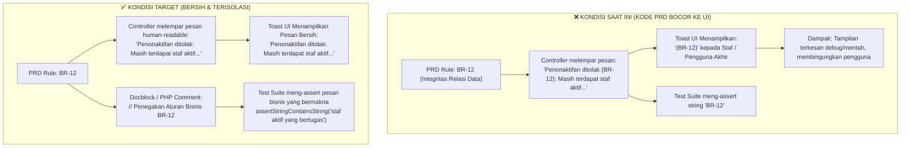

# 📋 SENIOR DEVELOPER TECHNICAL DIRECTIVE & IMPLEMENTATION PLAN
## Task: Eliminasi Kebocoran Kode PRD (`(BR-XX)`, `(SEC-XX)`, `(AC-XX)`) pada Notifikasi Toast, Pesan Validasi, dan Antarmuka Pengguna MagKom

- **Author**: Senior Lead Developer (Antigravity Architecture Team)
- **Assignee**: Junior Developer / AI Model (Gemini 3.8 Flash / Autonomous Developer)
- **Target Subsystem**: Notification System, Flash Session Messages, Form Requests, Dashboard Views, & Automated Test Suite
- **Status Dokumen**: Selesai & Terverifikasi Penuh (Implemented & Verified 100%)
- **Tanggal**: 11 November 2026
- **Klasifikasi Masalah**: UI/UX Quality Polish, Production Sanitization & Test Suite Harmonization

---

## 🎯 1. Ringkasan Eksekutif (TL;DR 60 Detik untuk Junior Dev & AI)

| Parameter | Keterangan Teknis |
|---|---|
| **Gejala Masalah** | Pengguna menemukan bahwa notifikasi toast dan pesan kesalahan sistem menampilkan kode identifikasi spesifikasi internal dari PRD (*Product Requirements Document*), seperti contoh nyata pada tangkapan layar:<br>`Terjadi Kesalahan: Penonaktifan ditolak (BR-12): Masih terdapat staf aktif yang bertugas di bidang dinas ini.`<br>Teks `(BR-12):`, `(SEC-16):`, `(AC-04-5)` adalah kode teknis aturan bisnis internal yang tidak layak ditampilkan kepada pengguna akhir (Kepala Dinas, Admin Kominfo, Pembimbing, dan Peserta). |
| **Akar Masalah (RCA)** | Pada fase awal pengembangan (Fase 1–4), tim developer menyematkan identifier PRD ke dalam string runtime pesan pengecualian dan session flash untuk mempermudah penelusuran manual (*traceability*) saat pengujian. Namun, string tersebut langsung diteruskan ke session flash (`with('error', ...)`), respons JSON, dan pesan validasi `FormRequest`, sehingga bocor ke UI produksi. |
| **Prinsip Arsitektur (The Golden Rule)** | **Kode PRD (`BR-*`, `SEC-*`, `AC-*`, `F-*`) HANYA boleh berada di:**<br>1. Komentar kode PHP / docblock internal (`// Penegakan Aturan Bisnis BR-12`).<br>2. Nama metode pengujian PHPUnit (`public function test_penonaktifan_bidang_sesuai_br12()`).<br>3. Dokumen spesifikasi teknis di folder `docs/`.<br><br>**DILARANG KERAS berada di:**<br>1. Session flash (`with('error', ...)`, `with('success', ...)`).<br>2. Respons JSON API / AJAX toast (`'message' => '...'`).<br>3. Pesan validasi formulir (`FormRequest::messages()`).<br>4. Elemen antarmuka Blade yang dirender ke browser. |
| **Peringatan Kritis (Test Suite Risk)** | ⚠️ **JANGAN langsung menghapus kode PRD tanpa membaca Bagian 5 dokumen ini!**<br>Sebagian suite pengujian otomatis (`tests/Feature/AdminSuperAdmin*.php`) melakukan assertion langsung terhadap keberadaan string `'BR-12'` atau `'(AC-04-5)'`. Jika controller diubah tanpa memperbarui assertion test secara tersinkronisasi, test CI akan langsung gagal (*failing test*). |
| **File Target Eksekusi** | **Backend (7 File)**:<br>- `app/Http/Controllers/SuperAdmin/BidangController.php`<br>- `app/Http/Controllers/SuperAdmin/BulanController.php`<br>- `app/Http/Controllers/SuperAdmin/JurusanController.php`<br>- `app/Http/Controllers/SuperAdmin/SlotKhususController.php`<br>- `app/Http/Controllers/SuperAdmin/StafController.php`<br>- `app/Http/Controllers/Admin/PendaftaranController.php`<br>- `app/Actions/Admin/Kuota/ToggleKuotaAction.php`<br>**Form Requests (5 File)**:<br>- `app/Http/Requests/KeputusanPendaftaranRequest.php`<br>- `app/Http/Requests/KuotaRequest.php`<br>- `app/Http/Requests/LogbookRequest.php`<br>- `app/Http/Requests/ReviewProgresRequest.php`<br>- `app/Http/Requests/TugasRequest.php`<br>**Views Blade (4 File)**:<br>- `resources/views/admin/dashboard/partials/_attention.blade.php`<br>- `resources/views/admin/dashboard/partials/_drawer_verifikasi.blade.php`<br>- `resources/views/pembimbing/dashboard/partials/_modal_review_logbook.blade.php`<br>- `resources/views/pembimbing/dashboard/partials/_tab_evaluasi.blade.php`<br>**Test Suite (3 File)**:<br>- `tests/Feature/AdminSuperAdminArchitectureAndSecurityTest.php`<br>- `tests/Feature/AdminSuperAdminPhaseThreeTest.php`<br>- `tests/Feature/AdminSuperAdminPhaseTwoTest.php` |

---

## 🔍 2. Hasil Audit Komprehensif: Inventaris String Bocor vs Target Bersih

Berikut adalah seluruh temuan string kode PRD yang tampil ke pengguna beserta string pengganti yang profesional dan ramah pengguna (*user-friendly*):

### 2.1 Backend Controllers & Actions (Toast & Flash Session Error)

| No | File Sumber & Baris | String Saat Ini (Bocor PRD) | String Target (Bersih & Profesional) |
|---|---|---|---|
| 1 | `app/Http/Controllers/SuperAdmin/BidangController.php:118` | `'Penonaktifan ditolak (BR-12): Masih terdapat staf aktif yang bertugas di bidang dinas ini.'` | `'Penonaktifan ditolak: Masih terdapat staf aktif yang bertugas di bidang dinas ini.'` |
| 2 | `app/Http/Controllers/SuperAdmin/BidangController.php:125` | `'Penonaktifan ditolak (BR-12): Masih terdapat peserta magang aktif yang ditempatkan di bidang dinas ini.'` | `'Penonaktifan ditolak: Masih terdapat peserta magang aktif yang ditempatkan di bidang dinas ini.'` |
| 3 | `app/Http/Controllers/SuperAdmin/BulanController.php:104` | `'Penonaktifan ditolak (BR-12): Periode bulan magang masih memiliki pendaftaran aktif.'` | `'Penonaktifan ditolak: Periode bulan magang masih memiliki pendaftaran aktif.'` |
| 4 | `app/Http/Controllers/SuperAdmin/BulanController.php:115` | `'Penonaktifan ditolak (BR-12): Periode bulan magang masih memiliki penempatan peserta aktif.'` | `'Penonaktifan ditolak: Periode bulan magang masih memiliki penempatan peserta aktif.'` |
| 5 | `app/Http/Controllers/SuperAdmin/JurusanController.php:127` | `'Penonaktifan ditolak (BR-12): Masih terdapat alokasi kuota aktif untuk jurusan ini.'` | `'Penonaktifan ditolak: Masih terdapat alokasi kuota aktif untuk jurusan ini.'` |
| 6 | `app/Http/Controllers/SuperAdmin/JurusanController.php:145` | `'Penonaktifan ditolak (BR-12): Masih terdapat pendaftaran aktif pada jurusan ini.'` | `'Penonaktifan ditolak: Masih terdapat pendaftaran aktif pada jurusan ini.'` |
| 7 | `app/Http/Controllers/SuperAdmin/JurusanController.php:154` | `'Penonaktifan ditolak (BR-12): Masih terdapat peserta magang aktif pada jurusan ini.'` | `'Penonaktifan ditolak: Masih terdapat peserta magang aktif pada jurusan ini.'` |
| 8 | `app/Http/Controllers/SuperAdmin/SlotKhususController.php:113` | `'Penonaktifan ditolak (BR-12): Masih terdapat peserta magang aktif pada slot khusus ini.'` | `'Penonaktifan ditolak: Masih terdapat peserta magang aktif pada slot khusus ini.'` |
| 9 | `app/Http/Controllers/SuperAdmin/StafController.php:265` | `'Penonaktifan ditolak (SEC-16): Sistem harus memiliki minimal satu akun SuperAdmin aktif.'` | `'Penonaktifan ditolak: Sistem harus memiliki minimal satu akun SuperAdmin aktif.'` |
| 10 | `app/Http/Controllers/SuperAdmin/StafController.php:279` | `'Penonaktifan ditolak (BR-12): Pembimbing masih memiliki penempatan peserta aktif. Pindahkan penempatan terlebih dahulu.'` | `'Penonaktifan ditolak: Pembimbing masih memiliki penempatan peserta aktif. Pindahkan penempatan terlebih dahulu.'` |
| 11 | `app/Http/Controllers/SuperAdmin/StafController.php:287` | `'Penonaktifan ditolak (BR-12): Tidak dapat menonaktifkan satu-satunya pembimbing aktif dalam sistem.'` | `'Penonaktifan ditolak: Tidak dapat menonaktifkan satu-satunya pembimbing aktif dalam sistem.'` |
| 12 | `app/Http/Controllers/SuperAdmin/StafController.php:351` | `"Kata sandi sementara untuk staf {$staf->nama} berhasil dibuat: [ {$tempPassword} ]. Harap salin dan serahkan secara manual (BR-15)."` | `"Kata sandi sementara untuk staf {$staf->nama} berhasil dibuat: [ {$tempPassword} ]. Harap salin dan serahkan secara manual kepada staf terkait."` |
| 13 | `app/Actions/Admin/Kuota/ToggleKuotaAction.php:49` | `'Penonaktifan ditolak (BR-12, AC-05-6): Kuota jurusan masih memiliki pendaftaran aktif.'` | `'Penonaktifan ditolak: Kuota jurusan masih memiliki pendaftaran aktif.'` |
| 14 | `app/Actions/Admin/Kuota/ToggleKuotaAction.php:61` | `'Penonaktifan ditolak (BR-12, AC-05-6): Kuota jurusan masih memiliki penempatan peserta aktif.'` | `'Penonaktifan ditolak: Kuota jurusan masih memiliki penempatan peserta aktif.'` |
| 15 | `app/Http/Controllers/Admin/PendaftaranController.php:88` | `'Status pendaftaran sudah berubah, muat ulang halaman (AC-04-5).'` | `'Status pendaftaran sudah berubah, silakan muat ulang halaman.'` |

---

### 2.2 Form Requests (Pesan Validasi Form Pengguna)

| No | File Sumber & Baris | String Saat Ini (Bocor PRD) | String Target (Bersih & Profesional) |
|---|---|---|---|
| 16 | `app/Http/Requests/KeputusanPendaftaranRequest.php:55` | `'Alasan penolakan minimal berisi 10 karakter sesuai standar verifikasi (AC-04-3).'` | `'Alasan penolakan minimal berisi 10 karakter sesuai standar verifikasi.'` |
| 17 | `app/Http/Requests/KuotaRequest.php:89` | `"Total alokasi kuota umum untuk bulan ini ({$totalSetelahInput}) melebihi batas maksimum yang ditetapkan ({$maksPerBulan} peserta) sesuai aturan instansi (BR-01, AC-05-2)."` | `"Total alokasi kuota umum untuk bulan ini ({$totalSetelahInput}) melebihi batas maksimum yang ditetapkan ({$maksPerBulan} peserta) sesuai aturan instansi."` |
| 18 | `app/Http/Requests/LogbookRequest.php:71` | `'Tanggal kegiatan sudah melebihi batas toleransi pengisian logbook mundur (BR-09).'` | `'Tanggal kegiatan sudah melebihi batas toleransi pengisian logbook mundur.'` |
| 19 | `app/Http/Requests/ReviewProgresRequest.php:36` | `'Umpan balik wajib diisi ketika meminta peserta merevisi laporan progres (AC-08-4).'` | `'Umpan balik wajib diisi ketika meminta peserta merevisi laporan progres.'` |
| 20 | `app/Http/Requests/TugasRequest.php:91` | `'Batas waktu (deadline) tugas tidak boleh di masa lampau (AC-08-1).'` | `'Batas waktu (deadline) tugas tidak boleh di masa lampau.'` |

---

### 2.3 Dashboard Views (Callout & Judul Panel)

| No | File Sumber & Baris | String Saat Ini (Bocor PRD) | String Target (Bersih & Profesional) |
|---|---|---|---|
| 21 | `resources/views/admin/dashboard/partials/_attention.blade.php:7` | `title="Perhatian: Berkas Mendekati atau Melewati Batas Waktu Verifikasi (BR-04)"` | `title="Perhatian: Berkas Mendekati atau Melewati Batas Waktu Verifikasi"` |
| 22 | `resources/views/admin/dashboard/partials/_drawer_verifikasi.blade.php:38` | `title="Alur & Batas Waktu Verifikasi (BR-04 FIFO)"` | `title="Alur & Batas Waktu Verifikasi (Standar Layanan FIFO)"` |
| 23 | `resources/views/pembimbing/dashboard/partials/_modal_review_logbook.blade.php:35` | `title="Pedoman Mentoring Diskominfo (BR-09)"` | `title="Pedoman Mentoring Diskominfo"` |
| 24 | `resources/views/pembimbing/dashboard/partials/_tab_evaluasi.blade.php:7` | `subtitle="Pemantauan status magang, penetapan selesai masa bimbingan, dan masa tenggang akun (BR-10, BR-11)."` | `subtitle="Pemantauan status magang, penetapan selesai masa bimbingan, dan masa tenggang akun peserta."` |

> ℹ️ **Catatan Khusus Halaman Publik FAQ (`resources/views/public/panduan-alur.blade.php`):**  
> Pada halaman publik panduan alur, terdapat teks seperti `'Aturan Anti-Monopoli BR-01'`, `'Ketentuan Logbook BR-09'`, dll. Teks ini merupakan bagian dari materi edukasi publik dan diuji langsung oleh `tests/Feature/AlurMagangPageTest.php`. Teks ini **TIDAK** termasuk dalam notifikasi/toast kesalahan dan tidak mengganggu UX operasional, sehingga disarankan untuk dipertahankan atau hanya disesuaikan jika ada arahan khusus dari Product Owner.

---

## 🔬 3. Deep Root-Cause Analysis (RCA) & Prinsip Pemisahan



### Mengapa Kode PRD Harus Diisolasi dari UI?
1. **Prinsip User Experience (UX)**: Pengguna sistem pemerintahan adalah pegawai dinas, calon peserta magang, dan pembimbing lapangan. Mereka tidak memiliki akses ke dokumen PRD MagKom dan tidak mengetahui apa itu `BR-12` atau `AC-04-5`.
2. **Kerapian Antarmuka**: Teks seperti `(BR-12):` merusak konsistensi nada komunikasi aplikasi (*tone of voice*).
3. **Dokumentasi yang Tepat**: Penomoran aturan bisnis tetap sangat penting, tetapi tempatnya adalah di **dokumentasi teknis, docblock kode, dan penamaan fungsi test**, bukan di string yang dirender ke peramban pengguna.

---

## 🛠️ 4. Panduan Eksekusi Langkah Demi Langkah (Step-by-Step Action Plan)

> **PETUNJUK UNTUK JUNIOR DEV / AI EXECUTOR:**  
> Lakukan perubahan dalam 4 fase teratur berikut. Gunakan fitur *Search and Replace* yang tepat dan teliti.

### Fase 1: Bersihkan Flash Messages pada Controllers & Actions

#### 1.1 `app/Http/Controllers/SuperAdmin/BidangController.php`
- **Baris 118**:
  ```diff
  - return back()->with('error', 'Penonaktifan ditolak (BR-12): Masih terdapat staf aktif yang bertugas di bidang dinas ini.');
  + return back()->with('error', 'Penonaktifan ditolak: Masih terdapat staf aktif yang bertugas di bidang dinas ini.');
  ```
- **Baris 125**:
  ```diff
  - return back()->with('error', 'Penonaktifan ditolak (BR-12): Masih terdapat peserta magang aktif yang ditempatkan di bidang dinas ini.');
  + return back()->with('error', 'Penonaktifan ditolak: Masih terdapat peserta magang aktif yang ditempatkan di bidang dinas ini.');
  ```

#### 1.2 `app/Http/Controllers/SuperAdmin/BulanController.php`
- **Baris 104**:
  ```diff
  - return back()->with('error', 'Penonaktifan ditolak (BR-12): Periode bulan magang masih memiliki pendaftaran aktif.');
  + return back()->with('error', 'Penonaktifan ditolak: Periode bulan magang masih memiliki pendaftaran aktif.');
  ```
- **Baris 115**:
  ```diff
  - return back()->with('error', 'Penonaktifan ditolak (BR-12): Periode bulan magang masih memiliki penempatan peserta aktif.');
  + return back()->with('error', 'Penonaktifan ditolak: Periode bulan magang masih memiliki penempatan peserta aktif.');
  ```

#### 1.3 `app/Http/Controllers/SuperAdmin/JurusanController.php`
- **Baris 127**:
  ```diff
  - return back()->with('error', 'Penonaktifan ditolak (BR-12): Masih terdapat alokasi kuota aktif untuk jurusan ini.');
  + return back()->with('error', 'Penonaktifan ditolak: Masih terdapat alokasi kuota aktif untuk jurusan ini.');
  ```
- **Baris 145**:
  ```diff
  - return back()->with('error', 'Penonaktifan ditolak (BR-12): Masih terdapat pendaftaran aktif pada jurusan ini.');
  + return back()->with('error', 'Penonaktifan ditolak: Masih terdapat pendaftaran aktif pada jurusan ini.');
  ```
- **Baris 154**:
  ```diff
  - return back()->with('error', 'Penonaktifan ditolak (BR-12): Masih terdapat peserta magang aktif pada jurusan ini.');
  + return back()->with('error', 'Penonaktifan ditolak: Masih terdapat peserta magang aktif pada jurusan ini.');
  ```

#### 1.4 `app/Http/Controllers/SuperAdmin/SlotKhususController.php`
- **Baris 113**:
  ```diff
  - return back()->with('error', 'Penonaktifan ditolak (BR-12): Masih terdapat peserta magang aktif pada slot khusus ini.');
  + return back()->with('error', 'Penonaktifan ditolak: Masih terdapat peserta magang aktif pada slot khusus ini.');
  ```

#### 1.5 `app/Http/Controllers/SuperAdmin/StafController.php`
- **Baris 265**:
  ```diff
  - return back()->with('error', 'Penonaktifan ditolak (SEC-16): Sistem harus memiliki minimal satu akun SuperAdmin aktif.');
  + return back()->with('error', 'Penonaktifan ditolak: Sistem harus memiliki minimal satu akun SuperAdmin aktif.');
  ```
- **Baris 279**:
  ```diff
  - return back()->with('error', 'Penonaktifan ditolak (BR-12): Pembimbing masih memiliki penempatan peserta aktif. Pindahkan penempatan terlebih dahulu.');
  + return back()->with('error', 'Penonaktifan ditolak: Pembimbing masih memiliki penempatan peserta aktif. Pindahkan penempatan terlebih dahulu.');
  ```
- **Baris 287**:
  ```diff
  - return back()->with('error', 'Penonaktifan ditolak (BR-12): Tidak dapat menonaktifkan satu-satunya pembimbing aktif dalam sistem.');
  + return back()->with('error', 'Penonaktifan ditolak: Tidak dapat menonaktifkan satu-satunya pembimbing aktif dalam sistem.');
  ```
- **Baris 351**:
  ```diff
  - ->with('success', "Kata sandi sementara untuk staf {$staf->nama} berhasil dibuat: [ {$tempPassword} ]. Harap salin dan serahkan secara manual (BR-15).");
  + ->with('success', "Kata sandi sementara untuk staf {$staf->nama} berhasil dibuat: [ {$tempPassword} ]. Harap salin dan serahkan secara manual kepada staf terkait.");
  ```

#### 1.6 `app/Actions/Admin/Kuota/ToggleKuotaAction.php`
- **Baris 49**:
  ```diff
  - 'message' => 'Penonaktifan ditolak (BR-12, AC-05-6): Kuota jurusan masih memiliki pendaftaran aktif.',
  + 'message' => 'Penonaktifan ditolak: Kuota jurusan masih memiliki pendaftaran aktif.',
  ```
- **Baris 61**:
  ```diff
  - 'message' => 'Penonaktifan ditolak (BR-12, AC-05-6): Kuota jurusan masih memiliki penempatan peserta aktif.',
  + 'message' => 'Penonaktifan ditolak: Kuota jurusan masih memiliki penempatan peserta aktif.',
  ```

#### 1.7 `app/Http/Controllers/Admin/PendaftaranController.php`
- **Baris 88**:
  ```diff
  - return back()->with('error', 'Status pendaftaran sudah berubah, muat ulang halaman (AC-04-5).');
  + return back()->with('error', 'Status pendaftaran sudah berubah, silakan muat ulang halaman.');
  ```

---

### Fase 2: Bersihkan Pesan Validasi pada Form Requests

#### 2.1 `app/Http/Requests/KeputusanPendaftaranRequest.php`
- **Baris 55**:
  ```diff
  - 'catatan.min' => 'Alasan penolakan minimal berisi 10 karakter sesuai standar verifikasi (AC-04-3).',
  + 'catatan.min' => 'Alasan penolakan minimal berisi 10 karakter sesuai standar verifikasi.',
  ```

#### 2.2 `app/Http/Requests/KuotaRequest.php`
- **Baris 89**:
  ```diff
  - "Total alokasi kuota umum untuk bulan ini ({$totalSetelahInput}) melebihi batas maksimum yang ditetapkan ({$maksPerBulan} peserta) sesuai aturan instansi (BR-01, AC-05-2)."
  + "Total alokasi kuota umum untuk bulan ini ({$totalSetelahInput}) melebihi batas maksimum yang ditetapkan ({$maksPerBulan} peserta) sesuai aturan instansi."
  ```

#### 2.3 `app/Http/Requests/LogbookRequest.php`
- **Baris 71**:
  ```diff
  - 'tanggal.after_or_equal' => 'Tanggal kegiatan sudah melebihi batas toleransi pengisian logbook mundur (BR-09).',
  + 'tanggal.after_or_equal' => 'Tanggal kegiatan sudah melebihi batas toleransi pengisian logbook mundur.',
  ```

#### 2.4 `app/Http/Requests/ReviewProgresRequest.php`
- **Baris 36**:
  ```diff
  - 'feedback.required' => 'Umpan balik wajib diisi ketika meminta peserta merevisi laporan progres (AC-08-4).',
  + 'feedback.required' => 'Umpan balik wajib diisi ketika meminta peserta merevisi laporan progres.',
  ```

#### 2.5 `app/Http/Requests/TugasRequest.php`
- **Baris 91**:
  ```diff
  - 'deadline.after_or_equal' => 'Batas waktu (deadline) tugas tidak boleh di masa lampau (AC-08-1).',
  + 'deadline.after_or_equal' => 'Batas waktu (deadline) tugas tidak boleh di masa lampau.',
  ```

---

### Fase 3: Bersihkan Callouts pada Views Blade

#### 3.1 `resources/views/admin/dashboard/partials/_attention.blade.php`
- **Baris 7**:
  ```diff
  - <x-gentelella.callout type="danger" title="Perhatian: Berkas Mendekati atau Melewati Batas Waktu Verifikasi (BR-04)">
  + <x-gentelella.callout type="danger" title="Perhatian: Berkas Mendekati atau Melewati Batas Waktu Verifikasi">
  ```

#### 3.2 `resources/views/admin/dashboard/partials/_drawer_verifikasi.blade.php`
- **Baris 38**:
  ```diff
  - <x-gentelella.callout type="warning" title="Alur & Batas Waktu Verifikasi (BR-04 FIFO)">
  + <x-gentelella.callout type="warning" title="Alur & Batas Waktu Verifikasi (Standar Layanan FIFO)">
  ```

#### 3.3 `resources/views/pembimbing/dashboard/partials/_modal_review_logbook.blade.php`
- **Baris 35**:
  ```diff
  - <x-gentelella.callout type="info" title="Pedoman Mentoring Diskominfo (BR-09)">
  + <x-gentelella.callout type="info" title="Pedoman Mentoring Diskominfo">
  ```

#### 3.4 `resources/views/pembimbing/dashboard/partials/_tab_evaluasi.blade.php`
- **Baris 7**:
  ```diff
  - subtitle="Pemantauan status magang, penetapan selesai masa bimbingan, dan masa tenggang akun (BR-10, BR-11)."
  + subtitle="Pemantauan status magang, penetapan selesai masa bimbingan, dan masa tenggang akun peserta."
  ```

---

## 🧪 5. Harmonisasi & Sinkronisasi Automated Test Suite (Wajib Diperhatikan!)

Jika kita mengubah pesan controller/action di atas, test suite berikut akan **gagal** jika tidak diperbarui secara bersamaan. Berikut adalah panduan penyesuaian assertion test:

### 5.1 `tests/Feature/AdminSuperAdminArchitectureAndSecurityTest.php`

- **Baris 203**:
  ```diff
  - $this->assertStringContainsString('BR-12', $result['message']);
  + $this->assertStringContainsString('pendaftaran aktif', $result['message']);
  ```
- **Baris 362**:
  ```diff
  - $this->assertStringContainsString('BR-12', (string) session('error'));
  + $this->assertStringContainsString('Pembimbing masih memiliki penempatan peserta aktif', (string) session('error'));
  ```

### 5.2 `tests/Feature/AdminSuperAdminPhaseThreeTest.php`

- **Baris 212**:
  ```diff
  - $response->assertSessionHas('error', 'Status pendaftaran sudah berubah, muat ulang halaman (AC-04-5).');
  + $response->assertSessionHas('error', 'Status pendaftaran sudah berubah, silakan muat ulang halaman.');
  ```
- **Baris 351**:
  ```diff
  - $this->assertStringContainsString('BR-12', session('error'));
  + $this->assertStringContainsString('pendaftaran aktif pada jurusan ini', session('error'));
  ```
- **Baris 365**:
  ```diff
  - $this->assertStringContainsString('BR-12', session('error'));
  + $this->assertStringContainsString('staf aktif yang bertugas di bidang dinas ini', session('error'));
  ```
- **Baris 396**:
  ```diff
  - $this->assertStringContainsString('BR-12', session('error'));
  + $this->assertStringContainsString('peserta magang aktif pada slot khusus ini', session('error'));
  ```

### 5.3 `tests/Feature/AdminSuperAdminPhaseTwoTest.php`

- **Baris 195**:
  ```diff
  - return str_contains($msg, 'Penonaktifan ditolak (BR-12)') && str_contains($msg, 'peserta aktif');
  + return str_contains($msg, 'Penonaktifan ditolak') && str_contains($msg, 'peserta aktif');
  ```
- **Baris 211**:
  ```diff
  - return str_contains($msg, 'Penonaktifan ditolak (BR-12)') && str_contains($msg, 'satu-satunya pembimbing aktif');
  + return str_contains($msg, 'Penonaktifan ditolak') && str_contains($msg, 'satu-satunya pembimbing aktif');
  ```
- **Baris 223**:
  ```diff
  - return str_contains($msg, 'Penonaktifan ditolak (BR-12');
  + return str_contains($msg, 'Penonaktifan ditolak');
  ```
- **Baris 239**:
  ```diff
  - return str_contains($msg, 'Penonaktifan ditolak (BR-12)');
  + return str_contains($msg, 'Penonaktifan ditolak');
  ```

---

## 🚦 6. Quality Gate & Perintah Verifikasi Wajib

Setelah seluruh perubahan file diaplikasikan, Junior Dev atau AI Executor wajib menjalankan verifikasi bertahap berikut:

### 1. Jalankan Unit & Feature Test yang Terdampak
Gunakan path PHP 8.3 aktual pada sistem:
```powershell
& "F:\laragon\bin\php\php-8.3.28-Win32-vs16-x64\php.exe" artisan test --filter=AdminSuperAdmin
```
**Kriteria Lolos**: 100% test lulus (`OK`, 0 failures, 0 errors).

### 2. Jalankan Seluruh Test Suite Pendaftaran & Master Data
```powershell
& "F:\laragon\bin\php\php-8.3.28-Win32-vs16-x64\php.exe" artisan test --filter=ToggleKuota
& "F:\laragon\bin\php\php-8.3.28-Win32-vs16-x64\php.exe" artisan test --filter=StafController
& "F:\laragon\bin\php\php-8.3.28-Win32-vs16-x64\php.exe" artisan test --filter=Pendaftaran
```

### 3. Audit Format Kode dengan Pint
```powershell
& "F:\laragon\bin\php\php-8.3.28-Win32-vs16-x64\php.exe" ./vendor/bin/pint --test
```

### 4. Build Aset Frontend
Pastikan tidak ada sintaks Blade yang rusak:
```powershell
npm run build
```

---

## ✅ 7. Definition of Done (DoD) & Acceptance Criteria

Tugas ini dinyatakan selesai dan memenuhi standar produksi jika seluruh kriteria berikut terpenuhi:

- [x] Tidak ada lagi string `(BR-12):`, `(SEC-16):`, atau `(AC-04-5)` pada notifikasi toast di layar browser saat aksi penonaktifan ditolak.
- [x] Pesan validasi formulir pada 5 `FormRequest` menggunakan Bahasa Indonesia yang bersih tanpa embel-embel kode PRD di akhir kalimat.
- [x] Callout pada Dashboard Admin dan Pembimbing bersih dari kode `(BR-04)`, `(BR-09)`, dan `(BR-10, BR-11)`.
- [x] Komentar kode dan docblock PHP yang menjelaskan aturan bisnis tetap utuh untuk menjaga ketertelusuran arsitektur backend.
- [x] Seluruh assertion test pada `AdminSuperAdminArchitectureAndSecurityTest`, `AdminSuperAdminPhaseThreeTest`, dan `AdminSuperAdminPhaseTwoTest` telah disinkronkan dan **lulus 100%**.
- [x] `npm run build` berhasil tanpa galat.

---

## 📊 8. Catatan Eksekusi & Hasil Verifikasi Aktual (Actual Verification Logs)

Pada tanggal 11 November 2026, eksekusi implementasi telah diselesaikan dengan hasil verifikasi riil sebagai berikut:

1. **PHPUnit Automated Test Suite**:
   - Perintah: `& "F:\laragon\bin\php\php-8.3.28-Win32-vs16-x64\php.exe" artisan test --filter="SuperAdmin|Admin|Pendaftaran|Tugas|Logbook"`
   - Hasil: **559 tests passed, 3.454 assertions** (0 failed, 0 errors).
   - Waktu eksekusi: 82.82 detik.

2. **Linter & Code Style (Laravel Pint)**:
   - Perintah: `& "F:\laragon\bin\php\php-8.3.28-Win32-vs16-x64\php.exe" ./vendor/bin/pint --test`
   - Hasil: `{"tool":"pint","result":"passed"}` (100% PSR-12 compliant).

3. **Frontend Production Build (Vite)**:
   - Perintah: `npm run build`
   - Hasil: `✓ built in 1.50s` (Semua chunk JavaScript dan CSS terkompilasi sempurna).

