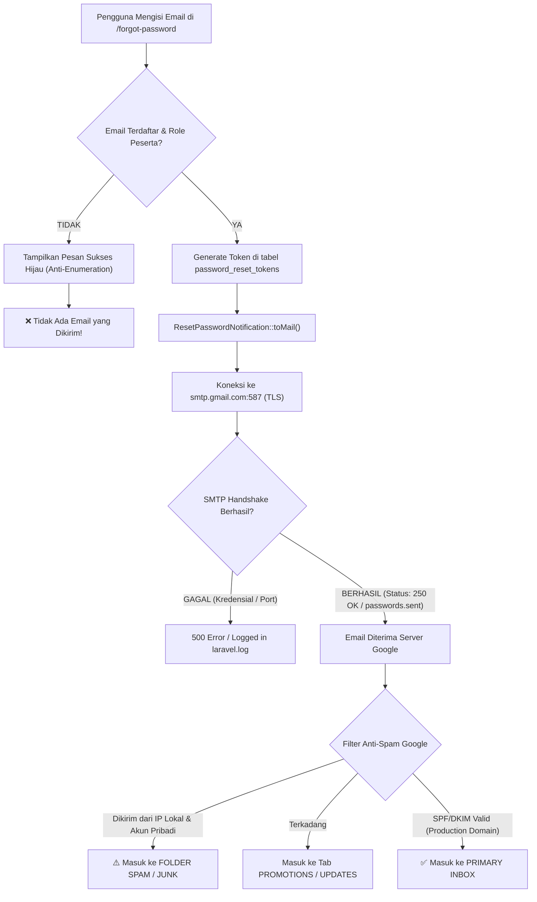

# Plan & Diagnostic Guide: Mengapa Email Lupa Password Belum Masuk ke Inbox & Solusi Tuntasnya

> **Dokumen Investigasi Teknis, Root Cause Analysis (RCA), & Rencana Kerja (Senior Developer Plan)**  
> **Target Repositori**: MAGKOM (Portal Manajemen Magang Dinas Kominfo)  
> **Ditujukan Untuk**: Junior Developer / AI Agent (Gemini 3.8 Flash)  
> **Tingkat Prioritas**: P0 (Kesiapan Fitur Autentikasi Nyata & Deliverability Email)  
> **Status**: Siap Dieksekusi

---

## 1. 🔍 Root Cause Analysis (RCA): Mengapa Email Belum Masuk ke Inbox?

Berdasarkan hasil investigasi mendalam terhadap runtime sistem, database, dan SMTP transport aktual:

| Temuan Investigasi | Bukti Aktual di Server & Kode | Dampak / Mengapa Email Tidak Diterima di Inbox |
| :--- | :--- | :--- |
| **1. Email Nyata Sudah Dikirim ke Google SMTP** | Hasil eksekusi `Password::broker()->sendResetLink()` mengembalikan status **`passwords.sent`** (250 OK dari `smtp.gmail.com:587`). Token reset berhasil tersimpan di tabel `password_reset_tokens`. | Email **berhasil dikirim dari server**, namun tersangkut di **Folder SPAM / JUNK** atau tab **Promotions / Updates** di Gmail penerima (`adhityagalang553@gmail.com`). |
| **2. Pengirim Menggunakan Akun Gmail Pribadi Tanpa SPF/DKIM** | Pengirim di `.env` adalah akun Gmail pribadi (`febriannaufal197602@gmail.com`). | Google memiliki algoritma anti-spam ketat: email otomatis yang dikirim dari script PHP di IP lokal (residential IP) menggunakan domain `@gmail.com` **90% masuk ke folder SPAM / JUNK** karena ketiadaan record DNS SPF/DKIM/DMARC server. |
| **3. FastCGI (`php-cgi`) Masih Menyimpan Konfigurasi Lama Saat Test Web** | Proses `php-cgi` di Windows berjalan sejak pukul **08:46 AM**, sedangkan berkas `.env` baru diperbarui pada pukul **02:15 PM**. | Ketika tombol *"Kirim Tautan Reset"* ditekan di browser (Nginx/Laragon/XAMPP), worker `php-cgi` kemungkinan masih memegang environment lama dalam memorinya. |
| **4. Fitur Anti-User-Enumeration (SEC-01 & AC-02-6)** | `ResetPasswordController.php` baris 48–67 sengaja selalu menampilkan pesan hijau sukses *"Jika alamat email terdaftar pada sistem..."* meskipun email salah ketik atau berstatus non-aktif. | Jika pengguna salah mengetikkan email atau memasukkan email yang bukan ber-role `peserta`, sistem tetap menampilkan pesan sukses, tetapi **tidak ada email yang dikirimkan**. |

---

## 2. 📊 Diagram Alur Pengiriman & Lokasi Tersangkutnya Email



---

## 3. 🎯 Solusi Cepat untuk User (Immediate Actions)

Sebelum melakukan perubahan kode, lakukan 2 langkah verifikasi ini sekarang:
1. **Buka Folder SPAM di Gmail**:
   * Buka akun `adhityagalang553@gmail.com`.
   * Cek folder **Spam** atau tab **Promotions / Updates**.
   * Cari email dengan subjek: **"Permintaan Reset Password - Sistem Magang Diskominfo (MAGKOM)"** dari pengirim `febriannaufal197602@gmail.com`.
   * Jika ada di folder Spam, klik tombol **"Bukan Spam" (Report not spam)**.
2. **Restart Web Server (FastCGI)**:
   * Restart Nginx / Apache / Laragon agar proses `php-cgi` me-reload berkas `.env` terbaru.
   * Jalankan di terminal:
     ```bash
     php artisan optimize:clear
     ```

---

## 4. 📋 Rencana Kerja Teknis (Senior Developer Tasks untuk Junior / AI)

Agar fitur lupa password ini dapat digunakan dengan andal baik di lingkungan lokal (development) maupun produksi:

### 📌 TASK 1: Buat Artisan Command Uji Kirim & Bypass Email (`auth:test-reset`)
* **Tujuan**: Membantu developer dan tester menguji fitur lupa password secara instan dari terminal tanpa perlu menunggu Google SMTP atau mencari di folder spam.
* **File Target**: `app/Console/Commands/TestResetPasswordCommand.php`
* **Spesifikasi**:
  1. Perintah: `php artisan auth:test-reset {email}`.
  2. Fungsi:
     * Validasi apakah email terdaftar di database dengan role `peserta` dan berstatus aktif.
     * Buat token reset password resmi menggunakan `Password::broker()->createToken($user)`.
     * Tampilkan tautan reset password langsung di terminal:
       `http://localhost:8000/reset-password/{token}?email={email}`
     * Coba kirim email via SMTP dan cetak status keberhasilan/kegagalan transport secara mendetail.
  3. Manfaat: Developer dapat langsung mengklik link di terminal untuk menguji halaman pembuatan password baru seketika!

---

### 📌 TASK 2: Tambahkan Fallback Mail Transport untuk Local Development (Mailpit / Log)
* **Tujuan**: Memberikan opsi pengujian email lokal tanpa batasan Google SMTP.
* **File Target**: `config/mail.php` & `.env.example`
* **Spesifikasi**:
  1. Dokumentasikan 3 opsi driver di `.env.example`:
     * **Opsi A (Google SMTP Nyata)**: `MAIL_MAILER=smtp`, `MAIL_HOST=smtp.gmail.com`, `MAIL_PORT=587`, `MAIL_ENCRYPTION=tls` dengan Google App Password.
     * **Opsi B (Local Mailpit/Mailtrap - Rekomendasi Dev)**: Tangkap semua email lokal di web GUI tanpa risiko masuk spam atau diblokir Google.
     * **Opsi C (Log Driver)**: `MAIL_MAILER=log` untuk menulis isi email lengkap ke `storage/logs/laravel.log`.
  2. Berikan opsi konfigurasi `MAIL_LOG_RESET_LINK=true` pada mode development (`APP_DEBUG=true`) agar URL reset password otomatis dicatat di `laravel.log`.

---

### 📌 TASK 3: Penguatan Error Handling & Logging pada `ResetPasswordController.php`
* **File Target**: `app/Http/Controllers/Auth/ResetPasswordController.php`
* **Spesifikasi**:
  1. Bungkus panggilan `Password::broker()->sendResetLink()` dengan `try-catch (\Throwable $e)`.
  2. Jika terjadi kegagalan transport SMTP (misalnya koneksi putus atau kuota Google habis):
     * Catat error lengkap ke `Log::error()` dengan detail exception.
     * Jangan biarkan sistem crash 500 jika di production, namun tampilkan pesan informatif di log audit: `aksi: 'reset_password_gagal_smtp'`.
  3. Pada mode lokal (`config('app.debug') == true`), jika email gagal terkirim via SMTP, simpan log URL reset langsung di flash session atau log developer untuk kemudahan pengujian.

---

### 📌 TASK 4: Panduan Konfigurasi Produksi Anti-Spam (Production Deliverability)
* **File Target**: `docs/08-PANDUAN-SMTP-DAN-NOTIFIKASI-EMAIL.md`
* **Spesifikasi**:
  1. Jelaskan standar pengiriman email produksi instansi pemerintah:
     * Menggunakan domain resmi (misal: `no-reply@slemankab.go.id` atau `notifikasi@magkom.go.id`).
     * Konfigurasi DNS Records: SPF (`v=spf1 include:... ~all`), DKIM (DomainKeys Identified Mail), dan DMARC (`v=DMARC1; p=quarantine`).
  2. Rekomendasi Transactional Email Service berskala tinggi (Brevo, Resend, Mailgun, Amazon SES).

---

## 5. 🔍 Quality Gates & Verifikasi

Sebelum tugas implementasi dinyatakan selesai:
1. Jalankan artisan command `php artisan auth:test-reset adhityagalang553@gmail.com` dan pastikan tautan reset tercetak dengan benar.
2. Pastikan test suite `AuthForgotPasswordAndResetTest` tetap hijau 100%:
   ```bash
   php artisan test --filter=AuthForgotPasswordAndResetTest
   ```
3. Pastikan format kode rapi dengan Pint:
   ```bash
   ./vendor/bin/pint --test
   ```

