# Plan & Task Guide: Enforce "Wajib Registrasi Sebelum Login" (MAGKOM)

> **Dokumen Panduan Teknis & Instruksi Kerja Senior Developer untuk Junior Developer / Agent AI (Gemini 3.8 Flash)**  
> **Target Repositori**: MAGKOM (Portal Manajemen Magang Dinas Kominfo)  
> **Modul Terkait**: `SocialiteController`, `AuthController`, `PesertaProfil`, `routes/web.php`  
> **Prioritas**: **P0 (Critical Architecture & Business Logic Fix)**  
> **Status**: Ready for Implementation (Menunggu Persetujuan Eksekusi)

---

## 1. 🎯 Executive Summary & Root Cause Analysis

### 1.1 Latar Belakang Masalah (Problem Statement)
Dalam sistem **MagKom**, peserta magang wajib memiliki data akademik dan peminatan yang valid sejak awal pendaftaran:
1. **Jenjang Pendidikan**: SMK vs Mahasiswa (D3/D4/S1).
2. **Bidang Penempatan / Peminatan**: Aptika, IKP, E-Gov, atau Jaringan.
3. **Jurusan / Program Studi**: Terikat ketat (*strictly constrained*) dengan jenjang dan bidang yang dipilih.
4. **Institusi & NIM/NISN**: Identitas resmi instansi asal peserta.
5. **Tipe Pendaftaran**: Mandiri (1 orang) atau Kelompok (2–4 orang).

Seluruh logika bisnis ini (termasuk kuota, filter jurusan, dan dokumen persyaratan) dikumpulkan pada saat **Registrasi** (`/register` & `AuthController::register`).

### 1.2 Akar Masalah Teknis (Root Cause)
Terjadi celah logika (*logical loophole*) fatal pada alur **Google OAuth Social Login** (`app/Http/Controllers/Auth/SocialiteController.php`):
* Pada halaman `/login`, terdapat tombol **"Masuk dengan Google"**.
* Ketika pengguna baru yang **belum pernah registrasi** mengklik tombol tersebut, kode pada `SocialiteController::callback()` baris 191–226 mengeksekusi:
  ```php
  // Kasus 3: Belum ada akun dengan email ini -> Buat akun Peserta baru
  $newUser = new User;
  $newUser->nama = (string) $name;
  $newUser->email = $email;
  $newUser->role = RoleEnum::Peserta;
  $newUser->status_aktif = true;
  $newUser->email_verified_at = now();
  $newUser->save();

  Auth::login($newUser);
  ```
* **Akibat Fatal**:
  1. Pengguna tersebut langsung masuk ke dalam sistem sebagai `Peserta` **tanpa pernah melalui form registrasi**.
  2. Data `PesertaProfil` tidak pernah dibuat, sehingga `jenjang`, `jurusan_id`, `bidang`, `institusi`, dan `nim_nisn` berstatus **KOSONG / NULL**.
  3. Ketika masuk ke halaman `/peserta/profil`, field `jenjang` dan `jurusan_id` bersifat **terkunci permanen (`disabled` / `is-permanent-locked`)** karena sistem berasumsi data tersebut wajib diisi pada saat registrasi awal.
  4. Pengguna terjebak (*deadlock*): tidak bisa memilih jurusan/jenjang di dalam, tidak bisa mengajukan magang di `/peserta/pendaftaran` (karena profil < 100%), dan pihak Admin Kominfo tidak mengetahui calon peserta tersebut dari kampus/sekolah mana dan ingin masuk ke bidang apa.

---

## 2. 🔄 Alur Logika: Sebelum vs Sesudah (Flowchart)

```mermaid
flowchart TD
    subgraph ALUR_LAMA["❌ Alur Lama (Bermasalah)"]
        A1["Calon Peserta Baru"] --> B1["Klik 'Masuk dengan Google' di /login"]
        B1 --> C1["SocialiteController (Kasus 3)"]
        C1 --> D1["Otomatis Buat User Baru di Database"]
        D1 --> E1["Langsung Login & Redirect ke Dashboard"]
        E1 --> F1["⚠️ TERJEBAK: Jenjang, Jurusan, Bidang KOSONG & Terkunci!"]
    end

    subgraph ALUR_BARU["✅ Alur Baru (Ketentuan Senior Dev)"]
        A2["Calon Peserta Baru"] --> B2["Akses Sistem"]
        B2 --> C2{"Punya Akun?"}
        
        C2 -- "Belum" --> D2["Wajib Buka Halaman /register"]
        D2 --> E2["Isi Jenjang, Bidang, Jurusan, Institusi, dsb."]
        E2 --> F2["Akun + Profil Lengkap Terbuat"]
        F2 --> G2["Bisa Login & Masuk Sistem"]

        C2 -- "Coba Login Google tapi Belum Registrasi" --> H2["Klik 'Masuk dengan Google' di /login"]
        H2 --> I2{"Email Ada di Database?"}
        I2 -- "TIDAK ADA" --> J2["❌ TOLAK LOGIN! Jangan Buat User!"]
        J2 --> K2["Simpan Data Google Sementara di Session"]
        K2 --> L2["Redirect ke /register dengan Pesan Edukatif"]
        L2 --> E2
        
        I2 -- "SUDAH TERDAFTAR" --> M2["✅ Izinkan Login ke Dashboard"]
    end
```



---

## 3. 🛡️ Prinsip Desain & Guardrail Arsitektur (Wajib untuk Junior Dev / Light AI)

Sebelum menyentuh satu baris kode pun, patuhi aturan berikut:
1. **PHP 8.3 & Laravel 10 Native**: Gunakan type hinting ketat (`declare(strict_types=1);`), enum (`RoleEnum`), dan Eloquent standar.
2. **Jangan Mengubah Blade Sembarangan**: Sesuai aturan MAGKOM, Blade berstatus **Read-Only** secara default. Perubahan hanya diperbolehkan untuk menampilkan pesan alert/flash atau membawa value session. Jangan menambahkan inline CSS atau JS baru ke dalam Blade.
3. **Prinsip Single Source of Truth Registrasi**: Data identitas akademik awal (`jenjang`, `jurusan_id`, `institusi`, `nim_nisn`) HANYA boleh diinisialisasi melalui formulir pendaftaran `/register`.
4. **Audit Trail Wajib**: Setiap penolakan login Google untuk pengguna yang belum terdaftar harus dicatat ke dalam audit log melalui `AuditService`.
5. **No Broken Windows / Zero Regression**: Fitur Google Login untuk peserta yang **sudah terdaftar** tetap harus berjalan normal 100%.

---

## 4. 📋 Pembagian Tugas Terperinci (Step-by-Step Task Breakdown)

### 📌 TASK 1: Refaktor `SocialiteController.php` (Blokir Pembuatan Akun Otomatis)
* **File Target**: `app/Http/Controllers/Auth/SocialiteController.php`
* **Lokasi**: Method `callback(string $provider, Request $request)` pada bagian `Kasus 3`.
* **Spesifikasi Perubahan**:
  1. Hapus logika pembuatan `new User` otomatis pada Kasus 3.
  2. Ganti dengan logika:
     * Catat log audit: `tipe: TipeAuditEnum::Aksi`, `aksi: 'login_oauth_ditolak_belum_terdaftar'`, detail mencatat provider, email, dan IP.
     * Simpan data profil Google sementara ke dalam session aman:
       ```php
       session()->flash('oauth_register_data', [
           'email' => $email,
           'nama' => $name,
           'provider' => $provider,
           'provider_id' => $providerId,
       ]);
       ```
     * Lakukan redirect ke `route('register')` dengan pesan edukatif:
       *"Akun Google Anda ({$email}) belum terdaftar di sistem MagKom. Silakan lakukan pendaftaran terlebih dahulu untuk memilih jenjang pendidikan dan jurusan magang."*
  3. Pastikan penanganan Kasus 1 (user sudah tertaut provider) dan Kasus 2 (user lokal terdaftar dengan email sama) tetap berjalan tanpa regresi.

---

### 📌 TASK 2: Adaptasi `AuthController.php` (`showRegister` & `register`)
* **File Target**: `app/Http/Controllers/Auth/AuthController.php`
* **Spesifikasi Perubahan**:
  1. **Pada `showRegister(Request $request)`**:
     * Periksa apakah terdapat data Google di `session('oauth_register_data')`.
     * Jika ada, kirim data tersebut ke view sebagai default `prefilledEmail` dan `prefilledNama`.
  2. **Pada `register(Request $request)`**:
     * Periksa apakah pendaftaran ini berasal dari alur Google OAuth (bisa melalui session atau hidden field terverifikasi).
     * Jika ya, simpan kolom `provider = 'google'`, `provider_id = $providerId`, dan set `email_verified_at = now()`.
     * **Kunci Utama**: Pastikan `PesertaProfil` SELALU dibuat secara transaksional (`DB::transaction`) bersamaan dengan `User` baru menggunakan `jenjang`, `jurusan_id`, `institusi`, dan `nim_nisn` yang divalidasi dari form.
     * Hapus session `oauth_register_data` setelah transaksi berhasil.

---

### 📌 TASK 3: Penguatan Guardrail Middleware `account.active` / `EnsurePesertaRegistrationComplete`
* **File Target**: `app/Http/Middleware/EnsurePesertaProfileComplete.php` (atau verifikasi di middleware rute peserta).
* **Tujuan**: *Defense-in-depth*. Mencegah situasi langka di mana ada akun peserta tanpa profil yang berhasil menembus login (misalnya akun lama atau anomali seeder).
* **Spesifikasi Perubahan**:
  1. Periksa rute grup peserta di `routes/web.php` (`Route::middleware(['auth', 'verified', 'must_change_password', 'account.active', 'role:peserta'])`).
  2. Tambahkan pengecekan: Jika user memiliki role `Peserta`, tetapi belum memiliki relasi `profil` ATAU `profil->jenjang` atau `profil->jurusan_id` masih kosong:
     * Alihkan otomatis ke halaman penyelesaian biodata atau tolak akses dashboard dengan pesan instruksi yang jelas.

---

### 📌 TASK 4: Banner & Notifikasi Edukatif di Tampilan Auth
* **File Target**:
  - `resources/views/auth/register.blade.php`
  - `resources/views/auth/login.blade.php`
* **Spesifikasi Perubahan**:
  1. Di `register.blade.php`:
     * Tampilkan banner informasi jika pengguna dialihkan dari Google Login:
       *"Langkah Terakhir: Akun Google Anda belum terdaftar. Silakan pilih Jenjang Pendidikan, Bidang, dan Jurusan untuk menyelesaikan pendaftaran magang."*
     * Isi field nama dan email secara otomatis dari data session OAuth (dengan atribut readonly atau saran jika sesuai).
  2. Di `login.blade.php`:
     * Pastikan session alert tipe `warning` dapat ditampilkan dengan rapi (menggunakan palet styling yang sudah ada, tanpa mengacak struktur layout `auth-depth`).

---

### 📌 TASK 5: Pembuatan Automated Feature Test Suite
* **File Target**: `tests/Feature/Auth/WajibRegistrasiSebelumLoginTest.php`
* **Skenario Pengujian Wajib**:
  1. `test_user_google_belum_terdaftar_tidak_bisa_login_dan_dialihkan_ke_register()`:
     * Mock Socialite user dengan email baru `maba@universitas.ac.id`.
     * Request callback Google OAuth.
     * Assert response: redirect ke `/register`.
     * Assert database: tabel `users` TIDAK bertambah record baru.
     * Assert session: terdapat pesan edukasi dan data `oauth_register_data`.
  2. `test_user_google_yang_sudah_terdaftar_bisa_login_langsung()`:
     * Buat User dengan role `peserta` beserta `PesertaProfil` di database.
     * Mock Socialite user dengan email yang cocok.
     * Request callback Google OAuth.
     * Assert response: redirect ke dashboard/pendaftaran dan user terotentikasi (`assertAuthenticated()`).
  3. `test_registrasi_dengan_data_oauth_berhasil_membuat_user_dan_profil_lengkap()`:
     * Simulasikan submit formulir `/register` lengkap dengan `jenjang = 's1'`, `bidang_id = 1`, `jurusan_id = 4`.
     * Assert: User dan `PesertaProfil` terbentuk dengan data akademik yang valid.

---

## 5. 🔍 Quality Gates & Verifikasi

Sebelum tugas dinyatakan selesai, Junior Developer atau AI implementer WAJIB menjalankan perintah berikut pada terminal dan memastikan status **100% HIJAU (PASS)**:

```bash
# 1. Jalankan test otomatis khusus fitur ini
php artisan test --filter=WajibRegistrasiSebelumLoginTest

# 2. Jalankan seluruh suite test autentikasi untuk memastikan zero regression
php artisan test --filter=Auth

# 3. Analisis statis kode PHP (PHPStan level sesuai repositori)
./vendor/bin/phpstan analyse --memory-limit=1G

# 4. Standardisasi format kode PSR-12 (Laravel Pint)
./vendor/bin/pint --test
```

---

## 6. 💡 Ringkasan Nilai Bisnis (Business Value)

1. **Integritas Data 100%**: Tidak ada lagi peserta "siluman" di database yang tidak diketahui asal kampus, jurusan, maupun bidang tujuannya.
2. **Pengalaman Pengguna (UX) yang Jelas**: Calon peserta tidak akan pernah lagi menemui kondisi buntu (*deadlock*) di mana form jurusan terkunci tanpa tahu cara mengisinya.
3. **Beban Verifikator Berkurang**: Admin dan Tim Seleksi Magang Kominfo selalu menerima data pendaftar yang siap diproses dan dikurasi sesuai kuota masing-masing bidang.

