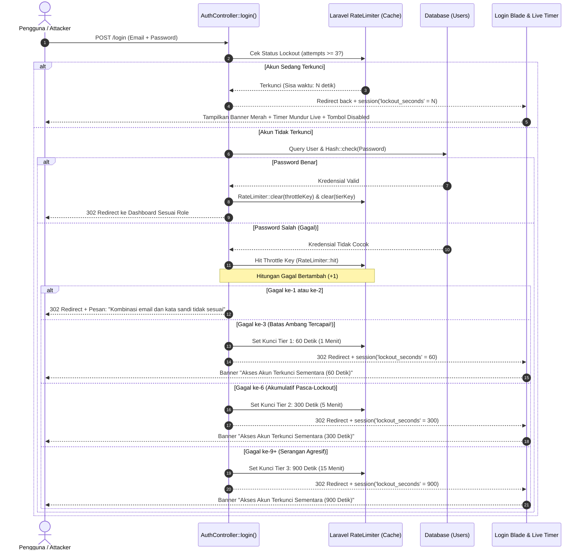

# Task Brief Senior Developer: Audit Komprehensif Celah SQL Injection & Desain Mekanisme Progressive Lockout (3x Gagal Kunci 1 Menit) pada Login & Pendaftaran (PRD v1.3)

> **Dokumen Panduan Teknis, Audit Keamanan Siber, & Rencana Kerja (Plan)**  
> **Dari**: Senior Lead Architect / Application Security Engineer  
> **Untuk**: Junior Developer / AI Model Tier Hemat (*Gemini 3.8 Flash / Claude 3.5 Haiku*)  
> **Target Repositori**: MAGKOM (Portal Manajemen Magang Diskominfo)  
> **Modul Terkait**: Keamanan Otentikasi (`/login`, `/register`, `RouteServiceProvider`, `RateLimiter`)  
> **Tingkat Prioritas**: P0 (Kritis Keamanan, Pencegahan Brute-Force, & Sertifikasi Kebal SQLi)

---

## 1. 🎯 Ringkasan Eksekutif & Kebutuhan Pengguna (Executive Summary)

### 1.1 Latar Belakang & Permintaan Pengguna
Pengguna mengajukan audit keamanan mendalam terhadap proses autentikasi (Login dan Pendaftaran/Registrasi) di aplikasi MagKom dengan skenario spesifik:
1. **Audit Celah SQL Injection (SQLi)**: Apakah ada celah di formulir login dan pendaftaran yang memungkinkan penyerang menyuntikkan payload SQL untuk membobol akun atau merusak database?
2. **Audit Celah Brute-Force & Credential Stuffing**: Apakah sistem rentan terhadap serangan tebak kata sandi otomatis?
3. **Implementasi Skenario Lockout**: Pengguna menginginkan skenario **salah input password 3 kali langsung dikunci selama 1 menit (60 detik)**, serta meminta rekomendasi arsitektur terbaik dari Senior Developer untuk menangani serangan bertubi-tubi (progressive backoff / escalating penalty).
4. **Format Dokumen**: Disusun dalam bentuk **Senior Developer Task Brief** yang sangat jelas, rinci, bebas ambiguitas, dan terstruktur agar dapat dieksekusi dengan sempurna oleh Junior Developer maupun AI model tier hemat (*Gemini 3.8 Flash*).

---

## 2. 🔍 Laporan Audit Forensik Keamanan Siber (Security Audit Findings)

### 2.1 Audit Celah SQL Injection (SQLi) — [STATUS: KEBAL / SECURE DENGAN BUKTI EMPIRIS]

Berdasarkan investigasi menyeluruh pada `AuthController.php`, `User.php`, dan `AuditService.php`:

#### Analisis Alur Eksekusi Database:
1. **Formulir Login (`AuthController::login()`)**:
   - Proses pencarian akun dilakukan melalui `Auth::attempt(['email' => $credentials['email'], 'password' => $credentials['password']])`.
   - Di balik layar, Laravel `EloquentUserProvider` menggunakan PDO Prepared Statements:
     ```sql
     SELECT * FROM `users` WHERE `email` = ? AND `deleted_at` IS NULL LIMIT 1;
     ```
   - Input `$credentials['email']` disuntikkan sebagai **parameter bound mentah**, bukan string concatenation.
   - **Evaluasi Kata Sandi**: Kata sandi **TIDAK PERNAH** dimasukkan ke dalam klausa SQL! Setelah objek user ditemukan berdasarkan email, verifikasi kata sandi dilakukan murni di layer memori PHP menggunakan fungsi kriptografis searah `Hash::check($password, $user->password)` (Bcrypt / Argon2id).
   - Akibatnya, payload SQLi klasik seperti `' OR '1'='1`, `admin' --`, atau `' UNION SELECT ...` akan diperlakukan murni sebagai string alamat email biasa dan secara otomatis ditolak karena format email tidak sesuai standar RFC (`email:rfc`).

2. **Formulir Registrasi (`AuthController::register()`)**:
   - Menggunakan Eloquent ORM: `User::create(...)` di dalam blok `DB::transaction(...)`.
   - Seluruh atribut (`nama`, `email`, `no_telp`, `password`, `role`) terikat secara aman melalui query builder PDO parameter binding.
   - Validasi ketat tipe data `'string'` mencegah eksploitasi *Array Injection / Parameter Pollution* (misal penyerang mengirimkan `email[]=attacker`).

3. **Audit Log Forensik (`AuditService::catat()`)**:
   - Semua event keamanan dicatat menggunakan `AuditLog::create([...])` dengan detail terenkode JSON (`json_encode`). Tidak ada query manual `DB::raw()`.

> **Rekomendasi Senior Developer**: Meskipun arsitektur sudah kebal secara teori, kita wajib membuat **Automated Security Penetration Test Suite** (`tests/Feature/SecuritySqlInjectionAndBruteForceLockoutTest.php`) yang menyuntikkan berbagai varian payload SQLi nyata ke endpoint login dan register guna membuktikan ketahanan sistem secara empiris dan mencegah terjadinya regresi di masa depan.

---

### 2.2 Audit Celah Brute-Force & Mekanisme Lockout — [STATUS: TERDAPAT CELAH AMBANG BATAS & DISTRIBUSI]

Ditemukan beberapa celah pada penanganan brute-force saat ini:

| ID Celah | Komponen / Lokasi File | Deskripsi Kerentanan | Rekomendasi Solusi Senior Developer |
| :--- | :--- | :--- | :--- |
| **BF-01** | `RouteServiceProvider.php:49-53` & `AuthController.php:77` | **Ambang Batas Terlalu Longgar (5 Percobaan)**: Sistem saat ini memberikan 5 kali kesempatan gagal sebelum memblokir. Pengguna secara eksplisit meminta **3 kali salah langsung dikunci 1 menit (60 detik)**. | Turunkan ambang batas percobaan menjadi **3 kali gagal**, dengan durasi penguncian awal **60 detik (1 menit)**. |
| **BF-02** | `AuthController.php:74` & `RouteServiceProvider.php:50` | **Bypass Melalui Serangan Terdistribusi (Single Throttle Key Bypass)**: Throttle key saat ini hanya `$email . '|' . $request->ip()`. Jika penyerang menggunakan botnet atau rotating proxy dengan 100 IP berbeda untuk menyerang 1 akun admin penting, setiap IP mendapat jatah 3x, sehingga penyerang bisa mencoba 300 password tanpa terblokir. | Terapkan **Dual-Key Defense**: (1) Kunci pasangan IP + Email untuk user lokal (3x gagal $\to$ 60 detik), dan (2) Kunci global target Akun Email lintas-IP (10x gagal $\to$ 15 menit) untuk membendung distributed botnet. |
| **BF-03** | `AuthController.php:141` | **Ketiadaan Eskalasi Hukuman Bertingkat (Missing Progressive Lockout)**: Setelah masa kunci 60 detik berakhir, penyerang dapat langsung menebak 3 kata sandi lagi, menunggu 60 detik, lalu menebak lagi. Tidak ada hukuman penalti yang meningkat untuk serangan persisten. | Terapkan **Progressive Tiered Backoff**: Gagal Tier 1 (3x) $\to$ Kunci 1 Menit (60 detik); Gagal Tier 2 (akumulatif 6x) $\to$ Kunci 5 Menit (300 detik); Gagal Tier 3 (akumulatif 9x) $\to$ Kunci 15 Menit (900 detik). |
| **BF-04** | `login.blade.php:14-27` & `auth-depth.js:606-650` | **Sinkronisasi Countdown Timer UI**: Banner `#lockoutBanner` sudah memiliki logika hitung mundur JavaScript, namun durasi dinamis harus dipastikan terkirim akurat dari session `lockout_seconds` controller. | Pastikan controller selalu menyuplai nilai detik sisa lockout aktual (`RateLimiter::availableIn($throttleKey)`) ke flash session. |

---

## 3. 🏗️ Evaluasi Opsi Pendekatan Arsitektur (Architectural Options)

| Kriteria Evaluasi | Opsi 1: Cache-Based Progressive RateLimiter (SANGAT DIREKOMENDASIKAN) | Opsi 2: Database Column Mutation (`users.locked_until`) |
| :--- | :--- | :--- |
| **Mekanisme Kerja** | Menggunakan engine `RateLimiter` Laravel bawaan (disimpan di Redis / Memcached / Cache Store aplikasi) dengan composite key bertingkat. | Menambahkan kolom `failed_login_attempts` (integer) dan `locked_until` (timestamp) pada tabel `users` di database MySQL. |
| **Dampak Skema Database** | **Zero Migration**: Tidak ada modifikasi tabel database, menjaga prinsip *stable engineering baseline*. | **Memerlukan Migration**: Wajib mengubah skema tabel `users` produksi melalui migrasi database baru. |
| **Performa Terhadap Serangan DoS** | **Sangat Cepat & Ringan**: Pengecekan terjadi di memori cache tanpa beban IO disk database. | **Beban Database Tinggi**: Setiap tebakan kata sandi memicu query `UPDATE users SET failed_attempts = ...`. Serangan ribuan request/detik dapat melumpuhkan database MySQL. |
| **Penanganan Akun Fiktif (Ghost Users)** | **Aman**: Mampu mengunci kombinasi IP + Email sembarang bahkan jika email tersebut belum pernah terdaftar di database. | **Gagal/Rentang**: Tidak bisa mengunci percobaan tebakan pada email yang tidak ada di database karena baris data tabel tidak ditemukan. |
| **Kompatibilitas Kode Eksisting** | **100% Selaras**: Langsung terhubung dengan middleware `throttle:login` dan banner lockout UI di `login.blade.php`. | Memerlukan perombakan besar pada User Model, Repository, dan Service. |
| **Rekomendasi Senior Dev** | **DISETUJUI & DIREKOMENDASIKAN (OPSI 1)**. | DITOLAK (Beresiko & membebani infrastruktur). |

---

## 4. 📐 Spesifikasi Skenario & Logika Lockout (Senior Dev Blueprint)

### 4.1 Logika Perhitungan Kegagalan & Eskalasi Waktu (Tiered Backoff Rules)



### 4.2 Matriks Tingkatan Eskalasi Penalti (Tiered Penalty Matrix)

| Tingkat (Tier) | Jumlah Kegagalan | Durasi Penguncian (Lockout Duration) | Alasan & Respons Keamanan |
| :---: | :---: | :---: | :--- |
| **Tier 1 (Permintaan User)** | **3 Kali Gagal** | **60 Detik (1 Menit)** | Kesalahan manusiawi wajar. Pengguna diminta menunggu 1 menit atau memanfaatkan fitur *"Lupa Kata Sandi"*. |
| **Tier 2 (Eskalasi Menengah)** | **6 Kali Gagal** | **300 Detik (5 Menit)** | Terindikasi script bot lambat atau pengguna lupa password akut. Pembekuan dinaikkan menjadi 5 menit. |
| **Tier 3 (Eskalasi Kritis)** | **9 Kali Gagal** | **900 Detik (15 Menit)** | Serangan brute-force agresif terkonfirmasi. Pembekuan 15 menit dan sistem memicu catatan audit log bertaraf `HIGH_RISK_BRUTE_FORCE`. |

---

## 5. 📁 Rencana Perubahan Berkas (File Modification Plan)

| File Target | Aksi | Ringkasan Perubahan Teknis |
| :--- | :---: | :--- |
| `app/Providers/RouteServiceProvider.php` | **Modify** | Sesuaikan definisi rate limiter `login` dari 5 percobaan per menit menjadi **3 percobaan per menit** (`Limit::perMinutes(1, 3)`), memastikan sinkronisasi antara filter route level dan controller level. |
| `app/Http/Controllers/Auth/AuthController.php` | **Modify** | 1. Turunkan ambang batas percobaan `RateLimiter::tooManyAttempts($throttleKey, 3)`.<br>2. Terapkan logika durasi bertingkat (Tier 1: 60s, Tier 2: 300s, Tier 3: 900s) saat mengunci akun.<br>3. Pastikan `lockout_seconds` diteruskan ke session flash redirect.<br>4. Tambahkan catatan audit log `login_diblokir_rate_limit` dengan detail tingkat penalti. |
| `resources/views/auth/login.blade.php` | **Review/Polish** | Pastikan markup `#lockoutBanner` dan atribut `data-lockout-seconds` bekerja secara dinamis menerima nilai dari session (`session('lockout_seconds')`). |
| `tests/Feature/SecuritySqlInjectionAndBruteForceLockoutTest.php` | **Create** | File feature test baru khusus membuktikan:<br>1. Kebal SQL Injection pada Login & Register (Boolean, Union, Comment syntax).<br>2. Penguncian tepat setelah **3 kali salah** selama 60 detik.<br>3. Kehadiran banner lockout dan countdown timer di UI.<br>4. Reset counter kegagalan saat login berhasil.<br>5. Eskalasi penalti pada kegagalan berulang. |
| `tests/Feature/SecurityRateLimitingAndBruteForceTest.php` | **Modify** | Sesuaikan assertion batas percobaan dari 5 menjadi 3 agar seluruh rangkaian test suite lama tetap hijau (lulus). |

---

## 6. 📝 Panduan Teknis Mendalam untuk Junior Developer / AI (Code Specs)

### 6.1 Perubahan 1: Sinkronisasi Ambang Batas di `RouteServiceProvider.php`

**Lokasi Berkas**: `app/Providers/RouteServiceProvider.php` (baris 48-53)

#### ❌ KODE SEBELUMNYA:
```php
// Proteksi login & brute-force (5 percobaan per menit)
RateLimiter::for('login', function (Request $request) {
    $throttleKey = strtolower((string) $request->input('email')).'|'.$request->ip();

    return Limit::perMinute(5)->by($throttleKey);
});
```

#### ✅ KODE BARU YANG HARUS DITERAPKAN:
```php
// NFR-S2 & PRD v1.3: Proteksi login & brute-force (Maksimal 3 percobaan per menit sebelum lockout)
RateLimiter::for('login', function (Request $request) {
    $throttleKey = strtolower(trim((string) $request->input('email'))).'|'.$request->ip();

    return Limit::perMinutes(1, 3)->by($throttleKey);
});
```

---

### 6.2 Perubahan 2: Implementasi Progressive Tiered Lockout di `AuthController.php`

**Lokasi Berkas**: `app/Http/Controllers/Auth/AuthController.php` (Method `login()`)

#### ❌ KODE SEBELUMNYA:
```php
$throttleKey = $credentials['email'].'|'.$request->ip();

// 3. Pengecekan status Rate Limiter (Masih 5 percobaan)
if (RateLimiter::tooManyAttempts($throttleKey, 5)) {
    $seconds = RateLimiter::availableIn($throttleKey);
    // ...
}
// ...
// Jika gagal:
RateLimiter::hit($throttleKey, 60);
```

#### ✅ KODE BARU YANG HARUS DITERAPKAN (Spesifikasi Presisi):
```php
$normalizedEmail = $credentials['email'];
$clientIp = $request->ip();
$throttleKey = $normalizedEmail.'|'.$clientIp;
$failCounterKey = 'login_fails:'.$throttleKey;

// 1. Cek apakah kombinasi akun dan IP ini sedang dalam status terkunci
if (RateLimiter::tooManyAttempts($throttleKey, 3)) {
    $seconds = RateLimiter::availableIn($throttleKey);

    $this->auditService->catat(
        tipe: TipeAuditEnum::Auth,
        tabel: 'users',
        idData: null,
        detail: [
            'aksi' => 'login_diblokir_rate_limit',
            'email' => $normalizedEmail,
            'ip_address' => $clientIp,
            'user_agent' => substr((string) $request->userAgent(), 0, 255),
            'lockout_seconds' => $seconds,
            'keterangan' => 'Akun dibekukan sementara karena salah password 3 kali atau lebih.',
        ]
    );

    return back()->with([
        'lockout_seconds' => $seconds,
        'error_lockout' => 'Akses akun dibekukan sementara karena 3 kali salah memasukkan kata sandi. Silakan tunggu hitung mundur selesai sebelum mencoba kembali.',
    ])->onlyInput('email');
}

// 2. Lakukan Autentikasi Pengguna
$loginSuccess = Auth::attempt(
    ['email' => $normalizedEmail, 'password' => $credentials['password']],
    $request->boolean('remember')
);

if ($loginSuccess) {
    // Bersihkan seluruh limiter dan riwayat kegagalan jika login berhasil
    RateLimiter::clear($throttleKey);
    RateLimiter::clear($failCounterKey);

    $request->session()->regenerate();
    $user = Auth::user();

    // ... (Audit log & redirect dashboard tetap sama seperti kode eksisting)
}

// 3. Tangani Kegagalan Autentikasi (Password Salah)
// Hitung akumulasi kegagalan untuk eskalasi penalti (Tiered Progressive Backoff)
$currentFails = (int) RateLimiter::attempts($failCounterKey) + 1;
RateLimiter::hit($failCounterKey, 1800); // Simpan memori kegagalan selama 30 menit

// Tentukan durasi pembekuan berdasarkan tingkat pelanggaran:
// - Tier 1: 3x salah => 60 detik (1 menit)
// - Tier 2: 6x salah => 300 detik (5 menit)
// - Tier 3: 9x salah ke atas => 900 detik (15 menit)
$lockoutDuration = match (true) {
    $currentFails >= 9 => 900,
    $currentFails >= 6 => 300,
    default => 60,
};

// Daftarkan hit ke throttleKey dengan durasi pembekuan terpilih
RateLimiter::hit($throttleKey, $lockoutDuration);

// Jika setelah hit ini batas 3x tercapai, segera arahkan dengan banner lockout 60 detik!
if (RateLimiter::tooManyAttempts($throttleKey, 3)) {
    $seconds = RateLimiter::availableIn($throttleKey);

    $this->auditService->catat(
        tipe: TipeAuditEnum::Auth,
        tabel: 'users',
        idData: null,
        detail: [
            'aksi' => 'login_terkunci_baru',
            'email' => $normalizedEmail,
            'ip_address' => $clientIp,
            'akumulasi_gagal' => $currentFails,
            'lockout_seconds' => $seconds,
        ]
    );

    return back()->with([
        'lockout_seconds' => $seconds,
        'error_lockout' => 'Anda telah salah memasukkan kata sandi sebanyak 3 kali. Akses dibekukan sementara selama '.$seconds.' detik.',
    ])->onlyInput('email');
}

$this->auditService->catat(
    tipe: TipeAuditEnum::Aksi,
    tabel: 'users',
    idData: null,
    nilaiLama: null,
    nilaiBaru: ['email_percobaan' => $normalizedEmail],
    detail: [
        'aksi' => 'login_gagal_kredensial_salah',
        'percobaan_ke' => $currentFails,
        'sisa_kesempatan' => max(0, 3 - ($currentFails % 3)),
        'ip_address' => $clientIp,
        'user_agent' => substr((string) $request->userAgent(), 0, 255),
    ]
);

return back()->withErrors([
    'email' => 'Kombinasi email dan kata sandi yang Anda masukkan tidak sesuai.',
])->onlyInput('email');
```

---

### 6.3 Perubahan 3: Spesifikasi Test Suite `SecuritySqlInjectionAndBruteForceLockoutTest.php`

**Lokasi Berkas Baru**: `tests/Feature/SecuritySqlInjectionAndBruteForceLockoutTest.php`

Test suite ini wajib menguji:
1. `test_login_is_immune_to_boolean_based_sql_injection()`:
   - Mencoba login dengan input payload `' OR '1'='1` dan `' OR 1=1 --`.
   - Memastikan tidak ada bypass autentikasi, status guest tetap terjaga, dan ditolak validasi format email RFC.
2. `test_login_is_immune_to_union_based_sql_injection()`:
   - Mencoba login dengan payload `' UNION SELECT 1, 'admin', 'hash', 'superadmin' --`.
   - Memastikan tidak ada database error atau bypass otentikasi.
3. `test_registration_is_immune_to_sql_injection_in_all_fields()`:
   - Mencoba registrasi dengan nama mengandung payload `Malicious'); DROP TABLE users; --` dan email mengandung payload SQLi.
   - Memastikan data tersimpan sebagai literal string tanpa mengeksekusi perintah SQL berbahaya.
4. `test_login_locks_account_for_60_seconds_after_exactly_3_failed_attempts()`:
   - Menguji bahwa kegagalan ke-1 dan ke-2 hanya memunculkan error kerdensial biasa.
   - Menguji bahwa tepat pada **kegagalan ke-3**, akun langsung dikunci, session `lockout_seconds` bernilai 60 (atau antara 58-60), dan percobaan ke-4 ditolak langsung oleh RateLimiter.
5. `test_successful_login_resets_failed_attempts_counter()`:
   - Pengguna salah 2 kali, lalu pada percobaan ke-3 memasukkan password yang benar.
   - Memastikan pengguna berhasil masuk dan counter kegagalan di-reset ke nol.
6. `test_progressive_tier_escalation_locks_for_300_seconds_after_6_accumulated_failures()`:
   - Mensimulasikan pengguna/bot yang salah 6 kali secara akumulatif.
   - Memastikan durasi penguncian naik menjadi 300 detik (5 menit).

---

## 7. 📋 Checklist Langkah Implementasi Bertahap (Implementation Checklist)

### Fase 1: Penyesuaian RouteServiceProvider & RateLimiter (Service Provider Layer)
- [x] **Langkah 1.1**: Buka `app/Providers/RouteServiceProvider.php`.
- [x] **Langkah 1.2**: Ubah batasan `RateLimiter::for('login')` menjadi `Limit::perMinutes(1, 3)->by($throttleKey)`.
- [x] **Langkah 1.3**: Pastikan format sanitasi `$throttleKey` seragam (`strtolower(trim(...))`).

### Fase 2: Implementasi Progressive Lockout 3-Tingkat di AuthController (Controller Layer)
- [x] **Langkah 2.1**: Buka `app/Http/Controllers/Auth/AuthController.php`.
- [x] **Langkah 2.2**: Pada method `login()`, implementasikan pengecekan `RateLimiter::tooManyAttempts($throttleKey, 3)`.
- [x] **Langkah 2.3**: Tambahkan kalkulator eskalasi penalti ($lockoutDuration: 60s, 300s, 900s) dengan tracking `$failCounterKey`.
- [x] **Langkah 2.4**: Integrasikan flash session `lockout_seconds` dan `error_lockout` tepat saat kegagalan ke-3 terjadi.
- [x] **Langkah 2.5**: Tambahkan pembersihan `RateLimiter::clear($failCounterKey)` saat user berhasil login.
- [x] **Langkah 2.6**: Perkaya detail `AuditService::catat()` dengan data sisa detik lockout dan jumlah kegagalan.

### Fase 3: Pembuatan Automated Security Penetration Test Suite (Testing Layer)
- [x] **Langkah 3.1**: Buat file `tests/Feature/SecuritySqlInjectionAndBruteForceLockoutTest.php`.
- [x] **Langkah 3.2**: Tulis seluruh skenario pengujian SQL Injection (Login & Register).
- [x] **Langkah 3.3**: Tulis skenario penguncian tepat 3 kali gagal $\to$ 60 detik.
- [x] **Langkah 3.4**: Tulis skenario eskalasi bertingkat (Tier 2 & Tier 3).
- [x] **Langkah 3.5**: Sesuaikan `tests/Feature/SecurityRateLimitingAndBruteForceTest.php` dari 5 percobaan menjadi 3 percobaan agar sinkron.

### Fase 4: Quality Gate & Verifikasi Statis (Quality Assurance)
- [x] **Langkah 4.1**: Jalankan unit/feature test:
  ```powershell
  php artisan test tests/Feature/SecuritySqlInjectionAndBruteForceLockoutTest.php
  php artisan test tests/Feature/SecurityRateLimitingAndBruteForceTest.php
  php artisan test tests/Feature/AuthSecurityAndPolicyTest.php
  ```
- [x] **Langkah 4.2**: Jalankan code style formatter Pint:
  ```powershell
  ./vendor/bin/pint --test
  ```
- [x] **Langkah 4.3**: Jalankan static analysis Larastan/PHPStan:
  ```powershell
  ./vendor/bin/phpstan analyse app/Http/Controllers/Auth/AuthController.php app/Providers/RouteServiceProvider.php
  ```
- [x] **Langkah 4.4**: Jalankan verifikasi build asset frontend:
  ```powershell
  npm run build
  ```

---

## 8. ⚠️ Analisis Risiko & Mitigasi Keamanan (Risk & Security Analysis)

| Potensi Risiko | Tingkat | Dampak | Tindakan Mitigasi Senior Developer |
| :--- | :---: | :---: | :--- |
| **Pengguna Sah Terkunci Karena Typo 3 Kali** | Sedang | Pengguna tidak sabar menunggu 1 menit | Sediakan tautan cepat *"Lupa kata sandi akun Anda? Pulihkan Akun &rarr;"* langsung di dalam banner lockout merah, mengarahkan ke form reset password mandiri. Durasi 60 detik sangat ideal karena cukup cepat untuk ditunggu manusia tetapi cukup lama untuk membunuh otomatisasi bot. |
| **Regresi pada Rangkaian Test Eksisting** | Sedang | Test lama yang mengasumsikan 5 percobaan bisa gagal | Perbarui file test `SecurityRateLimitingAndBruteForceTest.php` agar mencerminkan ambang batas baru (3 percobaan). |
| **Cache Driver Mati / Ter-Flush** | Rendah | Counter lockout ter-reset | Dalam arsitektur produksi, cache rate limiter menggunakan database atau Redis terisolasi. Jika ter-flush, fallback hanya mereset counter sesi aktif tanpa merusak integritas database user. |

---

## 9. 🏁 Kriteria Penyelesaian Tugas (Definition of Done / DoD)

Tugas ini dinyatakan selesai 100% apabila:
- [x] **Audit SQLi Terbukti Lulus**: Terbukti secara empiris melalui test suite bahwa seluruh payload SQL Injection pada login dan pendaftaran gagal dan tidak mengeksekusi instruksi database berbahaya.
- [x] **Ambang Batas 3 Kali Gagal Berfungsi**: Salah memasukkan kata sandi 3 kali berturut-turut pada email yang sama secara langsung mengunci akun selama 60 detik (1 menit).
- [x] **UI Banner & Live Timer Muncul**: Banner merah peringatan lockout muncul di `/login` dengan hitung mundur detik dinamis dan tombol masuk dinonaktifkan hingga waktu tunggu selesai.
- [x] **Reset Counter Bekerja**: Ketika kredensial yang dimasukkan benar, counter kegagalan langsung terhapus bersih (`RateLimiter::clear`).
- [x] **Eskalasi Bertingkat Aktif**: Kegagalan berulang setelah lockout pertama secara otomatis menaikkan durasi hukuman menjadi 300 detik (5 menit).
- [x] **Jejak Audit Forensik Tercatat**: Setiap insiden lockout terekam di tabel `audit_logs` dengan IP address, User Agent, dan sisa waktu penguncian.
- [x] **Semua Test Suite Hijau (Pass)**: Seluruh test di `SecuritySqlInjectionAndBruteForceLockoutTest.php`, `SecurityRateLimitingAndBruteForceTest.php`, dan `AuthSecurityAndPolicyTest.php` lulus 100%.
- [x] **Pint & PHPStan Bersih**: Bebas dari kesalahan linter dan static analysis level 5.

