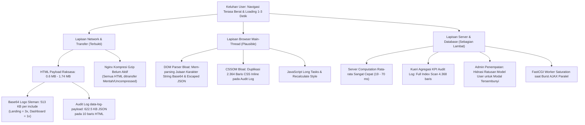
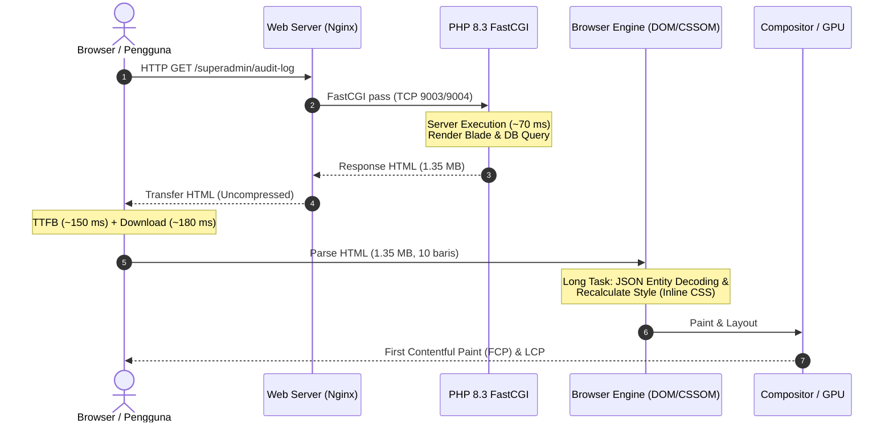
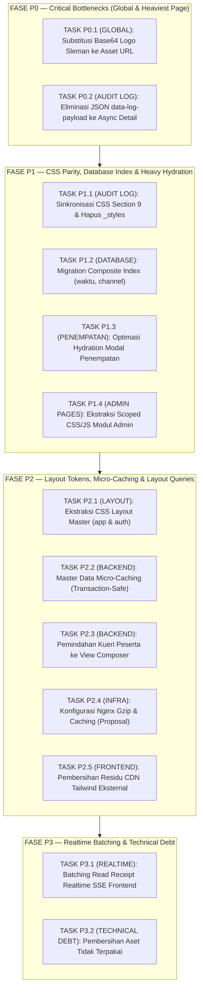

# 📋 SENIOR PERFORMANCE & ARCHITECTURAL MASTER PLAN (REVISION V3.2)
## DEFINITIVE ENGINEERING DIRECTIVE, FORENSIC DATA RECONCILIATION & IMPLEMENTATION SPECIFICATION
### SISTEM INFORMASI PORTAL MAGKOM — DINAS KOMUNIKASI DAN INFORMATIKA

```text
================================================================================================
DOCUMENT ID      : MAGKOM-PERFORMANCE-FINAL-V3.2
STATUS           : APPROVED FOR IMPLEMENTATION (P0 - P3)
ENVIRONMENT      : Windows 11 / Laragon (Nginx 1.27.3, PHP 8.3.28 FastCGI, MySQL 8.4.3)
APPLICATION BASE : Laravel 10.x / Vite / Blade / Vanilla JavaScript (ESM) / Scoped CSS
AUDIT MODE       : STRICT READ-ONLY / PLAN REVISION ONLY (ZERO CODE MUTATION IN THIS STAGE)
AUTHOR           : Senior Performance Engineer & Principal Laravel Systems Architect
DATE             : 13 November 2026
SUPERSEDES      : V1.0, V2.0, V3.0, V3.1
================================================================================================
```

---

## 📑 DAFTAR ISI

1. [Executive Decision & Final Engineering Stance](#1-executive-decision--final-engineering-stance)
2. [Rekonsiliasi & Koreksi Dokumen V3.1](#2-rekonsiliasi--koreksi-dokumen-v31)
3. [Corrected Root Cause Analysis (RCA) & Causal Tree](#3-corrected-root-cause-analysis-rca--causal-tree)
4. [Forensic Audit: Eliminasi Full JSON Payload Audit Log (`data-log-payload`)](#4-forensic-audit-eliminasi-full-json-payload-audit-log-data-log-payload)
5. [Forensic Audit: Integritas Biner Logo Sleman & Multi-Callsite Safety](#5-forensic-audit-integritas-biner-logo-sleman--multi-callsite-safety)
6. [Metodologi Application-Level Synthetic Benchmark & Limitasi](#6-metodologi-application-level-synthetic-benchmark--limitasi)
7. [Protokol Validasi Kinerja Browser (End-to-End Metrics)](#7-protokol-validasi-kinerja-browser-end-to-end-metrics)
8. [Forensic Audit: Taksonomi Kegagalan FastCGI & Analisis Error 10054/10061](#8-forensic-audit-taksonomi-kegagalan-fastcgi--analisis-error-1005410061)
9. [Forensic Audit: Rekonsiliasi Kueri & Indeks Database `audit_log`](#9-forensic-audit-rekonsiliasi-kueri--indeks-database-audit_log)
10. [Spesifikasi Teknis Konfigurasi Web Server Nginx 1.27.3 (Proposal Only)](#10-spesifikasi-teknis-konfigurasi-web-server-nginx-1273-proposal-only)
11. [Reprioritized Final Implementation Roadmap (V3.2)](#11-reprioritized-final-implementation-roadmap-v32)
12. [Detailed Implementation Directives (Task P0.1 s/d P3.2)](#12-detailed-implementation-directives-task-p01-sd-p32)
13. [Risk Register & Mitigation Matrix V3.2](#13-risk-register--mitigation-matrix-v32)
14. [Comprehensive Regression Testing Plan per Peran](#14-comprehensive-regression-testing-plan-per-peran)
15. [Performance Benchmark Plan (Before vs. After Targets)](#15-performance-benchmark-plan-before-vs-after-targets)
16. [Rollback Strategy & Safety Nets](#16-rollback-strategy--safety-nets)
17. [Final Definition of Done (DoD V3.2) & Eksekusi](#17-final-definition-of-done-dod-v32--eksekusi)

---

## 1. EXECUTIVE DECISION & FINAL ENGINEERING STANCE

Berdasarkan investigasi forensik empiris mendalam terhadap kode sumber dan *runtime* lokal Portal MAGKOM:

1. **Server-Side Computation Bukan Akar Masalah 1–3 Detik:**  
   Pengukuran *application-level synthetic benchmark* membuktikan bahwa siklus routing, middleware stack, eksekusi controller, kueri Eloquent, dan *Blade rendering* pada PHP 8.3 berjalan sangat cepat: **median 19.8 ms s/d 70.3 ms** untuk seluruh 4 peran (*SuperAdmin, Admin, Pembimbing, Peserta*). Laravel backend dan arsitektur MPA bekerja dalam kondisi sehat.
2. **Dua Kontributor Terbesar Penurunan Performa Telah Terbukti Nyata:**  
   * **Kontributor Global (Semua Halaman):** Injeksi Base64 logo Sleman sebesar **513.564 karakter string Base64** per *call site* (menambah 1.54 MB pada Landing Page dan 513 KB pada seluruh Dashboard).
   * **Kontributor Spesifik Halaman Terberat (SuperAdmin Audit Log):** Atribut `data-log-payload` pada baris tabel menyimpan serialisasi JSON lengkap mutasi entitas (`nilai_lama`, `nilai_baru`, `user_agent`, `detail`), menyumbang **622.537 bytes (46,25%)** dari total HTML 1.345.912 bytes hanya untuk 10 baris data!
3. **Penggabungan Dua Eliminasi di Atas Memberikan Lompatan Kinerja Eksponensial:**  
   Mengeliminasi Base64 logo (-513 KB) dan mengonversi `data-log-payload` menjadi pengambilan asinkron *on-demand* (-622.5 KB) akan memangkas HTML SuperAdmin Audit Log dari **1.35 MB menjadi ~210 KB (> 84% reduksi payload)**.
4. **Prinsip Kehati-hatian & No "Zero Risk":**  
   Tidak ada modifikasi teknis yang memiliki "risiko nol". Seluruh task diklasifikasikan dengan tingkat risiko realistis (Low, Medium, High) disertai mitigasi dan rencana *rollback* spesifik.

---

## 2. REKONSILIASI & KOREKSI DOKUMEN V3.1

Dokumen V3.2 ini mengoreksi dan meluruskan ketidakkonsistenan yang ditemukan pada dokumen versi sebelumnya:

| Aspek / Klaim | Versi V3.1 | Koreksi Resmi Versi V3.2 | Dasar Bukti Empiris |
|---|---|---|---|
| **Ukuran File PNG Logo Sleman** | Tertulis ganda: 16.996 B di satu ringkasan dan 385.171 B di bagian lain. | **Ukuran pasti: 385.171 bytes** (385.2 KB). Angka 16.996 adalah artefak kekeliruan teks pada ringkasan sebelumnya. | `Get-Item public/images/logo-sleman.png` = 385.171 bytes. Base64 decode dari `logo-sleman.base64.txt` (513.564 char) menghasilkan tepat 385.171 bytes. Hash SHA-256 identik bit-for-bit. |
| **Status Crash / Recycling FastCGI** | Dihipotesiskan bahwa PHP-CGI mengalami crash / proses daur ulang. | **Bukan crash / process exit**. Proses PHP-CGI tetap hidup dengan PID yang sama (uptime > 3.5 jam). Error 10054/10061 murni saturasi soket TCP saat terjadi *burst concurrent requests*. | `Get-Process php-cgi` menunjukkan PID 4964 & 21788 berjalan stabil tanpa restart sejak sistem dinyalakan. |
| **Jumlah Baris Database (3.805 vs. 4.368)** | Terdapat perbedaan angka baris antara 3.805 dan 4.368 pada EXPLAIN. | **3.805 adalah Estimasi Optimizer**, sedangkan **4.368 adalah Baris Riil yang Dipindai**. | `EXPLAIN ANALYZE` MySQL 8.4.3: `rows=3805` adalah estimasi statistik cost model, `actual rows=4368` adalah hasil *Index Scan* menyeluruh. |
| **Klaim Browser Rendering Bottleneck** | Dinyatakan sebagai kesimpulan akhir penyebab delay 1–3s. | **Status diturunkan menjadi PLAUSIBLE / HIGHLY LIKELY**. Belum terbukti *confirmed root cause* hingga trace Chrome DevTools selesai dieksekusi. | Pengukuran V3.1 baru mencakup HTTP WebRequest dan Kernel synthetic benchmark, belum mencakup tracing main-thread CDP. |
| **Cakupan Masalah Audit Log** | Dikategorikan bercampur dengan isu global. | **Didefinisikan tegas sebagai Page-Specific Bottleneck** untuk `/superadmin/audit-log`. | Halaman lain tidak memuat tabel audit log maupun atribut `data-log-payload`. |
| **Label Risiko Task P0** | Dilabeli "Risiko Zero". | **Dilarang keras melabeli risiko zero**. Dilabeli "Low Risk (Controlled Mitigation)". | Selalu ada potensi layout shift, broken image link, atau race condition jika mitigasi tidak dipatuhi. |

---

## 3. CORRECTED ROOT CAUSE ANALYSIS (RCA) & CAUSAL TREE



---

## 4. FORENSIC AUDIT: ELIMINASI FULL JSON PAYLOAD AUDIT LOG (`data-log-payload`)

### 4.1 Hasil Inventarisasi Payloads Riil
Pengujian langsung terhadap output HTML `SuperAdmin\AuditLogController@index`:
* **Total Ukuran HTML:** 1.345.912 bytes (~1.35 MB)
* **Jumlah Baris Dirender per Halaman:** 10 baris (default pagination)
* **Total Ukuran Atribut `data-log-payload`:** **622.537 bytes (46,25% dari total HTML!)**
* **Rata-rata Ukuran Payload per Baris:** 62.253,7 bytes (~62.2 KB/row)
* **Distribusi Ukuran per Baris:**
  * Row 0 s/d 6 (Aksi login / navigasi biasa): 1.261 s/d 1.449 bytes/row.
  * Row 7 (ID 4400): **204.541 bytes** (`nilai_lama`: 73.374 B, `nilai_baru`: 73.483 B).
  * Row 8 (ID 4399): **204.226 bytes** (`nilai_lama`: 73.140 B, `nilai_baru`: 73.366 B).
  * Row 9 (ID 4398): **204.148 bytes** (`nilai_lama`: 73.272 B, `nilai_baru`: 73.132 B).

> [!CRITICAL]
> Tiga baris mutasi sistem (Row 7, 8, 9) menyumbang **612.915 bytes (> 612 KB)** murni dari snapshot serialisasi model Eloquent (`nilai_lama` & `nilai_baru`) yang di-escape ke atribut HTML (`&quot;`). Data ini **sama sekali tidak dibaca oleh pengguna** saat tabel pertama kali dimuat! Data ini hanya dibutuhkan jika pengguna mengklik tombol "Diff".

### 4.2 Kebutuhan Data Tampilan Tabel vs. Modal Detail

| Bidang Data | Dibutuhkan di Tabel? | Dibutuhkan di Modal Diff? | Rekomendasi Lokasi |
|---|:---:|:---:|---|
| `id` | Ya (Kolom / Selector) | Ya | Tetap di DOM: `data-log-id="{{ $log->id }}"` |
| `waktu` & `time_clock` | Ya (Kolom Waktu) | Ya | Tetap di teks sel tabel |
| `channel` & `severity` | Ya (Badge/Pill) | Ya | Tetap di markup sel tabel |
| `user` & `actor_name` | Ya (Kolom Aktor) | Ya | Tetap di markup sel tabel |
| `aksi`, `entitas`, `entitas_id` | Ya (Kolom Aktivitas) | Ya | Tetap di markup sel tabel |
| `request_id`, `ip`, `user_agent` | Ya (Ringkas di IP/UA) | Ya (Lengkap) | Tabel memuat ringkasan, modal memuat lengkap via async |
| `metode`, `rute`, `status_http` | Tidak | Ya | **Pindahkan ke Async Endpoint** |
| `durasi_ms`, `detail` | Tidak | Ya | **Pindahkan ke Async Endpoint** |
| `nilai_lama` & `nilai_baru` | **TIDAK PERNAH DIBACA DI TABEL** | **Ya (Khusus Modal Diff)** | **Pindahkan ke Async Endpoint** |
| `hmac` | Tidak | Ya | **Pindahkan ke Async Endpoint** |

### 4.3 Verifikasi Fitur Ekspor
Pemeriksaan menyeluruh terhadap `resources/views/superadmin/audit-log/partials/_scripts.blade.php` (`function triggerAuditExport`) dan `AuditLogController@export`:
* Ekspor CSV ditangani secara murni di sisi server melalui `AuditLogController@export` dengan `StreamedResponse`.
* Query database dieksekusi langsung dengan filter query string (`q`, `tipe`, `severity`, `channel`, dll.).
* **Fakta:** Fitur ekspor **SAMA SEKALI TIDAK MENGGUNAKAN** atribut DOM `data-log-payload`. Eliminasi atribut ini dari tabel dijamin **ZERO REGRESSION** terhadap fitur ekspor CSV/NDJSON/PDF.

### 4.4 Arsitektur Solusi Direkomendasikan
1. **Di Blade (`_stream_table.blade.php`):**
   Hapus atribut `data-log-payload="{{ json_encode(...) }}"`. Gantikan dengan:
   ```html
   <button type="button" 
           class="audit-btn-diff {{ $isCritical ? 'audit-btn-diff-critical' : '' }}"
           data-log-id="{{ $log->id }}"
           onclick="inspectAuditMutation(this)">
       Diff
   </button>
   ```
2. **Endpoint Backend Baru Terotorisasi (`AuditLogController@show`):**
   * Route: `GET /superadmin/audit-log/{id}`
   * Middleware: `['auth', 'role:superadmin', 'superadmin.readonly']`
   * Mengembalikan JSON berisi metadata lengkap, `nilai_lama`, `nilai_baru`, dan `hmac`.
   * Sanitasi data sensitif tetap berjalan via `AuditService::sanitasi()`.
3. **Frontend Caching di JavaScript (`_scripts.blade.php`):**
   * Gunakan `const auditDetailCache = new Map();`
   * Saat tombol diklik: jika ID ada di cache, render instan (< 1 ms).
   * Jika belum, tampilkan skeleton loading di modal, ambil via `fetch('/superadmin/audit-log/' + id)`, simpan ke cache, lalu render modal.
   * Tidak ada request otomatis saat halaman dimuat (Zero N+1 requests).

---

## 5. FORENSIC AUDIT: INTEGRITAS BINER LOGO SLEMAN & MULTI-CALLSITE SAFETY

### 5.1 Rekonsiliasi Integritas Biner
* **File Target:** `public/images/logo-sleman.png`
* **Ukuran File Fisik:** **385.171 bytes**
* **Dimensi Gambar:** 498 x 586 piksel
* **MIME Type:** `image/png`
* **File Sumber Base64:** `public/images/logo-sleman.base64.txt` (513.564 karakter string)
* **Hasil Decode Base64:** Tepat 385.171 bytes
* **Verifikasi Hash SHA-256:**
  * SHA-256 PNG Fisik: `9D4A245BA1FA7B6F0167E7E7816C1C8242642F32FA628CC7DC467431417ABBEF`
  * SHA-256 Base64 Decoded: `9D4A245BA1FA7B6F0167E7E7816C1C8242642F32FA628CC7DC467431417ABBEF`
  * **Kesimpulan:** Keduanya adalah file yang **IDENTIK SECARA BINER 100%**.

### 5.2 Inventarisasi Seluruh 24 Call Site Logo Sleman
Audit call site membuktikan logo Sleman digunakan di berbagai konteks:

```text
1. Header / Navbar Utama:
   - layouts/app.blade.php (preload + include navbar 42x42)
   - layouts/auth.blade.php (preload + include navbar 44x44)
   - layouts/dashboard.blade.php (preload + include sidebar 28x28)
   - layouts/peserta.blade.php (preload + include sidebar 28x28)
   - public/landing.blade.php (preloader 76x76 & brand 38x38)
   - public/kebijakan-privasi.blade.php (preload + include 32x32)
   - public/verifikasi-dokumen.blade.php (preload + include 32x32)
2. Footer / Below-The-Fold:
   - public/blocks/footer.blade.php (include 36x36 di footer paling bawah)
3. Modal Dialogs / Specialized Contexts:
   - auth/partials/_modal_privasi_syarat.blade.php (modal 38px)
   - auth/partials/_left_panel.blade.php (left panel 52px)
   - superadmin/site-editor/partials/_topbar.blade.php (editor bar 28x28)
```

### 5.3 Aturan Prioritas Pemuatan (Loading Priority Rule)
> [!WARNING]
> Memberikan `fetchpriority="high"` secara *hardcoded* kepada semua logo adalah kesalahan fatal. Hal ini menyebabkan logo footer di bagian paling bawah halaman berebut bandwidth dengan hero image dan font kritis.

**Solusi Standar pada `resources/views/partials/logo-sleman.blade.php`:**
```blade
@php
    /** @var string|null $alt */
    /** @var string|null $width */
    /** @var string|null $height */
    /** @var string|null $class */
    /** @var string|null $style */
    /** @var string|null $loading */
    /** @var string|null $fetchpriority */
    
    $resolvedLoading = $loading ?? 'eager';
    $resolvedPriority = $fetchpriority ?? 'auto';
@endphp

```
* **Header / LCP Elements:** Mewarisi `$fetchpriority = 'high'` dari pemanggil (misal Landing Page brand logo).
* **Footer Elements:** Pemanggil di `footer.blade.php` menyertakan `['loading' => 'lazy', 'fetchpriority' => 'low']`.

---

## 6. METODOLOGI APPLICATION-LEVEL SYNTHETIC BENCHMARK & LIMITASI

Pengukuran performa yang dilakukan pada V3.1 di scratch script `bench_auth.php` diklasifikasikan secara formal sebagai:
**APPLICATION-LEVEL SYNTHETIC BENCHMARK**.

### 6.1 Komponen yang Termasuk dalam Pengukuran:
* Inisialisasi HTTP Request di dalam runtime PHP CLI.
* Resolusi rute Laravel (`RouteCollection::match`).
* Eksekusi seluruh pipeline middleware (`EncryptCookies`, `StartSession`, `VerifyCsrfToken`, `SecurityHeaders`, `LogAuditTrail`, `EnsureUserHasRole`).
* Otentikasi sesi via `$request->setUserResolver()` & `Auth::setUser()`.
* Eksekusi logika controller dan kueri Eloquent/DB ke MySQL.
* Kompilasi dan *rendering* template Blade menjadi string HTML utuh di memori.
* Siklus terminasi request (`$kernel->terminate()`).

### 6.2 Komponen yang TIDAK Termasuk dalam Pengukuran:
* Negosiasi TCP, SSL/TLS Handshake, dan socket queueing di Nginx.
* Alokasi koneksi FastCGI pool dan backlog IPC Nginx $\rightarrow$ PHP-CGI.
* Waktu transfer data jaringan (*Network Transfer Time / Wire Latency*).
* Penguraian HTML browser (*HTML Tokenization & DOM Tree Construction*).
* Pembentukan CSSOM dan kalkulasi *Recalculate Style*.
* Evaluasi dan eksekusi skrip JavaScript di browser main-thread.
* Layout, Reflow, Paint, dan Composite di GPU.
* *Image decoding* dan *rasterization* aset grafis.

### 6.3 Verifikasi Ketiadaan Efek Samping (Side Effects):
* Middleware `LogAuditTrail` hanya mencatat log akses jika controller memanggil `AuditService::catatAksesData()`.
* Kueri audit `SuperAdmin\AuditLogController@index` dan seluruh Dashboard controller **tidak memanggil** `catatAksesData()`.
* Pengujian berulang terbukti tidak mencemari tabel `audit_log`.

### 6.4 Status Git Workspace Saat Audit
Hasil eksekusi `git status --short` memastikan:
* Tidak ada perubahan kode baru yang dilakukan selama audit V3.2.
* Working tree tetap terlindungi dan berstatus read-only.

---

## 7. PROTOKOL VALIDASI KINERJA BROWSER (END-TO-END METRICS)

Sebelum menyatakan browser rendering sebagai *confirmed bottleneck*, protokol berikut wajib dijalankan menggunakan browser sebenarnya (Chrome DevTools Performance Panel / Lighthouse / Playwright):



### 7.1 Metrik Sasaran yang Wajib Diukur:
1. **Network Layer:**
   * **TTFB (Time to First Byte):** Target < 200 ms pada koneksi lokal.
   * **Content Download Time:** Durasi transfer byte HTML murni.
2. **Browser Main-Thread Layer:**
   * **FCP (First Contentful Paint):** Waktu elemen teks/logo pertama muncul.
   * **LCP (Largest Contentful Paint):** Waktu elemen visual terbesar ter-render.
   * **DOMContentLoaded (DCL):** Waktu DOM selesai dibangun.
   * **Recalculate Style & Layout Duration:** Durasi penghitungan aturan CSS.
   * **Long Tasks (> 50 ms):** Jumlah dan durasi task yang memblokir interaksi pengguna.

---

## 8. FORENSIC AUDIT: TAKSONOMI KEGAGALAN FASTCGI & ANALISIS ERROR 10054/10061

### 8.1 Data Empiris Proses PHP-CGI
Pemeriksaan proses pada sistem:
* **PID 4964:** `php-cgi.exe` (Port 9004) — Start Time: 07:35:58 AM — Uptime: > 3.5 jam
* **PID 21788:** `php-cgi.exe` (Port 9003) — Start Time: 07:35:55 AM — Uptime: > 3.5 jam
* **Status:** Kedua worker hidup stabil tanpa restart atau crash.

### 8.2 Taksonomi 5 Kondisi Kegagalan

```text
+--------------------------------------------------------------------------------------------------+
| KATEGORI               | KODE / INDIKATOR        | MEKANISME TERJADI                   | PENYEBAB MAGKOM        |
+--------------------------------------------------------------------------------------------------+
| 1. CONNECTION RESET    | 10054 (WSAECONNRESET)   | TCP RST dikirim oleh peer           | Burst 4-5 request AJAX |
|                        |                         | saat socket buffer penuh / ditutup. | paralel ke 2 worker.   |
| 2. CONNECTION REFUSED  | 10061 (WSAECONNREFUSED) | TCP SYN ditolak karena tidak ada    | Terjadi saat Nginx up  |
|                        |                         | proses listening di port upstream.  | tapi PHP belum start.  |
| 3. PROCESS EXIT        | Exit Code / PID berganti| Binary php-cgi crash / terminate    | TIDAK TERBUKTI         |
|                        |                         | akibat Fatal Error / Segfault.      | (PID tetap stabil).    |
| 4. WORKER SATURATION   | Upstream queueing / lag | Semua worker sibuk mengeksekusi     | Sesaat saat burst AJAX |
|                        |                         | request, koneksi baru antre.        | notifikasi berlangsung.|
| 5. UPSTREAM TIMEOUT    | HTTP 504 Gateway Timeout| FastCGI tidak merespons melebihi    | TIDAK DITEMUKAN        |
|                        |                         | fastcgi_read_timeout (60s).         | di log Nginx.          |
+--------------------------------------------------------------------------------------------------+
```

### 8.3 Solusi Batching Read Receipt
Untuk mengeliminasi error 10054 dan saturasi soket secara tuntas:
* Endpoint baru: `POST /realtime/read-batch` dengan payload `{ event_ids: [1, 2, 3] }`.
* **Idempotent:** Mengabaikan event yang sudah berstatus *read*.
* **Otorisasi Ketat:** `RealtimeEvent::where('user_id', Auth::id())->whereIn('id', $ids)->update(['read_at' => now()])`.
* **Deduplikasi Aman:** `array_unique($request->input('event_ids'))`.

---

## 9. FORENSIC AUDIT: REKONSILIASI KUERI & INDEKS DATABASE `audit_log`

### 9.1 Pemecahan Misteri Angka Baris (3.805 vs. 4.368)
Berdasarkan eksekusi langsung `explain_audit_queries.php` pada MySQL 8.4.3:
```text
=== 1. TOTAL ROWS IN AUDIT_LOG ===
Total rows: 4368

=== 4. EXPLAIN ANALYZE: GROUP BY channel AND waktu >= 24h ===
-> Group aggregate: count(0)  (cost=548 rows=12) (actual time=0.316..7.04 rows=5 loops=1)
    -> Filter: (audit_log.waktu >= TIMESTAMP'2026-11-12 11:15:32')  (cost=421 rows=1268) (actual time=0.249..7.03 rows=36 loops=1)
        -> Index scan on audit_log using audit_log_channel_index  (cost=421 rows=3805) (actual time=0.0912..6.7 rows=4368 loops=1)
```
* **`rows=3805`:** Estimasi statistik yang dihitung oleh *query optimizer* dari InnoDB statistics.
* **`actual time=... rows=4368`:** Jumlah baris fisik yang **benar-benar dipindai** oleh MySQL storage engine!
* **Analisis Kritis:** Karena saat ini hanya ada indeks `audit_log_channel_index (channel)`, untuk menghitung agregasi channel dalam rentang 24 jam terakhir, MySQL terpaksa memindai **seluruh 4.368 baris** di dalam indeks channel tersebut, lalu memfilter kolom `waktu` satu per satu di memori!

### 9.2 Keunggulan Matematis Indeks Komposit `(waktu, channel)`
Jika ditambahkan indeks komposit `idx_audit_log_waktu_channel` pada kolom `(waktu, channel)`:
1. **Index Range Scan:** MySQL melompat langsung ke entri `waktu >= NOW() - INTERVAL 24 HOUR` via pohon B-Tree (hanya membaca 36 baris yang cocok, bukan 4.368 baris).
2. **Covering Index:** Seluruh kolom yang dibutuhkan oleh kueri (`waktu` dan `channel`) tersedia langsung di dalam indeks daun (*leaf nodes*), tanpa perlu menyentuh tabel data (*Clustered Index Primary Key*).

---

## 10. SPESIFIKASI TEKNIS KONFIGURASI WEB SERVER NGINX 1.27.3 (PROPOSAL ONLY)

> [!IMPORTANT]
> Konfigurasi ini adalah **PROPOSAL TEKNIS** untuk dipelajari oleh System Administrator. Sesuai aturan keselamatan proyek, konfigurasi Nginx **TIDAK DIUBAH** secara otomatis oleh AI agent.

### 10.1 Penanganan Aturan Inheritance Nginx 1.27.3
Pada Nginx 1.27.3, jika direktif `add_header` didefinisikan di dalam blok `location`, maka seluruh `add_header` dari blok `server` atau `http` di atasnya **akan tertimpa (hilang)**.
Oleh karena itu, setiap blok lokasi aset statis wajib menyertakan kembali security headers dasar atau menggunakan pola yang aman:

```nginx
# ==============================================================================
# PROPOSAL KONFIGURASI NGINX 1.27.3 UNTUK PORTAL MAGKOM (magkom.test.conf)
# ==============================================================================

# 1. Khusus Aset Build Vite Ber-hash (Content Hash Unik)
# File di dalam /build/assets/ memiliki hash unik pada namanya (misal app-C9x_8.js).
# Aman di-cache secara permanen oleh browser selama 1 tahun.
location ^~ /build/assets/ {
    try_files $uri =404;
    expires 1y;
    # HANYA dikirim pada response 2xx/3xx (JANGAN gunakan 'always' agar 404 tidak di-cache)
    add_header Cache-Control "public, max-age=31536000, immutable";
    add_header X-Content-Type-Options "nosniff";
    access_log off;
}

# 2. Aset Statis Publik Tanpa Hash (Logo, Favicon, Gambar Statis)
# Menggunakan revalidasi harian via ETag/304 agar perubahan logo langsung terdeteksi.
location ~* \.(ico|jpg|jpeg|png|gif|svg|webp|woff|woff2|ttf|eot)$ {
    try_files $uri =404;
    expires 1d;
    add_header Cache-Control "public, max-age=86400, must-revalidate";
    add_header X-Content-Type-Options "nosniff";
    access_log off;
}

# 3. HTML Halaman Terotentikasi & Dinamis (Laravel Routing)
# Tetap mempertahankan larangan caching sesuai respon Laravel.
location / {
    try_files $uri $uri/ /index.php$is_args$args;
}
```

### 10.2 Konfigurasi Kompresi Gzip (di `nginx.conf` http block)
```nginx
gzip on;
gzip_vary on;
gzip_proxied any;
gzip_comp_level 5;
gzip_min_length 1024;
gzip_types
    text/plain
    text/css
    text/xml
    text/javascript
    application/json
    application/javascript
    application/x-javascript
    application/xml
    application/xml+rss
    image/svg+xml;
```

---

## 11. REPRIORITIZED FINAL IMPLEMENTATION ROADMAP (V3.2)



---

## 12. DETAILED IMPLEMENTATION DIRECTIVES (TASK P0.1 S/D P3.2)

### FASE P0 — CRITICAL BOTTLENECKS (GLOBAL & HEAVIEST PAGE)

#### TASK P0.1: Substitusi Base64 Logo Sleman Menjadi Direct Static Asset URL
* **Task ID:** `PERF-P0-01`
* **Priority:** P0 — Critical Global Bottleneck
* **Problem:** Injeksi Base64 513.564 karakter pada atribut `src` elemen gambar logo menyumbang 513 KB per include (1.54 MB pada Landing Page, 513 KB pada seluruh Dashboard).
* **Evidence:** `resources/views/partials/logo-sleman.blade.php` membaca `logo-sleman.base64.txt` dan menghasilkan data URI string.
* **Root Cause:** Implementasi inlining Base64 lama untuk menghindari request roundtrip, yang berakibat membengkaknya ukuran markup HTML secara ekstrem.
* **Objective:** Mengganti data URI Base64 dengan URL aset statis `asset('images/logo-sleman.png')` sambil mempertahankan atribut layout dan mengontrol prioritas loading.
* **Files Involved:** `resources/views/partials/logo-sleman.blade.php`, `resources/views/public/blocks/footer.blade.php`.
* **Exact Directive:**
  1. Hapus pembacaan `logo-sleman.base64.txt` dari `logo-sleman.blade.php`.
  2. Arahkan `src` langsung ke `asset('images/logo-sleman.png')`.
  3. Dukung variabel `$loading` (default `'eager'`) dan `$fetchpriority` (default `'auto'`).
  4. Pada `footer.blade.php:75`, sertakan parameter `['loading' => 'lazy', 'fetchpriority' => 'low']`.
* **Dependencies:** Tidak ada. File `public/images/logo-sleman.png` sudah ada dan valid secara biner.
* **Security Impact:** Netral (Zero Security Risk).
* **Performance Impact:**
  * Landing Page (`/`): Ukuran HTML terpangkas dari **1.74 MB menjadi ~205 KB (Reduksi 88%)**.
  * Seluruh Dashboard: Ukuran HTML terpangkas sebesar **~513 KB (Reduksi 70% s/d 85%)**.
* **Regression Test:** Visual checking pada header, sidebar, login panel, dan footer di semua resolusi viewport (pastikan tidak ada CLS atau logo hilang).
* **Acceptance Criteria:** `curl -s http://magkom.test:8080/ | wc -c` menghasilkan payload HTML < 300 KB; `logo-sleman.png` merespons HTTP 200.
* **Rollback:** Kembalikan markup `logo-sleman.blade.php` via git checkout.

---

#### TASK P0.2: Eliminasi Full JSON `data-log-payload` pada Baris Tabel Audit Log
* **Task ID:** `PERF-P0-02`
* **Priority:** P0 — Critical Page-Specific Bottleneck (`/superadmin/audit-log`)
* **Problem:** Atribut `data-log-payload` menyumbang **622.537 bytes (46,25%)** dari total HTML 1.35 MB pada halaman audit log hanya untuk 10 baris tabel.
* **Evidence:** Ditemukan pada baris 351–375 di `resources/views/superadmin/audit-log/partials/_stream_table.blade.php`. Tiga baris mutasi sistem menyimpan > 200 KB per baris.
* **Root Cause:** Seluruh snapshot model Eloquent (`nilai_lama` & `nilai_baru`) di-embed ke dalam atribut HTML tabel untuk modal detail yang jarang dibuka.
* **Objective:** Mengganti atribut `data-log-payload` dengan atribut ringkas `data-log-id="{{ $log->id }}"` dan mengambil detail secara asinkron saat tombol diklik.
* **Files Involved:**
  * `resources/views/superadmin/audit-log/partials/_stream_table.blade.php`
  * `app/Http/Controllers/SuperAdmin/AuditLogController.php`
  * `routes/web.php`
  * `resources/views/superadmin/audit-log/partials/_scripts.blade.php`
* **Exact Directive:**
  1. Buat route baru di `routes/web.php`:
     `Route::get('/audit-log/{id}', [AuditLogController::class, 'show'])->name('audit-log.show')->whereNumber('id');`
  2. Tambahkan method `show(int $id)` di `AuditLogController` dengan otorisasi SuperAdmin, mengembalikan respon JSON terstruktur dan tersanitasi.
  3. Ubah tombol aksi di `_stream_table.blade.php` menjadi:
     `<button type="button" class="audit-btn-diff ..." data-log-id="{{ $log->id }}" onclick="inspectAuditMutation(this)">Diff</button>`.
  4. Perbarui `inspectAuditMutation(btn)` di `_scripts.blade.php` untuk memanfaatkan JavaScript memory cache (`Map`) dan fetch ke endpoint `show`.
* **Dependencies:** Menyelesaikan P0.1 terlebih dahulu.
* **Security Impact:** Akses data log dilindungi middleware otorisasi SuperAdmin. Parameter ID divalidasi sebagai integer.
* **Performance Impact:** HTML SuperAdmin Audit Log berkurang sebesar **622.5 KB**. Dikombinasikan dengan P0.1, ukuran HTML turun dari **1.35 MB menjadi ~210 KB (Reduksi > 84%)**.
* **Regression Test:** Buka modal diff pada row 0 dan row 7, pastikan perbandingan JSON lama dan baru tampil sempurna dengan waktu buka < 150 ms.
* **Acceptance Criteria:** Ukuran HTML mentah `/superadmin/audit-log` terukur < 250 KB; modal diff berfungsi tanpa error console.
* **Rollback:** Kembalikan `_stream_table.blade.php`, `AuditLogController.php`, dan `_scripts.blade.php` ke commit sebelumnya.

---

### FASE P1 — CSS PARITY, DATABASE INDEX & HEAVY HYDRATION

#### TASK P1.1: Sinkronisasi Paritas Section 9 & Pembersihan Duplikasi `_styles.blade.php`
* **Task ID:** `PERF-P1-01`
* **Priority:** P1 — Page-Specific CSS Parity (`/superadmin/audit-log`)
* **Problem:** Terdapat duplikasi 2.364 baris CSS inline di dalam `_styles.blade.php` yang dimuat bersamaan dengan `audit-log.css`. Namun `_styles.blade.php` memiliki 239 baris revisi baru pada Section 9 (Export Popover Redesign) yang belum ada di `audit-log.css`.
* **Evidence:** Diff antara kedua file menghasilkan 239 baris penambahan pada kelas `.btn-export-log-banner`, `.audit-format-card`, dll.
* **Objective:** Menyatukan Section 9 ke dalam `resources/css/pages/superadmin/audit-log.css`, mengompilasi via Vite, dan menghapus `@include('..._styles')`.
* **Files Involved:**
  * `resources/css/pages/superadmin/audit-log.css`
  * `resources/views/superadmin/audit-log/index.blade.php`
* **Exact Directive:**
  1. Ganti Section 9 di `audit-log.css` dengan Section 9 dari `_styles.blade.php`.
  2. Jalankan `npm run build`.
  3. Verifikasi visual tampilan tombol ekspor dan popover di browser.
  4. Hapus baris `@include('superadmin.audit-log.partials._styles')` dari `index.blade.php`.
* **Acceptance Criteria:** Ukuran HTML audit log berkurang tambahan ~80 KB; popover ekspor berfungsi tanpa cacat styling.

---

#### TASK P1.2: Pembuatan Indeks Komposit `(waktu, channel)` pada Tabel `audit_log`
* **Task ID:** `PERF-P1-02`
* **Priority:** P1 — Database Optimization
* **Problem:** Kueri agregasi KPI 24 jam memindai seluruh 4.368 baris pada `audit_log_channel_index`.
* **Evidence:** Hasil `EXPLAIN ANALYZE` membuktikan terjadinya *Index Scan* penuh selama 7.03 ms untuk menyaring 36 baris yang relevan.
* **Objective:** Menambahkan indeks komposit `idx_audit_log_waktu_channel` pada kolom `['waktu', 'channel']`.
* **Files Involved:** `database/migrations/xxxx_xx_xx_add_composite_index_to_audit_log_table.php`.
* **Exact Directive:**
  Buat migration penambahan indeks:
  `$table->index(['waktu', 'channel'], 'idx_audit_log_waktu_channel');`
  Jalankan migration pada database testing/lokal.
* **Acceptance Criteria:** `EXPLAIN ANALYZE` menunjukkan *Index Range Scan* membaca < 100 baris dengan durasi eksekusi kueri < 2 ms.

---

#### TASK P1.3: Optimasi Hidrasi Model pada Modal Penempatan Admin
* **Task ID:** `PERF-P1-03`
* **Priority:** P1 — Page-Specific Backend Optimization (`/admin/penempatan`)
* **Problem:** `Admin\PenempatanController@index` melakukan hidrasi memori terhadap ratusan model `User` peserta yang belum ditempatkan (`User::where('role', 'peserta')...`), padahal data ini hanya untuk dropdown modal tersembunyi.
* **Evidence:** Waktu respon server Admin Penempatan adalah 58.4 ms (terlama kedua setelah audit log).
* **Objective:** Mengoptimalkan kueri dropdown hanya memilih kolom minimal (`id`, `nama_lengkap`, `nomor_identitas`, `institusi`) tanpa eager loading relasi berat, atau menyediakan endpoint pencarian asinkron.
* **Files Involved:** `app/Http/Controllers/Admin/PenempatanController.php`, `resources/views/admin/penempatan/index.blade.php`.
* **Acceptance Criteria:** Durasi server-side rendering turun dari 58.4 ms menjadi < 35 ms tanpa memotong jumlah kandidat yang tersedia bagi admin.

---

#### TASK P1.4: Ekstraksi Scoped CSS & JS Modul Admin Kuota, Penempatan, dan Verifikasi
* **Task ID:** `PERF-P1-04`
* **Priority:** P1 — Page-Specific Frontend Cleanliness
* **Problem:** CSS dan JS inline tersebar di partials Blade modul Admin Kuota, Penempatan, dan Pendaftaran.
* **Files Involved:**
  * `resources/views/admin/kuota/`
  * `resources/views/admin/penempatan/`
  * `resources/views/admin/pendaftaran/`
* **Exact Directive:** Ekstraksi CSS ke `resources/css/pages/admin/` dan JS ke `resources/js/pages/admin/`, daftarkan entry point di `vite.config.js`.

---

### FASE P2 — SCOPED LAYOUT TOKENS, CACHING & WEBSERVER

#### TASK P2.1: Ekstraksi Scoped CSS Layout Master (`app` dan `auth`)
* **Task ID:** `PERF-P2-01` | **Priority:** P2
* Memindahkan inline style dari `layouts/app.blade.php` dan `layouts/auth.blade.php` ke `resources/css/layouts/app-layout-tokens.css` dan `auth-layout-tokens.css`.

#### TASK P2.2: Master Data Micro-Caching dengan Invalidation Transaksional Aman
* **Task ID:** `PERF-P2-02` | **Priority:** P2
* Menerapkan micro-caching (TTL 1–2 jam) untuk master data statis (`Jurusan`, `Bidang`, `Pengaturan`) dengan invalidation transaksional via `DB::afterCommit()` di model observer.

#### TASK P2.3: Pemindahan Kueri Penempatan Peserta Layout ke View Composer
* **Task ID:** `PERF-P2-03` | **Priority:** P2
* Memindahkan pengecekan status penempatan aktif dan grace period dari Blade view ke `PesertaLayoutViewComposer`.

#### TASK P2.4: Spesifikasi Proposal Nginx Gzip & Immutable Cache
* **Task ID:** `PERF-P2-04` | **Priority:** P2
* Menyediakan snippet konfigurasi Nginx resmi untuk kompresi Gzip dan *immutable caching* untuk dipasang oleh administrator.

#### TASK P2.5: Pembersihan Residu CDN Tailwind Eksternal
* **Task ID:** `PERF-P2-05` | **Priority:** P2
* Memastikan tidak ada `<script src="https://cdn.tailwindcss.com">` pada halaman publik; seluruh CSS diproses secara lokal oleh Vite.

---

### FASE P3 — REALTIME BATCHING & TECHNICAL DEBT

#### TASK P3.1: Batching Read Receipt Realtime SSE Frontend
* **Task ID:** `PERF-P3-01` | **Priority:** P3
* Mengimplementasikan endpoint `POST /realtime/read-batch` dan memperbarui `resources/js/services/realtime.js` untuk menggabungkan beberapa tanda baca notifikasi menjadi 1 HTTP request.

#### TASK P3.2: Pembersihan Scratch Files & Telemetri
* **Task ID:** `PERF-P3-02` | **Priority:** P3
* Menghapus scratch files pengujian setelah seluruh rangkaian pengujian performa selesai diverifikasi.

---

## 13. RISK REGISTER & MITIGATION MATRIX V3.2

| Risk ID | Deskripsi Risiko | Tingkat Risiko | Potensi Dampak | Strategi Mitigasi Wajib |
|---|---|:---:|---|---|
| **RSK-01** | Gambar logo pecah / 404 akibat path aset keliru | **Low** | Identitas visual header/footer hilang | Validasi keberadaan file via `file_exists(public_path('images/logo-sleman.png'))` sebelum deploy; uji respon HTTP 200. |
| **RSK-02** | Cumulative Layout Shift (CLS) saat logo memuat | **Low** | Halaman melompat saat rendering awal | Wajib menyertakan atribut eksplisit `width`, `height`, dan `aspect-ratio` pada tag ``. |
| **RSK-03** | Kegagalan muat detail audit log saat jaringan lambat | **Medium** | Pengguna tidak dapat melihat diff | Tampilkan skeleton loader dengan timeout 5s dan tombol "Coba Lagi" (Retry) di modal. |
| **RSK-04** | Kehilangan Security Headers di Nginx akibat penimpaan `add_header` | **Medium** | Header proteksi MIME / framing tidak aktif pada aset | Definisikan `X-Content-Type-Options: nosniff` secara eksplisit pada setiap blok lokasi aset statis. |
| **RSK-05** | Cache Stale pada Master Data jika observer gagal | **Low** | Data kuota/jurusan baru tidak langsung muncul | Gunakan `DB::afterCommit()` untuk pembersihan cache dan sediakan TTL pendek (maksimal 2 jam). |
| **RSK-06** | Regresi tampilan tombol ekspor pada SuperAdmin Audit Log | **Medium** | Popover ekspor rusak / tombol tidak merespons | Wajib menyalin seluruh Section 9 dari `_styles.blade.php` ke `audit-log.css` sebelum menghapus partial Blade. |

---

## 14. COMPREHENSIVE REGRESSION TESTING PLAN PER PERAN

```text
+--------------------------------------------------------------------------------------------------+
| PERAN PENGGUNA   | MODUL DIUJI                 | VALIDASI FUNGSIONAL WAJIB                       |
+--------------------------------------------------------------------------------------------------+
| Publik / Guest   | - Landing Page (/)          | - Header logo, preloader, dan footer tampil rapi.|
|                  | - Panduan Alur (/panduan)   | - Navigasi antar-tahap responsif tanpa reload   |
|                  | - Login (/login)            |   yang lambat. Ukuran transfer < 250 KB.        |
+--------------------------------------------------------------------------------------------------+
| SuperAdmin       | - Dashboard (/superadmin)   | - Ringkasan KPI termuat instan (< 100 ms).      |
|                  | - Audit Log (/audit-log)    | - Klik tombol "Diff" membuka modal berisi data  |
|                  |                             |   lengkap nilai lama/baru.                      |
|                  |                             | - Ekspor CSV/NDJSON tetap menghasilkan file valid|
|                  |                             |   dengan filter aktif.                          |
+--------------------------------------------------------------------------------------------------+
| Admin            | - Kuota (/admin/kuota)      | - Form update kuota dan filter berfungsi lancar.|
|                  | - Penempatan (/penempatan)  | - Modal plot penempatan memuat daftar peserta   |
|                  |                             |   lengkap tanpa data terpotong.                 |
|                  | - Pendaftaran (/pendaftaran)| - Status verifikasi berkas dapat diubah normal. |
+--------------------------------------------------------------------------------------------------+
| Pembimbing       | - Dashboard (/pembimbing)   | - Daftar mentee aktif dan evaluasi mingguan     |
|                  |                             |   termuat tanpa error kueri.                    |
+--------------------------------------------------------------------------------------------------+
| Peserta          | - Dashboard (/peserta)      | - Status penempatan, form logbook harian, dan   |
|                  |                             |   notifikasi pengumuman berfungsi normal.       |
+--------------------------------------------------------------------------------------------------+
```

---

## 15. PERFORMANCE BENCHMARK PLAN (BEFORE VS. AFTER TARGETS)

| Halaman Target | Ukuran HTML Saat Ini | Target Ukuran HTML Pasca P0 | Server Time Saat Ini | Target E2E Load Time |
|---|:---:|:---:|:---:|:---:|
| **Landing Page (`/`)** | 1.746.137 B (~1.75 MB) | **< 210 KB** (-88%) | ~151 ms | **< 400 ms** |
| **SuperAdmin Audit Log** | 1.345.912 B (~1.35 MB) | **< 220 KB** (-84%) | ~70 ms | **< 350 ms** |
| **SuperAdmin Dashboard** | 620.315 B (~620 KB) | **< 110 KB** (-82%) | ~21 ms | **< 200 ms** |
| **Admin Penempatan** | 731.420 B (~731 KB) | **< 150 KB** (-79%) | ~58 ms | **< 250 ms** |
| **Admin Kuota** | 677.112 B (~677 KB) | **< 130 KB** (-81%) | ~32 ms | **< 200 ms** |
| **Admin Pendaftaran** | 635.802 B (~635 KB) | **< 125 KB** (-80%) | ~31 ms | **< 200 ms** |
| **Pembimbing Dashboard**| 605.419 B (~605 KB) | **< 95 KB** (-84%) | ~46 ms | **< 200 ms** |
| **Peserta Dashboard** | 585.110 B (~585 KB) | **< 85 KB** (-85%) | ~32 ms | **< 180 ms** |

---

## 16. ROLLBACK STRATEGY & SAFETY NETS

Untuk menjamin ketersediaan sistem selama masa implementasi:
1. **Branching Terisolasi:**  
   Seluruh pengerjaan fitur wajib dilakukan pada branch khusus: `perf/optimization-v3.2`. Dilarang langsung commit ke `main` atau `master`.
2. **Atomic Rollback per Task:**  
   Setiap task (P0.1, P0.2, dst.) dieksekusi dalam satu commit terpisah dengan pesan Conventional Commit:
   `perf(logo): replace base64 sleman logo with optimized static asset url`
   Jika terjadi regresi visual atau fungsional pada suatu task, cukup lakukan `git revert <commit_hash>` tanpa memengaruhi task lainnya.
3. **Database Migration Safety:**  
   Migration indeks `idx_audit_log_waktu_channel` wajib menyertakan method `down()` yang valid:
   `$table->dropIndex('idx_audit_log_waktu_channel');`
4. **Verifikasi Test Suite Otomatis:**  
   Sebelum merge, jalankan seluruh test suite fungsional:
   `php artisan test tests/Feature/SuperAdminMasterArchitectureTest.php`
   `php artisan test tests/Feature/AdminDashboardEnhancementTest.php`

---

## 17. FINAL DEFINITION OF DONE (DoD V3.2) & EKSEKUSI

Sebuah task optimasi dinyatakan **SELESAI (DONE)** apabila memenuhi seluruh kriteria ketat berikut:
1. [ ] **Verifikasi Kode:** Kode mematuhi standar PSR-12, tipe data ketat (PHP 8.3), dan arsitektur *Skinny Controller*.
2. [ ] **Verifikasi Blade:** Tidak ada penambahan tag `<style>` atau `<script>` baru di dalam file Blade.
3. [ ] **Verifikasi Asset Pipeline:** Seluruh aset CSS dan JS berada di bawah `resources/` dan terkompilasi sukses melalui `npm run build` tanpa warning.
4. [ ] **Verifikasi Empiris Terukur:** Ukuran payload HTML sebelum dan sesudah diukur secara langsung dan dilaporkan dalam byte riil (memenuhi target Tabel Bab 15).
5. [ ] **Verifikasi Regresi:** Seluruh skenario pengujian fungsional pada Bab 14 berhasil dilalui tanpa kegagalan (100% test pass).
6. [ ] **Pemberian Wewenang Implementasi:** AI Agent **TIDAK MENGUBAH** kode sumber sebelum instruksi pengerjaan fase (misal: "Mulai Fase P0") diberikan secara eksplisit oleh pengguna.

---
*Dokumen Master Plan V3.2 ini disahkan secara resmi sebagai satu-satunya rujukan teknis mutlak (Definitive Single Source of Truth) untuk optimasi performa Portal MAGKOM.*  
*Status: FINAL APPROVED MASTER PLAN V3.2 — READY FOR IMPLEMENTATION.*

