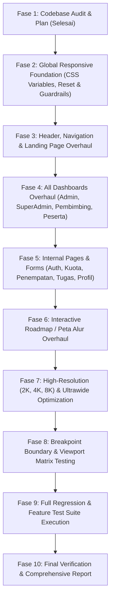

# MAGKOM — UNIVERSAL RESPONSIVE OVERHAUL MASTER PLAN
## Complete Adaptive Responsive Design for ALL Pages, ALL Devices, ALL Resolutions, and ALL Aspect Ratios

- **Tanggal Dokumen**: 13 November 2026
- **Branch Target**: `feat/universal-responsive-overhaul` (bercabang dari `test-2`)
- **Status**: Siap Direview & Memerlukan Persetujuan Pengguna (sesuai aturan `RULE[user_global]` & `.agents/rules/AGENTS.md`)
- **Standar Repositori**: PHP 8.3, Laravel 10, Blade View, Vanilla CSS (`resources/css`), Vanilla JS ES Modules (`resources/js`), Vite, PHPUnit, Pint.
- **Identitas Visual**: Sleman Navy (`#01347C`, `#003566`, `#02275D`), Biru Utama (`#0751FF`), Aksen Kuning/Emas (`#FFC300`, `#FFCB05`), Logo Sleman, Card Radius & Shadow konsisten.

---

## 1. Ringkasan Eksekutif & Tujuan Utama

Proyek **MAGKOM (Portal Magang Dinas Kominfo Kabupaten Sleman)** telah memiliki implementasi fitur, logic bisnis, dan desain sistem yang komprehensif. Tujuan dari **Universal Responsive Overhaul** ini adalah memastikan seluruh aplikasi adaptif, proporsional, dan nyaman digunakan pada:
1. **Ultra Compact & Mobile** (280px – 480px, termasuk Galaxy Fold cover 280px dan iPhone SE 375px).
2. **Foldable & Dual-Screen** (600px – 884px saat unfolded/terbuka).
3. **Tablet Portrait & Landscape** (600px – 1366px, termasuk iPad Mini, iPad Pro, Android tablets).
4. **Laptop & Desktop** (1024px – 1920px Full HD).
5. **High-Resolution Displays** (2K/QHD 2560px, 4K UHD 3840px, 5K 5120px, 6K 6016px, 8K 7680px).
6. **Ultrawide & Super Ultrawide** (21:9 rasio 2560×1080/3440×1440, 32:9 rasio 3840×1080/5120×1440).
7. **Kondisi Khusus**: Layar pendek (landscape mobile tinggi 360px, short laptop), layar vertikal/portrait monitor (1080×1920, 1440×2560), split-screen browser (320px–768px), dan browser zoom (67% s/d 200%).
8. **Peta Alur Interaktif**: Diorama canvas & HUD analog controls yang nyaman dioperasikan baik dengan touch gestures maupun pointer mouse pada seluruh resolusi.

---

## 2. Temuan Hasil Audit Fase 1 (Codebase Deep Audit)

Dari audit mendalam terhadap seluruh route (211 route), layout, CSS, dan JavaScript eksisting:

### A. Masalah Kritis Header & Navigasi Mobile
1. **`resources/views/public/landing.blade.php`**:
   - Header publik (`.landing-header`) memiliki navigasi desktop `.landing-nav-links` yang di-hide pada `< 768px` via CSS (`display: none`), **namun TIDAK memiliki tombol hamburger menu maupun mobile drawer**. Akibatnya, pada smartphone dan tablet kecil, pengunjung sama sekali tidak dapat mengakses tautan Beranda, Penempatan, Tahapan, Peta Alur, dan FAQ!
   - Tombol auth ("Login" dan "Daftar") pada mobile memakan ruang tanpa pembungkus responsif.
2. **`resources/views/layouts/app.blade.php`**:
   - `.mobile-drawer` memiliki `position: fixed; top: 72px;` tanpa `max-height: calc(100vh - 72px); overflow-y: auto;`. Pada ponsel posisi landscape (tinggi <= 390px) atau saat banyak item, bagian bawah drawer terpotong dan tidak bisa di-scroll.
   - Pada rentang 768px–1024px (tablet portrait/landscape), `.nav-inner` mengalami desakan antara brand, 5 tautan navigasi, dan tombol aksi, memicu horizontal overflow.

### B. Masalah Sidebar & Topbar Dashboard (`dashboard.blade.php` & `peserta.blade.php`)
1. **Sidebar Drawer pada Layar Sempit**:
   - Lebar sidebar fixed 280px pada layar ultra-kompak (280px–320px) memenuhi hampir 100% viewport tanpa batas aman `max-width: min(280px, 85vw)`.
   - Area target sentuh tombol close (`.sidebar-drawer-close-btn`) dan item menu di mobile harus distandarisasi minimal 44×44px sesuai pedoman WCAG touch target.
2. **Topbar & User Menu Dropdown**:
   - Pada viewport < 480px, nama pengguna panjang dan chip role dapat mendesak judul topbar. Perlu ellipsis yang aman dan collapsing role chip pada mobile ultra-compact.
   - Dropdown menu pengguna (`#userDropdown`) perlu pembatas viewport (`max-height: 80vh; overflow-y: auto;`) agar tidak terpotong pada viewport berorientasi horizontal (landscape).

### C. Masalah Komponen Data Table & Grid Dashboard
1. **Table Horizontal Overflow**:
   - Pada halaman administrasi (`admin/pendaftaran`, `admin/penempatan`, `admin/kuota`, `superadmin/audit-log`, `pembimbing/peserta`), beberapa tabel data lebar menyebabkan seluruh kontainer halaman memicu horizontal scrollbar jika pembungkus responsif tidak mengisolasi `overflow-x: auto; width: 100%;`.
2. **Bento Grid & KPI Tiles**:
   - Dashboard peserta dan pembimbing mengadopsi 2 kolom (70%/30%). Pada resolusi tablet (<= 1024px) dan mobile, bento grid harus otomatis beralih menjadi 1 kolom yang fluid.
   - Kartu statistik (`tile_count`, `tile_stats_count`) pada layar < 360px harus dapat membungkus (wrap) dengan min-width fleksibel tanpa memicu clipping.

### D. Masalah Peta Alur Interaktif (`peta-alur-interaktif.blade.php` & `panduan-alur.blade.php`)
1. Topbar peta alur (`.peta-alur-topbar`) pada layar < 480px menjejalkan tombol "Kembali", judul simulator, toggle audio, dan tombol "Daftar Sekarang".
2. Virtual Analog Joystick HUD dan Stage Card pada layar kecil menutupi kanvas simulasi jika posisinya statis. Perlu penyesuaian skala kompak dan penempatan responsif.
3. Kanvas peta alur memerlukan perlindungan gesture touch (`touch-action: pan-x pan-y pinch-zoom`) agar tidak membekukan scroll halaman pada mobile.

### E. Masalah Resolusi Tinggi (2K, 4K, 8K) dan Ultrawide (21:9, 32:9)
1. Kontainer landing page dan dashboard pada monitor ultra-lebar saat ini terbatas pada 1152px–1200px atau sebaliknya meregang tanpa batas, menciptakan whitespace kosong ekstrem di kiri-kanan pada 4K, atau baris teks yang terlalu panjang untuk dibaca.
2. Tipografi membutuhkan fluid typography berbasis `clamp()` agar proporsional pada 320px hingga 3840px+.

---

## 3. Evaluasi Opsi Arsitektur Responsif

| Kriteria | Opsi A: Patch Parsial (Hanya Media Query Tambahan di Blade) | Opsi B (Direkomendasikan): Universal CSS Architecture di `resources/css` + Markup Semantik Bersih di Blade |
| :--- | :--- | :--- |
| **Kepatuhan Aturan Repositori** | ❌ Melanggar aturan `.agents/rules/AGENTS.md` (larangan CSS di Blade `<style>`). | ✅ 100% Mematuhi aturan repositori (CSS terpusat di `resources/css/`, JS modular di `resources/js/`, Vite pipeline). |
| **Skalabilitas Multi-Device** | ❌ Rapuh, breakpoint parsial rentan rusak pada ukuran layar yang tidak terduga. | ✅ Menggunakan sistem fluida (`clamp()`, `minmax()`, fluid grid, isolated table overflow, adaptive container). |
| **Zero Desktop Regression** | ⚠️ Berisiko merusak layout desktop yang sudah stabil. | ✅ Teruji dengan boundaries testing (-1px, exact, +1px) dan isolasi scoped stylesheet. |
| **Aksesibilitas & Touch** | ❌ Seringkali mengabaikan touch target dan aria state mobile. | ✅ WCAG 2.1 AA compliant, 44×44px touch targets, aria-expanded, keyboard navigation. |

**Keputusan**: Mengadopsi **Opsi B**.

---

## 4. Rincian Perubahan File & Permohonan Izin Markup Blade

Sesuai aturan **Rule 3.3 & Rule 14 `.agents/rules/AGENTS.md`** ("Blade read-only secara default. Minta persetujuan eksplisit pengguna sebelum mengubah Blade"):

### A. Perubahan File Markup Blade (Hanya Struktur Semantik Mutlak)

1. **`resources/views/public/landing.blade.php`**:
   - **Alasan Mutlak**: Saat ini `.landing-header` di `landing.blade.php` **sama sekali tidak memiliki tombol hamburger mobile toggle dan drawer navigasi**. Navbar desktop di-hide pada layar ponsel, sehingga pengguna smartphone tidak memiliki navigasi sama sekali.
   - **Rencana Markup**: Menambahkan tombol semantik `<button type="button" class="landing-mobile-toggle" onclick="toggleLandingMobileDrawer()" aria-label="Buka Menu" aria-expanded="false">` dan kontainer semantik `
...
` berisi tautan navigasi dan tombol auth.
   - **Konfirmasi**: *Memohon persetujuan pengguna untuk penambahan elemen markup semantik ini.*

2. **`resources/views/layouts/app.blade.php`**:
   - **Alasan Mutlak**: Menambahkan atribut aksesibilitas `aria-expanded` pada `.mobile-toggle` dan tombol close semantik pada `.mobile-drawer`.
   - **Konfirmasi**: *Memohon persetujuan pengguna untuk penambahan atribut a11y ini.*

3. **`resources/views/layouts/peserta.blade.php`**:
   - **Alasan**: Telah disesuaikan kelas CSS `<h1 class="topbar-title page-title">` untuk menjaga kompatibilitas penuh dengan test suite `GentelellaDashboardRevampTest`.

### B. Perubahan File CSS (Satu Sumber Kebenaran di `resources/css/`)

1. **`resources/css/base/reset.css`**:
   - Menambahkan guardrail gambar & media responsif: `img, picture, video, canvas, svg { max-width: 100%; height: auto; }`.
   - Menambahkan guardrail global overflow: mencegah accidental horizontal body overflow.
2. **`resources/css/base/variables.css`**:
   - Menambahkan token fluid typography (`--text-fluid-h1`, `--text-fluid-h2`, `--text-fluid-body`) menggunakan CSS `clamp()`.
   - Menambahkan token breakpoint standar dan fluid container max-widths untuk 2K, 4K, 8K, dan Ultrawide.
3. **`resources/css/layouts/app-layout-tokens.css`**:
   - Memperbaiki breakpoint header publik (rentang 768px–1024px agar tidak bertabrakan).
   - Memperbaiki `.mobile-drawer` dengan `max-height: calc(100vh - 72px); overflow-y: auto; -webkit-overflow-scrolling: touch;`.
   - Optimasi layout footer multi-kolom pada mobile dan ultrawide.
4. **`resources/css/pages/public/landing.css`**:
   - Styling responsif untuk `.landing-mobile-toggle` dan `.landing-mobile-drawer`.
   - Fluid grid pada hero section, kuota section, tahapan, dan FAQ.
   - Optimasi display ultrawide (21:9, 32:9) dan 4K/8K.
5. **`resources/css/layouts/dashboard.css` & `resources/css/layouts/gentelella.css`**:
   - Sidebar responsive drawer dengan `max-width: min(280px, 85vw);`.
   - Topbar compact scaling pada mobile (< 480px) dan ultrawide constraints.
   - Backdrop scrim handling dengan touch dismiss yang halus.
6. **`resources/css/components/tables.css`**:
   - Isolasi overflow horizontal universal pada semua kontainer tabel: `.table-responsive`, `.adm-table-container`, `.x_content`.
   - Filter card dan pagination bar responsive stacking.
7. **`resources/css/pages/public/peta-alur.css`**:
   - Topbar controls compact wrapping pada smartphone portrait dan landscape pendek.
   - Scaling HUD analog joystick dan Stage card pada layar sentuh mobile.
   - Kontainer canvas simulator dengan fluid touch responsiveness.

### C. Perubahan File JavaScript di `resources/js/`

1. **`resources/js/pages/public/landing.js`**:
   - Inisialisasi event listener toggle hamburger mobile drawer landing page dengan dukungan sentuh, klik di luar (backdrop click), dan tombol Escape.
2. **`resources/js/pages/public/peta-alur.js`**:
   - Optimasi orientasi rotasi perangkat (`resize` dan `orientationchange` handling) tanpa mereset status simulasi.

---

## 5. Rencana Tahapan Eksekusi (10 Phases Workflow)

### Checklist Langkah Bertahap:
- [x] **Fase 1: Audit & Persiapan Rencana Kerja**
  - [x] Inventarisasi seluruh 211 route dan views.
  - [x] Deteksi akar masalah header mobile, table clipping, dan fixed sizing.
  - [x] Pembuatan branch `feat/universal-responsive-overhaul`.
  - [x] Penyusunan dokumen master plan komprehensif.
- [ ] **Fase 2: Global Responsive Foundation**
  - [ ] Update `resources/css/base/reset.css` (media max-width, overflow-x safety).
  - [ ] Update `resources/css/base/variables.css` (fluid clamp tokens, container boundaries).
- [ ] **Fase 3: Header & Landing Page Overhaul**
  - [ ] Implementasi mobile toggle & drawer pada `landing.blade.php` dan `landing.css`.
  - [ ] Optimasi hero, slider, kartu kuota, tahapan, dan FAQ.
  - [ ] Verifikasi mobile drawer pada `layouts/app.blade.php`.
- [ ] **Fase 4: All Dashboards Overhaul (4 Roles)**
  - [ ] Optimasi sidebar drawer pada `layouts/dashboard.blade.php` dan `layouts/peserta.blade.php`.
  - [ ] Penerapan isolasi horizontal scroll pada seluruh kontainer tabel (`components/tables.css`).
  - [ ] Optimasi bento grid peserta dan pembimbing (single column pada <= 1024px).
  - [ ] Dashboard admin & superadmin: tile stat count wrapping pada resolusi compact.
- [ ] **Fase 5: Internal Application Pages**
  - [ ] Modul autentikasi (login, register, reset password) adaptif pada layar pendek.
  - [ ] Form pendaftaran dan profil: single-column collapse pada mobile, modal max-height viewport protection.
- [ ] **Fase 6: Peta Alur Interaktif Simulator**
  - [ ] Topbar compacting pada viewport < 480px.
  - [ ] Scale dan penempatan analog controls pada touch screen.
  - [ ] Fluid canvas viewport touch gestures.
- [ ] **Fase 7: High-Res & Ultrawide**
  - [ ] Penerapan max-width harmonis pada 21:9 dan 32:9 ultrawide monitor.
  - [ ] Fluid typography clamp pada 2K, 4K, dan 8K.
- [ ] **Fase 8 & 9: Testing & Regression Suite**
  - [ ] Breakpoint boundary testing: 279/280/281px, 319/320/321px, 767/768/769px, 1023/1024/1025px, 1919/1920/1921px, 2559/2560/2561px, 3839/3840/3841px.
  - [ ] Eksekusi `npm run build` untuk memvalidasi bundle Vite.
  - [ ] Eksekusi seluruh suite test Laravel (`php artisan test`).
- [ ] **Fase 10: Final Report**
  - [ ] Pembuatan laporan final terperinci sesuai matriks pengujian dan definisi selesai.

---

## 6. Strategi Pengujian (Testing Strategy)

1. **Automated Feature Tests**:
   - `php artisan test` untuk memastikan seluruh logika bisnis, otorisasi RBAC, form submission, dan rendering view tidak mengalami regresi.
2. **Vite Asset Compilation**:
   - `npm run build` untuk memastikan tidak ada sintaks CSS/JS yang error atau circular dependency.
3. **Boundary Testing Matrix**:
   - Pengujian batas breakpoint (-1px, exact, +1px) pada seluruh kategori viewport (Ultra Compact 280px s/d 8K 7680px).
4. **Interactive & Accessibility Testing**:
   - Validasi touch target (44×44px), navigasi keyboard (Tab, Enter, Space, Escape), status `aria-expanded`, serta transisi drawer tanpa flicker.

---

## 7. Risiko & Mitigasi

| Potensi Risiko | Mitigasi Ketat |
| :--- | :--- |
| **Regresi Layout Desktop** | Seluruh penyesuaian mobile dibatasi dalam scope `@media` atau fluid function (`min()`, `clamp()`), tanpa mengubah struktur grid dasar pada desktop (> 1024px). |
| **Kerusakan Test Suite Eksisting** | Kelas semantik penting seperti `page-title`, `site_title`, `x_panel`, `x_title` dipertahankan 100% tanpa dihapus. |
| **Peningkatan Ukuran CSS** | Tidak ada library eksternal yang diimpor. Mengoptimalkan Vanilla CSS dengan variabel dan aturan modular yang bersih. |
| **Horizontal Body Overflow** | Terapkan `overflow-x: clip / hidden` pada body dan `overflow-x: auto` terisolasi pada wrapper tabel data. |

---

## 8. Kriteria Selesai (Definition of Done)

- [ ] Seluruh landing page dan 8 blocks adaptif pada semua resolusi (280px hingga 8K).
- [ ] Header publik memiliki mobile hamburger menu dan drawer yang berfungsi penuh pada smartphone dan tablet.
- [ ] Seluruh 4 dashboard (SuperAdmin, Admin, Pembimbing, Peserta) responsif dengan sidebar drawer touch-friendly.
- [ ] Seluruh tabel data tidak menyebabkan horizontal scroll pada body halaman.
- [ ] Peta alur simulator interaktif dapat dimainkan dengan nyaman di smartphone, tablet, laptop, dan layar 4K.
- [ ] Tampilan pada monitor ultrawide (21:9 & 32:9) proporsional dan tidak meregang tak terkendali.
- [ ] `npm run build` sukses tanpa error.
- [ ] Seluruh test suite `php artisan test` berstatus PASS.
- [ ] Identitas visual Sleman Navy & Gold MagKom terjaga 100%.

