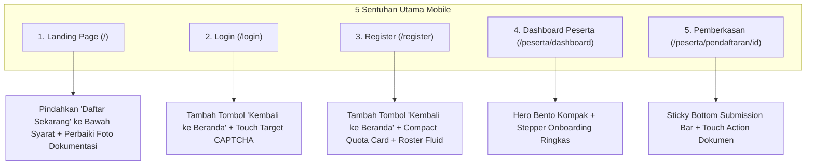
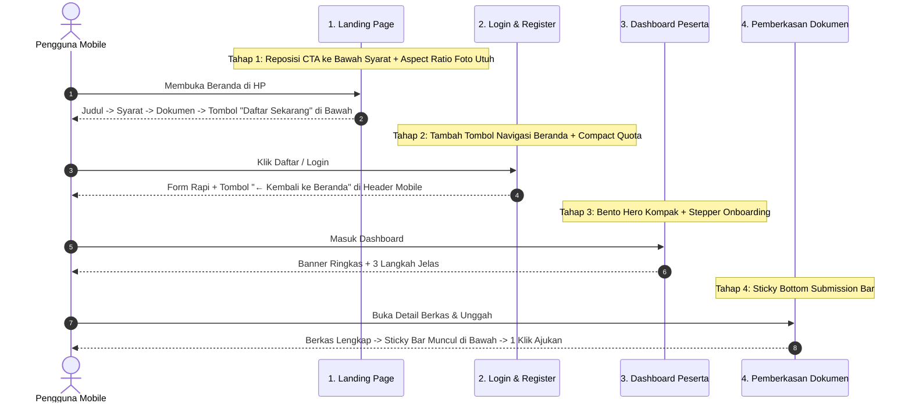

# Master Plan: Revamp Total Antarmuka Mobile (End-to-End Mobile UX Overhaul ala LENTERA Sleman)

Dokumen ini memuat audit lengkap terhadap seluruh anomali visual, tombol hilang/terkubur, gambar terpotong, dan tata letak di layar ponsel, serta rencana aksi implementasi perbaikan pada seluruh alur pengguna (**Landing Page**, **Login**, **Register**, **Dashboard Peserta**, dan **Pemberkasan**).

---

## 1. Matriks Audit Anomali & Rekomendasi Solusi per Halaman

---

### 1.1. Landing Page (`/`)
*File Terkait: `resources/views/public/blocks/hero.blade.php`, `resources/css/pages/public/landing.css`, `public/css/landing-modern.css`*

| No | Anomali Teridentifikasi | Dampak Pengguna | Rekomendasi Solusi Ergonomis |
|:---|:---|:---|:---|
| **1.1.1** | **Tombol "Daftar Sekarang" berada di atas persyaratan** | Pengguna mobile diminta mendaftar sebelum membaca syarat & dokumen yang harus dipersiapkan. | **Reposisi Tombol CTA ke Bawah**: Pada mobile, urutan konten diubah secara logis:  1. Judul Program & Periode Magang  2. Syarat Umum  3. Dokumen Pendaftaran  4. **Tombol "Daftar Sekarang" selebar kartu di bagian paling bawah**. |
| **1.1.2** | **Slide 2 (Foto Dokumentasi) Terpotong Ekstrem** | Foto lanskap dipaksa mengisi kontainer tinggi portrait ($\sim 700\text{px}$) sehingga wajah orang dan sisi kiri-kanan gambar terpotong habis. | **Aspect Ratio Adaptif Mobile**: Di mobile, kontainer slide gambar diberikan `aspect-ratio: 16/9; max-height: 280px; width: 100%; object-fit: cover;`, sehingga seluruh foto dokumentasi tampil utuh dan proporsional. |
| **1.1.3** | **Tombol Panah Slider Menabrak Teks Konten** | Panah bulat `<` dan `>` melayang di `top: 50%` menutupi teks persyaratan. | **Hilangkan Panah di HP**: Sembunyikan `.hero-side-nav-btn` pada $\le 768\text{px}$; navigasi slider 100% menggunakan *touch swipe* dan *indicator dots*. |
| **1.1.4** | **Tombol Panah Kuota Menutupi Kartu Kuota** | Tombol panah geser kuota melayang di tepi kiri-kanan kartu kuota. | Geser posisi tombol panah kuota ke baris navigasi bawah sejajar dengan teks keterangan kuota atau gunakan swipe murni tanpa panah menabrak. |

---

### 1.2. Halaman Login (`/login`)
*File Terkait: `resources/views/auth/login.blade.php`, `resources/views/layouts/auth-depth.blade.php`, `resources/css/pages/auth/auth-depth.css`*

| No | Anomali Teridentifikasi | Dampak Pengguna | Rekomendasi Solusi Ergonomis |
|:---|:---|:---|:---|
| **1.2.1** | **Tidak Ada Tombol Kembali ke Beranda di HP** | Panel kiri yang memuat tombol beranda disembunyikan di HP, sehingga pengguna tidak punya cara kembali ke landing page. | **Tambahkan Tombol Navigasi Mobile Back**: Pasang header bar ringkas di atas form login khusus mobile dengan logo Sleman dan tautan `"← Beranda"`. |
| **1.2.2** | **Tombol Tampilkan Kata Sandi (Eye Icon) Terhimpit** | Ikon mata untuk intip kata sandi terlalu mepet dengan batas kanan input di layar kecil. | Berikan padding kanan $50\text{px}$ pada input kata sandi dan target sentuh ikon mata $44\text{px}\times 44\text{px}$. |
| **1.2.3** | **CAPTCHA & Tombol Refresh di Layar $\le 360\text{px}$** | Gambar captcha dan tombol refresh bergeser ke bawah atau terpotong. | Bungkus gambar captcha dan tombol reload dalam flex container dengan lebar fleksibel dan tinggi seragam ($46\text{px}$). |

---

### 1.3. Halaman Register (`/register`)
*File Terkait: `resources/views/auth/register.blade.php`, `resources/css/pages/auth/auth-depth.css`*

| No | Anomali Teridentifikasi | Dampak Pengguna | Rekomendasi Solusi Ergonomis |
|:---|:---|:---|:---|
| **1.3.1** | **Tidak Ada Tombol Kembali ke Beranda di HP** | Sama seperti login, pengguna terjebak di form registrasi tanpa tombol kembali. | Tambahkan header navigasi mobile ringkas `"← Kembali ke Beranda"` di atas kartu registrasi. |
| **1.3.2** | **Selected Quota Card Menghabiskan Setengah Layar HP** | Banner kuota terpilih terlalu tinggi, pengguna harus scroll jauh sebelum melihat input nama. | Format kartu kuota pilihan menjadi **Compact Info Badge** yang ramping dengan opsi "Ganti Kuota" di samping. |
| **1.3.3** | **Input Anggota Kelompok Terhimpit pada Layar HP** | Form anggota tim (Nama, NIM, HP, Email) sulit diisi di layar kecil jika dalam 2 kolom. | Pastikan tumpukan 1 kolom vertikal (*single-column stack*) aktif dengan jelas di $\le 480\text{px}$. |

---

### 1.4. Dashboard Peserta (`/peserta/dashboard`)
*File Terkait: `resources/views/peserta/dashboard.blade.php`, `resources/css/pages/peserta/dashboard.css`*

| No | Anomali Teridentifikasi | Dampak Pengguna | Rekomendasi Solusi Ergonomis |
|:---|:---|:---|:---|
| **1.4.1** | **Bento Hero Terlalu Memakan Ruang Vertikal** | Sapaan, badge Pemkab, durasi magang, dan ring progress bertumpuk memanjang ke bawah. | Susun hero banner secara kompak: sapaan dan status badge di atas, progress lingkaran dibuat horizontal sejajar dengan sisa minggu magang. |
| **1.4.2** | **Tombol Aksi Utama (Isi Logbook, Tugas, Unduh SK)** | Tombol aksi bertumpuk 3 baris mengambil seluruh layar awal ponsel. | Buat grid 2 kolom kompak atau tombol aksi utama ("Isi Logbook") berukuran besar, sedangkan tombol pendukung berada di bawahnya secara proporsional. |
| **1.4.3** | **Stepper Onboarding (Langkah 1, 2, 3)** | Kartu panduan alur pendaftaran perlu status visual yang lebih kontras pada layar kecil agar peserta baru langsung tahu apa langkah berikutnya. | Perjelas badge langkah aktif dengan warna Sleman Gold/Navy dan tombol aksi langsung (*Direct CTA*). |

---

### 1.5. Menu Pemberkasan / Detail Berkas & Upload (`/peserta/pendaftaran/{id}`)
*File Terkait: `resources/views/peserta/pendaftaran/detail.blade.php`, `resources/css/pages/peserta/pemberkasan.css`*

| No | Anomali Teridentifikasi | Dampak Pengguna | Rekomendasi Solusi Ergonomis |
|:---|:---|:---|:---|
| **1.5.1** | **Tombol "Ajukan Pendaftaran" Terkubur di Bawah** | Pengguna harus scroll melewati banyak dokumen untuk mencari tombol ajukan; sering dikira "tidak ada tombol submit". | **Sticky Bottom Submission Bar**: Di mobile, ketika seluruh berkas wajib telah lengkap, pasang floating bar di bawah layar dengan tombol **"Ajukan Pendaftaran Sekarang ➔"** yang selalu terlihat dan mudah dijangkau jempol. |
| **1.5.2** | **Aksi Dokumen Terunggah Terlalu Sempit** | Tombol "Pratinjau", "Ganti File", dan badge status berdesakan di kartu dokumen pada HP. | Buat baris aksi dokumen membentang rapi dengan tombol icon + label yang mudah disentuh tanpa risiko salah tekan. |
| **1.5.3** | **Hero Meta Grid (Jurusan, Durasi, Jalur, Status)** | 4 kotak meta pendaftaran memakan ruang vertikal yang cukup banyak. | Ubah menjadi grid 2x2 kompak dengan font ukuran proporsional ($13\text{px}$) agar dokumen pendaftaran langsung terlihat di layar awal. |

---

## 2. Rencana Implementasi Bertahap

### Fase 1: Landing Page Mobile Overhaul
1. Di `resources/views/public/blocks/hero.blade.php`:
   - Reposisi tombol CTA `.btn-hero-cta` ("Daftar Sekarang"): pada mobile, tombol ini ditampilkan di bawah seksi Dokumen Pendaftaran.
2. Di `resources/css/pages/public/landing.css`:
   - Atur `.hero-full-image-slide` di mobile agar memiliki `aspect-ratio: 16/9; height: auto; max-height: 280px;` sehingga foto dokumentasi tidak terpotong.
   - Sembunyikan `.hero-side-nav-btn` pada $\le 768\text{px}$ dan pastikan slider dots di bawah berfungsi mulus.

### Fase 2: Auth Pages (Login & Register) Mobile Overhaul
1. Di `resources/views/layouts/auth-depth.blade.php` atau form partials:
   - Tambahkan header navigasi mobile ringkas yang menampilkan logo Sleman + tautan `"← Kembali ke Beranda"`.
2. Di `resources/css/pages/auth/auth-depth.css`:
   - Pastikan input CAPTCHA, toggle password, dan submit button memiliki touch target nyaman $\ge 46\text{px}$.
   - Buat kartu kuota terpilih (*selected quota badge*) lebih ringkas di mobile.

### Fase 3: Dashboard Peserta Mobile Overhaul
1. Di `resources/css/pages/peserta/dashboard.css`:
   - Ringkaskan padding hero banner di mobile ($14\text{px}$).
   - Buat progress lingkaran magang tampil berdampingan horizontal dengan teks informasi minggu.
   - Perjelas badge status pada onboarding stepper 3 langkah.

### Fase 4: Pemberkasan Dokumen Mobile Overhaul
1. Di `resources/css/pages/peserta/pemberkasan.css`:
   - Tambahkan gaya **Sticky Bottom Bar** untuk submission card (`.pemberkasan-submit-card`) pada layar $\le 640\text{px}$ ketika berkas sudah lengkap, dengan bayangan kontras dan tombol selebar layar.
   - Rapikan layout tombol aksi pada kartu dokumen yang sudah diunggah.

### Fase 5: Quality Gate & Verifikasi Komprehensif
1. Jalankan `npm run build` dan pastikan kompilasi aset bebas error.
2. Jalankan `pint --test` untuk verifikasi PSR-12 formatting.
3. Jalankan automated tests: `php artisan test --filter="Landing|PesertaPendaftaranFlowTest|AuthDepthVisualParityTest|PendaftaranKelompokTest"`.
4. Verifikasi visual manual di berbagai resolusi layar mobile ($320\text{px}$, $360\text{px}$, $375\text{px}$, $412\text{px}$).

---

## 3. Rincian File yang Akan Dimodifikasi

| File | Jenis Perubahan | Deskripsi Singkat |
|:---|:---:|:---|
| `resources/views/public/blocks/hero.blade.php` | Blade View | Reposisi tombol CTA ke bawah syarat/dokumen di mobile; perbaikan kontainer foto slide 2. |
| `resources/css/pages/public/landing.css` | Scoped CSS | Aspect ratio foto dokumentasi mobile, penataan kartu hero modular, penghapusan panah melayang. |
| `public/css/landing-modern.css` | Public CSS | Sinkronisasi aturan hero mobile publik. |
| `resources/views/layouts/auth-depth.blade.php` | Blade Layout | Penambahan top-bar navigasi mobile ("← Kembali ke Beranda"). |
| `resources/css/pages/auth/auth-depth.css` | Scoped CSS | Styling top-bar navigasi mobile, compact selected quota card, dan touch spacing. |
| `resources/css/pages/peserta/dashboard.css` | Scoped CSS | Bento hero ringkas, kartu KPI adaptif, dan stepper onboarding jelas. |
| `resources/css/pages/peserta/pemberkasan.css` | Scoped CSS | Sticky bottom bar untuk submission dan penataan tombol aksi berkas terunggah. |

