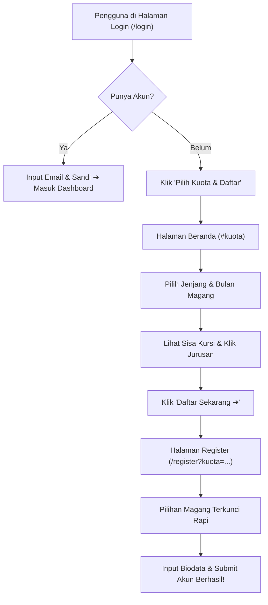

# Rencana Logika Alur Pendaftaran dari Menu Login & Visibilitas Kuota Magang

**Tanggal**: 16 November 2026  
**Dokumen**: `docs/plans/2026-11-16-plan-logika-alur-pendaftaran-dari-login-dan-visibilitas-kuota.md`  
**Status**: Menunggu Konfirmasi User  
**Referensi Masalah**: Gambar menu login (`media_1794810990819_88734d80.png`) dan kebingungan calon pendaftar saat klik "Daftar" tanpa mengetahui kuota/bulan yang dibuka.

---

## 1. Analisis Masalah & Pertanyaan Pengguna

### 1.1 Masalah di Lapangan (Real Problem)
> *"sekarang daftar dari menu login saat di klik daftar nah di sini saya masih bingung kan di situ bisa memilih jurusan dan penempatan nya kan nah kan dari sisi pendaftar gatau ini tersedianya berapa atau yang di buka mana saja gimana ya coba buat plan logika nya"*

1. **Kondisi Alur A (Dari Beranda / Landing Page)**:
   - Pengguna melihat kuota interaktif, gauge meter, bulan mulai, jenjang, bidang penempatan, dan status sisa kursi.
   - Pilihan jelas, terukur, dan ketika masuk ke `/register`, seluruh data terkunci rapi sesuai kuota riil.
2. **Kondisi Alur B (Dari Halaman Login `/login` atau Direct URL)**:
   - Pengguna yang belum punya akun mengklik tautan **"Belum punya akun magang? Daftar"** di halaman login.
   - URL `/register` yang dibuka **kosong tanpa parameter kuota**.
   - Di form pendaftaran, pengguna diminta memilih Jenjang, Bidang Penempatan, dan Jurusan secara manual melalui dropdown.
   - **TITIK BINGUNG PENDAFTAR**:
     - Pendaftar **tidak tahu bulan berapa saja yang dibuka** oleh Dinas Kominfo.
     - Pendaftar **tidak tahu berapa kursi yang tersisa** pada masing-masing jurusan (apakah masih ada 4 kursi, tinggal 1 kursi, atau sudah habis 0 kursi).
     - Pendaftar berisiko memilih jurusan yang sebenarnya kuotanya sudah ditutup/penuh.

---

## 2. Perbandingan 3 Pilihan Logika Solusi

| Kriteria | Opsi 1: Alihkan Link "Daftar" ke Beranda Kuota (Rekomendasi Utama) | Opsi 2: Info Kuota Langsung di Dropdown Register | Opsi 3: Smart Step-Gate & Quota Banner (Kombinasi Sempurna) |
|---|---|---|---|
| **Alur Pengguna** | Klik "Daftar" di login ➔ Diarahkan ke Beranda `#kuota` ➔ Pilih kuota yang pasti buka ➔ Masuk register dengan data terkunci. | Klik "Daftar" di login ➔ Masuk `/register` ➔ Dropdown menampilkan teks sisa kursi: `TKJ (Tersedia: 4 Kursi)`. | Link login mengarahkan ke `#kuota`, dan jika user buka `/register` langsung, tampil banner pemilih kuota + info kuota di dropdown. |
| **Kejelasan Kuota** | **Sangat Jelas (100%)**: Calon peserta melihat bulan, jenjang, bidang, dan jurusan lengkap dengan visual progress bar. | Cukup Jelas: Hanya tahu total kursi, tapi tidak tahu rincian per bulan magang. | **Sangat Jelas & Terarah**: Memberi edukasi visual dan perlindungan ganda. |
| **Risiko Salah Pilih** | **0%**: Kuota divalidasi sejak awal sebelum registrasi. | Sedang: Pendaftar tetap harus menebak bulan magang yang cocok. | **0%**: Terlindungi secara sistem. |
| **Effort Implementasi** | Ringan & Elegan. | Sedang. | Sangat Lengkap & Ramah Pengguna. |

---

## 3. Rencana Implementasi Opsi Rekomendasi (Opsi 3 - Smart Step-Gate & Quota Banner)

Kami menyarankan solusi **Opsi 3 (Kombinasi Sempurna)** yang menyelesaikan masalah dari akar hingga ujung:

### 3.1 Penyesuaian Halaman Login (`resources/views/auth/login.blade.php`)
1. **Pembedaan Alur Cerdas**:
   - Jika pengguna datang ke login membawa parameter kuota (misal: sempat melihat kuota lalu klik login):
     Tautan tetap mempertahankan parameter: `Belum punya akun magang? <a href="{{ route('register', request()->query()) }}">Daftar</a>`.
   - Jika pengguna datang ke login **tanpa parameter kuota** (pengguna umum yang baru pertama kali ingin daftar):
     Tautan diubah menjadi:
     ```html
     Belum punya akun magang? <a href="{{ url('/#kuota') }}">Pilih Kuota &amp; Daftar</a>
     ```
   - **Tujuan**: Membimbing calon peserta baru langsung ke sumber kebenaran informasi kuota di beranda, sehingga mereka tidak mendaftar secara "buta".

---

### 3.2 Penyesuaian Halaman Registrasi Mandiri (`resources/views/auth/register.blade.php`)
Jika ada pengguna yang tetap membuka `/register` secara langsung tanpa parameter kuota (`$isKuotaTerpilih === false`):

1. **Banner Edukasi Kuota di Atas Form (*Quota Discovery Callout*)**:
   - Tampilkan kartu notifikasi ramah bertema MagKom di atas form:
     ```
     ┌─────────────────────────────────────────────────────────────────┐
     │ 💡 Rekomendasi Pendaftaran Magang                              │
     │ Ketersediaan kuota berbeda untuk setiap jurusan dan bulan.     │
     │ Sebaiknya cek kuota terlebih dahulu agar penempatan Anda pasti.│
     │                                                                 │
     │ [ 🔍 Lihat & Pilih Kuota di Beranda ➔ ]                        │
     └─────────────────────────────────────────────────────────────────┘
     ```
   - Calon peserta yang ingin melihat visual ketersediaan kuota tinggal mengeklik tombol tersebut.

2. **Indikator Kuota pada Dropdown Jurusan (`#jurusan`)**:
   - Di backend (`AuthController::showRegister`), data sisa kuota aktif per jurusan sudah dihitung.
   - Pada dropdown jurusan, teks pilihan dilengkapi label sisa kursi:
     - `Teknik Komputer dan Jaringan (Tersedia: 4 Kursi)`
     - `Rekayasa Perangkat Lunak (Tersedia: 2 Kursi)`
     - `Multimedia / DKV (Kuota Penuh)`
   - Teks petunjuk di bawah field:
     *“Menampilkan ketersediaan kuota aktif. Pilihan jurusan yang kuotanya penuh akan otomatis masuk ke daftar tunggu (waiting list).”*

---

## 4. Alur Interaksi Pengguna (User Flow Diagram)



---

## 5. Pertanyaan & Konfirmasi untuk Pengguna

Apakah rancangan logika di atas (**Opsi 3: Mengarahkan pendaftar baru dari login ke `#kuota` beranda + memberikan banner edukasi kuota jika buka register mandiri**) sudah menjawab kebingungan Anda dan sesuai dengan alur yang Anda inginkan?

Silakan beri masukan atau konfirmasi (ketik **"gas"**), dan saya akan segera mengeksekusi rencana logika ini!

