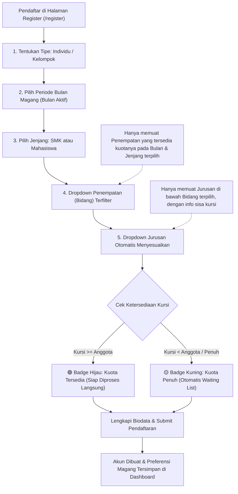

# Rencana Revisi: Pemilihan Kuota Penempatan & Jurusan Menyesuaikan di Halaman Registrasi (/register)

**Tanggal**: 16 November 2026  
**Dokumen**: `docs/plans/2026-11-16-plan-pemilihan-kuota-mandiri-di-halaman-registrasi.md`  
**Status**: Menunggu Konfirmasi User  
**Prinsip Utama**:
1. **Tetap 100% di Halaman Registrasi (`/register`)** tanpa dialihkan ke landing page.
2. **Dropdown Penempatan (Bidang)** hanya menampilkan penempatan yang **tersedia kuotanya** untuk periode bulan dan jenjang yang dipilih.
3. **Dropdown Jurusan** otomatis **menyesuaikan** pilihan penempatan, persis seperti penyesuaian jurusan di kartu penempatan landing page.

---

## 1. Analisis Kebutuhan & Konsep Inti

> *"drop down nya yang tersedia di kuota penempatan nya aja kan jadi yang jurusan tinggal menyesuaikan seperti di landing page itu coba di sesuaikan dan buat plan ulang"*

Pada sistem Landing Page MagKom:
- Pengguna memilih **Bulan** dan **Jenjang** (SMK / Mahasiswa).
- Yang tampil sebagai kartu utama adalah **Penempatan (Bidang)** (misal: *Aplikasi Informatika*, *Statistik*, *Persandian*, *Sekretariat*), yang memiliki kuota kursi.
- Di dalam kartu penempatan tersebut, terdapat daftar **Jurusan** yang bernaung di bawah penempatan tersebut beserta sisa kursinya.

Ketika pengguna mendaftar mandiri dari halaman Login (`/register`), alur di menu registrasi akan dibuat selaras dengan logika landing page:
1. **Periode Bulan Magang** dipilih (atau otomatis aktif jika hanya ada 1 bulan buka).
2. **Jenjang Pendidikan** dipilih (SMK atau Mahasiswa).
3. **Dropdown Penempatan (Bidang)**:
   - Hanya menampilkan penempatan yang **memiliki kuota aktif** untuk jenjang & bulan tersebut.
   - Label opsi memperlihatkan sisa kursi penempatan, contoh:
     - `Aplikasi Informatika & E-Gov (Tersedia 5 Kursi)`
     - `Informasi & Komunikasi Publik (Tersedia 2 Kursi)`
4. **Dropdown Jurusan**:
   - Otomatis **menyesuaikan** dengan bidang penempatan yang dipilih.
   - Hanya memunculkan jurusan-jurusan yang relevan dengan bidang dan jenjang tersebut, lengkap dengan info kursi:
     - `Teknik Informatika (Tersedia: 3 Kursi)`
     - `Sistem Informasi (Tersedia: 2 Kursi)`
     - `Multimedia / DKV (Kuota Penuh / Waiting List)`

---

## 2. Diagram Alur Interaksi (Cascading Flow)



---

## 3. Rincian Teknis Implementasi

### 3.1 Backend: Data Matriks Penempatan & Jurusan (`AuthController::showRegister`)
Agar interaksi di formulir responsif tanpa jeda loading (tanpa AJAX lambat), `AuthController::showRegister` menyusun struktur matriks data lengkap yang dipassing ke view:
1. **`$semuaBulanTersedia`**: Daftar bulan magang aktif yang statusnya `Tersedia`.
2. **`$matriksPenempatan`**:
   - Struktur JSON yang memetakan relasi `[bulan_id][jenjang][bidang_id]`:
     ```json
     {
       "bidang_id": 1,
       "nama_bidang": "Aplikasi Informatika & E-Gov",
       "total_kuota": 8,
       "sisa_kuota": 5,
       "is_tersedia": true,
       "jurusan": [
         {
           "id": 4,
           "nama": "Teknik Informatika",
           "kategori": "mahasiswa",
           "total": 5,
           "sisa": 3,
           "status": "tersedia"
         },
         {
           "id": 5,
           "nama": "Sistem Informasi",
           "kategori": "mahasiswa",
           "total": 3,
           "sisa": 2,
           "status": "tersedia"
         }
       ]
     }
     ```

### 3.2 Markup Form Registrasi (`resources/views/auth/register.blade.php`)
Ketika `$isKuotaTerpilih === false`:
1. **Field Periode Bulan Magang (`#bulan_magang_id`)**:
   - Dropdown memilih bulan magang aktif (misal: *Desember 2026*). Otomatis terpilih jika hanya 1 bulan buka.
2. **Field Jenjang Pendidikan (`#jenjang`)**:
   - Opsi: *SMK* atau *Mahasiswa (D3 / D4 / S1)*.
3. **Field Penempatan / Bidang (`#bidang`)**:
   - Secara dinamis diisi oleh JavaScript berdasarkan bulan & jenjang.
   - Opsi default: `-- Pilih Penempatan Magang --`.
   - Hanya menampilkan bidang yang memiliki formasi kuota pada periode tersebut.
4. **Field Jurusan (`#jurusan`)**:
   - Secara dinamis menyesuaikan setelah penempatan dipilih.
   - Opsi default: `-- Pilih Jurusan --`.
   - Menampilkan nama jurusan beserta status kuota: `[Nama Jurusan] — Tersedia (X Kursi)`.
5. **Live Quota Info Callout (`#live-quota-status-card`)**:
   - Kotak ringkasan visual yang langsung memberitahu pendaftar:
     - Jika kuota cukup: `🟢 Kuota Tersedia: [X] Kursi Tersisa. Pendaftaran Anda dapat langsung diproses.`
     - Jika kuota habis / anggota kelompok melebihi kuota: `🟡 Kuota Penuh. Anda tetap dapat mendaftar dan otomatis masuk ke Waiting List (Daftar Tunggu).`

### 3.3 Logika Frontend di JavaScript (`resources/js/pages/auth/auth-depth.js`)
Fungsi `initCascadingEducationFields` diperbarui:
1. **Listener pada Perubahan Bulan & Jenjang**:
   - Memfilter daftar Penempatan (Bidang).
   - Menghitung total sisa kuota pada bidang tersebut untuk jenjang dan bulan yang dipilih.
   - Mengisi opsi `#bidang` dengan teks informatif: `[Nama Bidang] (Tersedia: X Kursi)`.
   - Jika bidang belum bisa dipilih (jenjang belum dipilih), field didisbale sementara dengan pesan ramah.
2. **Listener pada Perubahan Penempatan (`#bidang`)**:
   - Mengambil daftar jurusan khusus di bawah bidang tersebut yang sesuai jenjang.
   - Mengisi opsi `#jurusan` dengan label status sisa kursi masing-masing jurusan.
3. **Listener pada Perubahan Jurusan (`#jurusan`) & Tipe Pendaftaran (Individu/Kelompok)**:
   - Memperbarui `#live-quota-status-card` secara real-time.
   - Membandingkan jumlah pendaftar (1 untuk individu, 2-4 untuk kelompok) dengan sisa kursi jurusan terpilih.

### 3.4 Penyimpanan Data di Backend (`AuthController::register`)
- Input `bulan_magang_id` (atau `redirect_bulan`), `bidang_id`, dan `jurusan_id` divalidasi dan disimpan ke:
  1. `PesertaProfil` (jenjang dan jurusan_id).
  2. Sesi `pendaftaran_preferensi` (bulan_id, bidang_id, jurusan_id, tipe, jumlah) agar dashboard peserta langsung terisi preferensi yang sama.

---

## 4. Rencana File yang Dimodifikasi

1. **`app/Http/Controllers/Auth/AuthController.php`**:
   - Menyiapkan data agregat kuota per bulan, per jenjang, dan per bidang (`$matriksPenempatan`) untuk dikirim ke view `auth.register`.
   - Menangani `bulan_magang_id` pada method `register`.
2. **`resources/views/auth/register.blade.php`**:
   - Menambahkan dropdown `#bulan_magang_id` untuk pendaftaran mandiri.
   - Menyediakan wadah `#live-quota-status-card` untuk kartu status kuota interaktif.
   - Menyematkan data JSON script `#register-penempatan-matrix` untuk dikonsumsi JavaScript.
3. **`resources/js/pages/auth/auth-depth.js`**:
   - Memperbarui fungsi `initCascadingEducationFields`:
     - Filter Penempatan berdasarkan Bulan & Jenjang.
     - Filter Jurusan menyesuaikan dengan Penempatan terpilih.
     - Tampilkan kartu status kuota live.
4. **`resources/css/pages/auth/auth-depth.css`**:
   - Styling scoped untuk `#live-quota-status-card` dan status badge (hijau untuk tersedia, kuning untuk waiting list).
5. **`tests/Feature/LandingPageToRegistrationPrefillTest.php`**:
   - Menambahkan test feature untuk pendaftaran langsung dari menu login/register dengan pilihan penempatan dan jurusan mandiri.

---

## 5. Verifikasi & Quality Gates

1. **Vite Build**: Jalankan `npm run build` untuk memverifikasi kompilasi CSS & JS.
2. **PHPUnit**: Jalankan `php artisan test --filter=LandingPageToRegistrationPrefillTest`.
3. **Code Quality**: Jalankan `./vendor/bin/pint --test`.
4. **Pengujian Browser**: Buka `http://127.0.0.1:8000/register` tanpa query parameter:
   - Verifikasi dropdown Penempatan hanya menampilkan bidang yang tersedia kuotanya.
   - Verifikasi dropdown Jurusan otomatis menyesuaikan dengan penempatan yang dipilih.
   - Verifikasi pilihan dari Landing Page tetap terkunci rapi (tidak berubah).

---

## 6. Persetujuan Eksekusi
Rencana revisi ini 100% mengikuti instruksi Anda:
- **Tetap di menu registrasi (`/register`)**.
- **Dropdown penempatan hanya yang tersedia kuotanya**.
- **Jurusan otomatis menyesuaikan seperti di landing page**.

Silakan ditinjau, dan jika sudah mantap, ketik **"gas"** untuk mulai eksekusi!
